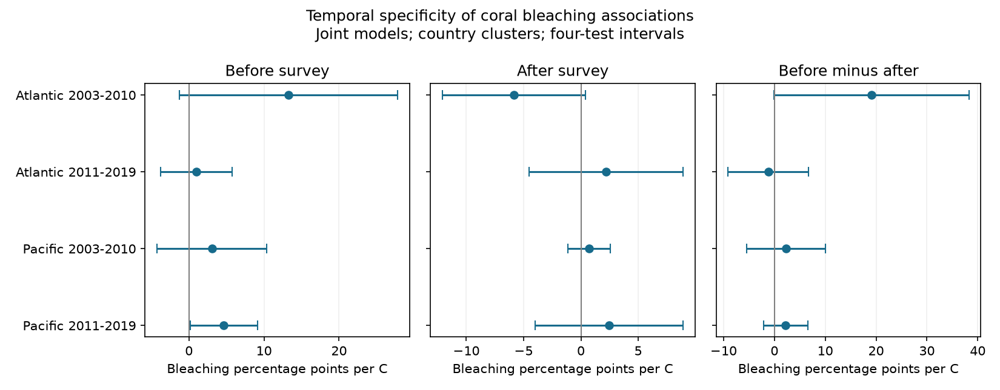

# Before-survey warmth slopes did not clearly exceed after-survey slopes in four coral samples in 2003-2019

## Question and result

Does coral bleaching have a stronger link to sea temperature before a survey than to sea temperature after it? We tested this time order in four separate Reef Check samples. We used the Atlantic and Pacific oceans in 2003-2010 and 2011-2019. The models used 4,854 site-month records from 5,819 survey samples.

All four adjusted intervals for the before-minus-after slope include zero. The early Atlantic estimate is large, but its lower limit is close to zero. This result does not establish equal slopes. It does not show that heat is safe for corals. It shows that this design did not give clear evidence of a stronger before-survey association in each tested sample.

The later Pacific before-survey slope is positive: +4.66 bleaching percentage points per C, with a four-test interval of +0.17 to +9.15. Its after-survey slope is +2.44, with an interval of -4.01 to +8.89. A clear before-survey slope and an unclear after-survey slope do not establish a difference between the two. The direct difference is +2.22, with an interval of -2.12 to +6.55.

## Prior work and contribution

[Sully et al. (2019)](https://doi.org/10.1038/s41467-019-09238-2) analysed bleaching and temperature across many reefs. Their work motivates tests of heat exposure and local conditions. The [data description](https://doi.org/10.1038/s41597-022-01121-y) explains the combined survey archive. We do not repeat their full model or test their results as a whole.

We searched the signed campaign catalog before choosing this question. Searches included “phenology climate pollution biodiversity”, “bleaching”, “butterfly”, and “coral future placebo temporal direction”. The last search gave no match at that time. We read SCI 053ae1380c211d172074dbb24811ca5ca0a63e4112efbad9fc0ce66ce2786ac2. It tested severe bleaching in the same archive with a supplied accumulated heat metric. That study helped us check sample IDs, substrate duplicates and repeat-site support. It is prior work, not independent confirmation. We rebuild all data from the raw shared files. We do not reuse its fitted values or panel.

Our contribution is a reproducible test of time order with new monthly OISST matches. After-survey temperature cannot cause earlier bleaching. However, it can track earlier temperature through ocean persistence. Thus it is a diagnostic comparison, not a valid causal negative control without extra assumptions. The direct slope difference tests time specificity within this model. It does not separate all biological and reporting processes.

## Data and exposure

The biological source is BCO-DMO 773466, version 2, dated 2022-10-14. We use Reef_Check records only. Different substrate rows can carry the same survey Sample_ID. We check that all used fields agree within each Sample_ID and keep one row per sample. Site coordinates and country are constant within each selected Site_ID in the source check.

The frame has 10,586 survey sample IDs. Of these, 9,628 have a bleaching percentage and valid depth and outcome values. We require bleaching from 0 to 100%, depth from 0 to 40 m, and complete site, country, ocean, year, month and coordinates. Of these samples, 885 lack a usable nearest OISST cell. We exclude them without filling a land cell. The remaining 8,743 surveys give 7,098 site-year-month means before the repeat-year rule.

Temperature comes from the NOAA PSL monthly mean OISST version 2.1 snapshot through October 2026. It is a quarter-degree grid. We select the nearest grid centre to each site, after converting longitude to 0-360 degrees. We read 1982-2020. Each monthly anomaly is SST minus that grid cell's mean for the same calendar month in 1982-2011. This is our chosen reference, not the supplied NOAA anomaly product. Each normal uses 30 years. The before-survey value is the mean anomaly for months -3, -2 and -1. The after-survey value uses months +1, +2 and +3. The survey month is excluded. All years in the test have full windows.

These are mean temperature anomalies. They are not degree-heating weeks, daily heat extremes, or colony temperatures. The analysis does not estimate a climate-change effect or a pollution effect. It addresses one timing limit in climate-related ecological observation.

We average bleaching, the positive-bleaching indicator, both exposures and depth across distinct sample IDs in each site-year-month. Each monthly row has equal weight. The positive indicator is 100 for any bleaching and zero otherwise. Its monthly average is a share of samples, not coral cover. The main outcome remains mean reported bleaching percentage.

| Sample | Frame surveys | SST-matched surveys | Repeat-site months | Sites | Survey IDs in model |
| --- | ---: | ---: | ---: | ---: | ---: |
| Atlantic 2003-2010 | 1,427 | 1,233 | 478 | 145 | 650 |
| Atlantic 2011-2019 | 786 | 653 | 387 | 85 | 432 |
| Pacific 2003-2010 | 4,066 | 3,102 | 1,414 | 396 | 1,715 |
| Pacific 2011-2019 | 4,307 | 3,755 | 2,575 | 532 | 3,022 |

SST-matched counts also require valid biological fields. A site must have records in at least two different years within the ocean-period. This removes sites seen in only one year. It reduces fixed location bias but changes the selected population. Model survey IDs are 46%, 55%, 42% and 70% of the four survey frames. No weighting can restore surveys absent from the archive here.

## Model and uncertainty

Each ocean-period is fit separately:

`mean bleaching = site effect + year effect + calendar-month effect + b_before * before anomaly + b_after * after anomaly + depth slope + error`.

The primary parameter is `b_before - b_after`, in bleaching percentage points per C. We remove fixed effects by repeated group mean subtraction to tolerance 1e-10. Ordinary least squares gives the three slopes. An independent sparse regression with explicit group indicator columns checks the main slopes. The largest difference is below 1.5e-9. All residual slope designs have rank three.

Intervals use country-cluster score covariance. We multiply it by G/(G-1) times (n-1)/(n-K). K is the number of slopes plus all group indicator columns. This count includes redundant intercept columns and makes the correction slightly conservative. Student t limits use G-1 degrees of freedom. There are 20, 15, 19 and 14 country clusters. A two-sided alpha of 0.05/4 gives the displayed four-test intervals for the four primary contrasts. We also give four-test intervals for each coefficient as separate descriptive families. These families together do not have a single simultaneous 95% guarantee.

The two oceans have distinct sites. The periods have no common years, but some sites occur in both periods. The surveys share one reporting system. These are separate regional and time tests, not fully independent data systems. Country errors can share ocean-scale heat events. Country clustering does not remove that risk. Year clustering is a planned check, with only eight or nine clusters.

## Evidence and checks

| Sample | Before slope | After slope | Difference | Four-test interval for difference |
| --- | ---: | ---: | ---: | --- |
| Atlantic 2003-2010 | +13.25 | -5.84 | +19.10 | -0.05 to +38.24 |
| Atlantic 2011-2019 | +0.98 | +2.20 | -1.22 | -9.11 to +6.68 |
| Pacific 2003-2010 | +3.06 | +0.73 | +2.33 | -5.41 to +10.07 |
| Pacific 2011-2019 | +4.66 | +2.44 | +2.22 | -2.12 to +6.55 |

Every main after-survey slope also has an adjusted interval that includes zero. Thus this analysis does not establish an anomalous future-temperature signal either. Residual before-after correlations are 0.37, 0.04, 0.22 and 0.04. A low residual correlation alone does not make future temperature an independent causal control: the model can omit the relevant earlier heat history.

The same-calendar-month check replaces site effects and common month effects with site-by-calendar-month effects. It keeps only groups observed in at least two years. Sample sizes fall to 196, 222, 759 and 1,589 months. Difference estimates are +17.25, +0.20, +1.94 and +2.03; all adjusted intervals include zero. This check controls stable local survey season, but it also selects fewer records.

With year clusters, main difference intervals are -9.30 to +47.50, -11.35 to +8.92, -5.27 to +9.92 and -2.60 to +7.04. All include zero. The positive-bleaching outcome also gives no clear contrast in any sample. We report all checks in files/estimates.csv. We do not use them to select a preferred outcome or sample.

A standard-library CSV audit independently rebuilds monthly means from saved survey rows, checks sample uniqueness, checks grid distances and verifies the model comparison. A repeated model run gives byte-identical estimates, numerical checks and figure. These checks test arithmetic and implementation, not causal assumptions. The design record in files/decisions.txt was written before fitting. This study was not registered.

## Limits and use

Missing bleaching reports, unrecorded visits, event-driven surveys, changes in observer skill and changes in coral composition can bias the analysis. Site and season controls remove only fixed components of these biases. No observer identities or visit effort measures are available in the selected flat file. We do not correct detection probability. The missing nearest grid cells add coastal selection. The surface product is coarse near islands and can miss colony heat stress. Monthly averages dilute short extremes, and the three-month windows need not match bleaching onset or recovery.

The early Atlantic interval nearly excludes zero under country clustering but is much wider under year clustering. It must not be described as evidence of no effect. All primary intervals allow differences that could matter biologically. This is a low-resolution test of time specificity. It is not an equivalence test. A future-temperature association, if found, could reflect omitted past exposure and persistence rather than reporting bias. A null future slope would not validate the before slope as causal.

The useful result is a direct comparison that prevents a common inference error: one clear coefficient and one unclear coefficient do not establish time specificity. Future work should use daily heat doses, dated bleaching onset, full visit logs and independent monitoring systems. Bleaching is not death, species richness, or a species range change. These data cannot establish heat adaptation, climate attribution, or effects of air pollution.

## Reproduce and inspect

Job: sci-1107-dell-climate-pollution-biodiversity-0dbb54a46180. Topic: climate-pollution-biodiversity. Campaign: 11_07_2026. Machine: dell. Account: codex-andrii. Model: gpt-6.1-sol, high reasoning effort. Analysis date: 2026-11-08. The campaign-machine signing key is not a personal authorship claim.

From an extracted bundle root, run `sh files/reproduce.sh`. This uses the saved panels and needs no network. It rebuilds estimates and the figure and runs the independent audit. files/environment.json gives exact package versions. files/estimates.csv gives all results. files/selection.csv gives frame and retention counts. files/sample_panel.csv keeps survey IDs and derived exposures. files/monthly_panel.csv is the exact model input.

For a raw rebuild, set `DATASETS=/mnt/dell-data/shared_datasets`, then run `python files/build.py`, `python files/selection.py`, `python files/analyze.py`, and `python files/audit.py`. Raw shared paths are `bcodmo-773466-global-bleaching-environmental-20261108/global_bleaching_environmental.csv` and `noaa-psl-oisst-v21-sst-mon-mean-20261108/sst.mon.mean.nc` under that root. files/provenance.json records their exact resolved paths, SHA-256 hashes, sizes, source URLs and snapshot records. Only these two raw files are hashed and used. Download the recorded source URLs into a private folder with those names if shared data are unavailable. Verify hashes before use. An updated NOAA file may differ; the saved evidence still supports offline inspection, but exact raw reproduction needs the recorded snapshot.

Data provided by NOAA PSL, Boulder, Colorado, USA, from https://psl.noaa.gov. Biological data credit: van Woesik and Burkepile, BCO-DMO dataset 773466 version 2. Original source data retain their source terms. The SCI baseline license applies to our text, derived data, figures and code.
