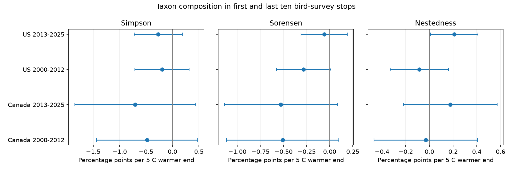

# Survey-end warmth gave no clear taxon replacement link in four Canada and US bird samples in 2000-2025

We tested whether a warmer survey end was linked to replacement of recorded taxa between the first and last ten bird survey stops. Four models used 39,165 accepted Canada and US surveys in 2000-2012 and 2013-2025. Models controlled start temperature, route and observer, state and year, survey timing, wind and sky. Replacement estimates ranged from -0.70 to -0.20 percentage points per 5 C warmer end. All four corrected 95 percent intervals included zero. Fair-weather and route-trend checks also gave uncertain replacement slopes. A small positive secondary component due to unequal richness in the late US sample did not persist with an individual interval above zero in either check. The evidence does not establish a weather link to taxon replacement. Repeat routes, incomplete detection, selected records and endpoint weather limit inference. This is a survey-bias test, not a causal climate or pollution test. The package gives code, source hashes, aggregate results, a figure and numerical checks. Raw inputs and record-level tables remain outside the bundle.



Figure 1. End-temperature slopes with start temperature and survey controls held fixed. Replacement bars use four-test corrected intervals. The other panels use individual 95 percent intervals. The panels have different horizontal scales.

## Main results

| Sample | Surveys | Routes | Replacement slope | Four-test corrected interval |

| --- | ---: | ---: | ---: | --- |

| Canada, 2000-2012 | 2,855 | 371 | -0.479 | -1.437 to +0.479 |

| Canada, 2013-2025 | 4,244 | 530 | -0.704 | -1.849 to +0.441 |

| US, 2000-2012 | 13,283 | 1,778 | -0.198 | -0.712 to +0.316 |

| US, 2013-2025 | 18,783 | 2,224 | -0.268 | -0.723 to +0.186 |

All slopes and intervals in the table are percentage points per 5 C warmer end. Each main individual 95 percent interval also includes zero. Mean replacement was 35.4 to 36.4 percent. The negative point estimates do not establish a negative effect. The intervals also permit small positive effects. The data do not support a clear common temperature link to replacement in the four samples.

The fair-weather and route-trend replacement estimates remain negative in all four samples. Every individual interval includes zero. Thus neither check establishes a replacement link. The full table includes all 36 outcome and model combinations, not only selected results.

Total dissimilarity has negative point estimates in all four main fits, with individual intervals across zero. The component due to unequal richness has a positive estimate of +0.209 percentage points in the late US sample, with an individual interval from +0.009 to +0.409. This is an exploratory result. Its individual interval includes zero in both the fair-weather and route-trend checks. The early US estimate is negative and uncertain. This does not establish a repeated nestedness pattern or explain the earlier richness result.

The early and late samples share 220 Canadian routes and 1,300 US routes. The periods therefore do not provide fully independent replication. There are separate routes across countries, but the survey protocol and some continental influences are shared.

## Question and prior work

Does a warmer survey end predict a change in the set of taxa recorded at the first and last ten stops? The start temperature stays fixed in this test. A decrease in recorded richness need not mean that the recorded set changes more. We test replacement and split total dissimilarity into two parts.

Robbins (1981) studied weather and bird activity. Thus, weather effects on counts are established concerns, not a new claim here. [Source](https://pubs.usgs.gov/publication/5210258). Baselga (2010) defined the split of dissimilarity into replacement and a part due to unequal richness. We use that set calculation. [Method](https://doi.org/10.1111/j.1466-8238.2009.00490.x).

We searched the shared SCI campaign before choosing this question. We read SCI 652071e7bf4b1964e6b29e8c4494ce23450a5342524ee3fe65cc2e0880558ecb, which tested endpoint richness differences, and SCI 7c0d7e95b8e97447379d3669643e3d9322f4d963fcf3bbc06fd739861056e194, which tested annual replacement with seasonal ozone and warmth. We test replacement within a morning, with no pollution exposure. This is a new outcome and scope on an existing survey system. It is not independent confirmation of those studies. Our plan was local and was saved before the block outcomes were computed. It was not registered. Campaign search and question choice add selection beyond the four tests below.

## Data and filters

We used the 2026 release of the North American Breeding Bird Survey, DOI [10.5066/P144YU3S](https://doi.org/10.5066/P144YU3S). Its 50-stop files cover the full chosen period. We use 2000-2012 and 2013-2025 in Canada and the US. There are no 2020 surveys. The countries have separate routes. Some routes occur in both periods. These are separate fits, not fully independent samples or separate data sources.

We count positive AOU codes as recorded taxa. These codes include species and other taxon groups. We do not equate them to a fixed list of biological species. Each block has ten three-minute stops. The two blocks are also at different places. The survey does not repeatedly visit the same points during a morning.

We select standard protocol 101, RunType 1, and QualityCurrentID 1. We require a known observer; known C or F units; start and end temperatures from -10 to 45 C; May 20 through July 10; start times from 02:00 through 09:00; valid clock minutes; and survey durations from three through seven hours. Wind and sky codes must be 0 through 8 and assistant status must be 0 or 1. We remove every record from a duplicate route-year and require positive richness in both endpoint blocks. Each route-observer pair must have at least five records in the given country and period. The fair-weather check applies this repeat rule again after its weather filter.

The code checks nonnegative, complete endpoint counts and taxon-row totals against TotalSpp. It checks duplicate taxon rows within each input chunk. It does not assume that a non-detection means biological absence. It saves all file and ZIP-member hashes. The exact input paths, source URLs, and SHA-256 hashes are in files/provenance.json and files/member_hashes.json. We read only the three specified shared files. No new raw download was needed.

## Method

Let a be the number of taxa recorded in both blocks, b the number in the first block only, and c the number in the last block only. The primary outcome is Simpson replacement, min(b,c)/(a+min(b,c)). Total Sorensen dissimilarity is (b+c)/(2a+b+c). The third outcome is total dissimilarity minus replacement. This last term is the nestedness-resultant component. It is not a separate measure of the full nestedness of the community. Each outcome ranges from zero to one. We report slopes in percentage points per 5 C warmer survey end.

For each outcome we fit:

```
outcome = route-observer effect + state-year effect
          + end temperature / 5 + start temperature / 5
          + linear and squared survey date, start clock time and duration
          + categorical start and end wind, start and end sky, and assistant
          + error
```

Date uses a common nonleap calendar. The end coefficient also describes morning temperature rise when start temperature is held fixed. Five C is a reporting scale. It is not an extreme-heat threshold. We remove fixed effects by repeated group-mean projection. The trend check uses sparse least squares to remove the same fixed effects and a linear time slope for each route. Its fixed-effect columns are scaled to unit norm. The time column is centered within each route-observer pair. This gives the same regression space and improves numerical conditioning. The fair-weather check limits both endpoints to wind codes 0-3 and sky codes 0-2.

For each temperature coefficient, we calculate route-cluster, year-cluster, and two-way route/year variances. We use the largest variance. We apply cluster and residual-degree corrections. The fixed-effect parameter count includes all route-observer and state-year levels, less one; this can overcount redundant effects. The trend check counts one further slope per route. Intervals use a t reference with min(number of routes, number of years) minus one degrees of freedom. This rule is conservative relative to some common alternatives, but it does not prove coverage under arbitrary dependence. There are only 13 early and 12 late calendar-year clusters.

The four primary replacement intervals use Bonferroni correction for four tests. Secondary outcomes and sensitivity checks use individual 95% intervals and are exploratory. We do not compare countries with a formal interaction test. An interval that includes zero does not establish no effect. The numerical checks compare fixed-effect coefficients with explicit dummy-variable least squares in small subsets. They also check the exact component-sum coefficient identity and the normal equations.

## Interpretation and limits

A temperature link to replacement could reflect a change in activity or detection across taxa. It could also reflect changes in habitat, route traffic, timing, taxon reporting, or local conditions. Route-observer effects remove stable route and observer differences, but they do not remove changing habitat, observer learning, or observer aging. State-year effects remove changes shared within a state or province and year. They do not remove all local weather or ecological effects. Wind, sky, and time controls can reduce confounding and can also condition on parts of the survey process.

The end temperature is a proxy for weather during the final block. There is no stop-level temperature. Clock time is not time relative to sunrise. Date has one quadratic shape in each country-period fit. Species differ in seasonal and daily activity. Equal numbers of stops do not ensure equal numbers of detected birds. We do not standardize to equal bird counts, estimate detection probability, or infer true absences. Replacement can change with detection even when true composition stays fixed. The split alone cannot distinguish those mechanisms.

Complete weather and repeated-observer filters select stable, well-documented routes. No weights correct selection. Roadside communities do not represent all habitats. The missing 2020 field season changes late-period coverage. Fixed effects and cluster errors do not make repeat routes independent across periods. The raw survey system overlaps earlier campaign studies, and this work is not an independent biological data source.

This study estimates a survey association. It does not estimate a climate-change trend, a heat-wave effect, mortality, migration, or air pollution effects. Its use for climate and pollution studies is to audit a possible observation pathway before a recorded taxon-set difference is assigned an ecological cause.


## Reproduction and checks

Job: sci-1107-dell-climate-pollution-biodiversity-bfcfc10a8cb4. Topic: climate-pollution-biodiversity. Campaign: 11_07_2026. Machine: dell. Account: codex-andrii. Model: gpt-6.1-sol, high reasoning effort. No child agents were used. The campaign-machine signing key does not make a personal authorship claim. Analysis date: 2026-11-09 UTC.

The exact logical shared inputs are:

- datasets/bbs-2026-release-50stopdata-6a0b0b0a/50-StopData.zip
- datasets/bbs-2026-release-weather-6a0b0b0a/Weather.csv
- datasets/bbs-2026-release-metadata-6a0b0b0a/metadata.xml

These paths use the shared dataset link, not a failed disk. Full absolute and resolved paths, exact URLs, byte sizes and hashes are in files/provenance.json. The data release is version 2026, covering 1966-2025. File hashes, not a current web version, define the inputs. The pinned source metadata was read for schema and use terms. The USGS release page marks the data CC0. We thank USGS, ECCC and the thousands of US and Canadian participants who perform and coordinate the survey. See files/EXTERNAL_DATA.txt.

The package contains our aggregate results and no source-derived record-level database. The analysis writes panel_external.csv to a separate scratch folder. The source counts, weather and source metadata stay outside the signed draft. The independent raw rebuild gave an identical panel hash. Main-model explicit dummy checks agreed within 4e-16 in coefficient units. Sparse route-trend checks agreed within 3e-16 on small subsets. Component-sum coefficient errors were below 5e-16. These checks verify calculations, not causal assumptions. The first alternating trend projection failed its convergence threshold; the final sparse least-squares method passed. Failed intermediate estimates are not reported as results.

Use Python 3.12 and the versions in files/requirements.txt. From an extracted bundle root, with the existing shared data available:

```bash
python -m venv /tmp/bbs-check-env
/tmp/bbs-check-env/bin/pip install -r files/requirements.txt
BBS_DATA_ROOT=/mnt/dell-data/shared_datasets /tmp/bbs-check-env/bin/python files/analyze.py /tmp/bbs-check-output
/tmp/bbs-check-env/bin/python files/validate_trend.py /tmp/bbs-check-output/panel_external.csv /tmp/bbs-trend-check.json
```

If the shared data are absent, use `python files/retrieve.py /tmp/bbs-external-inputs`, then set BBS_DATA_ROOT to that path. The retrieval script checks exact source hashes and refuses to write inside the publication. No third-party data need to be copied into the signed package. Analysis outputs must also be outside the publication. The main script records an environment file, source provenance, file-member hashes, selection counts, coefficient tables, coverage, numerical checks and a static PNG.

The full raw-to-result rerun completed. All 36 rows matched the saved-panel model run within 1e-10 for each coefficient and interval endpoint; files/repeat_check.json gives the largest difference. The selection audit starts with 144,146 weather rows. The country, year and quality screen leaves 68,884. Valid weather, date and time fields leave 54,841. No duplicate route-years are removed. All 54,841 match count data, and 54,817 have positive endpoint richness. The five-record rule leaves 39,165 main surveys. See files/audit.json.

The primary outcome is a linear model of a bounded index. The code does not force predictions into its range. Do not use these estimates as a probability model. The figure and aggregate estimates can be inspected without data access. Full record-level inspection requires the pinned external inputs and a rerun.

