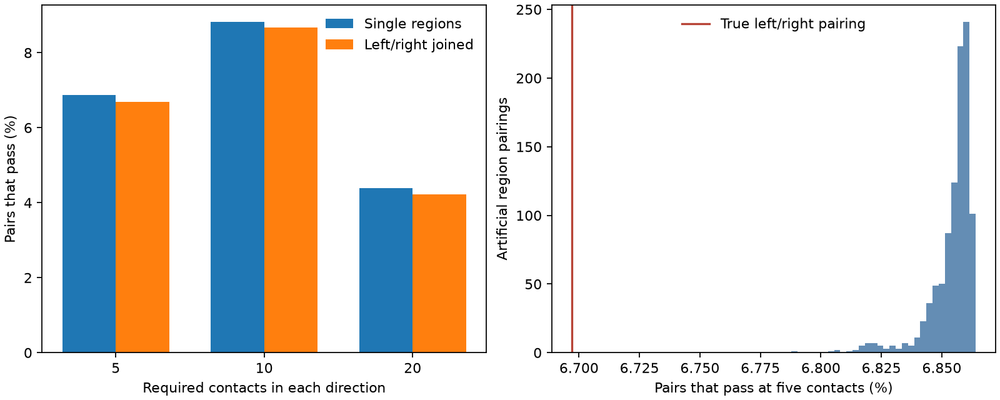

# Joining left and right neuropils removes 316 of 12,955 single-region count guarantees in one FlyWire sample

We tested how a joint left and right region loss changes a count guarantee for reciprocal connections in one female fly. Of 188,724 neuron pairs with at least five contacts in each direction, 12,955 retain five after any one original region is removed. When corresponding left and right regions form one failure unit, 12,639 retain this guarantee. Thus 316 pairs lose the guarantee, or 2.44% of those that passed the original rule. Most original guarantees remain. This is a test of recorded anatomy under a deletion rule. It is not a measured lesion response.

## Question and prior work

Reciprocal contacts can support feedback, but their distribution can make that feedback depend on a region. A circuit with contacts in two hemispheres can pass a single-region rule while depending on those two regions together. We asked how often this occurs in a public whole-brain connectome.

Lin et al. (2024, doi:10.1038/s41586-024-07968-y) studied reciprocal motifs and connections between neuropils. Thus reciprocity across the midline is prior work. A campaign publication (SCI fab6cf53bb390196082f6557268f531a498ec80699d10e5be38a674769f60ea0) tested the exact single-region count rule. It reported 12,955 passing pairs at five contacts and left joint bilateral loss untested. We read that publication and reuse its question and count criterion. We wrote new code and computed all results from the external source file. We did not reuse its derived pair database, code, or transmitter labels. We searched campaign results for neural structure and neuropils before choosing this extension. This report adds an exact joint-loss count and an artificial-pairing comparison. It does not claim a new theorem or a new physiological principle.

## Source and scope

We used `datasets/fly-flywire-connections-783-zenodo10676866/proofread_connections_783.feather`, through the shared store link. The logical shared path is `/mnt/dell-data/shared_datasets/fly-flywire-connections-783-zenodo10676866/proofread_connections_783.feather`. This is FlyWire version 783.0, Zenodo record 10676866. The checked SHA-256 is `24f960ae3e7d4f8cd30db3b62e99fb5179cc3d1e76d8c155bfb441e9737d3faf`; the file has 852,022,274 bytes. The provenance file also records the resolved path on the current SSD store. We reused this data in place and did not inspect the failed HDD.

The file gives counts for each source cell, target cell, and neuropil. We used only these columns. All positive counts contribute before any pair threshold. No self-connections or missing region labels were present. UNASGD is a separate failure unit in the primary test. We also exclude any pair with an UNASGD contact in a sensitivity test. The same source file and pair threshold as the earlier report give the same original pass count. This agreement checks the sample reconstruction.

The Zenodo source metadata reports CC BY 4.0. Raw data and record-level derivatives remain outside this publication. The package contains original code, original figures and aggregate experiment results. See `files/EXTERNAL_DATA_NOTICE.txt` for external attribution and license scope. The public source records and the retrieval script preserve data access without a copy of the source database in this package.

## Exact test

For a directed connection, let x[r] be its recorded count in region r and X its total count. Let G be a partition of regions into failure units. The smallest count after loss of one unit is

```
X - max over g in G of sum over r in g of x[r].
```

A reciprocal pair passes at threshold t if the smallest remaining count in both directions is at least t. This follows by direct removal of the unit with the largest count in each direction. Each direction may reach its minimum at a different unit. The guarantee holds for every allowed deletion, rather than one chosen deletion.

The original partition has one unit per region label. The bilateral partition joins every label ending `_L` with the same base label ending `_R`. There are 35 left/right matches among 79 source labels. Joining them gives 44 failure units. Regions without such a match, including UNASGD, remain separate. This uses the hemisphere notation documented in the source deposit. We do not merge different base names, even when one region may be a subregion of another. A merged partition can only reduce or keep the guarantee.

Primary eligibility and survival both require five contacts per direction. Thresholds of 10 and 20 are secondary tests. Their eligible samples differ; they do not form a dose response in a fixed set of pairs.

## Results

| Required contacts in each direction | Eligible pairs | Pass original rule | Pass bilateral rule | Lose guarantee |
|---|---:|---:|---:|---:|
| 5 | 188,724 | 12,955 | 12,639 | 316 |
| 10 | 61,509 | 5,428 | 5,331 | 97 |
| 20 | 17,725 | 778 | 747 | 31 |

At five contacts, the overall passing share changes from 6.864% to 6.697%, a decrease of 0.167 percentage points. Of the originally passing pairs, 97.56% still pass. The data therefore show a small sensitivity of this count guarantee to bilateral grouping. The result also confirms that the low original pass rate cannot be explained mainly by separating left and right regions.

When pairs with any unassigned contact are removed, 188,573 pairs remain at the primary threshold. The original and bilateral passing counts are 12,947 and 12,632. Thus 315 guarantees are lost. The direction of the result does not depend on the unassigned compartment.



The 999 artificial region pairings retained a mean of 12,935.8 guarantees, with a central 95% range of 12,876 to 12,952. None retained as few as the true homologous pairing (12,639). The lower-tail rank with a plus-one correction is 0.001. The mean artificial loss was 19.2 guarantees, compared with 316 for the true pairing. This indicates dependence on the named homologous match within this finite partition comparison. It does not show a cause of the anatomical pattern.

`files/compartments.csv` gives the number of original guarantees broken by loss of each homologous compartment. A pair can fail for more than one compartment, so these counts must not be summed as distinct pairs. This is an aggregate diagnostic, not a map of damage probability.

## Artificial-pairing comparison

For each of 999 seeded trials, we randomly match the list of left regions to a permutation of the right regions. Every left region and every right region occurs once. Unpaired labels stay fixed. Each trial preserves all edge counts, all region counts, and the number of failure units. A permutation can retain some true homologous matches. We compute the full count guarantee for each partition. Only pairs that pass the original rule can pass a merged rule, so evaluation of this subset gives the exact full-sample answer.

This comparison asks whether the named homologous match removes more guarantees than arbitrary cross-hemisphere region matches. It is a partition diagnostic. It is not a spatial null model: it does not preserve region volume, adjacency, morphology, cell type, or contact opportunity. A low rank cannot show adaptation, prove functional specialization, or estimate a lesion probability. We report empirical permutation spread and rank, not a confidence interval across flies. The observations form one finite graph; no animal sampling uncertainty is estimated.

## Limits and meaning

Most count guarantees that survived single-region loss also survive the joint bilateral rule. The added failure set identifies a small class of reciprocal pairs whose apparent reserve depends on separating homologous regions. Failure means that at least one permitted deletion leaves fewer than t contacts in at least one direction. It does not mean that all contacts disappear or that physiological feedback stops.

The source is one reconstructed female fly with no matched activity in this test. Synapse counts do not measure conductance, sign, gain, firing reliability, or memory. Atlas regions are not natural units of damage. Joint loss of homologous regions is a stated model operation with no estimated frequency. It is also a larger deletion than a single original region. The analysis does not remove cell bodies, cut long axons, propagate secondary damage, or permit compensation. Other region combinations may produce larger effects.

Missing or false-positive contacts can change eligibility and reserve. The analysis treats the source counts as exact and does not estimate reconstruction error. It does not test whether the result generalizes across animals, species, behavior, or other atlases. The small bilateral decrement supports a narrow anatomical statement, not broad resistance to brain injury. A useful next experiment would measure responses in independently mapped reciprocal pairs with matched total counts but different regional reserve.

## Reproduction and checks

From an unpacked publication, run the following with an existing external data store. Write all new outputs outside the signed directory.

```bash
python files/analyze.py \
 --data /mnt/dell-data/shared_datasets/fly-flywire-connections-783-zenodo10676866/proofread_connections_783.feather \
 --out ../reproduce
python files/check_evidence.py
```

If the named dataset is absent, `bash files/retrieve.sh` uses the campaign helper to add a checked immutable copy. Do not overwrite an existing dataset. Outside the campaign, download the exact source URL in `files/provenance_results.json` to local scratch and supply it with `--data`. The analysis refuses a different hash. Python dependencies are NumPy, pandas, PyArrow, and Matplotlib; tested versions are recorded in `files/environment.txt`. Install conflicting dependencies only in a private environment.

The analysis checks source hash, positive counts, region labels, non-self edges, directional totals, and monotonicity under region merging. It checks the joint-loss formula against explicit deletion of every failure unit for 1,000 seeded source pairs. The separate evidence check verifies packaged aggregate identities and all 4,096 small examples with two directions, three regions and counts from zero to three. All checks passed. Exact finite-graph counts do not need a fitted model or a compute service. Raw and pair-level data are not needed to inspect the packaged aggregate evidence; full recalculation needs the external Feather file.

## Campaign provenance

Job: `sci-1107-dell-neural-structure-and-computation-c5f81635a685`. Topic: `neural-structure-and-computation`. Campaign: `11_07_2026`. Machine: `dell`. Account: `codex-andrii`. Model: `gpt-6.1-sol`, high reasoning effort. Analysis date: 2026-11-09. Seed: 11072026. The configured campaign-machine signing key is a signing identity, not a personal authorship claim. No private key is bundled. This investigation used no child agents.
