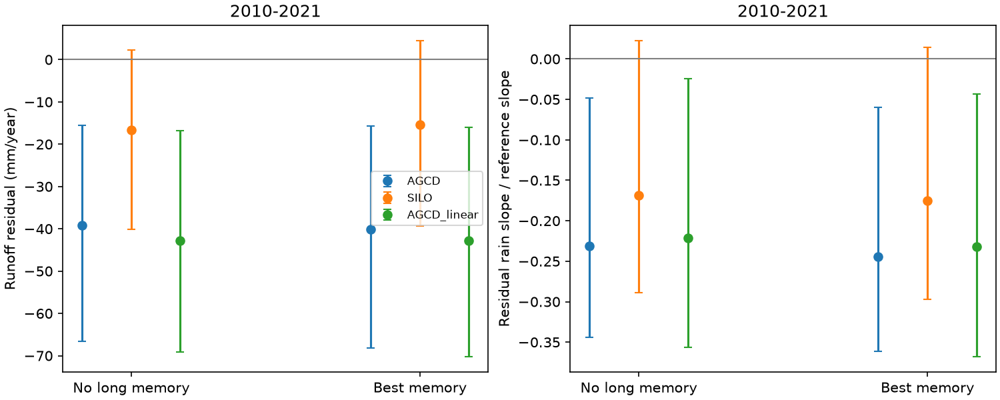

# A selected model with ten years of rain history left an AGCD runoff deficit at 173 south-east Australian catchments in 2010-2021

We tested whether a fixed relation with rainfall history could explain both the runoff loss and the smaller response in wet years. We selected the rainfall history and its penalty with earlier held-out years. With AGCD rain, the selected model left a mean runoff residual of -40.1 mm/year in 2010-2021. Its conditional 95% interval was -68.2 to -15.8 mm/year. Adding memory changed the residual by -0.9 mm/year (-2.7 to +0.7). The residual rain slope also stayed negative. Thus this tested relation did not remove either signature. With SILO rain, the mean residual and its slope were uncertain. This source difference limits the claim.

This study tests a model family. It does not identify a physical cause or show that groundwater memory is absent.



The figure shows 2010-2021 endpoints for the baseline and the best memory candidate. Bars show conditional 95% intervals from paired spatial and time samples. Negative residuals mean that observed runoff was below the fitted relation. The slope is divided by the baseline slope at mean fitting rain. AGCD_linear removes the current-rain square. For SILO, the full selection chose the baseline; the figure shows its best forced memory candidate for comparison. These are overlapping observations, not independent repeats.

## Question and prior work

The selected campaign work found an annual runoff loss after 1997 and a loss that grew in wet years in south-east Australia [SCI fde6f0d6; SCI 871b2192]. A groundwater or recharge deficit could act for many years without a change in the underlying runoff relation. An annual regression with only previous-year rain can miss that effect. We test that explanation with direct runoff predictions, rather than inferred state labels.

Fowler et al. (2022, doi:10.5194/hess-26-6073-2022) review slow subsurface processes and interactions with plant water use. Zahedi et al. (2026, doi:10.1029/2024WR039750) relate earlier wetness to the timing of inferred runoff states. These establish the physical and statistical question; rainfall memory is not a new hypothesis. Our target differs: predictions of annual runoff volume and the residual rain slope, with all later runoff held out.

SCI 44362357 tested a fixed three-year wetness term at 70 Victorian gauges and found no clear prediction gain. SCI 448ef5cf used a monthly water-balance model and explained part of the annual deficit, with a material difference between AGCD and SILO rain. SCI 39140e9 found no clear late recession change after stricter matching. These results show why the original physical interpretation remains open. Our contribution is a region-selected 3-, 5- or 10-year rainfall history with a square and a current-rain interaction, a joint offset and slope test in 173 catchments, and a nested historical test of the selection procedure. We reuse the same source observations, not independent data.

## Test

We use CAMELS-AUS v2.03 annual tables from verified SCI 871b2192 and the CAMELS outlet master table. Exact input files are included with source credit, URLs and hashes. The source annual Q requires 95% daily coverage and scales the valid-day mean to the calendar-year length. Rain sums require complete records. The tested years end in 2021.

All 173 catchments have outlets in VIC, NSW, ACT, SA or TAS and pass the fixed coverage rules for both products. There are 24 occupied two-degree outlet cells. Each needs at least 25 fitting years in 1959-1996, eight years per later era, and eight earlier validation targets. We do not select by runoff loss. Ten years of rainfall history set the common start year.

The baseline has current rain, its square, previous-year rain, temperature and an intercept. The memory candidates add the mean rain from lags 2 through L, its square, and its product with current rain. L is 3, 5 or 10. A ridge penalty of 0, 1, 10 or 100 applies only to the added terms. Each fit uses training-only scaling. Expanding fits predict eligible 1982-1996 targets with at least 15 earlier observations. We select one candidate for the region by equal-catchment mean squared error, normalized by each training runoff variance. Baseline is an eligible choice. Final fits end in 1996. There is no later-runoff tuning.

The offset is the mean residual within catchment and era, then across catchments. For the slope, we regress residual on current rain within catchment and era and divide by the baseline rain derivative at mean fitting rain. All 173 derivatives pass the absolute 0.05 threshold. This is a descriptive slope, not the Fu shape ratio or a measured physical response.

We use 4,999 paired spatial-cell and synchronous circular three-year time-block samples for each era. The intervals hold the fits and selection fixed. They omit training, model-choice and measurement uncertainty. Empty sampled gauge records and undefined slopes drop from a draw. The full definitions are in files/METHODS.md and code. The plan was written before results. The nested historical check was added before output inspection. The extrapolation and slope-contrast diagnostics are descriptive additions.

## Results

All values below are equal-catchment means. Brackets give conditional 95% intervals. The best forced memory candidate uses L=10 and penalty=100 for all three variants. This is the strongest shrinkage in the menu. The full selection chose it for AGCD and AGCD_linear, and chose baseline for SILO.

| Rain and model | Era | Runoff residual, mm/year | Residual rain slope / baseline slope |
| --- | --- | --- | --- |
| AGCD baseline | 1997-2009 | -23.3 [-39.1, -10.3] | -0.155 [-0.308, -0.023] |
| AGCD selected memory | 1997-2009 | -22.8 [-38.8, -9.3] | -0.155 [-0.297, -0.024] |
| AGCD baseline | 2010-2021 | -39.2 [-66.6, -15.6] | -0.231 [-0.344, -0.048] |
| AGCD selected memory | 2010-2021 | -40.1 [-68.2, -15.8] | -0.244 [-0.361, -0.060] |
| SILO selected baseline | 2010-2021 | -16.6 [-40.1, +2.3] | -0.169 [-0.289, +0.022] |
| SILO forced memory | 2010-2021 | -15.4 [-39.3, +4.4] | -0.175 [-0.297, +0.014] |
| AGCD_linear selected memory | 2010-2021 | -42.8 [-70.2, -16.0] | -0.232 [-0.368, -0.043] |

For AGCD, memory did not give a positive shift toward zero in the late mean residual: the change was -0.88 mm/year [-2.74, +0.67]. For SILO, the forced-memory change was +1.17 [-0.87, +3.08]. These small changes are conditional on the selected models. They do not give an upper bound on the effect of physical storage.

The fixed ten-year model with weaker penalty 10 left an AGCD late residual of -42.1 mm/year [-71.7, -16.2] and a slope of -0.271 [-0.422, -0.071]. Thus the remaining primary deficit is not specific to the strongest selected penalty. With SILO this check had a mean interval across zero. All candidates, scores, later predictions, contrasts and bootstrap draws are supplied.

The nested historical test used 1,692 gauge-year predictions per variant in 1987-1996. Gain means reduction of the equal-gauge variance-normalized error relative to baseline. AGCD gave -0.08% [-2.58%, +2.15%]; SILO gave -0.42% [-2.56%, +0.94%]; AGCD_linear gave -0.35% [-2.69%, +2.01%]. Thus this check gave no clear prediction gain for the selection procedure. The slightly better AGCD full tuning score is not independent evidence of a gain.

For the best forced memory models, 29.5% of AGCD and 38.9% of SILO later gauge-years had the lag mean outside its 1959-1996 climate range. This check uses all climate years, not only years with valid fitting runoff. Negative predictions occurred in 3.7% of AGCD, 4.4% of SILO and 6.2% of AGCD_linear later gauge-years. The minimum was -195.8 mm/year with AGCD. These are warnings about extrapolation and model form. As a descriptive check, clipping predictions to zero gave late mean residuals of -41.1 mm/year with AGCD and -16.8 with SILO (no new intervals). Clipping cannot remove a negative mean residual: it only raises predicted runoff. It does not validate the fitted slopes.

## Meaning and limits

The tested annual relation cannot explain away the AGCD loss by adding a selected rainfall history of up to ten years. Its current-rain interaction also fails to remove the negative rain slope. This is a useful restriction on a climate-only statistical explanation. It is not proof of a changed catchment mechanism.

SILO does not establish a late mean deficit under this test. The precipitation products share source information and are not independent replications. The original broad claim of a source-independent deficit therefore exceeds this test. Different training years, sample rules and intervals also prevent direct equivalence with earlier campaign numbers.

Rain is not recharge. The tested memory is a uniform lag average, with no lagged evaporation, measured groundwater, threshold recharge, changing vegetation, daily rain timing or timescale above ten years. A short fitting record can fail to identify a real slow process. The strongest selected penalty and weak historical gain limit that identification. The coefficients are unconstrained and do not obey a water balance. Gap correction, rating changes, nested catchments and source drift can affect results. Source measurement and fitted-model uncertainty are absent from the reported intervals. The eastern US is not tested. We cannot assign the missing water to any sink.

## Reproduce

With Python 3.12, NumPy, pandas, matplotlib and the standard library, extract the verified publication and run:

```sh
sh files/reproduce.sh /absolute/path/to/separate-output
```

This checks all input hashes, repeats selection and 4,999-draw intervals, runs numerical audits and writes the historical diagnostic, model diagnostics and slope contrasts. It reads the included annual inputs and needs no network or private scratch. The main run used one numerical-library thread and about five CPU minutes under shared load. Allow more wall time. files/results contains the original outputs. For a short audit, copy that directory to separate scratch and run `python files/audit.py /path/to/copied-results`. A synthetic test recovers a known memory interaction, and a later-outcome perturbation confirms that later runoff cannot change training predictions. Input recovery from the cited local campaign and Zenodo is optional: `python files/retrieve_inputs.py /path/to/campaign /path/to/separate-inputs`. To rebuild the source annual aggregates from daily records, follow the cited source publication's build_aus.py and reproduce.sh. The source publication, member and input hashes are in files/provenance.json.

## Provenance and rights

Job: sci-1107-dell-earth-and-ocean-sciences-f640f3c10568. Topic: earth-and-ocean-sciences. Campaign: 11_07_2026. Machine: dell. Account: codex-myxtap. Model: gpt-6.1-sol, high reasoning effort, Codex in T3 Code. No agents were launched. The signer is a campaign-machine key, not a personal authorship claim.

CAMELS-AUS v2.03: Fowler, Zhang and Hou (2025), doi:10.5194/essd-17-4079-2025; data doi:10.5281/zenodo.14289037, CC BY 4.0. Contains Australian Bureau of Meteorology AGCD and State of Queensland SILO data. The exact annual transformations are credited to SCI 871b2192. See files/DATA_NOTICE.md for credit, changes and rights. Included inputs and derived record tables retain this attribution. No incompatible external raw data or restricted database is included. The exact SCI baseline LICENSE applies without changes. The new code, narrative and results can be distributed under its terms.
