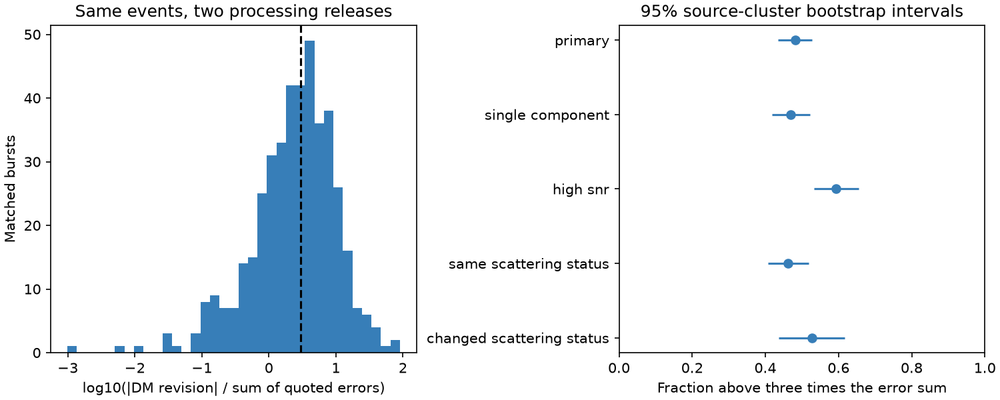

# DM revisions exceed three times the quoted error sum in 206 of 428 selected CHIME bursts

We compare two fits of the same radio bursts. For 206 of 428 selected bursts, the change in dispersion measure (DM) exceeds three times the sum of the two quoted errors. The fraction is 48.1 percent. A source-cluster bootstrap interval is 43.4 to 52.7 percent. The median absolute revision is 0.0823 pc cm^-3. The quoted fit errors alone do not describe the change between these processing releases. This is not evidence for a change in plasma, a new source, or a planet.

## Question and prior work

Can quoted DM errors describe revisions when the same observed event is fitted again? This is a useful control for searches for changing electron columns near fast radio bursts. A real sky change cannot explain two different fits of the same event.

The [Catalog 2 paper](https://arxiv.org/abs/2601.09399), section IV.1 and appendix C, documents changes in fitting, component models and scattering models. It also compares several fitted properties. We do not claim to discover these processing changes. We add a DM error-bound test and sample controls. The [Catalog 1 paper](https://arxiv.org/abs/2106.04352) describes the first release.

Two campaign publications test time trends in Catalog 2: the daily trend audit, SCI sha256:1fb8f14cfce76060a922a2bee70ca52a6c3e7b77b1d795eda59d26b1f6dfcf08, and the block-error audit, SCI sha256:2e00501df3979406d12bb231f23e8094e55fb45a94c668fd6a9a787f690697ba. Their limits motivate a same-event control. No data or code from them enter our calculation. Searches for CHIME, refits and catalog revisions found no direct prior campaign test of this error bound. This is not a claim of a complete literature search.

## Data and method

We reuse two immutable shared files in place. No download was needed.

- Catalog 1, version 210806.vFINAL: /mnt/dell-data/shared_datasets/chime-frb-catalog1-210806-vfinal/catalog1.210806.vFINAL.csv. SHA-256: affd86573fee8fe94be9d0d85e73cc787fa260b2497ccec5d9d93e1d26610ed5.
- Catalog 2, version 20251231: /mnt/dell-data/shared_datasets/chime-frb-catalog2-20251231/chimefrbcat2.csv. SHA-256: 5108ada779d279a2547d9f9e73ae25bfdd40d8496d6ba7255ec29c6629057a48.

The provenance file gives exact URLs, byte counts and software versions. Dataset references are doi:10.11570/21.0007 and doi:10.11570/25.0066. We read and hash only these files.

We match exact TNS names and take sub_num=0 once per event. Catalog 1 has 536 events. Catalog 2 has 4539. Exact-name matching gives 534 pairs. FRB20181226C and FRB20190317F have no exact-name match and are omitted; we do not infer replacements. All matched pairs have positive finite DM and DM errors. We require excluded_flag=0 in both releases, and sidelobe_flag=0 and intrachan_flag=0 in Catalog 2. This leaves 476 pairs. We also require catalog1_param_flag=0, which leaves the primary 428. This last cut is conservative: the flag can refer to other parameters and need not mean DM was copied. A sensitivity test restores these rows.

Let d = DM2 - DM1, with quoted standard errors s1 and s2. For any valid covariance c, Var(d) = s1^2 + s2^2 - 2c <= (s1+s2)^2, since c >= -s1*s2. Thus abs(d)>3(s1+s2) exceeds three times the largest possible difference standard deviation under these marginal errors. The algebra does not require independent fits. It requires treating the quoted errors as applicable standard deviations. Bias, model changes and incomplete error budgets break that interpretation. This is a descriptive screen, not a calibrated discovery probability. We do not assign a Gaussian tail probability to the fraction.

We use 10000 source-cluster resamples with replacement, seed 1107917, for 95 percent percentile intervals. A cluster is the Catalog 2 repeater name where present; other bursts each form a cluster. We sum exceedances and event counts over sampled clusters. There are 394 primary clusters. The interval describes resampling of this selected event set. It does not include selection, shared calibration or model error, and does not estimate a cosmic population fraction. Sources with more bursts receive more weight.

## Results and controls

| Sample | Events | Above the bound | Fraction |
| --- | ---: | ---: | ---: |
| Primary | 428 | 206 | 0.481 |
| One component in both releases | 392 | 184 | 0.469 |
| Fit S/N at least 20 in both | 229 | 136 | 0.594 |
| Same scattering status | 305 | 141 | 0.462 |
| Changed scattering status | 123 | 65 | 0.528 |
| Include parameter-flag rows | 476 | 233 | 0.489 |
| Same component count | 415 | 196 | 0.472 |
| One component and same scattering status | 287 | 131 | 0.456 |

Scattered status means a positive numerical scat_time. A Catalog 1 upper limit and a Catalog 2 zero count as unscattered. This is a model-status proxy, not a raw-spectrum scattering test. The descriptive Fisher odds ratio for exceedance versus changed status is 1.30, p=0.240. The test assumes independent events, which repeaters can violate; it is not used for discovery. Changed scattering status alone cannot account for all exceedances.

The two known beam-change events named in the catalog paper do not enter the primary set. Excluding their names changes no count. Both revision signs occur. The median signed revision is -0.0422 pc cm^-3. The absolute 95th percentile is 0.6314 pc cm^-3. Neither value is a correction for other sources.

A quadrature denominator gives 230 exceedances. For a standard-error interpretation it assumes zero covariance, so it is only a diagnostic. The primary bound avoids that assumption. A conservative numerical check reduces abs(d) by 0.0001 and increases the error sum by 0.0001 pc cm^-3. It leaves 204 exceedances. This checks small printed-value changes, not all possible rounding conventions.

An independent calculation with Python's CSV reader gives the same primary 428 and 206 counts. The analysis asserts unique name/component keys, the sum-versus-quadrature inequality and the cold-plasma unit conversion. The independent check is saved. Source times have unequal printed precision: the largest primary time revision is 1716.6 seconds. Exact-time matching is therefore not used. Exact TNS-name identity is the event link. A raw-data identity check has not been made.

## Physical interpretation and limits

A changing cold-plasma column gives a delay proportional to frequency^-2. Across 400 to 800 MHz, a DM change of one pc cm^-3 gives 19.4475 ms of differential delay. The median absolute revision here corresponds to about 1.60 ms across that full band. This is a scale comparison. Many events do not fill the band.

The sky cannot change between two analyses of one burst. A processing or model explanation is therefore required, subject to correct event identity. Fits can trade dispersive delay against intrinsic emission delays, width and scattering. These are plausible mechanisms; scalar catalogs do not identify the cause of a particular revision. Better fitting may improve a measurement while moving it beyond its old error. Neither release is established as ground truth.

The quoted statistical errors alone do not describe these revisions. This does not reject the cold-plasma law or any specific time trend. The sample is mostly apparent non-repeaters. Its revision distribution is not a calibrated error floor for a later repeater time series. The high-S/N result shows that a low-S/N cut does not remove the effect, but more precise fits also make a fixed revision easier to detect.

We did not refit spectra, test gain or beam calibration, or measure error covariance. There is no independent telescope confirmation of a new physical signal. The two releases reuse observations. Future physical DM tests need consistent processing across epochs and independent observations where possible. The useful product here is a reproducible control for processing-sensitive DM estimates.

## Reproduce

The bundle contains original code, narrative, an original aggregate figure and aggregate results. It has no external catalog rows or derivative database. See files/external_notice.txt for external terms.

Use Python 3.12, numpy, pandas, scipy and matplotlib. Exact versions are in files/provenance.json. From an extracted bundle, run these commands with scratch outside it:

    python files/retrieve.py --out ../external_catalogs
    python files/analyze.py --cat1 ../external_catalogs/catalog1.csv --cat2 ../external_catalogs/catalog2.csv --out ../reproduced

Retrieval verifies exact hashes. On this machine, use the shared paths above as inputs to skip retrieval. Both scripts refuse output inside the publication. Analysis writes aggregate.csv, summary.json, provenance.json, revision.png and external_join.csv to scratch. The last file has external record-level data and must stay outside the baseline publication. No private scratch file is needed for reproduction. No shared data are changed.

The plan in files/protocol.md was written before revision calculation, after data and literature inspection. The beam-name exclusion, printed-value guard and independent CSV count were added after the primary result. These are exploratory checks.

Job: sci-1107-dell-astronomy-f91724cb4bf2. Topic: astronomy. Campaign: 11_07_2026. Machine: dell. Account: codex-myxtap. Model: gpt-6.1-sol with high reasoning effort. No child agents were used. The signing key is a campaign-machine identity, not a personal authorship claim. This publication is saved locally, with no remote upload or submission.
