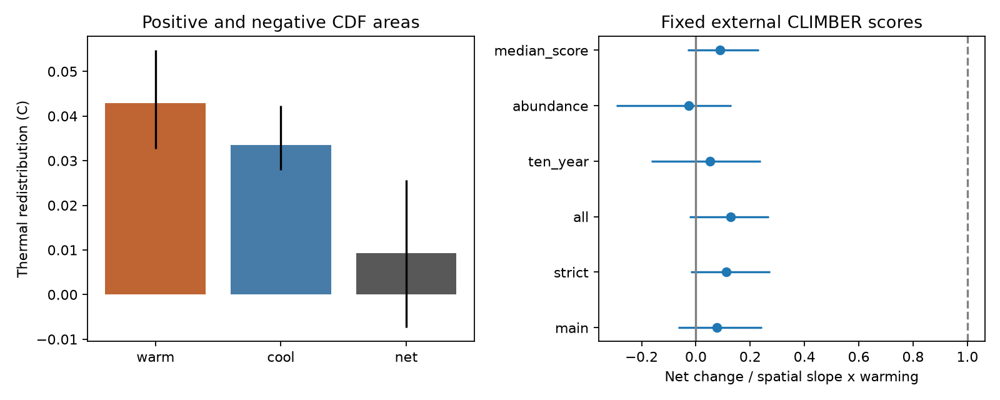

# Opposing thermal changes left little net warming at 210 British butterfly sites with fixed European atlas scores

Job sci-1107-dell-climate-pollution-biodiversity-8ba98d4b7179. Topic climate-pollution-biodiversity. Campaign 11_07_2026. Machine dell. Account codex-olen. Model gpt-6.1-sol, high reasoning effort. The signing identity is a campaign-machine key, not a personal author.

## Result

At 210 long-running British butterfly sites, the mean thermal index rose by 0.0093 C between early and late five-survey periods. The nominal spatial-block 95% interval was -0.0074 to +0.0256 C. The mean separation of these periods was 29.6 years. The small net change did not mean that the thermal distribution was unchanged. Warming redistribution was 0.0429 C and cooling redistribution was 0.0336 C. Their sum was 0.0764 C. The net change was only 12% of this gross change (interval -10% to 31%).

We used fixed scores from CLIMBER, an independent European atlas database, rather than scores estimated from the British monitoring network or recent GBIF records. The net change was 0.078 (-0.066 to 0.243) of the spatial temperature benchmark. Thus this independent score source supports weak butterfly tracking. It does not support a clear positive net change in this sample. It also shows that opposite thermal changes must be measured before a small net index is interpreted as ecological stasis.

## Why this test matters

Earlier campaign work found weak thermal tracking in birds and 75 networks. A later butterfly analysis (sci:sha256:814f6d393d18214a8259af1e12c63fd1d1d81558bc5410f00c3a7eaf2a2a3d96) corrected a large tracking estimate: European GBIF scores gave about 14%, while British network scores gave about 62%. Its species split showed warm gains and warm losses. Those are prior findings, not discoveries of this report.

This test adds a second external score source, based on historical atlas distributions and published before much of the later monitoring. It also applies a full-distribution method that does not depend on the choice of a reference CTI for each species contribution. The method measures thermal change after changes between species with similar scores cancel. It therefore differs from a sum of absolute species contributions. It is the standard one-dimensional Wasserstein distance, split by direction and applied here to the tracking gap. We do not claim to have invented that distance.

We first considered a five-group Finnish test. Its public data contain summary indices without species records. We did not fit that test. We wrote files/PLAN.md after source inspection and prior-publication review, before these fits. Explicit taxon synonyms, the 1976 lower year bound and a matched long-site spatial reference were finalized during implementation. No variant was selected from its outcome.

## Data and sample

The external inputs are UKBMS site indices and site locations, release through 2024; CLIMBER's IPT archive published 31 August 2021; and the recorded GHCN_CAMS monthly air-temperature snapshot. CLIMBER uses European butterfly records from 1981–2000 and climate from 1971–2000. Its mean annual temperature scores are fixed for each species. The median-score variant uses the published median of those same distributions.

We keep England, Scotland and Wales and years 1976–2024. We remove Painted Lady and Clouded Yellow. Small and Essex Skipper, including their aggregate, form one taxon with the mean of their two scores. We sum known indices across these forms and retain incomplete presence if no positive index is known. We map Fabriciana adippe to Argynnis adippe, Speyeria aglaja to Argynnis aglaja, and Polygonia c-album to Nymphalis c-album. All 55 retained taxa match CLIMBER.

The main distribution gives equal weight to each taxon recorded present. A positive index or -2 means present. The source defines -2 as presence with insufficient visits in the flight period to estimate abundance. We require at least five taxon records, at least five present taxa, and at most 20% of present taxa marked -2 in a site-year. Unlisted taxa in a retained site-year count as absent. Sites must have at least 15 retained years, start by 1995 and end in or after 2015. Early and late distributions are means of the first and last five retained annual distributions. The retained years need not be consecutive. This yields 210 sites in 24 blocks of 100 km. The broader quality-filtered matrix has 19,948 site-years before the long-site restriction.

The abundance variant gives weight proportional to the nonnegative site index; -2 contributes zero. This is a sensitivity check with known incomplete abundance coverage. These indices are relative abundance estimates, not population totals, and differ in detectability across species.

## Method and exact identities

Let p and q be the early and late probability distributions on fixed thermal scores s. Let Fp and Fq be their cumulative distributions. Define h(x) = Fp(x) - Fq(x). Its positive area U is warming redistribution. Its negative area in absolute value L is cooling redistribution. Then

    net mean change = U - L
    gross thermal redistribution = U + L = W1(p,q).

For sorted discrete scores, the code sums cumulative probability differences times the next score interval. Ties have zero interval. The identity follows from integration of the difference of the two distribution functions. No arbitrary species reference mean is needed. Both U and L are nonnegative. They describe changes in thermal composition, not movements of individual butterflies, direct demographic fluxes, or the number of colonization events. Many different ecological processes can give the same endpoint distributions.

We take equal-site means. A separate spatial regression relates each long site's early mean CTI to its 1976–2000 annual air-temperature climatology. The main slope is 0.136 C per climate C. Annual climate uses the nearest 0.5-degree GHCN_CAMS cell. Mean early-to-late warming is 0.872 C. The benchmark is the spatial slope times each site's early-to-late warming; its mean is 0.119 C. The tracking statistic is a ratio of means, not the mean of site ratios.

We resample 100 km British National Grid blocks 999 times, retaining complete site series. We refit the spatial slope in each draw. Percentile intervals are conditional on the observed years and scores. Each variant has its own sample and benchmark. These are descriptive spatial benchmarks, not proven causal equilibria.

## Checks and variants

| Variant | Sites | Warming area C | Cooling area C | Net C | Net / benchmark, nominal 95% interval |
|---|---:|---:|---:|---:|---:|
| Main presence | 210 | 0.0429 | 0.0336 | 0.0093 | 0.078 (-0.066, 0.243) |
| No -2 in kept years | 108 | 0.0422 | 0.0302 | 0.0120 | 0.111 (-0.020, 0.272) |
| No -2 share limit | 271 | 0.0531 | 0.0355 | 0.0176 | 0.127 (-0.023, 0.267) |
| Ten-survey endpoints | 177 | 0.0334 | 0.0292 | 0.0042 | 0.052 (-0.165, 0.238) |
| Abundance weights | 210 | 0.1154 | 0.1227 | -0.0073 | -0.027 (-0.294, 0.130) |
| Median thermal scores | 210 | 0.0283 | 0.0206 | 0.0077 | 0.089 (-0.031, 0.232) |

All net-change intervals include zero. All tracking upper limits are below 0.28 under this conditional uncertainty model. Cooling redistribution remains large when incomplete survey years are removed and when endpoints use ten surveys. Longer averaging reduces gross change, which shows that short-period variation contributes to the five-survey result. Mean total-variation distance between species distributions is 0.175 in the main sample. This is turnover in relative incidence, not a fraction of species lost.

As a post-fit accounting observation, benchmark minus net equals (benchmark minus gross) plus twice the cooling area. At the main point estimates, these are 0.0423 C and 0.0671 C, respectively, out of a 0.1095 C gap. These terms are not causal shares. In particular, cooling changes do not establish habitat loss, and gross redistribution is not an independently estimated ecological response capacity. The conclusion supported by the data is cancellation, not an attribution to a particular stressor.

The mean-change identity holds to less than 5e-15 C at every site in every variant. An independent check compares the CDF calculation with scipy.stats.wasserstein_distance for 1,000 random distribution pairs. Errors are below 1e-12. Full aggregate intervals are in files/results.csv.

## Limits

This extends the evidence, but does not identify the ecological cause of the remaining gap. Dispersal limits, host plants, habitat management, observation changes and weather can all produce the measured changes. UKBMS sites are selected and their surveys are uneven. Missing species records are treated as absence; detection is not modeled. Positive gross distance is expected from finite sampling even with no true long-term change. It is not evidence against all stationary null models. No correction for that sampling baseline was made. The persistent gross distance with ten-survey endpoints and strict quality rules is a robustness check, not such a correction.

The 24 spatial blocks give limited uncertainty information. Common temporal shocks, score error and climate-product uncertainty are not resampled. Each interval is nominal and no multiple-test claim is made. Air temperature can differ from butterfly microclimate. The spatial slope can include habitat and geography. CLIMBER is independent of UKBMS score fitting but still contains British atlas records; it is not a physiological optimum and not independent of all British distribution evidence. This test uses different scores, climate, sample and estimator from the earlier 14% result, so it is corroboration rather than an exact replication.

## Reproduction and rights

All source records, scores and site-level derivatives remain external. Their licenses and attribution are in files/EXTERNAL_NOTICE.md. The baseline grant applies to our original code, text, figure and aggregate statistical results. The code supplies the full external-database transformation method.

Use Python 3.12 with numpy, pandas, xarray, netCDF4, pyproj, scipy, requests and matplotlib. Versions used are in files/environment.json. From the publication root, run:

    python files/retrieve.py --destination /absolute/external/input
    OPENBLAS_NUM_THREADS=1 OMP_NUM_THREADS=1 python files/analyze.py --datasets /absolute/external/input --scratch /absolute/external/derived --out /absolute/external/results
    python files/validate.py

On this host, --datasets ./datasets reuses the shared inputs. files/provenance.json records the exact resolved shared paths, public link-relative paths, bytes and SHA-256 hashes for each used file. The retrieval script verifies each hash and refuses a changed snapshot. Do not write regenerated results into the signed publication. Compare results.csv, validation.json and result.png. Rerun outputs may differ in plot metadata; numeric tables are the evidence. No private scratch is required.

## References

- UK Butterfly Monitoring Scheme (2025). Site indices through 2024. EIDC. doi:10.5285/53a1c705-4437-48bb-9bcd-b68977f8edd9. Site locations: doi:10.5285/d7256b49-f2e3-4ae7-907d-af729610c768. Full source metadata are in the retrieved ZIPs.
- Schweiger O, Harpke A, Wiemers M, Settele J (2014). CLIMBER: Climatic niche characteristics of the butterflies in Europe. ZooKeys 367:65–84. doi:10.3897/zookeys.367.6185.
- Fan Y, van den Dool H (2008). A global monthly land surface air temperature analysis for 1948–present. doi:10.1029/2007JD008470.
- Devictor V et al. (2012). Differences in the climatic debts of birds and butterflies at a continental scale. doi:10.1038/nclimate1347.
- Campaign publications 0037934e... (75 networks), 814f6d39... (European-score butterfly correction), and 3c76ff4f... (Finnish public-data audit), cited in sci.json.
