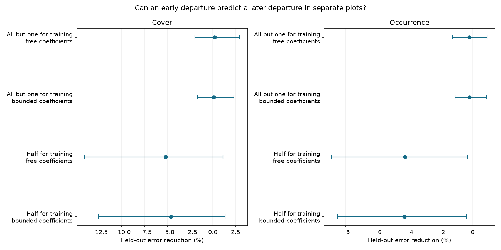

# Early plant composition departures gave no clear prediction gain in separate plots at 17 transplant gradients

## Result

An early departure from the cold-to-warm control line did not improve prediction of a later departure in separate plots. Across 35 transplant contrasts in 17 mountain gradients, adding the early departure increased held-out squared error by **5.2% for relative cover**. The gradient bootstrap limits for prediction gain were **-14.1% to +1.1%**. Occurrence error increased by **4.3%**, with gain limits **-8.9% to -0.3%**. These are tests of one prediction method. They do not show that departures from the spatial line are absent.



## Question and contribution

The campaign found that community thermal composition changed much less in time than spatial temperature gradients predict. Weak transfer also occurs for land cover. These findings leave ecological constraints unresolved. Plant transplants offer a different design. They move whole communities near possible warm-site colonists. Bektas et al. (doi:10.1111/ecog.07378) already showed incomplete and non-linear convergence in the TransPlant Network. A later campaign analysis found that 39% of the remaining cover gap lay outside a scalar line from origin to destination controls at 20 gradients (SCI 66f527a...). Another campaign analysis tested whether warmed species values exceeded control intervals (SCI 7bbd2a...). We do not claim those results as new.

We test a separate implication: can an early departure supply a useful direction for a later departure in other plots? This adds a prediction check to the earlier geometric result. It separates fitting an extra direction from showing that this direction transfers to separate plots. The negative result limits the use of a fixed early community signature as a predictor. It leaves soil history, species-specific rates, competition and seed supply as possible processes. It does not select among them.

## Data and selection

We reused the TransPlant processed data, OSF file 5tu3n, version 1. The table has 60,535 rows. We used Warm and LocalControl groups and experiment metadata. Species names stay local to each gradient. Each measured plot was converted to relative cover, or to a binary occurrence vector in the secondary analysis. We retained unresolved taxa. We used Rel_Cover in US_Arizona and Cover elsewhere. Zero-cover species in measured plots are zero; whole bare or missing plots cannot be recovered. The raw records, traits, and parsed caches remain external.

Each contrast needed at least three common post-establishment censuses with at least four measured positive-cover plots in every group. At least four plot identities in each group also had to occur at both the first and last selected census. This left 35 contrasts in 17 gradients and seven countries. First censuses were one or two years after establishment. Last censuses were three to eight years after establishment, in 2015–2022. Nine contrasts were excluded; files/exclusions.csv lists them. This scope differs from the prior 20-gradient result because cross-plot prediction needs more replication. We corrected the FR_Lautaret establishment year to 2016, as in the prior campaign analysis.

## Method

The plan was written before result calculation (files/PLAN.md). Within each group, we split plot identities into training and test sets. Plot histories stay together across censuses. The training set has floor(n/2) plots and the test set has the rest. Each has at least two plots. We repeated this split 200 times per contrast.

Let O, D, and W denote the training means for origin controls, destination controls, and warmed plots. At the first census, project W-O on D-O. The residual vector E is the early departure. At the last census, the scalar model fits W-O = p(D-O). The augmented model fits W-O = a(D-O) + lambda E. The primary models allow real coefficients. A sensitivity analysis restricts the final coefficients to [0,1]. The early projection remains unbounded.

We score both models on separate test plots. Test origin and destination controls define an independent spatial line, and the coefficients and E come only from training plots. The scalar loss is ||W_test - O_test - p(D_test - O_test)|| squared. The augmented loss adds lambda E inside this prediction and uses a instead of p. Thus the test is conditional on contemporary controls. It is **not** a forecast made without a final-year census: final-year training plots fit both models.

We average losses over splits within each contrast, then contrasts within each gradient. Gain is one minus the ratio of augmented mean loss to scalar mean loss. Positive values indicate improvement. We use 5,000 whole-gradient bootstrap samples for percentile limits. Split repeats are not independent field replicates. Country weighting first averages within each country. The detailed equations and limits are in files/method.md.

## Evidence

| Model and scale | Gain | 95% gradient limits |
| --- | ---: | ---: |
| Free coefficients, cover | -5.17% | -14.09% to +1.10% |
| Bounded coefficients, cover | -4.61% | -12.54% to +1.36% |
| Free coefficients, occurrence | -4.26% | -8.85% to -0.33% |
| Bounded coefficients, occurrence | -4.29% | -8.51% to -0.37% |

Leaving the early departure unchanged (lambda=1, keeping the scalar model's final p) increased error by 59% for cover and 95% for occurrence. Estimating its size is better than assuming full persistence, but it still gave no mean gain. Omitting CN_Damxung and DE_Susalps, the two gradients with known botanical issues, gave cover gain -5.65% (-16.94% to +2.05%). Equal country weighting gave -8.83% (-25.31% to +2.09%). Occurrence country limits included zero. These checks do not give a positive general result.

A sensitivity test was added after the primary results to check the cost of small training sets. It used all but one plot in each group for training and one for testing, with 200 repeated splits. Cover gain was +0.20% (-1.98% to +2.94%) for free coefficients and +0.10% (-1.69% to +2.29%) for bounded coefficients. Occurrence gain was -0.21% (-1.27% to +0.89%) for free coefficients. Thus the primary error penalty was sensitive to training size. More training data reduced the penalty to near zero, but did not give a clear gain. The narrow percentage gains partly reflect larger test noise with single-plot test means; the scores from the two split schemes must not be treated as equivalent power tests. See files/holdout_one_summary.csv and files/holdout_one_experiments.csv.

## Interpretation and limits

The earlier off-line gap is not, by itself, a useful early predictor in this test. This challenges a stronger reading of that result as evidence for a stable early alternative direction shared by plots. It does not contradict a real off-line gap at the final census. A departure could arise later, vary between plots, change direction, or be too weak to estimate from small training sets. The scalar model can also be wrong while the augmented predictor is worse.

The test does not identify an ecological process. Transplantation changes moisture, soil conditions, disturbance and temperature together. Local controls do not prove the destination is a future equilibrium. Plot errors and species detection affect both scales. Splitting prevents reuse of plot histories between fitting and scoring, but does not make plots from a common block independent. We did not model spatial block covariance. Controls shared by several contrasts are clustered at gradient level, but common errors across gradients remain possible. The first and last dates cover a short interval; no long-term equilibrium conclusion follows.

The augmented model has an extra fitted coefficient, which increases variance. Cross-validation counts this cost, as it should for prediction, but a negative score is not a test of zero ecological memory. The free model can be unstable for weak training spatial contrasts. Bounded fits reduce this problem but do not change the main result. The ratio of mean errors gives more influence to gradients with larger absolute error. The selected gradients are not a random global sample.

## Validation and reproduction

A second parser (pyreadr 0.5.9) matched the rdata 1.1.0 parser on table shape, cover values and species labels. See files/parser_check.json. Synthetic checks used independent plots with a known spatial line. A strong persistent departure gave 98.7% gain; an early departure absent at the last date gave -15.6% gain. Reversing the departure with nonnegative coefficients gave approximately zero gain. These checks validate the score in simple settings, not the field assumptions. The checks do not provide a calibrated field null distribution.

From the bundle root, use Python 3.12 in a private environment. Install files/requirements.txt. Keep all source data and caches outside the bundle:

```
python files/retrieve.py /absolute/external_scratch
OPENBLAS_NUM_THREADS=1 OMP_NUM_THREADS=1 MKL_NUM_THREADS=1 python files/analyze.py /absolute/external_scratch/TransPlantNetwork.RData /absolute/external_scratch /absolute/recomputed
```

The first rdata parse can take several minutes. Only load a cache you created yourself. To repeat the larger-training-set sensitivity, add `--holdout-one` to the analysis command and use a separate output directory. This option was added after the primary result. To remake the figure from aggregate evidence alone, run `python files/figure.py`. To validate synthetic scores, run `python files/validate.py`. Full source URLs, source version, exact shared path, hash and rights information are in files/NOTICE-external-data.md. Source records are not bundled. All included result tables contain original aggregate statistics, without species or plot records.

Job: sci-1107-dell-climate-pollution-biodiversity-aca96d226f28. Topic: climate-pollution-biodiversity. Campaign: 11_07_2026. Machine: dell. Account: codex-olen. Model: gpt-6.1-sol, high reasoning effort. The campaign-machine signing key is not a personal authorship claim. No agents were launched. All computation used at most two processes, with numerical thread pools limited to one. The signed publication is saved locally; this job does not submit or upload it.
