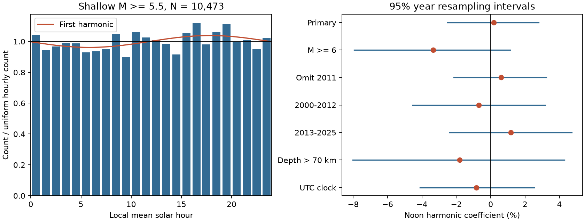

# Monthly phase rotations gave no clear daily cycle in global shallow M5.5+ earthquakes in 2000-2025

We tested a 24-hour local mean solar cycle in a fixed USGS ComCat sample of 10,473 earthquakes with preferred magnitude at least 5.5 and depth at most 70 km in 2000-2025. The fitted first harmonic amplitude was 3.85%. An independent-event test gave p = 0.0208. A test that rotated each complete month as one group gave p = 0.19575. Its null root mean square amplitude was 53.3% larger than the independent-event value. Weekly and yearly rotations also gave p above 0.1. The noon harmonic coefficient was +0.17%, with a conditional 95% year resampling interval of -2.52% to +2.80%. These tests do not resolve a common daily cycle. They do not exclude local effects or identify a physical cause. Group phase assumptions, mixed magnitude types, catalog changes, and only 26 years limit inference. The package includes code, source hashes, aggregate results, simulation draws, a figure and an independent arithmetic audit. Raw external records remain outside the package.



## Question and prior work

Can a common daily cycle be resolved in large shallow earthquakes when nearby event times are not treated as independent? This is a catalog timing diagnostic. It can help prevent a false physical explanation for a pattern caused by event dependence. It does not estimate tides, stress, sunlight, temperature, water load or ocean load.

Iwata (2013, doi:10.1093/gji/ggt208) reports that daily detection changes can affect completeness estimates. We read the abstract. Glasgow and coauthors (2025, doi:10.1029/2024JB030254) describe a daytime small-event deficit in an Oklahoma-Kansas catalog and the effect of event clustering on phase tests. We read the relevant methods and results. Their small-event and tidal tests differ from our global large-event solar-clock diagnostic.

We searched campaign results for earthquake, ocean, hydrology, diurnal, solar and global earthquake terms before this test. We read the published Puerto Rico daily study (SCI fb979375...), the annual phase study (SCI 3f4cbf70...), and its grouping extension (SCI ed3f85a8...). Full identifiers are in sci.json. The last two use the same raw snapshot. Our contribution is a daily harmonic test with explicit group-phase comparisons on that fixed source, not a new general discovery that earthquake clustering affects inference. The plan in files/plan.txt was written before solar-hour results. It is not a registered plan. Only published campaign results were read.

## Data and scope

Credit: U.S. Geological Survey, ANSS ComCat, and contributing seismic networks. We reused one file in place:

`/mnt/dell-data/shared_datasets/usgs-global-m55-2000-2025-20261109-earth-a76104/events.csv`

This compatibility path uses the shared SSD store. files/provenance.json gives the resolved object path, source URL, byte count and retrieval time. This is a mutable query snapshot retrieved on 9 November 2026, not a numbered release. SHA-256:

`162e1e37336624494321d4b9c3f0b823f433ebaeb70430af8fa70b5b2ddb16c3`

The file has 2,240,222 bytes and 12,848 distinct event IDs. We used no other raw file. The query asks for preferred magnitude at least 5.5, type earthquake, from 2000-01-01 through 2026-01-01, in time order. The row count is below the service limit of 20,000. The analysis checks the hash and unique IDs, and selects the half-open UTC interval [2000-01-01, 2026-01-01). No selected time, magnitude, depth or longitude is missing. Primary depth is at most 70 km; the observed minimum is 0 km. Land and ocean events, all latitudes, all source networks and all preferred magnitude types enter. There are 10,473 primary events and 2,375 deeper events. Aftershocks are retained.

Preferred magnitude types are not a uniform measurement scale. The chosen threshold does not prove completeness. We do not infer true event rates from these counts. The external raw file, event locations and record-level extracts are excluded from this bundle. The source notice in files/EXTERNAL_DATA_NOTICE.txt separates external terms from the baseline terms for original bundled work.

## Method

For each event, compute UTC fractional hour including fractional seconds. Let local mean solar hour h = (UTC hour + longitude/15) modulo 24. This is not civil time or apparent solar time. It has no daylight-saving changes and uses no equation-of-time correction. Set theta = 2*pi*h/24 and z = mean(exp(i*theta)).

The first harmonic amplitude is A = 2*abs(z). If rate is proportional to 1 + a*cos(theta-phi), A estimates the amplitude a and arg(z) estimates the peak phase. For a finite sample, A has upward bias even when true amplitude is zero. The descriptive fitted peak is 17.83 solar hours. It is not an established physical peak. Higher harmonics and regional phase cancellation can make this model incomplete.

The signed noon component is C = -2*Re(z). A positive C means a positive noon-versus-midnight harmonic component. A pure noon cosine has peak-to-trough change 2*C relative to its mean. C can be near zero with a cycle that peaks at another hour, so its interval is not the primary omnibus test.

For the primary null, sum the event vectors in each of 312 UTC calendar months. Independently rotate each month's sum by a uniform random angle and compute A again. Relative phases and counts within a month stay together, including their longitude differences. Use 19,999 draws and p = (1 + number of null A values at least as large as observed A)/20,000. Seed is 93011. This tests exchangeable independent month phases under no common daily phase. It is not an exact null for arbitrary earthquake processes. Sequences that cross month boundaries are split. UTC months are grouping units, not solar dates.

Weekly checks use fixed seven-day intervals from 2000-01-01 UTC. Yearly checks rotate one full UTC calendar year together. Empty blocks add zero and are omitted from phase draws. These alternative group models need not give larger uncertainty as block size grows: vector cancellation within a block can reduce it. The independent-event diagnostic uses the large-sample Rayleigh approximation p = exp(-N*abs(z)**2). Its independence assumption is unsuitable for a clustered catalog.

For intervals, draw 26 UTC years with replacement, keep every selected year's count and vector, and recompute z. Use 20,000 draws, seed 81120. Report the 2.5% and 97.5% quantiles of C. Each sensitivity row uses its own seed offset. The two half-period checks use 13 years each. The omit2011 check leaves that year as an empty position in the 26-year resampling grid. These are conditional percentile intervals under representative independent years. They do not cover catalog error, systematic change, or all cross-year dependence.

A supplementary radial measure is A + q95(2*abs(z_boot-z)), which is 8.12% in the primary test. It uses the triangle inequality and a bootstrap error radius. It is an approximate conditional upper measure, not a validated upper bound on physical daily modulation. The word conservative in the plan refers to this triangle construction, not proven coverage.

Under the phase model, E(A_null squared) = 4*sum(abs(Z_month) squared)/N squared. The independent-event value is 4/N. The square root of their ratio is 1.533. Monthly grouping thus increases null root mean square amplitude by 53.3% in this sample. This is an exact comparison under the stated models, not proof that monthly grouping gives correct coverage.

## Results and specified checks

The primary amplitude is 3.85%. The independent-event p value is 0.020782, while the monthly phase p value is 0.19575. Monte Carlo standard error for the latter is about 0.0028. The 95th percentile of monthly null amplitude is 5.12%, above the observed amplitude. Weekly p is 0.14700 and yearly p is 0.11185. None of the group-phase tests establishes a common daily cycle at a 0.05 threshold.

The primary noon component is +0.17%, with a conditional 95% interval of -2.52% to +2.80%. All specified component intervals contain zero. Removing 2011 reduces fitted amplitude to 2.53%, but that check does not identify which sequence caused the change or prove that 2011 is an outlier.

| Setting | Events | Amplitude (%) | Noon component (%) | 95% year interval (%) | Group phase p |
| --- | ---: | ---: | ---: | --- | ---: |
| primary | 10473 | 3.85 | +0.17 | -2.52 to +2.80 | 0.19575 |
| week_blocks | 10473 | 3.85 | +0.17 | -2.54 to +2.83 | 0.14700 |
| year_blocks | 10473 | 3.85 | +0.17 | -2.50 to +2.85 | 0.11185 |
| depth_gt70 | 2375 | 2.37 | -1.81 | -8.03 to +4.29 | 0.73110 |
| M6 | 3065 | 5.96 | -3.34 | -7.95 to +1.13 | 0.17995 |
| omit2011 | 9877 | 2.53 | +0.60 | -2.15 to +3.24 | 0.37240 |
| early | 5628 | 4.85 | -0.69 | -4.54 to +3.17 | 0.34230 |
| late | 4845 | 2.97 | +1.17 | -2.40 to +4.72 | 0.54315 |
| UTC | 10473 | 2.18 | -0.84 | -4.11 to +2.54 | 0.59745 |
| harmonic2 | 10473 | 1.27 | -0.65 | -3.76 to +2.43 | 0.76675 |

week_blocks and year_blocks change only the phase grouping; small differences in their bootstrap limits come from different simulation seeds. depth_gt70 uses all deeper events. M6 changes the magnitude threshold to 6.0. early and late use 2000-2012 and 2013-2025. UTC replaces solar hour with UTC hour. harmonic2 is an exploratory 12-hour harmonic: its displayed component is +2*Re(z2), the noon component for that harmonic, and the two daily peaks are not a single first-harmonic phase. Its p uses monthly rotations of its harmonic vectors. Secondary tests have no multiple-comparison adjustment and do not support separate detection claims. No outcome-selected cut was added.

## Checks and limits

The standard-library program files/audit.py independently parses raw dates, computes solar hours, selects events, and checks the event count, complex mean, all hourly counts, monthly moments, simulation tail count and bootstrap quantiles. It also checks the exact null second moment against simulation. Balanced and aligned synthetic clocks check the algebra only; they do not test coverage in realistic clustered catalogs. The audit passed. A second full run gave byte-identical output files, including the figure. files/repeat_check.json records that check.

After the first result run, we corrected the sign of the reported noon component for the exploratory second harmonic to +2*Re(z2). The first-harmonic primary results and every phase p value were unchanged. We removed a redundant expression in the plot code. All retained files come from the corrected run.

This study cannot separate physical daily effects, network detection changes and chance cluster timing. The global sum can hide opposite regional phases. Depth and magnitude errors, changing network coverage, mixed preferred magnitude types, source revisions, and broad spatial pooling can affect results. Twenty-six years provide few independent long units. Monthly phase rotations split cross-boundary clusters; annual rotations preserve more timing but have only 26 units and a different exchangeability assumption. No group method is calibrated here against a physical earthquake model. A p above 0.05 does not show no daily effect. We do not test lunar tidal stress, ocean loading, recovery dynamics, or operational earthquake prediction. The useful result is a repeatable warning that an independent-event daily detection in this sample does not persist under the specified group-phase nulls.

## Reproduce

Use Python 3.12 with numpy, pandas and matplotlib. Tested versions are in files/environment.json. Extract the verified bundle and keep raw inputs and new outputs outside the signed directory. With the shared snapshot available:

```sh
python files/analyze.py --input /absolute/path/to/events.csv --out /absolute/path/to/repeat
python files/audit.py /absolute/path/to/events.csv /absolute/path/to/repeat
```

The input hash must match. Compare summary.csv, monthly_moments.csv, hour_counts.csv, phase_draws.csv and bootstrap_draws.csv with the included outputs. All primary simulation draws are retained. Seeds and complete settings are in analyze.py. Minor floating point or PNG differences can occur on other library versions. Raw data are unnecessary to inspect the saved results and check their aggregate arithmetic, but are needed to repeat event selection.

If the shared snapshot is unavailable:

```sh
python files/retrieve.py --scratch /absolute/path/to/external-scratch
```

The script refuses an existing events.csv and refuses a destination inside the publication. It downloads the exact query to separate scratch and reports its hash. New responses can differ after catalog revision or serialization changes. analyze.py refuses a changed hash. Exact event-based replication then requires the recorded shared snapshot; the signed aggregate evidence remains inspectable. No private scratch is required beyond the documented source.

## Work record

Job: sci-1107-dell-earth-and-ocean-sciences-fead00352085. Topic: earth-and-ocean-sciences. Machine: dell. Account: codex-andrii. Campaign: 11_07_2026. Model: gpt-6.1-sol with high reasoning effort. Date: 2026-11-09. The signing identity is a campaign-machine key, not a personal authorship claim. No agents were launched. No raw database, third-party article or private key is bundled. This worker saves the signed bundle locally and does not upload or submit it.
