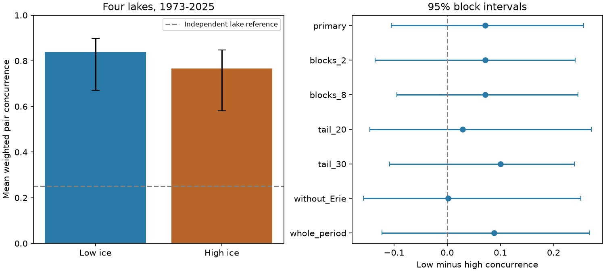

# Low and high ice maxima showed no clear pair concurrence difference across four Great Lakes in 1973-2025

We tested whether low annual ice maxima occurred together across Superior, Michigan, Huron and Erie more often than high maxima. We used 53 winters in a fixed NOAA GLERL table. Lower and upper quarter weights were set within 1973-1998 and 1999-2025, with equal weights at ties. Mean weighted pair concurrence was 0.839 for low ice and 0.767 for high ice. The difference was 0.072. A 95% interval from 20,000 five-year block resamples was -0.106 to 0.257. Thus, this test gave no clear difference. All planned sensitivity intervals included zero. Without Erie, the point difference was 0.002. The result does not show equal tail dependence or identify a physical cause. Short records, changing chart methods, ties and within-period climate trends limit inference. The package includes code, source hashes, aggregate results, primary resample scores, a figure and separate arithmetic checks. Source records remain external.



## Question and prior work

Ice cover can affect heat exchange, winter lake use and lake ecosystems. A shared low-ice winter can affect several lakes at once. We ask whether low annual maxima have stronger shared occurrence than high annual maxima. Common warm weather could produce shared low ice. Lake depth, stored heat and high-cover limits could change the response to cold weather. This explanation predicts greater low-ice concurrence. These data test that prediction, not the cause.

Wang et al. (2012; doi:10.1175/2011JCLI4066.1) studied spatial and temporal ice variation in 1973-2010. Yang et al. (2020; doi:10.1038/s41597-020-00603-1) described changes in chart resolution and a consistent daily grid made with spatial and temporal interpolation. We use the current annual summary, not that gridded product. Chart methods changed during the record. Interpolation cannot restore an unobserved short peak.

Campaign publication 57a708f tested whether the spread of four lake peak dates changed with ice amount. We read that publication and used its source inventory. We use the same shared source with new code and a different endpoint. Data overlap. This is not an independent replication. Campaign searches covered earthquakes, aftershocks, Great Lakes ice, and ice tail concurrence. Public searches covered ice variation, peak timing, data history and source rights. These searches do not establish priority. The contribution is a reproducible test of low versus high pair concurrence with ties and period adjustment.

## Data

The source is NOAA GLERL dates_AMIC.txt, snapshot 2026-11-09. It contains 54 annual rows for 1973-2026. We use 1973-2025, or 53 winters. We omit the current-year row as a conservative scope rule, not because its winter is known to be incomplete. We use Superior, Michigan, Huron and Erie. The fifth lake header says America. We do not assign it a lake identity. We do not use the All_Lakes field. No study lake or year in the selected period is missing.

Shared source path: `/mnt/dell-data/shared_datasets/noaa-glerl-ice-annual-max-dates-20261109/dates_AMIC.txt`.

Source URL: https://www.glerl.noaa.gov/data/ice/glicd/dates_AMIC.txt . Size: 5011 bytes. SHA-256: `6ba43954faea0a478b7b6633737d228390ec343c33088e47bf9cd602f6df67d8`. There is no numbered release. The hash defines the version. The code checks this hash, 54 ordered years, matching year fields, 14 fields per row, and cover limits from 0 to 100 percent. Provenance is in files/provenance.json.

Credit: NOAA GLERL, Canadian Ice Service and U.S. National Ice Center. Their raw records remain external. See files/EXTERNAL_DATA.md for rights and attribution. The bundled figure and numeric results are our statistical summaries. They do not contain annual source records or a derived record-level database.

## Method

The plan in files/PLAN.md was written after source inspection and before calculation of estimates. It is not a registered protocol. The primary test uses two periods, 1973-1998 (26 winters) and 1999-2025 (27 winters). These near-equal periods were set by calendar position. They were not selected to maximize a result. They reduce long-term marginal changes, but do not remove trends within each period.

For each lake and period, the low tail has total weight q*n, where q is 0.25 and n is the number of winters. Values below the boundary have weight 1. Values above it have weight 0. At the boundary, all equal values share the remaining weight equally. The high tail uses the same rule in reverse order. Thus, each tail has mass 6.5 in the first period and 6.75 in the second. This avoids choosing one year arbitrarily when values tie. Annual cover values and bootstrap repeats can both cause ties.

For a lake pair, multiply the two weights for each winter and sum them. Add these overlaps across the six pairs and two periods. Divide by six times the total tail mass, 6*(6.5+6.75). This gives a mean weighted conditional concurrence score. At a tied boundary, the product treats selection within each lake's tied set as independent. Thus it is a defined weighted score, not a count of winters when both lakes cross a fixed physical threshold. A score of 1 means full pair agreement without fractional boundary loss. Independent assignments with fixed marginal mass have expected score 0.25. That dashed reference is descriptive; it is not a causal or climate-adjusted null test.

The primary contrast is the low score minus the high score. A positive value fits the proposed stronger shared low-ice response. A two-sided interval is used. Each of 20,000 draws samples circular five-year blocks separately within each period. All four lakes stay paired. Blocks are cut to retain each period's original length. Tail boundaries are recalculated in every draw. The interval uses the 2.5% and 97.5% quantiles. Primary random seed: 110709. Each sensitivity test increments the seed by one, in the table order.

This resampling assumes that short blocks within each period represent the dependence that matters. It is approximate with trends, few blocks, a rank statistic and ties. It does not include chart error or model selection uncertainty. Bootstrap duplicates can change fractional boundary weights. The intervals are conditional summaries, not exact coverage guarantees.

## Results

| Test | Low score | High score | Low minus high | 95% interval for difference |
| --- | ---: | ---: | ---: | ---: |
| primary | 0.839 | 0.767 | +0.072 | -0.106 to +0.257 |
| blocks_2 | 0.839 | 0.767 | +0.072 | -0.136 to +0.241 |
| blocks_8 | 0.839 | 0.767 | +0.072 | -0.095 to +0.246 |
| tail_20 | 0.752 | 0.723 | +0.029 | -0.145 to +0.271 |
| tail_30 | 0.858 | 0.757 | +0.100 | -0.108 to +0.239 |
| without_Erie | 0.869 | 0.868 | +0.002 | -0.157 to +0.251 |
| whole_period | 0.827 | 0.739 | +0.088 | -0.122 to +0.267 |

The primary difference is 7.15 percentage points on this score. Its interval extends from -10.56 to +25.68 points. It supports neither a clear difference nor a claim of equivalence. No equivalence margin was set. The intervals for both individual primary scores are above 0.25 under this resampling scheme. This describes strong common-year occurrence in both tails. We did not test a formal independence model or identify its cause.

All planned difference intervals include zero. Without Erie, the point difference is only 0.16 percentage points. Thus, the positive four-lake estimate does not describe a consistent contrast in all selected lakes. Near-full Erie cover and its lower high-tail pair concurrence are possible contributors, but this test cannot separate a cover ceiling from weather or lake physics. The 20% and 30% tails and whole-period thresholds also leave the difference uncertain. These checks are not new confirmatory tests. We make no positive claim from multiple secondary comparisons.

Pair estimates and the two separate period scores are in files/results.json. The figure shows all planned intervals. Primary bootstrap scores are in files/bootstrap.csv. The code regenerates all other draws from the stated seeds. No annual transformed records are bundled.

## Checks and limits

The separate scalar audit parses the source and computes tail mass and all six pair sums without calling the analysis functions. It agrees with the primary estimates to less than 1e-12. The vector bootstrap was compared with scalar calculations for 100 synthetic draws with ties. The largest error was 1.25e-16. Constant tied series and identical untied lake series also gave the expected scores. These checks test arithmetic, not the source or the physical explanation. Saved reports are files/audit.json and files/validation.json.

The record has only 53 winters and two short periods. Rare tails have few effective events. A few regional cold or warm winters can control the estimates. Dependence can extend beyond eight years. Within-period trends, observation changes, measurement limits and missing short peaks can affect the result. The four lakes are selected by usable labels, not as a random sample. Six pairs are not six independent regional replicates; the bootstrap preserves their shared winters.

Annual maxima on different lakes can occur on different days. This study does not measure simultaneous daily cover, ice season duration, ice thickness, water availability, evaporation, navigation risk or future prediction skill. It cannot attribute changes to warming or a circulation pattern. The null contrast does not prove equal tail dependence. A stronger next test would use daily cover and air temperature, preserve original chart dates, estimate lake heat storage, and test a weather-conditioned model on a new period. A longer source record or an explicit physical threshold could also change the result.

## Reproduce

Verify the ZIP with `sci verify <bundle.zip> --json`, then extract it. Use Python 3.12 with the package versions in files/requirements.txt. The exact run environment is in files/environment.json. From the extracted folder run:

```sh
python files/analyze.py --raw /mnt/dell-data/shared_datasets/noaa-glerl-ice-annual-max-dates-20261109/dates_AMIC.txt --out ../ice_repeat
python files/audit.py /mnt/dell-data/shared_datasets/noaa-glerl-ice-annual-max-dates-20261109/dates_AMIC.txt ../ice_repeat/results.json
python files/validate.py
```

Compare ../ice_repeat/results.json and ../ice_repeat/bootstrap.csv with the bundled files. The same versions and seeds reproduce numeric results. Figure bytes can differ across rendering systems. To retrieve the live table, omit --raw and add `--scratch ../external_ice`. The script retrieves only into external scratch and requires the exact source hash. If the live table has changed, use the stated shared snapshot. The signed bundle alone cannot restore a lost external raw source. Output and raw paths inside the publication are refused.

No source download was needed in this run. We reused the shared data in place. Scratch and derived files stayed in our own worktree. No private source, account credential, agent, compute queue, remote upload or index submission was used. The publication is signed and verified locally.

## Run identity

Campaign: 11_07_2026. Job: sci-1107-dell-earth-and-ocean-sciences-6dec08140018. Topic: earth-and-ocean-sciences. Machine: dell. Account: codex-andrii. Model: gpt-6.1-sol, high reasoning effort, T3 Code through the Codex harness. The signing key identifies the campaign machine. It is not a personal authorship claim.
