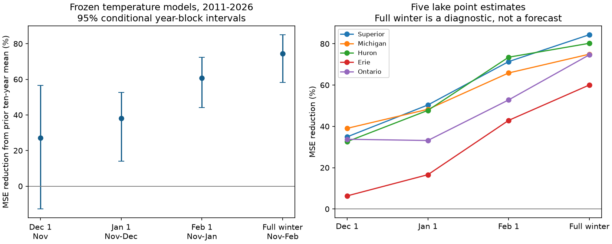

# Early winter temperature cut Great Lakes ice prediction error in a frozen 2011-2026 test

Job: sci-1107-dell-climate-pollution-biodiversity-dc5c2ca8bc0e. Topic: climate-pollution-biodiversity. Campaign: 11_07_2026. Machine: dell. Account: codex-myxtap. Model: gpt-6.1-sol, high reasoning effort. Date: 10 November 2026. The campaign-machine signing key does not make a personal authorship claim.

## Question and result

Does a strong climate response retain useful prediction skill in later years? We test annual maximum ice cover in five Great Lakes. We also ask how much skill requires temperature information that arrives during winter. Ice affects lake habitat, water temperature and spring plankton. We do not test these biological effects.

Five separate temperature models were fitted to 1973-2010 and then held fixed. In 2011-2026, a model with mean November-December air temperature reduced equal-lake mean squared error by **38.10%**, compared with the prior ten-year mean ice cover. Its conditional 95% three-year block interval was **14.11% to 52.62%**. RMSE fell from **28.16 to 22.15 percentage points** of lake area. All 80 lake-year ice peaks occurred after the nominal 1 January issue date.

The same model family with November-January temperature cut error by **60.82%** (44.05% to 72.28%). A model given full November-February temperature cut error by **74.41%** (58.31% to 85.07%). The full-winter result is a diagnostic, not a forecast: 60 of 80 ice peaks had already occurred before 1 March. November alone gave a 27.04% point gain, but its interval crossed zero (-12.81% to 56.49%). Thus a transferable physical response can coexist with an unresolved early-season forecast gain.



The figure gives marginal intervals. Approximate Bonferroni intervals for the three early issue dates are -22.35% to 61.01%, **7.89% to 54.35%**, and **39.41% to 73.89%**. These control three comparisons under the bootstrap approximation. They do not include source-data or fitted-parameter uncertainty.

## Prior work and scope

The selected campaign work found mixed forward skill for climate responses in ecology, disease and water quality. The Lake Erie test (sci:sha256:63b4bcb70ab4f2fa5893e67aec84fff2e07d931390226776508c3cf46c5be136) also showed that revised observations can change apparent skill. We searched the campaign for climate, hypoxia, ozone and GLERL before choosing the ice test. Existing Great Lakes work tests ice timing, water levels, evaporation and summer water temperature. This study tests a different target and a set of early winter information windows. It is not independent evidence from a new source archive.

Wang et al. (2012), doi:10.1175/2011JCLI4066.1, studied Great Lakes ice variability through 2010. Wang et al. (2020), doi:10.25923/88c9-hm22, supplied winter severity and ice relationships through 2018. The latter report defines winter severity as the mean of November-February monthly temperatures and discusses possible prediction uses. We adopt this seasonal definition and the older 2010 endpoint. We use new gridded temperature fits, not the printed station-based coefficients. This is a test of a published response form. It is not an exact numerical replication or an evaluation of NOAA operational forecasts. The contribution is a dated transfer test that separates early information from a full-season diagnostic. The existence of a temperature-ice relation is established prior knowledge.

The plan in `files/analysis_plan.txt` was saved before scores were calculated. It is a local analysis plan, not a registered protocol. It specified all four temperature windows, the controls and sensitivity checks. The scalar audit, family intervals and conditional error budget were added after the main scores were seen. No test year or lake was selected by its result.

## Data and method

The source target is NOAA GLERL's annual maximum ice cover and peak date file, snapshot retrieved 9 November 2026, with 1973-2026 records. Its fifth lake is now labelled America; this column is the lake conventionally named Ontario. We label it Ontario for consistency with the cited science. The sixth all-lake column is not used. Each lake's own maximum is the target, not a common-date basin maximum.

Temperature is NOAA PSL GHCN_CAMS monthly air temperature, version 3.01, snapshot retrieved 9 November 2026. Values extend through October 2026. For each lake we use the cosine-latitude weighted average of all grid centres in a fixed box: Superior 46-49 N, 92-84 W; Michigan 41-46 N, 88-85 W; Huron 43-46 N, 84-80 W; Erie 41-43 N, 84-79 W; Ontario 43-45 N, 80-76 W. These are coarse regional proxies, not lake masks. GHCN_CAMS estimates air temperature over a land-based grid; we do not interpret it as lake water temperature. We equally average monthly means. Each winter is labelled by its January year.

There are 38 fit winters and 16 test winters per lake. Each model has an intercept and one temperature slope. Windows are November alone (T1), November-December (T2), November-January (T3) and November-February (T4). Slopes and intercepts are frozen after 2010. Predictions are clipped to 0-100%. Nominal issue dates are 1 December, 1 January, 1 February and 1 March. These describe the information window only: monthly estimates may be released later. There are no archived issue-time input vintages in this test.

The main control is the mean ice cover in the preceding ten winters, updated using earlier test outcomes only. Other controls are the frozen fit mean and a frozen linear time trend. All controls use the same bounds. The score is one minus the sum of model squared errors divided by the sum of control squared errors. Each lake has equal weight. Since percentage ice area is the common unit, high-variance lakes can contribute more error. We also supply training-variance-normalized MSE. The T2 normalized MSE is 0.907 versus 1.460 for the control, a 37.86% reduction.

We resample contiguous circular blocks of three test years, with all lakes and models kept together: 20,000 draws, seed 1107. This treats a winter as the shared information unit; there are 16 winters, not 80 independent trials. Fits remain fixed. Intervals are conditional on the selected years, fitted models, source versions and block scheme. They are not confidence limits for all climate systems. Resample results are supplied for inspection.

## Checks and limits

| Information | RMSE, percentage points | MSE gain, percent | Conditional 95% limits, percent |
|---|---:|---:|---:|
| November | 24.05 | 27.04 | -12.81 to 56.49 |
| November-December | 22.15 | 38.10 | 14.11 to 52.62 |
| November-January | 17.62 | 60.82 | 44.05 to 72.28 |
| November-February, diagnostic | 14.24 | 74.41 | 58.31 to 85.07 |

T2 gains against the fit mean and frozen trend were 35.64% and 37.60%. T2 gains were positive for each lake: Superior 50.36%, Michigan 48.26%, Huron 47.75%, Erie 16.60%, Ontario 33.16%. These lake values are descriptive; we do not claim five independent significant results. Removing any one lake left pooled gains of 33.48-46.22%. Removing any one test year left gains of 31.58-46.95%. Two- and four-year blocks retained positive T2 intervals. A quadratic temperature model gave 35.44% gain (5.01% to 55.95%). Removing clipping left the T2 point score unchanged.

A stricter test limited to 2013-2026, after the 2012 paper, gave 39.48% T2 gain (10.91% to 58.00%). A separate fit through 2018, followed by the eight winters 2019-2026, gave **24.39% T2 gain with limits -15.21% to 55.27%**. This recent-only check does not resolve a gain. It changes both fit and test years, so it is not a clean test of slope change. T3 retained gain in that check: 57.26% (28.18% to 79.20%). These overlapping tests are checks, not independent replications.

Eleven of 80 maxima were before 1 February. Excluding them gave 60.55% point T3 gain on 69 records. This exclusion uses the later known peak date and is only a selection diagnostic. A record that peaks after issue does not guarantee that all previous ice information was unavailable. We did not compare with current ice cover, lake heat content, dynamical forecasts or an operational ensemble.

The full-winter diagnostic reduced error by a further 34.67% (17.98% to 51.14%) relative to T3. This gap can reflect both additional weather information and different fitted slopes. It is not a causal estimate of the value of a temperature forecast. In particular, transfer skill with observed winter weather cannot establish pre-winter operational skill.

NOAA says that the historical ice archive was standardized to a new grid in 2020. The entire test uses that revised record. Temperature fields are also retrospective. This prevents a real-time vintage claim. The short shared record, coarse boxes, source changes, lack of parameter uncertainty, assumed block dependence and simple model form limit inference. The results do not establish an ecological mechanism, safe ice thickness or a gain for biodiversity forecasts. The unresolved November result does not prove that an early forecast is impossible.

## A conditional temperature-error budget

As an exploratory method extension, we translate the full-winter response into a required weather-forecast error budget. Let the fixed full-winter fit be yhat = a + b T. At a nominal 1 January issue, observed November-December values provide half of T. Let e be the error in a forecast of mean January-February temperature. Then the ice prediction changes by b e / 2. If e has zero mean, equal variance sigma squared in each lake, and zero covariance with the full-weather ice residual, expected pooled squared error is:

**MSE = MSE_full + mean(b squared) sigma squared / 4.**

We use the unbounded linear model for this identity; clipping would break the exact equality. Its full-weather MSE is 215.05 percentage-point squared versus 792.77 for the trailing control. The added-error coefficient is 34.42 percentage-point squared per degree C squared. Under these assumptions, mean January-February temperature RMSE below **4.10 C** leaves a positive expected pooled gain. Separate lake thresholds are 3.58-4.79 C. The table and code are in `error_budget.csv` and `error_budget.py`.

This is a conditional planning bound, not measured weather forecast skill or a verified operational threshold. A biased temperature forecast, correlated ice and weather errors, different lake error variances or source revisions can change it. No archived temperature forecasts were tested. The method makes the missing operational evidence explicit: the next test needs issue-time weather forecasts, current ice controls and observation vintages.

## Reproduce and inspect

The signed package contains our code, model coefficients, aggregate loss scores, all main bootstrap skill draws, an original figure and source provenance. It excludes raw source files, the external temperature/ice panel and record-level prediction tables. This avoids granting baseline terms for external records or derivative databases. Source attribution and terms are in `files/EXTERNAL_DATA_NOTICE.txt`. Data were provided by NOAA GLERL and NOAA PSL, Boulder, Colorado, USA. The source ice product also uses Canadian Ice Service and U.S. National Ice Center charts. No endorsement is implied.

Exact source URLs, shared paths, byte counts and SHA-256 hashes are in `files/provenance.json`. The shared inputs are `datasets/noaa-glerl-ice-annual-max-dates-20261109/dates_AMIC.txt` and `datasets/psl-ghcncams-air-mon-mean-20261105/air.mon.mean.nc`, where `datasets` is the campaign shared dataset link. Original files remain immutable there. The PDF read for method definitions was https://repository.library.noaa.gov/view/noaa/22950/noaa_22950_DS1.pdf, SHA-256 aa29343d28d1d6bd6c634d7631ff4754e80412a55afb04b3556a8d3e1a35c211. It is not needed by the calculation.

Use Python 3.12 with numpy, pandas, xarray, netCDF4 and matplotlib. Versions used are in `summary.json`. After unpacking a verified bundle, run from any directory:

```
python /path/to/files/fetch_inputs.py /tmp/ice-inputs
python /path/to/files/analyze.py /tmp/ice-inputs /tmp/ice-analysis
python /path/to/files/audit.py /tmp/ice-analysis /tmp/ice-audit
python /path/to/files/error_budget.py /tmp/ice-analysis /tmp/ice-audit
```

On the campaign machine, substitute the shared `datasets` path for `/tmp/ice-inputs` to reuse the exact snapshots without fetching. Write outputs outside the signed package. Live URLs can change. The retrieval code stops if a hash differs; exact reproduction then needs the recorded shared snapshot. The scalar covariance audit independently reconstructed all 20 linear fits and all 320 temperature predictions within 1e-10 percentage points. `audit.json` gives the exact discrepancy, comparison scores and family intervals. `annual_mean_losses.csv` permits score and resampling inspection without source records.
