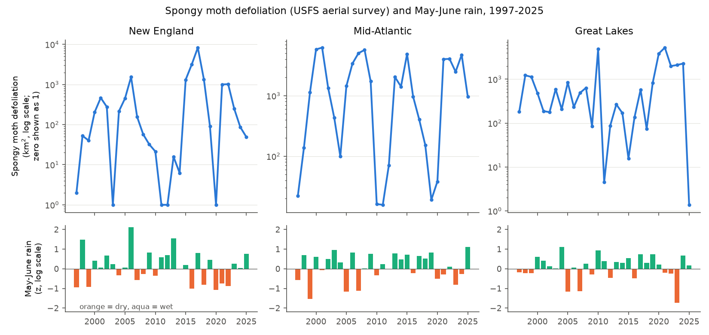
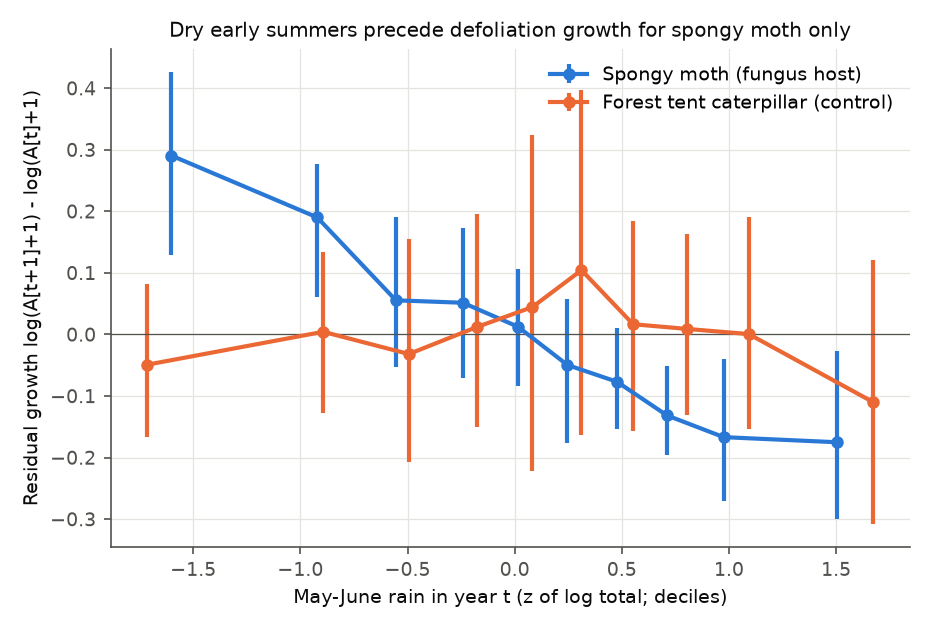
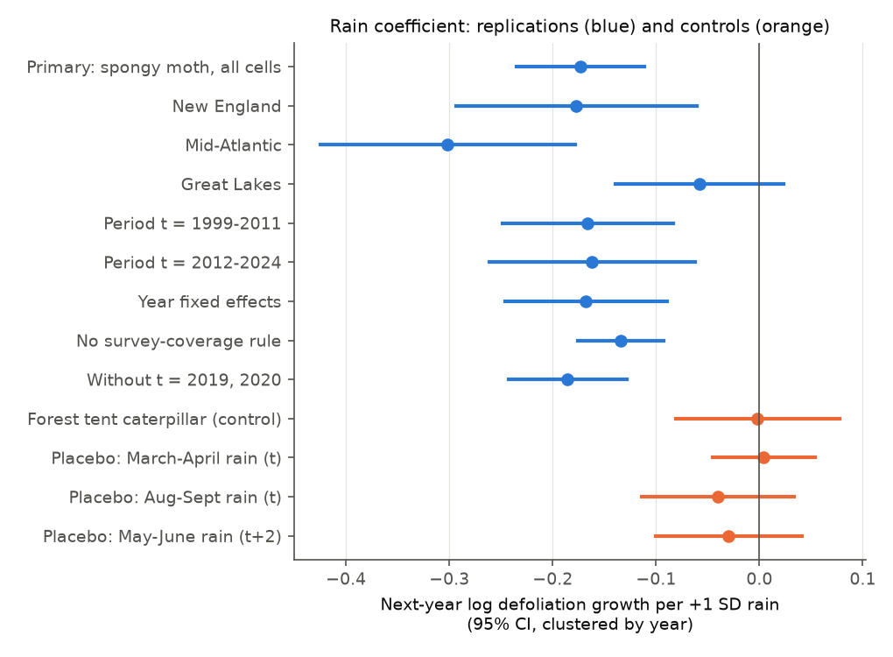

# Dry May-June weather was followed by more spongy moth defoliation in the next year in eastern US aerial surveys, 1999-2025; forest tent caterpillar did not show this

Job: sci-1107-dell-climate-pollution-biodiversity-7b93cba8e8b4. Topic: climate-pollution-biodiversity. Machine: dell. Account: claude-sci. Model: Claude Opus 5.5 (claude-opus-5-5). Campaign 11_07_2026. Date: 2026-11-12. The signing key is a campaign-machine key. It is not a personal authorship claim.

## Summary

The spongy moth (*Lymantria dispar dispar*, formerly "gypsy moth") is an invasive defoliator of oak forests in the eastern US. Since 1989 the fungus *Entomophaga maimaiga* has controlled many populations. The fungus needs rain and humid conditions in May and June to infect and kill the caterpillars (Hajek 1999; Reilly et al. 2014). State forest agencies said that dry springs caused the 2015-2018 southern New England outbreak and the 2020-2022 outbreak in New England and the Great Lakes states. We did not find a quantitative test across many regions and years that also controls for aerial survey coverage. This publication supplies such a test.

- **Data.** USFS Insect and Disease Survey (IDS) aerial sketch-map polygons for Regions 9 and 8 (April 2026 release), survey years 1997-2025. We rasterized spongy moth and forest tent caterpillar defoliation and the surveyed areas at 250 m and summed them into 0.25-degree cells. NOAA nClimGrid monthly precipitation and temperature gave the weather of each cell.
- **Primary result (pre-registered).** In 1,066 range cells with 15,042 cell-year transitions, a May-June rain total 1 SD above the cell normal in year t was followed by -0.173 (95% CI -0.235 to -0.112) lower log growth of defoliated area from year t to t+1. One SD is about 28% of the May-June rain total (about 60 of 209 mm). When we moved complete rain maps among years (2,000 permutations), no permutation gave a coefficient as far from zero (two-sided p = 0.0005, the smallest possible value).
- **Replication.** The coefficient was negative in New England (-0.18), the Mid-Atlantic (-0.30) and the Great Lakes (-0.06; the CI includes zero). It was negative in both periods (-0.166 for t = 1999-2011, -0.162 for t = 2012-2024), in the legacy sketch-map era and the digital (DMSM) era, and with year fixed effects (-0.168). With year fixed effects, only rain differences between cells in the same year are used.
- **Specificity.** Forest tent caterpillar is not a host of *E. maimaiga*. Its coefficient was -0.002 (CI -0.081 to 0.078). The spongy moth minus FTC difference was -0.172 (CI -0.291 to -0.053).
- **Timing.** Rain before the larval season (March-April, +0.004), after it (August-September, -0.040; July, -0.040), and two years later (-0.030) gave coefficients near zero. Only May-June rain gave a clear signal.
- **Size.** In cells that already had defoliation, a 1 SD drier May-June was followed by about 1.6 times more next-year defoliated area (coefficient -0.48). In cells without defoliation, the onset probability (base rate 7.9% per year) increased by 4.6 percentage points for each SD of drier weather. The rain effect was larger where defoliation was already large (interaction -0.15 per log unit of area).
- **Limits.** Rain improved a forward forecast of 2015-2024 cell growth by only 1.9% of the mean squared error (7 of 10 years better). Most variation in defoliation comes from the outbreak cycle and from other causes. In the cells with survey coverage, the large 2020 to 2021 increase did not follow an unusually dry May-June 2020 (area-weighted z = +0.25). Most of New England had no aerial survey in 2020, so that transition is not in the main sample.

Conclusion: in 27 years of public aerial survey data, dry May-June weather was followed by spongy moth defoliation growth in the next year. The signal repeated in regions and periods, was specific to the larval season, and was absent for a defoliator that the fungus does not infect. This agrees with the fungus explanation. It does not prove the mechanism, because we did not measure infection.

## Prior work and what is new

- Laboratory and field studies show that *E. maimaiga* infection increases with rain and humidity in May-June (Hajek 1999, doi:10.1128/MMBR.63.4.814-835.1999). Reilly et al. (2014, doi:10.1603/EN13194) linked fungal mortality in outbreak populations to weather at plot scale. Pasquarella et al. (2018, doi:10.1007/s10530-018-1778-0) mapped the 2015-2017 southern New England defoliation with Landsat data and linked it to drought.
- The campaign record had no publication about spongy moth. Campaign publication sci:sha256:19527cb5... (our earlier IDS study of western bark beetles) found that a pooled "defoliator" class had a negative response to hot-dry summers. That class did not separate agents.
- New here: a pre-registered test with 1,066 cells from Minnesota to Maine and Virginia, three regions, two periods and two survey eras; aerial survey coverage control; a year-permutation test that keeps the spatial structure of weather; a non-host control defoliator; and placebo weather windows.

## Data

| Input | Use | Identity |
| --- | --- | --- |
| USFS IDS flat file, CONUS Region 9, all years (release of 2026-04-22) | Damage polygons and surveyed areas, survey years 1997-2025 | Shared dataset `usfs-ids-conus-region9-allyears-20260422-complete`; https://www.fs.usda.gov/foresthealth/docs/IDS_Data_for_Download/CONUS_Region9_AllYears.gdb.zip; sha256 99efca56b1965c13ea1091be6104a840fec23cdb7e1b2c10ae26dd1213c35e49 (265,368,558 bytes). Downloaded for this work. |
| USFS IDS flat file, CONUS Region 8, all years (same release) | Same, for Virginia and other southern states | `usfs-ids-conus-region8-allyears-20260422-complete`; same URL with Region8; sha256 6ae45303cb6a373ecffacde1d5b3142c4bc6a844d0ef1f5f1308d8a3f8081f73 (173,597,485 bytes). Downloaded for this work. |
| NOAA NCEI nClimGrid monthly precipitation, version modified 2026-10-06 | May-June and placebo-window rain | Shared dataset `noaa-nclimgrid-monthly-prcp-20261006`; https://www.ncei.noaa.gov/data/nclimgrid-monthly/access/nclimgrid_prcp.nc; sha256 1d9f6cb28dd8ed203ed512ad9083f5a5252dedd85ac58cf155a33582b36459fb |
| NOAA NCEI nClimGrid monthly mean temperature, same version | May-June temperature (secondary) | `noaa-nclimgrid-monthly-tavg-20261006`; .../nclimgrid_tavg.nc; sha256 b781f5ee586c1b9de5334a65453bb6e6888da43c959ba8d306f2d1e7f59d83c7 |

Shared paths are under `/mnt/dell-data/shared_datasets/`. Both sources are US federal government works. See `files/NOTICE.md` for attribution.

## Methods

The plan (`files/PLAN.md`, sha256 ab673c35...) was written before we calculated any weather-defoliation estimate. The models below follow it. Items marked "exploratory" were not in the plan.

1. **Defoliation.** IDS polygons with DCA_CODE 12089 (spongy moth) or 12096 (forest tent caterpillar) and DAMAGE_TYPE starting with "Defoliation". We rasterized the polygons of each agent and year at 250 m in the native Albers projection. Overlapping polygons count once. We summed the area into 0.25-degree cells (A, km2). Surveyed-area polygons were treated the same way. The surveyed fraction is surveyed km2 divided by the land area of the cell (nClimGrid land mask). Mortality polygons were not used.
2. **Weather.** nClimGrid 1/24-degree monthly values averaged into the same cells. P_MJ = log of the May+June total, as a z-score from the 1991-2020 cell mean and SD. The placebo windows (March-April, July, August-September) and May-June mean temperature were treated the same way.
3. **Sample.** Range cells: cells with spongy moth defoliation in at least one year of 1997-2025. Transitions t to t+1 with t = 1999-2024 (survey polygons start in 1999). The surveyed fraction must be 0.5 or more in t and t+1.
4. **Model M1.** G = log(A[t+1]+1) - log(A[t]+1) = b1 P_MJ(t) + b2 P_MJ(t+1) + d log(A[t]+1) + cell fixed effects. The CR1 standard errors are clustered by year t (26 clusters). Our code (`files/code/fe.py`) uses alternating-projection demeaning.
5. **Year-permutation test.** We gave the P_MJ(t) map of year t to a different year (a random permutation of 1999-2024, the same for all cells). This keeps the spatial pattern of each year's weather. We used 2,000 permutations.
6. **Groups.** New England: cell centres east of 73.5 W and north of 41 N. Great Lakes: west of 80.5 W. Mid-Atlantic: the remainder, which includes New York, Pennsylvania, New Jersey, Maryland, West Virginia and Virginia.

## Results

### Pre-registered hypotheses

| Hypothesis | Test | Result | Decision |
| --- | --- | --- | --- |
| H1: b1 < 0 | Clustered CI below zero and permutation p < 0.05 | -0.173 (-0.235 to -0.112); p = 0.0005 | Supported |
| H2: replication | b1 < 0 in at least 2 of 3 groups and both periods | Negative in 3 of 3 groups and in 2 of 2 periods | Supported (Great Lakes CI includes zero) |
| H3: specificity | Spongy moth minus FTC < 0 | -0.172 (-0.291 to -0.053); FTC alone -0.002 | Supported |
| H4: timing | abs(b1) larger than for placebo windows | 0.173 vs 0.004 (Mar-Apr), 0.040 (Aug-Sep), 0.030 (t+2) | Supported |

### All models

Rain coefficient (per +1 SD), year-clustered standard error, and sample. All rows are in `files/results/model_results.csv`.

| Model | Coefficient | SE | Transitions | Cells |
| --- | --- | --- | --- | --- |
| M1 primary, P_MJ(t) | -0.173 | 0.032 | 15,042 | 1,066 |
| M1 primary, P_MJ(t+1) | -0.069 | 0.037 | 15,042 | 1,066 |
| M1 primary, log(A[t]+1) | -0.583 | 0.050 | 15,042 | 1,066 |
| New England | -0.177 | 0.059 | 3,044 | 146 |
| Mid-Atlantic | -0.302 | 0.063 | 5,339 | 465 |
| Great Lakes | -0.058 | 0.041 | 6,659 | 455 |
| t = 1999-2011 | -0.166 | 0.042 | 9,277 | 1,053 |
| t = 2012-2024 | -0.162 | 0.051 | 5,765 | 900 |
| Forest tent caterpillar | -0.002 | 0.041 | 14,318 | 868 |
| Spongy moth minus FTC (stacked) | -0.172 | 0.061 | 29,360 | 1,530 |
| Placebo March-April (t) | +0.004 | 0.025 | 15,042 | 1,066 |
| Placebo July (t) | -0.040 | 0.037 | 15,042 | 1,066 |
| Placebo August-September (t) | -0.040 | 0.038 | 15,042 | 1,066 |
| Placebo May-June (t+2) | -0.030 | 0.036 | 14,744 | 1,066 |
| All windows together: May-June (t) | -0.171 | 0.031 | 14,744 | 1,066 |
| Coverage rule 0.2 | -0.176 | 0.029 | 18,580 | 1,074 |
| Coverage rule 0.8 | -0.167 | 0.033 | 11,751 | 1,034 |
| No coverage rule | -0.134 | 0.021 | 28,002 | 1,077 |
| Surveyed fractions as covariates | -0.173 | 0.031 | 15,042 | 1,066 |
| Year fixed effects | -0.168 | 0.040 | 15,042 | 1,066 |
| Group-by-year fixed effects | -0.123 | 0.033 | 15,042 | 1,066 |
| Plus May-June temperature (t, t+1) | -0.192 | 0.032 | 15,042 | 1,066 |
| (temperature t coefficient) | -0.068 | 0.034 | 15,042 | 1,066 |
| Legacy era, t = 1999-2013 | -0.163 | 0.036 | 10,488 | 1,056 |
| DMSM era, t = 2015-2024 | -0.168 | 0.073 | 3,958 | 826 |
| Onset probability, A[t] = 0 | -0.046 | 0.009 | 11,793 | 1,058 |
| Growth where A[t] > 0 | -0.483 | 0.101 | 3,249 | 817 |
| Without t = 2019 and 2020 | -0.186 | 0.029 | 14,523 | 1,066 |
| Clustered by group-year (78 clusters) | -0.173 | 0.039 | 15,042 | 1,066 |

### Exploratory results (not in the plan)

- **Density interaction.** With a P_MJ(t) x log(A[t]+1) term, the rain coefficient was -0.114 (SE 0.027) at zero defoliation and the interaction was -0.150 (SE 0.052). At the median log area of defoliated cells (1.67) the rain coefficient was about -0.36. Thus the rain signal was largest where populations were already high. This agrees with a pathogen that kills larvae in dense populations, but other explanations are possible.
- **Temperature.** A warmer May-June was also followed by slightly lower growth (-0.068, SE 0.034) when rain was in the model. Thus the signal is "dry" and not "hot-dry".
- **Forward test.** A pooled model fitted on t = 1999-2013 (without cell effects) predicted the growth of t = 2015-2024. Adding P_MJ(t) to density alone decreased the mean squared error by 1.9% (1.006 to 0.987). It was better in 7 of 10 years (`files/results/forward_by_year.csv`). The fitted rain coefficient on the training years (-0.154) was close to the full-sample value.
- **Counterfactual transitions** (`files/results/counterfactual_transitions.csv`). We set P_MJ(t) to normal with the M1 coefficient. Then the 2016 to 2017 next-year area decreased from 8,417 to 7,050 km2 (-16%), the 2005 to 2006 area by 20% and the 2007 to 2008 area by 19%. The 2020 to 2021 increase did not follow a dry May-June in the covered cells. A wet 2019 May-June (z = +1.2) came before a small 2020 area.

## Observation bias and limitations

- **Aerial sketch maps are approximate.** Observers draw polygons from aircraft. The minimum mapped defoliation, polygon size and the legacy-to-DMSM change in 2015 (grid cells with a percent class) change the area values. Cell fixed effects remove constant differences. The result was the same in both eras.
- **Survey coverage changes.** Coverage decreased after 2015 and was very low in 2020 (COVID-19 flight restrictions; most of New England not flown). The coverage rule, coverage covariates, year fixed effects and a model without t = 2019-2020 all gave similar coefficients. A survey that does not see light defoliation can still bias the growth values in a way that we cannot measure.
- **Mechanism.** We did not measure fungal infection, egg-mass counts or virus (LdNPV). The pattern agrees with the *E. maimaiga* explanation, but drought can also change host-tree quality or larval survival in other ways. The FTC control decreases the probability that the signal is a general effect of drought on how defoliation looks from the air, but FTC feeds on different hosts (aspen, sugar maple) and its outbreaks were mostly before 2012.
- **Effect size.** The weather signal is clear but small compared with the outbreak cycle. It is not sufficient for good cell-level forecasts (1.9% forecast gain).
- **Great Lakes.** The Great Lakes coefficient was smaller and not clear. Possible reasons are a later invasion front (newer populations with less fungus), sandy soils, or different survey methods in Michigan, Wisconsin and Minnesota. We did not test these.
- **Spatial scale.** 0.25-degree cells (about 500-700 km2) mix forest types. The cluster unit (year) gives only 26 clusters. The permutation test does not need a large number of clusters.
- **Not tested.** Air pollution, Canadian provinces (Ontario had the largest outbreak on record in 2021), daily humidity, soil moisture, and egg-mass survey data.

## What remains open

1. Test the same model with state egg-mass counts or Ontario aerial data, to use an independent observation system.
2. Use daily humidity or rain-day counts in late May and June. The fungus responds to the number of wet days, not only to totals.
3. Explain the weak Great Lakes response (invasion age, soil, survey method).
4. Test if a 2-year drought sequence (t-1 and t) has a larger effect than one dry year.

## Reproduction

1. `bash files/code/00_fetch.sh SCRATCH` downloads the raw files into a scratch directory and checks the IDS hashes. The nClimGrid files are replaced each month by NCEI; a new download can have different values for recent months.
2. `bash files/code/run_all.sh SCRATCH OUT` runs the pipeline: `01_climate_cells.py` (weather cells), `02_ids_cells.py` (rasterization, about 25 minutes per region on one CPU), `03_panel.py` (cell-year panel), `04_models.py` (pre-registered models, permutation test), `05_explore.py` (exploratory analyses) and `06_figures.py`.
3. The derived panel is in `files/data/cell_year_panel.csv.gz` (one row per cell and year, 1997-2025; defoliated km2 for both agents, surveyed km2, land km2, weather z-scores). With this file, the models can be checked without the raw data: load it, rename the columns `spongy_defol_km2`, `ftc_defol_km2` and `surveyed_km2` to `spongy`, `ftc` and `survey`, and run `04_models.py` on it.

Software: Python 3.12, numpy, pandas, xarray, pyogrio, rasterio 1.5.2, pyproj, matplotlib. OMP_NUM_THREADS=1. Random seed 20261112 for the permutations.

## Files

- `files/PLAN.md`: analysis plan written before the estimates.
- `files/code/`: all code.
- `files/data/cell_year_panel.csv.gz`: derived cell-year panel.
- `files/results/`: model tables, permutation draws, exploratory outputs.
- `files/figures/`: four figures.
- `files/provenance.json`: source URLs and hashes.
- `files/NOTICE.md`: attribution for external data.
