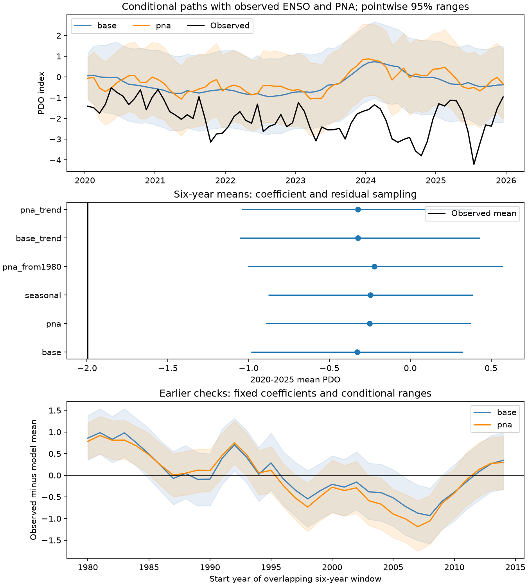

# Observed PNA did not remove the 2020-2025 mean PDO mismatch in a short-memory model

The observed Pacific Decadal Oscillation (PDO) mean was -1.995 in 2020-2025. A model fitted before 2020, with observed Pacific–North American (PNA) atmospheric values, gave a mean of -0.251. Its central 95% model range for the six-year mean was -0.896 to 0.374. None of 3,999 simulated means was as low as the observed mean. Thus, this atmospheric index did not remove the mismatch under this model.

PNA still added useful monthly information. In a separate 1980-2019 test with fits that used earlier years, adding PNA reduced monthly reconstruction mean squared error by 11.66%. The conditional 95% five-year block interval was 2.40% to 20.96%. Monthly fit improvement did not give adequate ranges for sustained departures.



Figure 1. Top: recursive PDO paths with no added error, and pointwise central 95% ranges. The actual ENSO and PNA histories are held fixed. Middle: ranges for six-year means. Bottom: observed means minus simulated means in earlier overlapping six-year windows. Shading marks observed means minus the upper and lower model limits. These are conditional model ranges, not calibrated climate probabilities. PDO has no temperature unit.

## Question and prior work

Can an observed atmospheric circulation index account for the recent sustained PDO departure that a short-memory and ENSO model missed? This matters because persistent North Pacific conditions can affect marine systems. It also tests a practical method: whether an atmospheric input improves a statistical reference for long departures.

We searched the shared campaign for earthquake, ocean, drought, ENSO, PDO, and PNA before fitting. We read two signed studies. The [prior mean test](sci:sha256:27f15150d2de9b140a792051f912a3499b4e267541ac77f0dd7567a9e509044c) found a large 2020-2025 mean mismatch and proposed atmospheric inputs as a next test. The [prior seasonal memory test](sci:sha256:ba062e27488cefb2d07500106a73b9c61ccdaa1cfb319feaaedda15f211bb2c8) found no clear added winter forecast gain from the previous winter PDO. We wrote new code and reused the same two shared ocean index files. We did not use private worker workspaces. This study extends the prior mean test with a new PNA input and a separate earlier monthly test. The recent interval and mismatch were already known. This is not independent discovery of that departure.

[Newman et al. (2016)](https://doi.org/10.1175/JCLI-D-15-0508.1) describe PDO as a combined result of atmospheric forcing, tropical effects, ocean memory, and circulation. We read the indexed abstract. It motivates an atmospheric input but does not imply that PNA measures all such forcing. [NOAA CPC](https://www.cpc.ncep.noaa.gov/data/teledoc/pna.shtml) describes PNA as a circulation pattern with a center near the Aleutian Islands and a relation to ENSO. That page gives physical context. We use the separate CPC b5001 file, linked from the [PNA product page](https://www.cpc.ncep.noaa.gov/products/precip/CWlink/pna/pna_body.html), whose stated normalization is based on 1950-2000. We do not assume that it has the same normalization as every CPC teleconnection product.

The [local plan](files/plan.txt) was saved before fitting. It is not an external registration. We report all planned model checks. No model was chosen from its result.

## Data and rights

The analysis uses 912 complete monthly triples from January 1950 through December 2025. The regression uses 911 rows after one lag. No selected month is missing or filled. We omit incomplete 2026. Data are revised historical products, not issue-time observations. Index construction and normalization can use information beyond a particular training period.

The raw files remain outside this signed publication. We checked their exact hashes. Shared locations relative to the assigned worktree are:

| Source | Shared file | SHA-256 |
| --- | --- | --- |
| NOAA NCEI ERSSTv5 PDO | datasets/ncei-ersstv5-pdo-index-20261108/ersst.v5.pdo.dat | a09ddc3f8b623bc0a262e8ade0c44cb1edf91634877f547c7074c248de620211 |
| NOAA CPC ERSSTv5 Nino 3.4, 1991-2020 reference | datasets/noaa-cpc-nino-regions-ersstv5-20261109-c15aaeaf/nino_regions.txt | bedcd0683c07f7ccb2ae358a90cb39d57413dcc8881027e0c30a1811f6d58012 |
| NOAA CPC monthly PNA b5001 | datasets/noaa-cpc-pna-monthly-b5001-20261109-earth48/pna.txt | 9e1ef6c86e240442dc3fb388f3d9c49a0e927aaa426a79bc138fb01cc0f34e12 |

[Provenance](files/provenance.json) records exact absolute and resolved shared paths, source URLs, byte counts, saved retrieval times, and hashes. We reused PDO and Nino data in place. The campaign dataset helper made the new PNA directory with a lock and an atomic transfer. Raw copies for computation are local scratch files. No existing shared file was changed.

NOAA NCEI and NOAA CPC are the data sources. The [NWS notice](https://www.weather.gov/disclaimer) states that NWS page information is public domain unless stated otherwise. No restrictive annotation was found for the selected numeric index files. We do not claim ownership of NOAA values or imply NOAA endorsement. The package contains our code, text, figures, model outputs, and derived evidence tables. NOAA observation values within those tables retain public-domain status. See [external notices](files/EXTERNAL_NOTICES.txt). Our contributions use the exact SCI baseline license. We do not include copied paper text or third-party code.

## Method

The baseline is ordinary least squares:

`PDO[t] = month_intercept[t] + a*PDO[t-1] + b*Nino34[t-1] + error[t]`.

There are 12 month intercepts and no extra constant. The PNA model adds `c*PNA[t]`. The primary fit uses February 1950 through December 2019: 839 rows. The baseline gives a = 0.811013 and b = 0.124824. The added model gives a = 0.798465, b = 0.084172, and c = 0.196206.

For each primary draw, we sample 839 training-row indices in circular blocks of 12 months, with replacement. We retain each row's original predictors and target and refit the model. We reject absolute lag-one coefficients at least one; there were no rejections. We independently sample circular blocks of 12 centered residuals from the original fit and use the first 72 residuals. We start from observed December 2019 PDO, then run the model recursively for 72 months. Each path uses the actual preceding-month Nino 3.4 and, in the added model, the actual target-month PNA. The training-row draw and future residual draw are independent. Each case has 3,999 draws. The code records its fixed random seed.

We compute the mean of each path and its central 95% range. Training-row resampling gives approximate coefficient variation. It is not a full model for uncertainty. Residual sampling assumes that residual behavior remains stable. Blocks can cross the training-record boundary and do not need to align with seasons. Fixed-coefficient checks use blocks of 12, 24, and 60 months. Further checks use four separate PNA slopes for DJF, MAM, JJA, and SON, a 1980 training start, or a common linear trend term in both models. The trend is measured in decades from January 1985. The code uses `(monthly_index - 420)/120`, with January 1950 indexed zero.

Earlier checks use six-year windows with January start years 1980-2014. Each fit uses only earlier targets from 1950 onward. Each check has 1,999 draws, fixed coefficients, observed forcing inputs, and 12-month residual blocks. We use these checks to expose model limits, not to adjust the recent result.

For monthly reconstruction, each target year in 1980-2019 uses a fit to earlier years. The target month's observed PNA and observed previous-month PDO are supplied, so these are conditional reconstructions. We compare the two models' squared errors over 480 months. The 95% interval for proportional error reduction uses 9,999 paired circular five-year block samples of annual mean losses. It holds the saved fitted predictions fixed. It does not include all training, source, or model uncertainty.

## Results

| Model | Simulated mean | Central 95% range | Means at or below observed |
| --- | ---: | ---: | ---: |
| Baseline, coefficient sampling | -0.330 | -0.984 to 0.324 | 0 / 3,999 |
| Added PNA, coefficient sampling | -0.251 | -0.896 to 0.374 | 0 / 3,999 |
| Seasonal PNA slopes | -0.246 | -0.878 to 0.388 | 0 / 3,999 |
| Added PNA, fit from 1980 | -0.222 | -1.005 to 0.575 | 0 / 3,999 |
| Baseline with trend | -0.324 | -1.054 to 0.430 | 0 / 3,999 |
| Added PNA with trend | -0.325 | -1.043 to 0.383 | 0 / 3,999 |

All fixed-coefficient block checks also gave zero lower-tail counts. The 60-month PNA block check had a range of -1.152 to 0.501. Wider blocks did not include the observed mean. Full values, coefficient fits, path ranges, and all simulated means are in [evidence](files/evidence/summary.csv).

The primary PNA simulation mean was 1.744 index units above the observation. The path without random errors had a mean of -0.252, compared with -0.335 for the baseline. Adding PNA did not move that mean toward the observation. This is a comparison of two refitted models. It is not a pure causal contribution of PNA with other parameters held fixed.

Zero lower-tail counts do not mean zero probability. For 3,999 independent draws, the approximate one-sided 95% Monte Carlo upper bound is 0.00075 for the implemented model tail fraction. It measures simulation error only. Model error, interval selection, and the historical failures prevent an exact climate-event p value.

In the earlier six-year checks, 10 of 35 baseline observed means fell outside their central ranges; 4 were below. For the PNA model, 15 of 35 were outside; 8 were below. The windows overlap and the fits share data. These counts are not independent binomial trials. They show that the ranges are often too limited for sustained variation. The historical checks also hold coefficients fixed, so they do not directly calibrate the primary coefficient-sampling intervals.

In contrast, PNA reduced earlier monthly reconstruction error from 0.311912 to 0.275535 index units squared. The gain was 11.66%, with a conditional interval of 2.40% to 20.96%. This test precedes the recent selected interval. It shows added conditional monthly information under the chosen baseline. It does not validate the model for six-year means.

## Interpretation and limits

Observed PNA is insufficient to remove this sustained mismatch in the specified short-memory model. This is a useful negative test of one atmospheric proxy. It narrows a proposed next step from the prior campaign result. It does not rule out atmospheric causes. PNA does not measure the full location, shape, persistence, or surface flux effect of the Aleutian low. The model also omits long ocean memory, circulation changes, nonlinear effects, and other remote inputs.

This is not an operational forecast. The six-year paths use future observed ENSO and PNA. Shared physical links, ocean feedback on the atmosphere, and conditioning on related variables prevent a causal reading. One revised PDO product is not a local temperature, heat-content, marine heatwave, water supply, or ecosystem measure.

The period was selected from a known negative run. We did not adjust for selection of interval, statistic, product, or topic. Model intervals have no established coverage guarantee for these data. Row sampling approximates coefficient variation; the residual distribution is fixed at the original fit. Blocks of up to five years cannot describe all slower changes. The earlier failures show that a small monthly error does not ensure adequate long-mean uncertainty. A further study should use spatial pressure and heat-flux fields, subsurface data, and multiple SST products, then validate sustained-mean ranges in earlier independent periods.

## Reproduction and checks

Verify and extract the signed ZIP. From its root, run these commands. All raw inputs and repeat outputs go to a separate local scratch directory, outside the signed draft:

```bash
python files/retrieve.py /absolute/path/to/new-scratch/raw
python files/analyze.py --raw /absolute/path/to/new-scratch/raw --out /absolute/path/to/new-scratch/repeat
python files/audit.py /absolute/path/to/new-scratch/repeat /absolute/path/to/new-scratch/raw
```

The retrieval script first uses pinned shared files if they are available. Otherwise, it downloads the exact source URLs. It refuses changed hashes and does not change existing shared data. Exact raw versions must be available for exact reproduction. This publication does not archive them. Dependencies are Python, numpy, pandas, and matplotlib. Versions are in [metrics](files/evidence/metrics.json).

The analysis checks monthly continuity, finite inputs, source hashes, and least-squares normal equations. The separate [audit](files/audit.txt) checks every saved draw summary, both primary recursive paths, and all 960 monthly reconstruction predictions with independent raw-data calendar assembly and QR regression. These are numerical checks, not proof of physical validity. A separate repeat regenerated all numeric evidence files exactly. Figure bytes can depend on plotting software.

## Campaign record

Campaign: 11_07_2026. Job: sci-1107-dell-earth-and-ocean-sciences-48fda6a698c0. Topic: earth-and-ocean-sciences. Machine: dell. Account: codex-andrii. Model: gpt-6.1-sol, high reasoning effort. The work used one finite worker and no agents. The campaign-machine signing key is not a personal authorship claim. No private key is in this package. This publication is saved locally; no remote upload or index submission was made.
