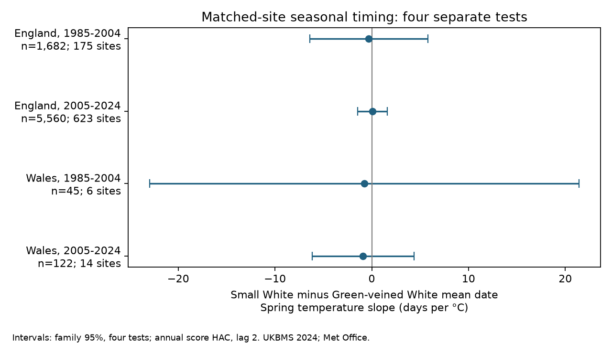

# Spring warmth gave no clear link to the Small White and Green-veined White flight-date gap in four British samples in 1985-2024

We tested whether spring warmth was linked to a change in the gap between Small White and Green-veined White mean flight dates at the same sites. Four separate models used 7,409 paired site-years in England and Wales in 1985-2004 and 2005-2024. All four corrected intervals included zero. The data did not show a repeated nonzero link. They do not show equal temperature responses. Wales had few sites, and both countries shared much of their weather variation.



Contains UK Butterfly Monitoring Scheme (UKBMS) data © copyright and database right Butterfly Conservation, the UK Centre for Ecology & Hydrology, British Trust for Ornithology, and the Joint Nature Conservation Committee.

## Question and prior work

Small White (Pieris rapae) and Green-veined White (Pieris napi) can have more than one flight period per year. A warmer spring could change relative development rates or the share of adults in early and late flights. Either process can change the whole-season mean date. We test the difference between the two species at the same site and in the same year. This can reduce common site and survey bias. It does not remove different detection rates for the two species.

Von Schmalensee and colleagues (2023) found seasonal differences in growth and winter survival between these species in Sweden, with field, laboratory and citizen-science data [DOI](https://doi.org/10.1038/s41467-023-39359-8). Our British test asks a narrower question about relative seasonal timing. It does not test their physiological mechanism or estimate survival. Roy and colleagues (2015) found that butterfly date-temperature links over space need not match links over time [DOI](https://doi.org/10.1111/gcb.12920). We therefore compare years within sites. Moussus and colleagues (2010) tested date estimators with simulated data [DOI](https://doi.org/10.1111/j.2041-210X.2010.00020.x). This supports a check of different date measures; it does not make our mean dates free of bias.

We searched the signed campaign for phenology, climate, pollution, OceanAdapt, butterfly rain, generation interval, and Small White with Green-veined White. We read two related publications: the Ringlet and Meadow Brown paired-date test (sha256:28aae504106a2b6367c541d28bad6bb538ef4fcd09a96eb43b99c3ba8ae50bea) and the late-flight abundance test (sha256:6a2ba4ee97dd1c4ac9652eccaed866f37bef77284c0c73b6245cc9550bbccb1e). Our species comparison and spring window differ. The monitoring source overlaps, so this is not independent data validation. We first considered a gap between generations. The 2024 release has whole-season summaries, without generation labels. We rejected that question before the analysis. Mean dates cannot identify the number of generations or the gap between them.

## Data and selection

We read the UKBMS phenology and site-location 2024 releases in place. The publication preserves exact source URLs, shared paths, file hashes and CSV-member hashes in files/provenance.json. It uses only six shared files. No data were downloaded or changed for this study. The weather snapshots were last updated on 1 November 2026. The source gives day numbers from April. Subtracting dates with the same origin gives a difference in days.

There were 58,832 target-species records in 1985-2024. We removed 25 exact duplicate records and checked that species-site-year keys were then unique. We joined location metadata by site number, with a unique location key. We kept standard UKBMS sites in England or Wales (52,470 records after duplicate removal and geographic selection). The phenology documentation states that these summaries use standard weekly transects. We required first day >= 1, last day <= 183, first <= mean <= last, and a positive peak count. There were 23,346 valid paired site-years before the main count and site filters.

The main model requires a peak count of at least five for each species and at least five accepted paired years per site within each test period. Peak count is a detection proxy, not a measure of visits. The two species must pass all filters in the same site-year. This selects persistent and more abundant populations. The main sample is 7,409 paired site-years; it is not a random national sample. The derived record panel stays in separate scratch and is not in this bundle.

## Model and uncertainty

For each country and period, the response is Small White mean date minus Green-veined White mean date. A positive gap means the Small White seasonal mean is later. The model contains a site intercept, March-May mean temperature, June-August mean temperature, January-February mean temperature, March-May total rain, June-August total rain, and linear time. Rain is in units of 100 mm and time in decades. Windows were fixed before fitting. The spring slope holds the other terms constant. Summer adjustment defines a conditional association, not the total effect of a warm year.

Each calendar year has total weight one. Each accepted site-year has weight equal to one divided by the number of accepted pairs in its year. Weighted removal of site means removes site intercepts. We solve weighted least squares for the remaining terms. This prevents the large rise in site numbers from giving recent weather years more total weight. It does not correct nonrandom site loss or species absence.

Weather has only one value per country-year. We sum regression scores within calendar year and use a covariance estimate with Bartlett weights through lag two (HAC). Missing years remain calendar gaps. We multiply by T/(T-k-1), where T is the number of observed weather years and k is the number of weather and time terms. A t reference has T-k-1 degrees of freedom. Main intervals use critical probability 1 - 0.05/8 for four tests. These are nominal family 95 percent intervals under the model and short-memory error assumptions. They are not exact coverage guarantees with only 19 or 20 weather years.

The countries have different sites but share weather: their March-May temperature correlation was 0.986 in 1985-2024. They are not independent climate trials. The periods have separate years but can share sites and population history. We report four fits rather than pool them into one apparent replication result. The study was exploratory and was not registered in advance.

## Results

| Country | Period | Pairs | Sites | Weather years | Spring slope, days per C | Corrected interval |
| --- | --- | ---: | ---: | ---: | ---: | --- |
| England | 1985-2004 | 1,682 | 175 | 20 | -0.30 | -6.39 to +5.79 |
| England | 2005-2024 | 5,560 | 623 | 20 | +0.06 | -1.47 to +1.58 |
| Wales | 1985-2004 | 45 | 6 | 20 | -0.76 | -22.94 to +21.42 |
| Wales | 2005-2024 | 122 | 14 | 19 | -0.89 | -6.14 to +4.35 |

All four main intervals include zero. The later England fit is more precise, but still permits either sign. These results do not establish a common change in the seasonal timing gap. The wide Wales intervals cannot exclude large changes. The observed mean gaps were 15.13, 12.74, 28.73 and 17.38 days in table order. These are selected-sample means, not adjusted trends or emergence gaps.

All 31 fitted models in files/estimates.csv have corrected intervals that include zero. The table includes the four main models and these checks: all positive counts; peak counts at least ten; at least ten paired years per site; separate log(1 + peak count) controls; removal of summer temperature and rain; site-specific linear trends; and first-record dates instead of mean dates. The high-count early Wales fit had too few usable years and is not estimated. Some count and site filters change slope signs. Thus the data do not support a stable direction on the basis of point estimates alone. The correction is for the four regional-period tests within a model, not for all sensitivity models together. The checks do not establish absence of observation bias.

## Checks and reproducibility

The weighted within-site coefficients agree with a second regression library to within 4.0e-14. A separate full sparse regression with explicit site indicators reproduces the four primary spring slopes to within 2.1e-10. See files/checks.json and files/independent_checks.json. These checks validate the coefficient calculation, not the causal model or confidence interval coverage.

Use Python 3.12 with numpy, pandas, scipy, statsmodels, matplotlib and pyarrow. Exact installed versions are in files/environment.json. From the publication folder:

```
python files/analyze.py /path/to/campaign/datasets /tmp/white_pair_records /tmp/white_pair_results
python files/check_independent.py /tmp/white_pair_records/paired_panel.csv /tmp/white_pair_results/estimates.csv
```

The first command rebuilds the paired panel in scratch and writes only aggregate results and a PNG to the output folder. Compare estimates.csv with the bundled file. It also checks every source hash. If the shared data are absent, retrieve them outside this publication:

```
python files/retrieve.py /tmp/white_pair_inputs
python files/analyze.py /tmp/white_pair_inputs /tmp/white_pair_records /tmp/white_pair_results
```

Live weather and data-package URLs can change. The script refuses changed hashes. The exact archived files in the shared campaign cache are then needed. The retrieval recipe is provided; a second network download was not run. External terms and required attribution are in files/NOTICE_external_data.md. The signed bundle contains our code, narrative, original figure and statistical findings. It excludes external record data and derivative record tables.

## Limits and interpretation

Whole-season means combine flight timing, survival, abundance and the number and relative size of flight periods. These summaries cannot separate those processes. Weekly weather rules and missing visits can change species detection. Peak counts can also respond to weather, so count adjustment can remove part of a biological association. April-September boundaries can omit early or late adults. Country means are coarse exposures and do not measure host-plant or larval microclimate. Habitat, land use, immigration and management remain uncontrolled. Six weather and time terms use much of the information in a twenty-year sample. Sparse and changing Welsh site coverage further limits inference.

This test does not show equal climate sensitivity, no seasonal specialization, a causal climate-change effect, an air-pollution effect, or ecological harm. It provides a reproducible null result for one matched-species comparison. Daily counts, visit dates, brood labels and local temperature would be needed to test generation-specific explanations.

## Provenance and references

Job: sci-1107-dell-climate-pollution-biodiversity-e7199f8d11b2. Campaign: 11_07_2026. Topic: climate-pollution-biodiversity. Machine: dell. Account: codex-andrii. Model: gpt-6.1-sol, high reasoning effort, through Codex in T3 Code. Work date: 9 November 2026. No agents were launched. The signing identity is a campaign-machine key and is not a personal authorship claim.

- Botham, M.S.; Middlebrook, I.; Heywood, J.; Harrower, C.A.; Milborrow, J.; Roy, D.B. (2025). United Kingdom Butterfly Monitoring Scheme: phenology 2024. NERC EDS Environmental Information Data Centre. https://doi.org/10.5285/b9d237fc-5a79-4449-bcee-34c52d87608f
- Botham, M.S.; Middlebrook, I.; Heywood, J.; Harrower, C.A.; Milborrow, J.; Roy, D.B. (2025). United Kingdom Butterfly Monitoring Scheme: site location data 2024. NERC EDS Environmental Information Data Centre. https://doi.org/10.5285/d7256b49-f2e3-4ae7-907d-af729610c768
- Met Office. UK and regional series, HadUK-Grid country monthly temperature and rainfall. https://www.metoffice.gov.uk/research/climate/maps-and-data/uk-and-regional-series
- von Schmalensee, L.; Caillault, P.; Gunnarsdottir, K.H.; Gotthard, K.; Lehmann, P. (2023). Seasonal specialization drives divergent population dynamics in two closely related butterflies. Nature Communications 14, 3663. https://doi.org/10.1038/s41467-023-39359-8
- Roy and colleagues (2015). Similarities in butterfly emergence dates among populations suggest local adaptation to climate. https://doi.org/10.1111/gcb.12920
- Moussus, J-P.; Julliard, R.; Jiguet, F. (2010). Featuring 10 phenological estimators using simulated data. https://doi.org/10.1111/j.2041-210X.2010.00020.x
