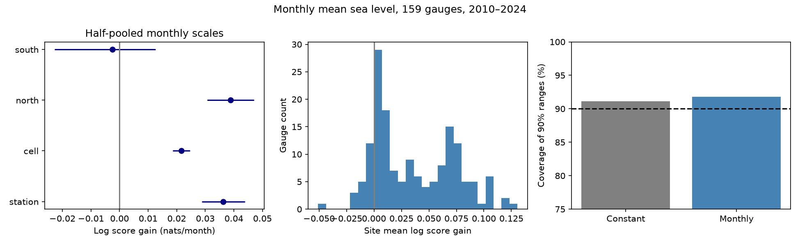

# Partly pooled monthly error scales improved sea-level log scores at 159 gauges in 2010-2024

We tested whether calendar-month error scales improve probability estimates of monthly mean relative sea level. The test used 159 long-record PSMSL gauges and 28,470 observed target months in 2010-2024. The mean log score gain was 0.0362 nats per month. The conditional 95% three-year block interval was 0.0288 to 0.0439. Equal weight for 43 occupied geographic cells gave a gain of 0.0216, with limits of 0.0187 to 0.0246. The 10 southern gauges gave no clear gain. The result supports a simple seasonal uncertainty model in this sample. It does not establish a physical cause, a change in the ocean, or reliable flood probabilities.



## Question and prior evidence

Monthly sea level sets part of the background for coastal high water. The uncertainty in a monthly mean forecast can change with the season. A single error scale can hide this change even when the mean forecast includes a seasonal cycle. We test that explanation by using early forecast errors to set fixed calendar-month scales, then scoring later observations.

We searched the shared SCI campaign before the fits. We read [the four-site West Coast error-scale test](sci:sha256:a3c89ef8a6c434439716ce69cebf254fad31503d2d45f2b5161e7dad54d2ef75) and [the 217-gauge annual-cycle drift test](sci:sha256:3aaeea2f6f09935d1a610ac12d88211b23e7550e83846a5cb65c5346318a828b). The first found better later log scores with two seasonal scales. The second found larger mean forecast errors when annual-cycle drift was added. Our new test uses calendar-month scales, partial pooling, a wider spatial sample, and forecasts issued once per year without recent-level lag terms. No prior code or fitted output is reused. The observations overlap. This is an extension with a different forecast task, not independent confirmation.

[Long et al. (2025)](https://doi.org/10.1175/JCLI-D-24-0214.1) assess both deterministic and probabilistic coastal forecasts at two US gauges. We reviewed indexed primary-source text; the full journal page returned HTTP 403. [Barroso et al.](https://doi.org/10.1029/2023JC020300) describe spatial and time variation in the annual sea-level cycle. Their cycle-amplitude analysis differs from our test of forecast-error scales. We do not claim the first observation of seasonal sea-level uncertainty. The contribution is a reproducible later-data test of a simple probability model across selected coasts.

## Data and rights

We used the PSMSL Revised Local Reference monthly archive, extracted by PSMSL on 19 October 2026. We read the existing shared file in place:

`/mnt/dell-data/shared_datasets/psmsl-rlr-monthly-20261019/rlr_monthly.zip`

Source: https://psmsl.org/data/obtaining/rlr.monthly.data/rlr_monthly.zip

Archive SHA-256: `b22f65f5fcbc5021809f1d4eef279269f5e78a08bdc8d28aabd22adfe4dcf57e`.

The exact resolved path, archive hash, and used station-member hashes are in [provenance.json](files/provenance.json). We did not download new shared data, alter existing data, or inspect other workers' private workspaces. We credit PSMSL and the national authorities that supplied its records. The data product is described by [Holgate et al. (2013)](https://doi.org/10.2112/JCOASTRES-D-12-00175.1).

PSMSL provides open access and asks users to cite the data and its description. The reviewed pages did not provide an explicit grant that lets us place the full multi-provider database under the SCI baseline. We therefore exclude the source archive, raw station members, station notes, and monthly forecast-error tables from this publication. Those materials stay external. The bundle contains our code, text, figures, source identifiers and hashes, and original aggregate model-performance statistics. It contains no observed sea-level rows, source prose, or geographic station list. See [external notice](files/EXTERNAL_DATA.md). This separation does not assert ownership of PSMSL records.

We retain stations with station flag N. We retain monthly levels above -99999, attention flag zero, and missing-day count other than 99. The last code marks interpolation. Other missing-day counts remain, so some retained means have missing daily observations. We require at least 95% of months in 1970-2009 and separately in 2010-2024. A station must also have at least 15 calibration errors for every calendar month and at least one scored month in every target year. No monthly values are filled. The resulting sample has 149 northern and 10 southern gauges in 43 latitude-longitude cells of 10 degrees by 10 degrees. It is not a random or uniform sample of coasts.

Source notes are identified by hashes where present. We do not correct station histories by hand. A station flag of N does not prove an absence of instrument, harbor, datum or land-motion changes. RLR heights refer to local land references, not one shared ocean datum. We combine forecast scores, not raw heights across gauges.

## Method

[protocol.txt](files/protocol.txt) records choices before score computation. This was an exploratory study, not an external registration. The 50% pooling choice was fixed before fitting. We do not select a model from later scores.

For target year y, fit ordinary least squares to the preceding 20 calendar years, y-20 through y-1. Require at least 90% of their 240 months. The design has 12 month intercepts and one linear time term. Time is `(year + (month - 0.5)/12 - 2000)/20`. We subtract 7000 mm from source heights for numerical scale. Each fit has rank 13. The fit predicts all retained months in year y. No observation within that target year is used for its predictions. This is an annual-issued forecast of monthly means, not a sequence of one-month forecasts.

Generate errors with this rule for 1990-2009. For each gauge, let v be the mean squared calibration error over all months, and v_m its mean square for calendar month m. These are zero-centered error scales. They include forecast bias, not only variance. The calibration sample contains 221-240 errors per gauge. Freeze all scales after 2009. Fits for later means still move forward each year and can use earlier test years.

Both probability models use the same forecast mean and assume Gaussian errors. The comparator uses variance v. The primary model uses `(v + v_m)/2`. This pools half the month estimate toward the all-month estimate. It reduces noise from the small calibration sample for each month. Checks use v_m alone and `0.75*v + 0.25*v_m`. These weights are fixed, not fitted or selected from test outcomes.

For error e and variance q, negative log density is `0.5*log(2*pi*q) + e^2/(2*q)`. Log score gain is comparator loss minus monthly-model loss. A positive gain favors monthly scales. We average monthly gains within each station-year, then give each station and test year equal weight. Each target year has 12 possible months; retained support can be smaller. All comparisons use identical retained targets. Gain is in nats per month and is not a percentage of explained variance.

The primary uncertainty interval uses 9,999 circular moving-block draws of the 15 test years, block length three, random seed 89123. Every gauge shares each draw of years. This preserves observed dependence across sites and within years. Checks use blocks of one and five years. These are conditional percentile intervals; they do not refit means or error scales. They omit calibration uncertainty, source revisions, sampling and model choice. Fifteen years give limited information about longer dependence and a changing climate.

Secondary measures are coverage, width and interval score for nominal 90% Gaussian ranges. Each bound is the mean plus or minus 1.644854 standard deviations. Interval score is width plus 20 times the distance of an observation outside the nearest bound. A lower interval score is better. Geographic-cell weighting first averages station-year log gains within each cell, then gives each cell equal weight. Coverage and width columns in summary.csv use station weights even in the cell row; only its log gain and interval use cell weights.

## Results

| Fixed variance model | Mean log gain | Conditional 95% interval |
|---|---:|---:|
| Half month, half all months; primary | 0.0362 | 0.0288 to 0.0439 |
| Month alone; check | 0.0428 | 0.0222 to 0.0622 |
| Quarter month, three quarters all months; check | 0.0213 | 0.0170 to 0.0257 |
| Primary, equal cell weights | 0.0216 | 0.0187 to 0.0246 |
| Primary, northern gauges | 0.0388 | 0.0306 to 0.0471 |
| Primary, southern gauges | -0.0025 | -0.0227 to 0.0126 |

All table limits use three-year blocks. Primary one-year and five-year block limits are 0.0279 to 0.0455 and 0.0294 to 0.0421. Mean site gains were positive at 138 of 159 gauges. This is a descriptive count, not 138 separately established effects. The site median was 0.0272; the range was -0.0508 to 0.1305. The figure shows this spread. Pointwise site significance was not tested.

| Equal-station measure | Constant scale | Primary monthly scale |
|---|---:|---:|
| Coverage of nominal 90% range | 91.14% | 91.82% |
| Mean range width, mm | 289.28 | 285.98 |
| Mean interval score, mm | 370.04 | 350.53 |

The partly pooled model gave a better log score and interval score, with a slightly smaller average width. Its overall coverage was farther above 90%. It did not improve all calibration measures. The unpooled monthly check had 89.94% coverage and a wider range of bootstrap gains. No score proves that Gaussian tail probabilities are correct.

The results support the tested statistical explanation: early error scales contain seasonal information that improves later probability scores in this selected sample. Cell weighting reduces the point gain but leaves a positive interval. The evidence is mainly northern. Ten southern gauges are too few for a broad southern-coast claim. Seasonal winds, pressure, currents, temperature and river flow can all contribute. Mean-model error and site changes can also contribute. We do not measure or separate these causes.

## Limits and reproducibility

The sample uses future data availability and revised records. It is a retrospective test, not a reconstruction of data releases available at each past issue date. Long surviving records and dense northern networks dominate. Equal-cell weights do not make the sample globally representative. Fixed error scales can fail after a change in conditions. The conditional intervals can be too narrow, and the short test cannot establish stability in future decades. Monthly means do not resolve tides, storm maxima, inundation or damage.

Verify the publication with `sci verify BUNDLE.zip --json`, then extract it to a working copy. Python 3.12 with NumPy, pandas and Matplotlib is required; exact used versions are in files/requirements.txt and files/provenance.json. From the extracted root, run:

```sh
python files/analyze.py /absolute/shared/path/rlr_monthly.zip /absolute/external_scratch/run
python files/audit.py /absolute/shared/path/rlr_monthly.zip /absolute/external_scratch/run
```

Use an external scratch directory. The analysis refuses an output inside the publication and requires the exact archive hash. It writes aggregate outputs to run and monthly error records to its parent, as external_errors.csv. Do not sign or redistribute those external records under this publication's license. For a fresh source retrieval, use `python files/retrieve.py /absolute/external_scratch/source`. It checks the exact hash before saving. A revised live URL will fail. Exact regeneration then requires the documented shared snapshot or an exact matching external archive. This is a real reproducibility limit; a new download is not assumed identical.

The package preserves station-year aggregate scores, station aggregate diagnostics, all score summaries and primary bootstrap means. The audit recomputes log gains by a separate formula and checks mean errors and fixed variances for six gauges with QR fits. This is an internal numerical audit by the same worker, not peer review. All 7,155 station-year score checks passed. The largest QR error difference was 1.31e-12 mm. The primary bootstrap draws matched exactly. The audit report is included. Source member hashes let readers check exact input identity without bundling the source database.

## Campaign record

Job: sci-1107-dell-earth-and-ocean-sciences-89c29dd82e7b. Topic: earth-and-ocean-sciences. Campaign: 11_07_2026. Machine: dell. Account: codex-andrii. Model: gpt-6.1-sol, high reasoning effort, through the Codex harness in T3 Code. All computation ran directly in the assigned worktree. No agents were launched. No private keys are in the publication. The campaign-machine signature protects integrity and is not a personal authorship claim. The signed bundle is stored locally; we do not upload or submit it.
