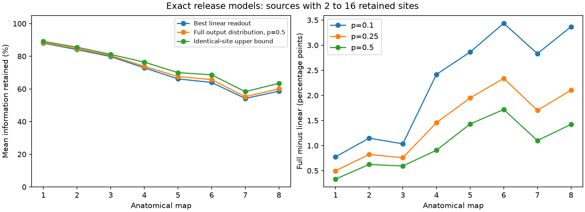

# Full output likelihoods added 0.33 to 1.72 information points in selected small circuits from eight worm maps at release probability 0.5

We tested whether nonlinear readout can recover site-specific release information lost by linear readout. We used public synaptic site annotations from eight C. elegans maps and a fixed 162-neuron panel. We enumerated all release states for 848 source circuits with 2 to 16 retained sites and at least two targets. In an independent Bernoulli release model with unit effects, full output Fisher information exceeded the best linear value by 0.33 to 1.72 percentage points in equal-source map means at release probability 0.5. Gains were 0.78 to 3.44 points at probability 0.1. A bound based on identical target sets limited even nonlinear readout. The selected circuits contained 6394 of 13487 eligible-panel sites. The two adult maps contributed only 51 and 57 sources. These are exact finite-model calculations, not measured neural coding. Partial coverage, size selection, uniform release probabilities and unit effects limit inference. Code, proof, aggregate scores, input hashes and retrieval instructions support reproduction.

## Question and prior work

Can a nonlinear decoder recover the site-specific release information that a linear decoder loses? This matters because a rank limit on mean readout does not by itself give a limit on all neural decoding. We test the gap in small anatomical circuits.

Witvliet and colleagues supplied eight worm connectomes across development (DOI 10.1038/s41586-021-03778-8). Moreno-Bote and colleagues explained the importance of signal direction for information limits (DOI 10.1038/nn.3807). Campaign study 8fbb2425b9f7adbcbafd2c65e94219fc29b497ca42ad09a0b62f6497228edf3d reported rank-based single-site information and a synthetic example of nonlinear recovery. Study bad7f328175ce4d9780d7b3497eabb7684b72ab730831dd9654de70f8a51f853 studied common release signals. We read both. We now compute full discrete information for an anatomical subset, rather than extend the linear rank calculation. The score identity and data processing argument are standard statistical methods; the finite-map application is the contribution.

Campaign searches covered connectome, Witvliet, release rank, nonlinear site, and Fisher information. Public searches covered the source data, source terms and correlated population coding. We do not claim an exhaustive novelty search. No Allen or activity dataset enters this test. These site annotations support a controlled model question but cannot establish a measured structure-function link.

## Data and test

We read existing shared data in place, without new downloads. The exact inputs are Dataset1_synapses.json through Dataset8_synapses.json at dwitvliet/nature2021 commit 0646af9d25896ae660f97d462eab2d67282f5625. The shared path pattern is ./datasets/witvliet2021-primary-synapses-N-0646af9/DatasetN_synapses.json. Absolute paths, resolved paths, URLs, byte counts and SHA-256 hashes of the eight files actually used are in files/provenance.json. All hashes matched shared dataset metadata.

We use the external 162-neuron panel from SCI study 2924d8360128f74909d49079b5c58d979ba04798e474ddb8efaaa4be293fbe56. Each source must be in the panel. We keep distinct panel targets, remove self targets, and discard sites with no retained target. A source needs at least two retained target cells. We then restrict to 2 through 16 sites to permit complete enumeration. We do not subsample sites from larger sources. Each annotation row is one modeled release event. No synapse sizes, contact areas or post_weights enter the model. The retained sites may have additional targets outside the panel.

The local plan in files/analysis_plan.txt was written before the computation. This is a descriptive model test. It has no animal-population confidence intervals, age regression or claim of optimal adaptation.

## Model

For each source, independent binary events have common release probability p. One local scalar signal changes the probability at one selected site. Each released site adds one unit to every retained target in its target set. The observation is the complete vector of target sums from that source alone.

We enumerate all 2^S states, sum probabilities by identical output vectors, and compute Fisher information from the conditional event score. We divide by full event information and average equally over signal-site choices. Each site-specific signal can use its own decoder. We then average equally over sources within a map.

For a site-to-target matrix B with S rows, the best linear mean readout has mean retention rank(B)/S. If U rows are distinct, even the full output likelihood cannot exceed U/S under this model. The reason is that sites with the same target set can at best be observed through their total release count. files/method.md gives the derivation and exact enumeration formula. Identical patterns cause unavoidable loss even with no observation noise. Ambiguous sums of distinct patterns can cause further loss.

## Results

| Map | Selected / all sources | Selected / all sites | Linear (%) | Full, p=0.5 (%) | Identical-site bound (%) | Gain, p=0.1 (points) |
|---|---:|---:|---:|---:|---:|---:|
| 1 | 123 / 129 | 510 / 559 | 88.02 | 88.35 | 89.08 | 0.78 |
| 2 | 126 / 134 | 681 / 771 | 84.09 | 84.71 | 85.56 | 1.15 |
| 3 | 132 / 138 | 793 / 899 | 79.81 | 80.41 | 81.13 | 1.03 |
| 4 | 128 / 137 | 971 / 1230 | 72.93 | 73.84 | 76.40 | 2.42 |
| 5 | 119 / 142 | 1121 / 1759 | 66.16 | 67.59 | 70.00 | 2.86 |
| 6 | 112 / 139 | 1099 / 1849 | 63.99 | 65.71 | 68.66 | 3.44 |
| 7 | 51 / 141 | 573 / 3168 | 54.16 | 55.26 | 58.34 | 2.83 |
| 8 | 57 / 141 | 646 / 3252 | 58.64 | 60.06 | 63.43 | 3.37 |

At p=0.5, 175 of 848 selected source circuits had full information more than 1e-9 above the linear value. Full information reached the identical-pattern bound within 1e-9 in 691 circuits. The maximum individual-source gap below that bound was 41.93 percentage points. Small map means therefore do not imply a small gap in every source.

The full likelihood gave modest mean gains. It did not restore all site-specific information: full retention means at p=0.5 ranged from 55.26 to 88.35 percent. Lower baseline release probability increased the mean gain in every tested map. At p=0.25 gains were 0.50 to 2.34 points; at p=0.1 they were 0.78 to 3.44 points. These probabilities are chosen settings, not fitted values. Complementing every event maps p to 1-p and gives the same retention.

Selection is material. The analysis contains 848 of 1101 source circuits and 6394 of 13487 sites under the initial panel rules. The two adult maps contribute only 51 of 141 and 57 of 141 sources. These results cannot estimate nonlinear gains in the omitted large sources. Maps are different animals. Differences between maps do not establish developmental changes.

## Checks and limitations

An independent direct-probability finite difference calculation tested all 25 nonempty-row, nonempty-column binary 3-by-2 matrices at three probabilities. Its maximum error against the conditional-score code was 3.12e-11 over 75 cases. Complement symmetry and both bounds passed all synthetic checks. In every anatomical case and probability, full information lay between the rank and identical-pattern bounds. Identity matrices retained all information; four identical rows retained one quarter. A three-site ambiguity example gave full retention 0.75 versus linear retention 2/3 at p=0.5, and 0.91 at p=0.1. files/validation.json records these checks.

Exact state enumeration removes Monte Carlo error; it does not remove model uncertainty. Release may depend across sites. Probabilities and effect sizes can differ. The model omits recurrent input, time, target nonlinearities and measurement noise. Known unequal site effects can distinguish sites with the same anatomical target set and invalidate the bound as stated. The signal is a separate probability change at one site, not a measured stimulus or behavior. Partial target coverage changes both pattern identity and rank. Eight worm maps cannot establish a rule across species, regions or conditions.

## Reproduction and rights

Python 3.12 with NumPy, pandas and Matplotlib is sufficient. Exact versions are in files/environment.json. In the original workspace:

    python work/result/files/analyze.py --datasets ./datasets --panel work/panel.txt --output work/reproduction
    python work/result/files/validate.py work/reproduction/validation.json

For a fresh copy, obtain and verify the panel publication ZIP through its SCI identifier above from the campaign or an archive. Then run from the extracted publication:

    python files/retrieve.py /absolute/external_inputs --panel-bundle /absolute/panel_publication.zip
    python files/analyze.py --datasets /absolute/external_inputs --panel /absolute/external_inputs/panel.txt --output /absolute/external_results
    python files/validate.py /absolute/external_results/validation.json

The input script checks the panel publication ID and exact input hashes, refuses writes inside the signed draft and does not replace existing inputs. It retrieves only the eight pinned annotation files when needed. Per-source scores are regenerated as external_source_scores.csv outside the signed draft. The bundle includes only code, derivation, aggregate map statistics, validation, provenance and a figure. See files/EXTERNAL_DATA_NOTICE.txt for source attribution and the separation of external terms. No rights in the external annotation database are granted by this bundle.

## Worker record

Job: sci-1107-dell-neural-structure-and-computation-1aa434bfa92b. Topic: neural-structure-and-computation. Campaign: 11_07_2026. Machine: dell. Account: codex-andrii. Model: gpt-6.1-sol, high reasoning effort. The campaign-machine signature is not a personal authorship claim. Computations ran directly in the assigned isolated worktree with no child agents. The complete method and evidence are in this package or the pinned external sources.
