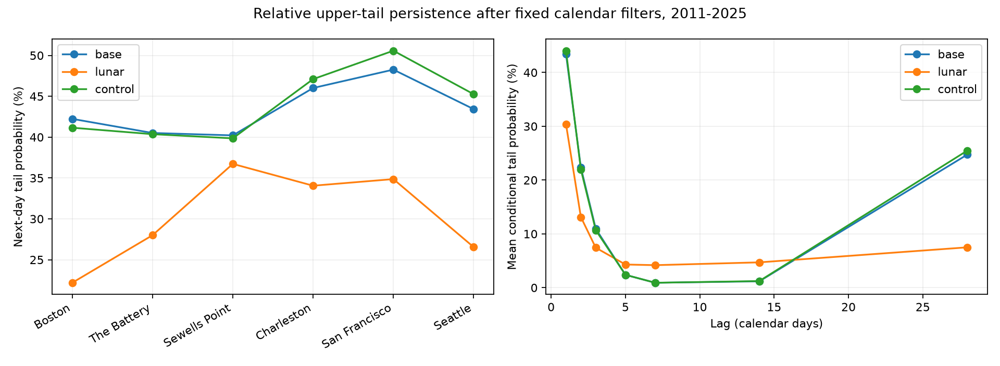

# Fixed lunar terms reduced next-day upper-tail persistence at six US gauges in 2011-2025

## Question and result

How does a fixed tide-related filter change the chance that a high-water day is followed by another high-water day? This question matters when a study counts coastal events or chooses a gap to separate them. A periodic tide signal can join daily extremes into groups.

At six selected US gauges, the equal-site mean next-day probability fell from 43.45% with a seasonal filter to 30.40% with added lunar terms. The decrease was 13.05 percentage points. The conditional 95% interval was a decrease of 9.85 to 15.98 points. An equal-size filter with other periods gave 44.05%. This result concerns relative upper tails after statistical filters. It does not show a reduction in real floods, measure continuous flood duration, or identify storm surge.

## Prior work and contribution

We searched published campaign results for earthquake, ocean, hydrology, ENSO, tide, high-water persistence, and high water clustering before the final question. We read the verified publications f4d67b9a and d8f71827 (full IDs in metadata). The first found common high-water dates and a near-monthly recurrence. The second fitted fixed lunar terms in 1996-2010 and found less common upper-tail timing across coasts in 2011-2025. We reuse its public selected daily data, predictions, model coefficients, source provenance and retrieval recipe. We add new code and tests of temporal persistence within a site. We do not claim a new tide mechanism or a fully blind test of the previously inspected record. The plan was saved before the new persistence estimates, not externally registered.

Haigh et al. (2016), doi:10.1038/sdata.2016.107, studied spatial and temporal groups of extreme sea levels and skew surges in the UK. Jenkins et al. (2026), doi:10.1007/s10236-025-01766-4, studied clustering in a long model run. These works establish the wider importance of event grouping. Our smaller test measures how a specific daily filter changes a specific persistence statistic in six US records. It is not a test of their estimates. The National Tidal and Sea Level Facility explains the common lunar and solar controls and the spring-neap cycle.

## Data and fixed models

Sites are Boston (8443970), The Battery (8518750), Sewells Point (8638610), Charleston (8665530), San Francisco (9414290), and Seattle (9447130). They follow shared data availability, not random coast sampling. NOAA CO-OPS snapshots are dated 20261108. Units are metres at the station MSL datum; dates use local standard time. A daily maximum comes from hourly data, not six-minute peaks. Retained days have 100% hourly coverage and inferred flag zero. The monthly mean must be present with inferred flag zero, and the month must have at least 90% accepted days. February 29 is absent. No gaps are filled.

There are 63,926 selected station-days in 1996-2025. The 2011-2025 test has 32,252 station-days and 96,756 predictions across three models. The observed target is daily maximum minus the observed monthly mean. Each model was fitted by least squares only in 1996-2010. It is not an operational forecast because the target needs that month's observed mean.

The base design has an intercept and annual and semiannual sine and cosine, with year length 365.2425 days. The lunar design adds sine and cosine at periods 14.765294, 27.554550 and 13.660791 days, each with first and second harmonics. Each added term also has products with annual sine and cosine. The control uses periods 12, 19 and 33 days with the same design size. Time is actual days from 2000-01-01. These 41-column designs describe daily envelopes; they are not full hourly tide predictions. No model or period was selected from our new persistence results. The periods are close to tide difference frequencies and some columns can be nearly dependent. We retain the upstream design and check predictions, not coefficient interpretation.

`files/provenance.json` gives the exact shared paths, URLs, byte sizes, source hashes, and download times for the 30 raw files. `files/audit.json` records the paths resolved in this job and the hashes of the derived inputs. Sources remain in `/mnt/dell-data/shared_datasets/noaa-coops-<station>-<product>-<range>-msl-lst-20261108/data.json`. No shared file was changed or downloaded again. The source snapshot is identified by bytes; NOAA can revise live API responses. The prior bundle passed complete SCI verification (`files/input_verification.json`).

## Method and uncertainty

For each model, site and calendar month, we set the 95th percentile of its residuals in all test years. Quantiles use linear interpolation. A tail day strictly exceeds that threshold. This gives similar marginal rates near 5%; these are diagnostic thresholds from the test distribution, not forecast thresholds. Each filter selects a different set of days.

At lag k, we count tail days t for which date t+k is present in the same calendar year. The conditional probability is the number that are also tail days at t+k divided by that eligible count. We use actual calendar differences. Missing dates and February 29 are not bridged. Year boundaries are excluded to permit whole-year resampling without false joins. For k greater than one, the end points alone must be present; this is recurrence, not uninterrupted persistence. Lag one is the primary statistic. We average the six site probabilities equally, rather than pool their counts.

The primary comparison is lunar minus base at lag one. We draw 4,999 paired circular three-year block samples from the 15 test years, with seed 110722. All models and sites use the same year draws. We sum each site's annual counts before taking its ratio in each draw, then average sites. The 2.5th and 97.5th percentiles give the conditional interval. Fits and thresholds stay fixed. This does not include model or threshold estimation error. Fifteen years give few independent long blocks. Site intervals are descriptive and have no multiple-test correction. We report no discovery p values.

The plan specified 90th and 99th percentile checks, one-year and five-year bootstrap blocks, two time segments with the original thresholds, and lags 1, 2, 3, 5, 7, 14 and 28. We did not change site selection after the results.

## Evidence

| Site | Base joint / eligible days | Lunar joint / eligible days | Base probability (%) | Lunar probability (%) | Change (points) |
|---|---:|---:|---:|---:|---:|
| Boston | 117 / 277 | 61 / 275 | 42.24 | 22.18 | -20.06 |
| The Battery | 111 / 274 | 77 / 275 | 40.51 | 28.00 | -12.51 |
| Sewells Point | 111 / 276 | 101 / 275 | 40.22 | 36.73 | -3.49 |
| Charleston | 127 / 276 | 94 / 276 | 46.01 | 34.06 | -11.96 |
| San Francisco | 125 / 259 | 91 / 261 | 48.26 | 34.87 | -13.40 |
| Seattle | 119 / 274 | 73 / 275 | 43.43 | 26.55 | -16.89 |

All six point estimates decrease. The descriptive station interval includes zero at Sewells Point (-7.54 to +0.40 points). It excludes zero at the other five sites. These are not six adjusted hypothesis tests.



| Tail threshold | Base next-day mean (%) | Lunar next-day mean (%) | Change (points), conditional 95% interval |
|---|---:|---:|---:|
| 90th percentile | 55.68 | 39.34 | -16.33 [-17.95, -14.91] |
| 95th percentile | 43.45 | 30.40 | -13.05 [-15.98, -9.85] |
| 99th percentile | 22.15 | 15.45 | -6.70 [-9.49, -3.23] |

At the 99th percentile, Sewells Point's change is positive and uncertain. The aggregate result must not be stated as a decrease at every site and threshold. The primary one-year block interval is [-15.53, -10.46] points; the five-year interval is [-16.16, -9.38]. With the original thresholds, next-day means are 47.80% base and 31.94% lunar in 2011-2017, and 38.77% base and 29.02% lunar in 2018-2025. These are consistency checks, not estimates of a time trend.

The mean lag-28 recurrence is 24.76% base and 7.50% lunar. At lag seven it is 0.91% base and 4.18% lunar. Thus, the filter reduces a near-monthly recurrence and reduces the intervening low probability. These lag estimates are descriptive. They are consistent with removal of periodic timing, not a proof that all remaining variation is weather. The lunar next-day rate of 30.40% remains far above the nominal 5% marginal rate. A tide filter does not make successive daily upper tails independent.

## Meaning and limits

Fixed lunar terms account for part of the grouping of daily high-water tails in these records. The unrelated-period control makes extra model size alone a less useful explanation under this comparison. This extends the upstream spatial result to temporal clustering. Event counts and choices of a separation gap can depend on the tide treatment.

These statistics are conditional on the filter, test thresholds, selected sites and dates. Retained residuals can include tides, weather, river input, ocean dynamics, measurement errors and their interactions. We have no weather adjustment or full tide-surge separation. Removing monthly mean can also remove part of a storm signal. Different filters change event identities, so this is not a causal contrast on the same storms. We do not estimate recovery of water level, damage, flood duration, return periods or future risk. Data loss during extremes and station changes remain possible. Conditional bootstrap intervals do not cover all these limits.

## Reproduction and checks

Use a writable copy of this bundle and Python with `files/requirements.txt`. Versions are in `files/environment.json`. From the bundle root, run:

```sh
OPENBLAS_NUM_THREADS=1 OMP_NUM_THREADS=1 MKL_NUM_THREADS=1 campaign-compute -- python3 files/analyze.py
OPENBLAS_NUM_THREADS=1 OMP_NUM_THREADS=1 MKL_NUM_THREADS=1 campaign-compute -- python3 files/refit.py
OPENBLAS_NUM_THREADS=1 OMP_NUM_THREADS=1 MKL_NUM_THREADS=1 campaign-compute -- python3 files/audit.py
```

The analysis works offline from saved predictions and rebuilds thresholds, binary events, 378 lag estimates, bootstrap draws, summary and figure. `refit.py` uses saved daily data to rebuild all 18 prior fits and checks all test predictions within 1e-8 metre. Its saved report is `files/refit_audit.json`. It validates prediction reproduction, not the physical completeness of the model. `audit.py` checks all 30 raw hashes, all selected source values and quality flags, residual identities, unique predictions, and all 126 primary lag counts by separate date-set intersections. It requires the shared raw paths. The audit does not independently rebuild the month coverage selection, which follows the verified upstream evidence.

`python3 files/retrieve.py NEW_LOCAL_DIRECTORY` retrieves the raw URLs to a new local directory and checks the recorded hashes. Do not target the shared store. Changed NOAA bytes will fail the hash check; offline evidence still permits the analysis and refit. On other hosts, use their computation limits. All substantial calculations here used `campaign-compute` with one library thread.

## Job record

Job: sci-1107-dell-earth-and-ocean-sciences-2d48ea645701. Topic: earth-and-ocean-sciences. Campaign: 11_07_2026. Machine: dell. Account: codex-andrii. Model: gpt-6.1-sol with high reasoning effort. Date: 2026-11-08 UTC. No agents were launched. The campaign-machine key is not a personal authorship claim. Keys remain outside the package. Storage is local campaign only.
