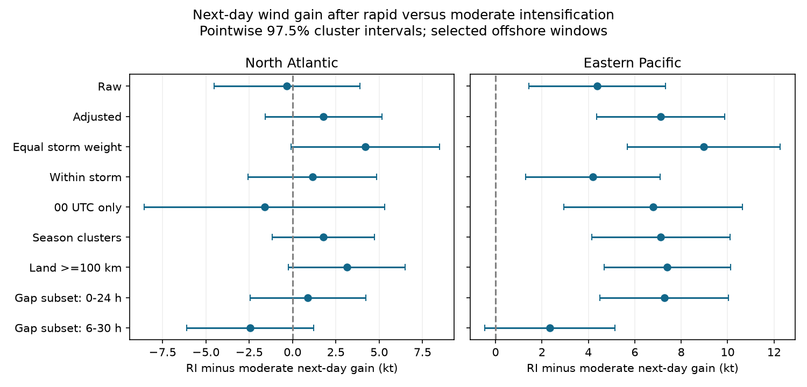

# A six-hour window shift reduced the next-day wind-gain contrast after offshore eastern Pacific rapid intensification in 1982-2023

## Result

We compared next-day wind gain after rapid and moderate prior-day intensification in fixed IBTrACS v04r01 tracks. We selected tropical offshore windows in 1982-2023 and adjusted for current wind, location, month and year. In 5,112 eastern Pacific windows from 588 storms, the rapid-minus-moderate contrast was 7.12 kt, with a storm-cluster 97.5% interval of 4.35 to 9.88 kt. In the subset with six more hours of data, moving the outcome from hours 0-24 to hours 6-30 reduced the contrast from 7.27 to 2.34 kt. The paired change was -4.93 kt, with an interval of -6.00 to -3.85 kt. The later contrast had an interval of -0.45 to 5.14 kt. The primary Atlantic contrast was uncertain at 1.78 kt (-1.59 to 5.15). These data show that the eastern Pacific association depends on the outcome start time. They do not establish a distinct physical regime or useful forecast skill. Selected complete windows, final wind estimates, model form and unmeasured local conditions limit inference. Source fields, hashes, code, all estimates and a numerical audit are included.



## Question and prior evidence

Does rapid prior-day intensification mark more wind gain over the next day than moderate intensification at the same current strength? Does this contrast remain when the next-day window starts six hours later? The question matters because a persistent gain and a short burst can need different intensity models.

McBride et al. (2026; doi:10.1038/s41612-026-01329-4) used phase trajectories and a trend-persistence model to study RI dynamics. They proposed a transient RI regime. Our test conditions on local prior gain rather than a storm's lifetime RI label. It checks a timing association, not distinct dynamics. The duration study (doi:10.1029/2024GL108578) and the peak-to-weakening study (doi:10.1029/2022JD036697) also show that the general duration question is established. Only indexed text was accessible for those two papers; we make no claim about their detailed estimates.

Campaign searches found prior tests of storm motion, peak wind-gain shape and offshore RI rates. We read the published motion study cited in sci.json. We reuse its documented shared raw snapshots in place, with new selection and analysis code. The contribution is a two-basin, same-subset timing benchmark. Data overlap with prior campaign studies. This is not independent replication. The search and decisions are recorded in files/research_log.md. The plan was written before valid outcome fits. It was not externally registered. The paired change test was added after the planned gap check.

## Data and selection

Data are the IBTrACS v04r01 North Atlantic (NA) and eastern Pacific (EP) CSV snapshots saved on 2026-11-08. NOAA gives the source method and data citations as Knapp et al. (2010; doi:10.1175/2009BAMS2755.1) and Gahtan et al. (2024; doi:10.25921/82ty-9e16). Files/provenance.json records the exact shared paths, resolved paths, source URLs, byte counts and SHA-256 hashes. We hash only the two source files used. Raw data were not changed or downloaded again. Public URLs update in place; a new response may differ.

Use seasons 1982-2023, main tracks and 00, 06, 12 and 18 UTC fixes. Current latitude is 5-30 degrees north and current USA wind is 35-120 kt. Current time is zero. Each of nine fixes from -24 through +24 hours must have status TD, TS or HU, belong to the tested basin, have a wind estimate, and be at least 200 km from land. These conditions exclude land approaches, transitions and incomplete tracks. They use future eligibility, so the sample is not an operational forecast sample. Distance refers to the center at fixes, not the whole storm or the track between fixes.

Prior gain is V(0)-V(-24). RI means at least 30 kt. Moderate gain means 5-25 kt. Other gains are excluded. Outcome is V(+24)-V(0). The gap check requires an eligible tenth fix at +30 hours, then uses V(+30)-V(+6). Controls remain at time zero for both outcomes. All input fields at every lag are preserved in files/windows.csv.gz. Rows in that table pass the broader 100-km rule; analyze.py applies the 200-km rule explicitly. BASIN uses literal NA, which the CSV reader must not treat as a missing value.

The primary NA sample has 251 RI and 1,953 moderate windows. EP has 893 RI and 4,219 moderate windows. A storm can enter both groups. Windows overlap, and long storms have more weight. The RI current mean wind is 88.01 kt in NA and 89.19 kt in EP, compared with 59.68 and 61.55 kt in the moderate groups. This large difference motivates adjustment and limits direct group comparison. No ocean temperature, ocean heat content, shear or internal storm structure data were used.

## Method

Fit separate ordinary least-squares models in each basin. Regress outcome on an RI indicator, current wind and its square, latitude and its square, longitude and its square, month categories and season categories. Scale wind by 50, latitude by 20 and longitude by 100 for numerical stability. The RI coefficient is an adjusted descriptive contrast. It is not a causal effect of entering RI.

Use a cluster sandwich covariance with finite-sample correction and a t reference with cluster count minus one degrees of freedom. Each primary interval is 97.5%, which gives a Bonferroni bound of at least 95% coverage for the two primary contrasts under the model assumptions. The many sensitivity intervals are pointwise and do not have joint coverage. Model assumptions include the specified conditional mean, sufficient covariate overlap and independent clusters. No single p value establishes a physical explanation.

Checks use only 00 UTC fixes, season clusters, equal total weight per storm, a 100-km land bound, and within-storm adjustment. The within-storm fit subtracts storm means from outcome and the seven RI/wind/location columns. It omits month and year and uses a covariance correction that counts storm fixed effects. This removes constant storm differences but not changing local conditions. The gap subset compares the two outcomes on identical rows. The follow-up paired regression uses their difference as outcome, with identical controls and clusters. Thus it tests coefficient attenuation directly rather than comparing whether two intervals include zero.

## Estimates

All contrasts are RI minus moderate, in kt. For shift_difference, the contrast is the 6-30-hour coefficient minus the 0-24-hour coefficient. Complete standard errors, p values, rank and counts are in files/estimates.csv.

| Basin | Check | Windows | Storms | Contrast (kt) | 97.5% interval |
| --- | --- | ---: | ---: | ---: | --- |
| NA | primary | 2204 | 264 | 1.78 | -1.59 to 5.15 |
| NA | raw | 2204 | 264 | -0.32 | -4.52 to 3.88 |
| NA | 00UTC | 546 | 225 | -1.61 | -8.56 to 5.33 |
| NA | season_cluster | 2204 | 264 | 1.78 | -1.16 to 4.72 |
| NA | equal_storm | 2204 | 264 | 4.19 | -0.09 to 8.48 |
| NA | within | 2204 | 264 | 1.15 | -2.57 to 4.86 |
| NA | land100 | 2512 | 310 | 3.14 | -0.23 to 6.51 |
| NA | gap_matched_0h | 2124 | 251 | 0.88 | -2.45 to 4.21 |
| NA | gap_matched_6h | 2124 | 251 | -2.44 | -6.11 to 1.22 |
| NA | shift_difference | 2124 | 251 | -3.33 | -5.23 to -1.42 |
| EP | primary | 5112 | 588 | 7.12 | 4.35 to 9.88 |
| EP | raw | 5112 | 588 | 4.39 | 1.45 to 7.33 |
| EP | 00UTC | 1284 | 540 | 6.79 | 2.95 to 10.63 |
| EP | season_cluster | 5112 | 588 | 7.12 | 4.14 to 10.10 |
| EP | equal_storm | 5112 | 588 | 8.98 | 5.69 to 12.26 |
| EP | within | 5112 | 588 | 4.19 | 1.31 to 7.08 |
| EP | land100 | 5466 | 628 | 7.40 | 4.68 to 10.12 |
| EP | gap_matched_0h | 4970 | 568 | 7.27 | 4.51 to 10.03 |
| EP | gap_matched_6h | 4970 | 568 | 2.34 | -0.45 to 5.14 |
| EP | shift_difference | 4970 | 568 | -4.93 | -6.00 to -3.85 |


The EP primary association remains positive with equal storm weights, within-storm adjustment, 00 UTC selection, season clusters and the 100-km bound. The NA primary interval includes zero. This difference in interval signs does not itself establish a basin difference; no basin interaction test was planned.

In the EP gap subset, the coefficient falls by 4.93 kt, or about 68% of its initial value. The paired interval excludes zero. Selection for the extra fix changes the 0-24-hour estimate only from 7.12 to 7.27 kt. Thus this attenuation is not explained by loss of rows alone. The NA gap contrast also falls; its two level estimates remain uncertain. The EP later contrast is compatible with both a small negative value and a gain near 5 kt. It is not evidence for exactly zero persistence.

## Interpretation and limits

The evidence supports a short-lived component of the adjusted EP contrast in this selected record. It does not show that RI is a separate physical regime. A six-hour shift removes the first six outcome hours and adds six later hours. It also removes the shared wind endpoint between exposure and outcome. These changes cannot be separated here. Storm-stage changes, environmental persistence, correlated wind errors, rounded winds, and the adjustment model can all affect the contrast. A time-zero wind error enters prior gain positively and the immediate outcome negatively, which further limits interpretation of adjacent changes.

Conditioning on current wind can also select different storm histories. The large wind-group difference may require model extrapolation. Quadratic controls are a simple approximation, not exact matching. Future offshore and tropical-status selection can change the link. These results need a test with independent wind estimates and measured local ocean and atmosphere conditions before any mechanism claim. This study does not estimate a climate trend, forecast error, real-time skill, landfall risk or water supply response.

The estimates apply to one revised best-track snapshot, two basins, chosen bounds and storms that remain eligible. More than one window can represent one burst. Cluster intervals allow dependence within storms, while season clusters check a different dependence level. Neither handles all possible dependence or errors in source winds. Model-based intervals do not include data revision uncertainty.

## Reproduction and inspection

From the publication root, run `python files/analyze.py` to repeat all models, tables and the figure offline from the preserved source subset. Packages are numpy, pandas, scipy, statsmodels, patsy and matplotlib; exact versions are in files/environment.json. For a complete source rebuild from the workspace that contains datasets/, run:

```sh
python work/result/files/build.py
python work/result/files/analyze.py
python work/result/files/audit.py
```

Set DATASETS to another raw-data root if needed. For retrieval to a new private directory, run `python files/retrieve.py NEW_DIRECTORY`; it refuses an existing directory and stops if a live source has a different hash. Do not use this private retrieval script to write shared storage. For a new shared dataset use the campaign dataset helper. The saved subset supports offline reproduction if live sources change.

The audit independently looks up all saved wind, status, basin and land-distance fields at all ten lags in the raw files. It checks both primary selections, uses a separate least-squares matrix and directly constructs the cluster sandwich to verify both primary coefficients and standard errors. It is a check by this worker, not an independent scientific review. files/audit.json records the checks. files/repeat_check.json records a repeated offline run. Source code and results are included under the baseline license; source products remain attributable to NOAA and its contributors.

## Work provenance

Campaign: 11_07_2026. Job: sci-1107-dell-earth-and-ocean-sciences-82206c8323c7. Topic: earth-and-ocean-sciences. Machine: dell. Account: codex-andrii. Model: gpt-6.1-sol, high reasoning effort, through T3 Code and the Codex harness. Analysis date: 2026-11-09. The campaign-machine signing key does not identify a personal author. No private key is included. The signed publication is stored locally; no remote archive or index is used.
