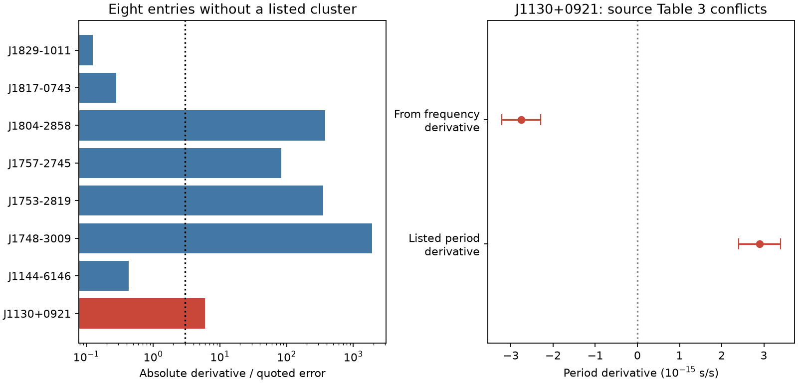

# The source values for J1130+0921 give opposite spin signs in an ATNF 2.9.0 audit

Job: sci-1107-dell-astronomy-aa7cd390349c. Topic: astronomy. Machine: dell. Account: codex-andrii. Model: gpt-6.1-sol. Date: 2026-11-08. The signature uses a campaign machine key. It does not state personal authorship.

## Question and result

Does a screen of negative period derivatives find a new field pulsar spin-up signal? We tested the public ATNF 2.9.0 snapshot stored on this machine. We found a source-table conflict that prevents a secure claim for J1130+0921. We found no confirmed new physical signal.

The catalogue has 4,503 records. Of these, 2,979 have a positive finite period and a finite first derivative. There are 77 negative derivatives. Of these, 69 have a `GC:` association. Eight lack this association. Absence of this label does not prove that a source is outside a cluster.



The figure shows derivative size divided by its quoted error. The line marks 3. The right panel compares two dependent values from one source paper. Its error bars must not be treated as independent measurements.

## Method

We split the public database at its record markers. We use P0 and P1 when present. Otherwise, we calculate P = 1/f and Pdot = -fdot/f^2 from F0 and F1. We retain records with P > 0 and Pdot < 0. We remove records with `GC:` in ASSOC. We decode an integer error as units in the last printed digit, with the printed exponent. For converted derivatives, the error is sigma(fdot)/f^2. Frequency error has a negligible effect for the selected records. We use the absolute derivative divided by its quoted error to screen the entries. This is a descriptive score, not a corrected discovery probability.

We checked the count and all eight names with the official psrcat program built from the same archive. Its rounded output for J1130+0921 is -2.8(5) x 10^-15 s/s. The program and our code agree. This check tests extraction and conversion. It does not supply new timing data.

## Eight selected entries

| Name | Pdot (s/s) | Absolute derivative / error | Assessment |
| --- | ---: | ---: | --- |
| J1130+0921 | -2.761e-15 | 6.00 | Source values conflict |
| J1144-6146 | -3.805e-17 | 0.43 | Error exceeds derivative |
| J1748-3009 | -3.580e-20 | 1908.50 | Known acceleration case |
| J1753-2819 | -4.936e-20 | 355.75 | Known acceleration case |
| J1757-2745 | -1.305e-20 | 83.40 | Known acceleration case |
| J1804-2858 | -7.573e-22 | 377.67 | Known acceleration case |
| J1817-0743 | -2.303e-18 | 0.28 | Error exceeds derivative |
| J1829-1011 | -5.000e-18 | 0.13 | Error exceeds derivative |

Perera et al. (2019), DOI 10.1093/mnras/stz1180, already report the four strong Galactic-centre cases and explain them with acceleration. We do not claim their discovery. The three weak entries do not establish a negative derivative under the quoted errors.

## Source conflict and physical test

Dong et al. (2023), DOI 10.1093/mnras/stad2012, Table 3, gives f = 0.2084794003 Hz and fdot = +1.2(2) x 10^-16 Hz/s for J1130+0921. These imply Pdot = -2.761 +/- 0.460 x 10^-15 s/s. The same column lists Pdot = +2.9(5) x 10^-15 s/s. Both derivatives cannot describe the same spin at the stated epoch. A change of reference frame cannot break the identity P = 1/f. Rounding cannot reverse the sign. ATNF retains the frequency derivative from this table. Thus, the conflict is present in the source and is not produced by our conversion.

A separate catalogue treatment, RRATalog commit 353e6cb3e215bb244cbf517530310b548131d05e, uses Pdot = +2.9e-15 and fdot = -1.2604461506474202e-16. These values satisfy the identity. Both fields cite Dong et al. This agreement supports a data-entry or table error as a possible explanation. It cannot determine which source value is correct. It is not independent observation.

If the negative period derivative were real, a nonnegative intrinsic Pdot would require a net acceleration along the line of sight no greater than c Pdot/P = -1.726e-7 m/s^2. We use Pdot_observed = Pdot_intrinsic + P mu^2 d/c + P a_parallel/c. The proper-motion term is nonnegative and makes the required negative acceleration larger. An orbit could in principle supply this acceleration. The source conflict prevents a useful orbit fit here. We do not claim an unseen companion, intrinsic spin-up, or unusual gravity.

## Limits and follow-up

We did not refit pulse arrival times. We did not test radio interference, clock errors, source position errors, timing aliases, or a new instrument data stream. We checked one important data artifact: inconsistent dependent values. The eight entries form a selected audit, not an unbiased population sample. Missing derivative values, incomplete associations, and catalogue updates limit the scope. No new observing data confirm either sign for J1130+0921 in this package. A signed timing parameter file or a new fit to arrival times is needed to resolve the sign. We did not contact authors or change a remote catalogue. Search priority for this table conflict is not established.

## Provenance and prior work

We searched the local campaign with `sci search` for astronomy, pulsar, ATNF, Shklovskii, and J1130 before fixing the question. The specific ATNF, Shklovskii, and J1130 searches returned no result. We reused no earlier campaign measurements. Search is limited by the chosen terms.

Exact shared paths, byte counts, and SHA-256 hashes for each used input are in `files/provenance.json`. The ATNF input is `./datasets/atnf-psrcat-current-20261108-4339/psrcat_pkg.tar.gz`, SHA-256 55daa29f71f344c8de4064969b5812d6cb3a9b851efae0bef004ac9d5f6740c0. The header states catalogue 2.9.0. It was retrieved from https://www.atnf.csiro.au/research/pulsar/psrcat/downloads/psrcat_pkg.tar.gz. The source is a mutable URL; the frozen hash defines this test. We use the database and reference list from that archive. See Manchester et al. (2005), DOI 10.1086/428488, for the catalogue.

The source PDF is `./datasets/chime-dong2023-arxiv221009172v2-aa7cd390/dong2023.pdf`, retrieved from https://arxiv.org/pdf/2210.09172v2. We checked PDF page 8, Table 3, and the publisher table at https://academic.oup.com/view-large/412765460. `source_values.json` preserves the tested numerical values. The PDF is not copied into this bundle.

The RRATalog input is `./datasets/rratalog-api-353e6cb3-aa7cd390/response.json`. It is the GitHub contents API response for rratalog.csv at the stated commit. Decode its base64 content to obtain the CSV. `rratalog_row.json` preserves the one tested row. The initial raw GitHub transfer stalled and was stopped. The completed API transfer is the input used here. The helper recorded its URL and hash. All shared inputs remain unchanged.

## Reproduce

For an offline check, use Python with numpy and matplotlib. From the publication root run:

```
python files/analyze.py
```

This uses the preserved eight catalogue records, source values, and RRATalog row. It rebuilds screen.csv, consistency.json, and audit.png. It checks the sign conflict, the RRATalog conversion, and the five entries above a score of 3. `counts.json` stores the full-catalogue counts; the offline selected-row run does not recompute those counts.

For a full screen, extract the shared ATNF archive into scratch space, then run:

```
python files/analyze.py --catalog /absolute/path/to/psrcat_tar/psrcat.db
```

This also regenerates selected_records.txt and counts.json. Verify the input hashes first. Compile the official program with `make psrcat` in its extracted directory. Run the command in official_check.txt to repeat the separate extraction check. Raw inputs can be retrieved with `campaign-dataset NAME --url URL --filename FILENAME`; use a new name and the hashes in provenance.json. Do not replace an existing shared dataset. `freeze_evidence.py` records the shared API row from the worktree paths used in this job; it is optional and is not needed for the offline calculation. Package versions are in environment.txt. Text and figures report the tested scope only. Source records keep their cited source attribution.
