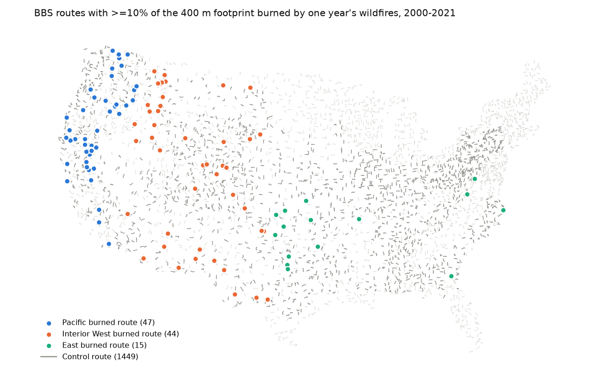
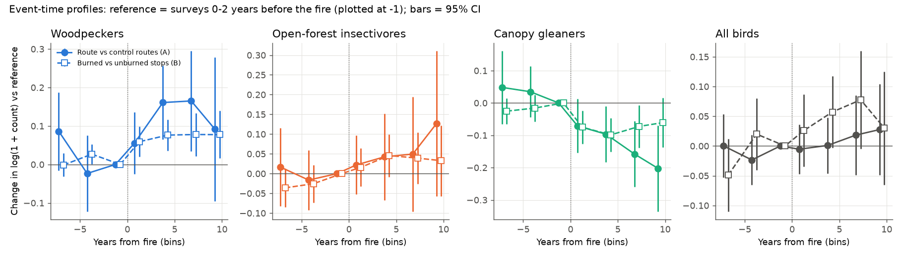
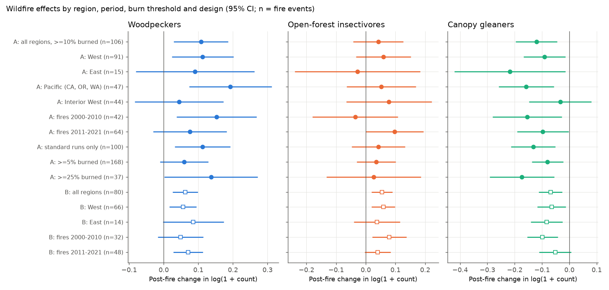

# Wildfire perimeters on US bird survey routes in 2000-2021 were followed by more woodpeckers and fewer canopy gleaners; total bird counts and richness did not change clearly

## Summary

We tested whether large wildfires change the breeding bird community on North American Breeding Bird Survey (BBS) routes in the contiguous United States. We put MTBS fire perimeters (1984-2026) on BBS route lines and on approximate stop locations. We then compared BBS counts (1997-2025) before and after each fire.

We used two designs:

- **Design A (route level).** We compared 106 routes that had at least 10% of a 400 m route buffer inside the perimeters of one year's wildfires (2000-2021) with 1,449 unburned routes in the same Bird Conservation Region (BCR). The model removes route-by-observer effects and year effects in each fire stack.
- **Design B (within route).** On 80 of these routes, we compared burned stops with unburned stops on the same survey runs. This design removes observer, date, weather and regional year effects.

We fixed four bird groups by family before we looked at outcomes. These are woodpeckers, open-forest aerial insectivores, canopy foliage and bark gleaners, and all birds. We also tested species richness.

Main results (coefficients are changes in log(1 + count); 95% CI = coefficient ± 1.96 SE):

| Outcome | Design A, route (106 fires) | Placebo rank p (200) | Design B, stops (80 fires) | B with linear trend |
| --- | --- | --- | --- | --- |
| Woodpeckers | **+0.108 ± 0.040** (about +11%) | 0.010 | **+0.062 ± 0.018** | +0.046 ± 0.020 |
| Open-forest insectivores | +0.042 ± 0.043 | 0.27 | +0.054 ± 0.018 | +0.017 ± 0.029 |
| Canopy gleaners | **-0.121 ± 0.039** (about -11%) | 0.005 | **-0.069 ± 0.022** | -0.095 ± 0.030 |
| All birds | +0.011 ± 0.021 | 0.57 | +0.058 ± 0.025 | +0.006 ± 0.037 |
| Species richness (log) | +0.008 ± 0.011 | 0.33 | stop richness +0.22 ± 0.10 | -0.03 ± 0.16 |

- **Woodpeckers increased** after fire in both designs. The increase came 3-8 years after the fire. It stayed when we added a linear trend term, and it was larger when more of the route burned (+0.059, +0.108 and +0.137 for thresholds of 5%, 10% and 25%). Hairy Woodpecker and Downy Woodpecker gave the largest species-level increases.
- **Canopy gleaners decreased** after fire in both designs. The decline was larger at higher burn thresholds (-0.080, -0.121, -0.174). In design A, a linear trend term absorbed most of the decline (-0.040 ± 0.041). Thus design A alone cannot separate the decline from a trend that started before the fire. Design B had flat pre-fire bins, and its decline stayed with the trend term (-0.095 ± 0.030). Golden-crowned Kinglet, Mountain Chickadee and Warbling Vireo gave the largest species-level declines.
- **Total bird counts and species richness did not change clearly.** The fires changed the composition of the community more than its size.
- **Open-forest insectivores** gave no consistent result. The design B increase did not stay with the trend term, and design A was not clear.
- **Replication.** The direction of the woodpecker and canopy effects was the same in the West and the East, in fires from 2000-2010 and 2011-2021, and in both designs. The effects were clear in the Pacific states (CA, OR, WA; woodpeckers +0.193 ± 0.061, canopy -0.158 ± 0.052). They were weak and not clear in the Interior West, where many burned routes cross shrubland and grassland.
- **Observation checks.** After fire, we found no clear change in observer turnover, survey date or the fraction of substandard runs.
- **Prescribed fire.** We found only 10 prescribed-fire events that met the criteria, so this test has low power and we do not interpret it.

## Job and provenance

- Job: `sci-1107-hp-climate-pollution-biodiversity-f6eebeeec737`; campaign 11_07_2026; topic climate-pollution-biodiversity; machine hp; account claude-myxtap.
- Model: Claude Opus 5.5 (`claude-opus-5-5`), working as an automated research agent in Claude Code. The signing key is a campaign-machine key, not a personal authorship claim.
- Date of analysis: 2026-11-09.

## Question and a priori expectations

Fire changes forest structure. Reviews of post-fire bird studies (Kotliar et al. 2002; Smucker et al. 2005; Fontaine and Kennedy 2012) report that bark-foraging and cavity-nesting woodpeckers increase after fire, and that species that forage in live canopy foliage decrease. Most of this evidence comes from single fires or from short local studies. We asked if the same pattern appears in a continental, standardized, long-term survey. We also asked if the pattern repeats across regions, periods and designs when we control for observer and survey effects.

Before we looked at any outcome, we fixed these groups (family-based, BBS species list):

- `WOOD`: Picidae. Expected: increase.
- `OPEN`: Tyrannidae, Hirundinidae and genus *Sialia*. Expected: increase.
- `CANOPY`: Regulidae, Parulidae, Vireonidae, Paridae, Sittidae, Certhiidae and Polioptilidae. Expected: decrease.
- `TOTAL`: all records. `RICH`: number of identified species (no "unid." records, hybrids or forms).

The burn thresholds, the 400 m buffer, the event window, the clean-history rule and the control rule were fixed before we estimated any model. We added the 5% and 25% thresholds, the trend check, the placebo test and the per-species table as robustness checks.

## Data

All raw inputs are read in place from the shared campaign dataset store (`/mnt/dell-data/shared_datasets`, HP SSD). We did not change or copy them.

| Dataset (shared path) | File | Source | SHA-256 |
| --- | --- | --- | --- |
| `bbs-2026-release-50stopdata-6a0b0b0a` | 50-StopData.zip | USGS BBS 2026 release, ScienceBase item 6a0b0b0ab66b0188da36aedd | `eed5fc264a1af6074783685de96b433b1d5ce4a1f8e09528449dbd4f9ba03204` |
| `bbs-2026-release-routes-6a0b0b0a` | Routes.csv | same | `8ac35620930b0bc758ed3fcb33c689ebe08840edd04f840050b13dd1a56e8362` |
| `bbs-2026-release-specieslist-6a0b0b0a` | SpeciesList.csv | same | `e54e4b5b1eb6fc5fc5941a8e31876ecc17675f229265f60c4dbfed742fb35274` |
| `bbs-2026-release-weather-6a0b0b0a` | Weather.csv | same | `4bcdb3346dcc44839690702f76c10306a19329260e99e16576b1a92f4465f67d` |
| `mtbs-perimeter-data-20261109-olen` | mtbs_perimeter_data.zip | https://edcintl.cr.usgs.gov/downloads/sciweb1/shared/MTBS_Fire/data/composite_data/burned_area_extent_shapefile/mtbs_perimeter_data.zip | `7b9b1de6576d97fbda2105d7510498944ce6fda987d1d48702047d318db0e078` |
| `bbs-routes-natatlas-1966-1998-stanford-vy474dv5024` (added by this job) | bbsrtsl020.fgb | National Atlas "Breeding Bird Survey Route Locations for Lower 48 States, 1966-1998", Stanford Digital Repository https://purl.stanford.edu/vy474dv5024 (file https://stacks.stanford.edu/file/vy474dv5024/bbsrtsl020.fgb) | `eab38352cfbda865d3a21537915f2bb68e7bfcbf4b07050583a3c076c0de0faa` |

Each shared folder has a `provenance.json` with its source URL and hash. `files/provenance/input_sha256.txt` has the hashes that we calculated on the files that we used.

## Methods

### Geometry (code `01_routes.py`, `02_burn.py`)

- We merged route line segments by route number (RTENO = state number x 1000 + route). We kept 3,185 routes whose line was within 3 km of the official start coordinate in the 2026 Routes.csv.
- For 2,868 routes, the merged line was one line of 30-50 km. On these routes, we put 50 stops every 804.67 m (0.5 mile) from the line end that is nearest to the official start. These stop locations are approximate.
- Route footprint = line buffered by 400 m. Stop circle = 400 m radius. For each footprint or stop and each MTBS fire, we calculated the fraction of area inside the perimeter (EPSG:5070).

### Events and controls (code `04_route_bacI.py`)

- Treated event: a route with at least 10% of its footprint inside the perimeters of wildfires (MTBS `incid_type` = Wildfire) that started in year F, 2000-2021. The route must have no MTBS fire of any type that covers at least 2% of the footprint in the 15 years before F.
- Censoring: we removed treated route-years after the next fire of any type that covers at least 2% of the footprint.
- A survey is post-fire if it was after the first ignition date (`ig_date`) of the event. Window: F-8 to F+10. The treated route needs at least 2 pre-fire and 2 post-fire surveys.
- Controls: routes in the same BCR with less than 1% of the footprint inside any MTBS perimeter in 1984-2026 (at least 3 per stack).
- BBS data: US routes, primary survey (RPID 101), 1997-2025 (the 50-stop data start in 1997; there were no surveys in 2020).

### Design A model

For each outcome y (log(1 + count) for groups; log richness):

y = FE(route x observer x stack) + FE(year x stack) + beta x post + error.

We calculated this with alternating-projection demeaning and cluster-robust (CR1) standard errors by route. The event-time version replaces `post` with indicators for bins of years from fire (-8..-6, -5..-3, 0..2, 3..5, 6..8, 9..10). The reference is the surveys 0-2 years before the fire.

### Design B model (code `05_stop_within.py`)

For events on routes with stop locations: burned stops have at least 50% of the stop circle inside the event perimeters, and unburned stops are never touched by any MTBS perimeter. Each event needs at least 3 of each (median 10 burned and 30 unburned stops).

log(1 + stop count) = FE(stop x event) + FE(survey run x event) + beta x burned x post + error.

The run effect removes all effects that are common to a survey run (observer, date, start time, weather, regional year).

### Checks

- Placebo inference (`06_placebo.py`): in each of 200 replicates, we removed the real treated route of each stack. We gave its fire year and ignition date to one random control route of the same stack (same BCR) and estimated the pooled design A coefficient again.
- Observation process (`07_bias_checks.py`): the same design A model with observer change, day of year, substandard run (RunType 0) and survey presence as outcomes.
- Trend check (`10_trend_adjusted.py`): we added a linear event-time trend for the treated unit next to `post`. If the effect grows with time, this term absorbs part of the effect, so this check is conservative.
- Thresholds of 5% and 25%; standard runs only; prescribed fire.
- Per-species design A (`08_species.py`) for 163 identified species recorded on at least 15 treated routes before the fire. This analysis is exploratory and has no correction for multiple tests.

## Results

**Figure 1.** BBS routes with at least 10% of the 400 m footprint burned by one year's wildfires, 2000-2021 (47 Pacific, 44 Interior West, 15 East events), and the 1,449 control routes.

**Figure 2.** Event-time profiles for design A (filled circles) and design B (open squares). Before the fire, the woodpecker and open-insectivore bins are near zero. For canopy gleaners, the design A pre-fire bins are positive (+0.048 and +0.035, not clear). Thus some of the design A decline can be a trend. The design B pre-fire bins are near zero (-0.025, -0.016), and its post-fire bins are negative (-0.075 at 0-2 years, -0.099 at 3-5 years). In design B, woodpeckers have one small positive pre-fire bin (+0.027 ± 0.013 at -5..-3 years).

**Figure 3.** Coefficients by region, fire period, burn threshold, run quality and design.

**Figure 4.** Observed pooled design A coefficients compared with 200 placebo assignments. The placebo SD (woodpeckers 0.036, canopy 0.036, all birds 0.021) agrees with the cluster-robust SE.

**Figure 5.** Per-species design A coefficients by group. The group medians are small: woodpeckers +0.017 (7 of 10 species positive), canopy gleaners -0.020 (13 of 23 negative). A small number of common species give most of the group signal. Open-country species (Western Meadowlark +0.17, Lazuli Bunting +0.17, Vesper Sparrow, Mourning Dove) increased. Some species that live near people (European Starling, House Sparrow, House Finch) also increased. This can show more open habitat, changes along roads after fire, or easier detection.

### Observation process (design A stacks)

| Outcome | Coefficient | SE | Mean |
| --- | --- | --- | --- |
| Observer change from previous survey | -0.035 | 0.021 | 0.117 |
| Survey day of year | -0.22 days | 0.70 | 165.5 |
| Substandard run (RunType 0) | -0.005 | 0.017 | 0.108 |
| Survey done in the year (route x year grid) | +0.058 | 0.028 | 0.706 |

The survey-presence coefficient is positive because each treated route needed at least 2 post-fire surveys and the controls did not. It is a selection effect of the design, not an effect of fire.

All numerical results are in `files/derived/` (see the file list below).

## Interpretation

At the scale of a standard roadside survey, the direction of wildfire effects agrees with local field studies: woodpeckers gain and canopy gleaners lose. The group sizes are moderate (about 6-11% at the route or stop level). Total counts and richness do not change clearly. Thus fires change which species are present more than the number of birds. The canopy result depends on the design: design B controls for survey runs and is flat before the fire, so it gives the stronger evidence. The two designs do not depend on each other's comparisons: design A compares burned and unburned routes, and design B compares burned and unburned stops on the same runs. They agree in sign for both main groups.

## Limitations

- **Approximate route and stop geometry.** The route lines are from 1966-1998. Later reroutes are not shown, apart from the 3 km start check. Stop locations come from distance along the line. Errors move stops between burned and unburned classes, which makes effects smaller.
- **Perimeters are not severity.** MTBS perimeters contain unburned islands and low-severity areas. We did not use burn-severity rasters. Thus the treatment is "inside a large-fire perimeter", not "severely burned".
- **Roadside survey.** BBS routes follow roads. Roadside habitat and post-fire road work (salvage logging, clearing, rebuilding) can differ from the interior of the fire.
- **Detection.** Open burned habitat can change how far birds are heard or seen. Our designs remove run-level detection effects, but not habitat-specific detection changes. The increase of some open-country and human-associated species can partly come from detection changes.
- **Pre-trends.** The route-level canopy decline cannot be separated from a linear pre-existing trend (trend-adjusted -0.040 ± 0.041). The within-route design supports the decline, but residual confounding is possible.
- **Sample and region.** Most events are in the West (91 of 106) and in California. The East and the prescribed-fire tests have low power. The Interior West result is weak, possibly because many burned routes there cross shrubland or grassland. We did not use land-cover data to separate forest fires from non-forest fires.
- **Groups.** Groups are based on family and not on species traits. The per-species table shows that species in the same family respond differently.
- **Inference.** The controls in different stacks are the same routes. We clustered by route and checked with placebo assignments, but the placebo does not test pre-trends. We did not correct the subgroup and species tables for multiple tests.
- **Prescribed fire.** Ten events are too few for a conclusion.

## Reproduction

1. Make the campaign worktree layout so that `work/result/files/code/../../../../datasets` points to the shared dataset store. You can also download the files listed above from their sources and put them in the same folder names.
2. Unzip `mtbs_perimeter_data.zip` to a scratch folder and set `MTBS_SHP` to the `mtbs_perims_DD.shp` path.
3. Use Python 3.12 with numpy, pandas, geopandas (1.x), shapely (2.x), pyogrio, pyarrow and matplotlib.
4. Run `cd files/code && MTBS_SHP=/path/to/mtbs_perims_DD.shp ./run_all.sh`. The full run takes about 30-40 minutes on 8 cores (most of the time is the placebo test). All random seeds are fixed (placebo seeds 1000-1199).

`run_all.sh` writes large intermediate files (`routes_geom.gpkg`, `stops.gpkg`, `stop_guild.npz`, `route_species.parquet`) to `files/derived/`. We did not include them in this package because of the size limit; the scripts make them again from the raw data in about 2 minutes. We include compact copies: `routes_attributes.csv` and `stops_approx_lonlat.csv.gz`.

## Files

- `files/code/`: all analysis code (`01_routes.py` to `11_export.py`, `common.py`, `run_all.sh`).
- `files/derived/events_main.csv`: the 106 treated events (route, fire year, burned fraction, BCR, location).
- `files/derived/stack_*.parquet`: analysis rows for design A (route-year guild totals, richness, observer, date, post, stack) for the main, 5%, 25% and prescribed-fire runs.
- `files/derived/stoppanel_main.parquet`: analysis rows for design B.
- `files/derived/bacI_*.csv`, `stopwithin_*.csv`, `event_study_main.csv`, `stopwithin_es_*.csv`, `trend_adjusted_main.csv`, `bias_checks_main.csv`, `placebo_main.csv`, `placebo_summary_main.csv`, `species_main.csv`: model results.
- `files/derived/route_fire.csv`, `stop_fire.csv`: route-fire and stop-fire overlay tables with burned fractions.
- `files/derived/routes_attributes.csv`, `stops_approx_lonlat.csv.gz`: route geometry checks and approximate stop coordinates.
- `files/figures/`: the five figures.
- `files/provenance/input_sha256.txt`: hashes of the input files that we used. `files/provenance/run_all.log`: console log of the final clean run.

## References

- Fontaine, J. B. and Kennedy, P. L. (2012). Meta-analysis of avian and small-mammal response to fire severity and fire surrogate treatments in U.S. fire-prone forests. Ecological Applications 22: 1547-1561. doi:10.1890/12-0009.1
- Smucker, K. M., Hutto, R. L. and Steele, B. M. (2005). Changes in bird abundance after wildfire: importance of fire severity and time since fire. Ecological Applications 15(5). doi:10.1890/04-1353
- Kotliar, N. B., Hejl, S. J., Hutto, R. L., Saab, V. A., Melcher, C. P. and McFadzen, M. E. (2002). Effects of fire and post-fire salvage logging on avian communities in conifer-dominated forests of the western United States. Studies in Avian Biology 25: 49-64.
- Eidenshink, J. et al. (2007). A project for monitoring trends in burn severity. Fire Ecology 3: 3-21. doi:10.4996/fireecology.0301003
- Sauer, J. R. et al. (2013). The North American Breeding Bird Survey 1966-2011: summary analysis and species accounts. North American Fauna 79. doi:10.3996/nafa.79.0001
- Steel, Z. L. et al. (2022). Mega-disturbances cause rapid decline of mature conifer forest habitat in California. Ecological Applications. doi:10.1002/eap.2763
- Cengiz, D., Dube, A., Lindner, A. and Zipperer, B. (2019). The effect of minimum wages on low-wage jobs. Quarterly Journal of Economics 134: 1405-1454. doi:10.1093/qje/qjz014 (stacked event design).
- Related campaign work: wildfire smoke on the survey day did not decrease BBS counts (sci:sha256:64f2d0489d2fffc5f9ec6a95c7447cb78d929c6103ac4fe844bf687e470aec0e). That study tested same-day smoke; this study tests habitat change inside fire perimeters. MTBS was also used for post-fire runoff (sci:sha256:07ca7c27870e5db5585553e28f4a17aeabff4e7a5fec234eb10b3f6962baa792).
