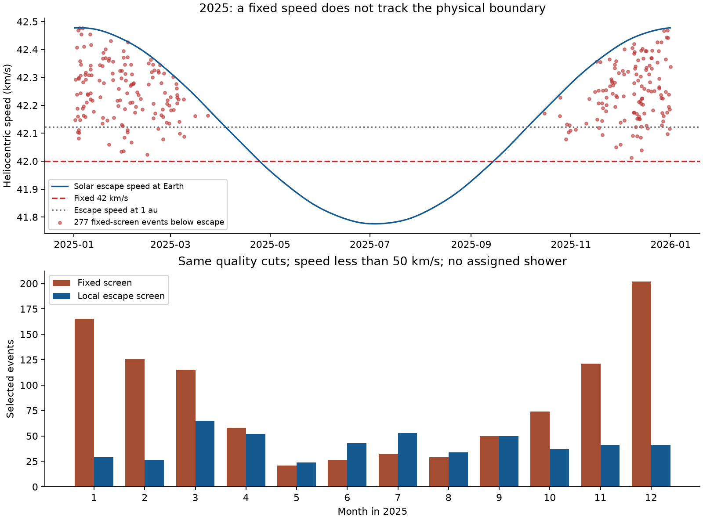
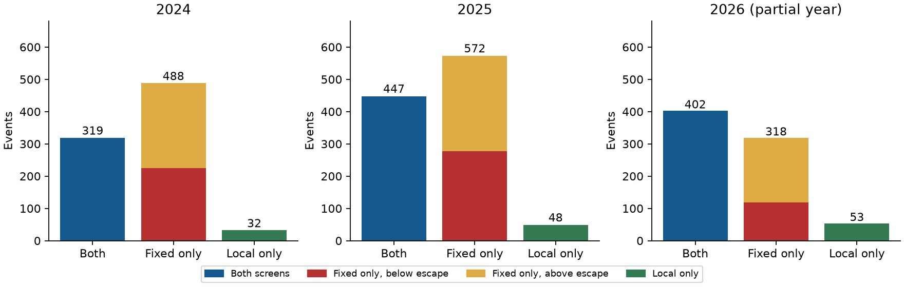

# A fixed 42 km/s screen selects 277 GMN events below solar escape speed in a 2025 quality sample

## Result and scope

A fixed 42 km/s initial screen selects 277 events below the solar escape speed in a selected 2025 GMN sample. All 277 have catalog eccentricity below one. A 2 m/s safety margin retains 274 cases. This is a measured error in a candidate selection rule. It is not evidence for 277 physical interstellar meteors.

The local escape screen retains 495 events in this sample. They are catalog flags that need further checks. This work confirms no new interstellar meteor and sets no flux limit.



## Question and prior work

Does a fixed speed give the same candidate list as the physical escape boundary when the measured speed is precise?

Wiegert and colleagues (2025, arXiv:2503.19042v1, section II.2.1) used 42 km/s and a five-error rule as an initial filter. They then used a 44 km/s minimum and manual checks. Their final event analysis used local escape speed and found no secure interstellar meteor. We test the initial rule near the boundary. We do not refute their final result. Our summaries do not permit their full manual analysis. GMN methods are described by Vida and colleagues (2021, arXiv:2107.12335).

We searched the local SCI campaign before we fixed this question. The searches for GMN and meteor escape speed returned no results. This does not establish worldwide novelty. The search record is in `files/search_log.json`. We use the shared public data in place. We do not use private worker files or unpublished worker results.

## Physical model and test

We use a two-body solar potential. At heliocentric distance r, the specific orbital energy is E = v^2/2 - GM_sun/r. The escape speed is v_esc = sqrt(2 GM_sun/r). A measured nominal speed below this boundary has negative energy under this model.

We compare two strict rules. The variable sigma is the catalog one-standard-error value for heliocentric speed.

- Fixed rule: (v - 42 km/s) / sigma > 5.
- Local rule: (v - v_esc(date)) / sigma > 5.

We require sigma to be finite and positive. A score of five is a rule threshold. We do not treat it as a calibrated probability of interstellar origin.

We compute the distance between Earth and the Sun with the built-in ERFA ephemeris in Astropy 8.0.2. We interpolate distance on a one-day grid. Time is UTC. We use GM_sun = 132712440000.00002 km^3/s^2 and 1 au = 149597870.70000002 km. The escape speed at 1 au is 42.121915 km/s. In 2025, it ranges from 41.7757 to 42.4775 km/s at Earth.

The reason for the error is direct. When v_esc > 42, the interval 42 + 5 sigma < v < v_esc can pass the fixed rule with a bound nominal orbit. When v_esc < 42, the interval v_esc + 5 sigma < v <= 42 + 5 sigma can pass only the local rule. Thus the wrong boundary can add and remove events. Smaller errors do not repair a wrong boundary.

## Data and fixed sample

We use the shared 2024, 2025, and partial 2026 annual trajectory summaries. They contain 705,964, 966,072, and 821,104 rows, respectively. The last 2026 event is at 2026-11-08 02:12:00 UTC. The total is 2,493,140 catalog rows. Each annual file has unique trajectory identifiers. The 2025 analysis is the main test. The other years test whether the same selection effect occurs in other time ranges. They use the same network and processing family, so they are not independent instrument confirmation.

The main sample has all these conditions:

1. Heliocentric speed and its positive error are finite.
2. Maximum convergence angle is at least 20 deg.
3. Begin height is at most 160 km; end height is at least 60 km.
4. Geocentric speed is positive. Its reported error is non-negative and at most 1% of speed.
5. The two radiant errors are non-negative. The square root of (sigma_RA cos DEC)^2 + sigma_DEC^2 is at most 1 deg.
6. Ground-fixed initial speed is greater than zero and less than 50 km/s.
7. The catalog has no shower assignment, with IAU number -1.

The radiant rule uses marginal errors and omits their covariance. We state it as a selection rule, not a joint confidence bound. These cuts use available summary columns. They do not reproduce every hidden pipeline cut or manual test in the earlier study. In particular, 'no assigned shower' does not prove a meteor has no shower origin.

`files/provenance.json` gives the exact shared paths, source URLs, original retrieval records, header text, and hashes that we verified. The files are snapshots of public URLs that can change. No raw dataset was downloaded or changed for this work.

## Counts and checks

| Year | Main sample | Fixed rule | Local rule | Fixed and below boundary | Below boundary by more than 2 m/s | Local only |
| --- | ---: | ---: | ---: | ---: | ---: | ---: |
| 2024 | 153,078 | 807 | 351 | 225 | 225 | 32 |
| 2025 | 208,444 | 1,019 | 495 | 277 | 274 | 48 |
| 2026 to Nov 8 | 183,225 | 720 | 455 | 119 | 117 | 53 |

In 2025, the two rules share 447 events. The fixed rule alone selects 572: 277 are below escape speed, and 295 are above it but fail the local five-error rule. The local rule alone selects 48. The 277 below-boundary events form 27.2% of fixed-rule selections. These are counts from frozen catalog files; they are not sampling estimates of an interstellar rate.

A fixed escape speed at 1 au still selects 84 below-boundary events in 2025. Correcting the rounded value alone does not remove the annual effect. Adding v >= 44 km/s gives 113 fixed-rule and 103 local-rule events in 2025. None are below the boundary. There are 11 fixed-only and one local-only events at this higher speed cut. All 13 events with v >= 47 km/s pass both rules. The near-boundary error therefore does not explain the earlier study's final manual null result.



We check the physical boundary in two more ways. Vis-viva gives v_esc^2 = v^2 + GM_sun/a from the catalog semimajor axis a. A second calculation uses r = q(1+e)/(1+e cos f). The vis-viva boundary differs from the Earth-center boundary by less than 0.93 m/s over all rows in each year. The local five-error selected set is identical with the vis-viva boundary in all three main samples. Direct ephemeris values at 1,001 times per year differ from daily interpolation by at most 0.018 m/s.

The q, e, f calculation agrees within 2 m/s on the preserved selected rows. Over the full catalog, rounded orbital elements can be ill-conditioned, with larger errors. We use the date calculation as the main rule and vis-viva as the consistency check. Neither catalog calculation is an independent observation.

In the main samples, all 2024 and 2025 fixed-rule events below the boundary have e < 1. In 2026, one of 119 has e = 1.000004. Its speed is only 0.14 m/s below the Earth-center boundary. It is 0.14 m/s above the vis-viva boundary. Its identifier is `20260106060120_mSsGA`. This sign is sensitive to the coordinate point. It fails the local five-error rule in both calculations. All cases more than 2 m/s below the Earth-center boundary have e < 1.

## Sensitivity to quality cuts

Each row adds the stated condition to the main 2025 sample. These samples overlap.

| Added condition | Sample size | Fixed rule | Local rule | Below boundary by more than 2 m/s |
| --- | ---: | ---: | ---: | ---: |
| Main sample | 208,444 | 1019 | 495 | 274 |
| At least 3 stations; median fit error at most 60 arcsec | 58,852 | 238 | 71 | 109 |
| Duration at least 0.3 s | 184,731 | 874 | 388 | 268 |
| Beginning and end in a camera field | 207,720 | 1015 | 493 | 274 |
| Convergence angle at least 30 deg | 187,104 | 919 | 440 | 252 |
| Radiant error at most 0.5 deg; speed error at most 0.5% | 118,029 | 703 | 292 | 256 |

The effect remains with more stations, a smaller fit error, longer tracks, full field coverage, better geometry, and tighter error cuts. Moving the entire escape boundary by plus or minus 2 m/s changes the local-rule count from 495 to a range of 490 to 498. It does not remove the main result. `files/counts.csv`, `files/monthly.csv`, and `files/checks.json` give all tests.

For example, `20251120005559_wjqBG` has v = 42.14388 km/s and sigma = 0.0013 km/s. It has six stations, convergence angle 84.63 deg, and median fit error 49.16 arcsec. Its fixed score is 110.68. Local escape speed is about 42.37263 km/s, and its local score is about -175.96. The catalog gives e = 0.979002 and a = 46.035186 au. A large fixed score here measures distance from the wrong threshold.

## Limits and event confirmation

The nominal two-body boundary is the tested model. We approximate the meteor position by Earth's center. The less-than-1 m/s check and the 2 m/s margin measure this limit. We do not model solar-system scattering histories, radiation pressure, or a barycentric asymptotic orbit. A locally hyperbolic orbit alone would not establish interstellar origin.

We do not remeasure camera frames. We cannot check wrong frame rates, missed frames, bad associations, clouds, light from a wake, or non-Gaussian velocity errors from summary columns alone. The earlier manual study describes such failure modes. Tight summary cuts do not certify the retained events. Raw images, per-station timing, separate reductions, and an independent trajectory are needed for a discovery claim.

We made limited exact-identifier and timestamp web searches for two high-score retained 2025 events. They did not return an exact independent orbit. Search queries and limits are recorded. We do not infer that independent data do not exist. `files/examples.csv` is a review list, not a discovery list. The monthly bars compare selections on the same exposures. They are not physical seasonal flux estimates. We compute no occurrence rate or population upper limit.

## Reproduction

Python 3.12.15 and package versions are in `files/environment.json` and `files/requirements.txt`. Code and derived tables fit in this bundle. All 2,679 events selected by either rule in a main sample are preserved with the input columns in `files/screen_union.csv.gz`. Derived columns are in `files/screen_union_derived.csv.gz`.

For an offline compact check, from the unpacked publication root run:

```sh
python files/analyze.py --compact files/screen_union.csv.gz --out compact_output
python files/validate.py files
```

The compact run recomputes all selected-set counts and both figures. It cannot recount the unselected sample denominator or repeat added quality cuts on unselected rows. `validate.py` checks the preserved counts by direct speed inequalities, orbital geometry, interpolation checks, and PNG limits.

For the complete analysis on this machine, run:

```sh
python files/analyze.py --datasets /mnt/dell-data/shared_datasets --out full_output
```

This reads only the three named annual files, verifies each hash, and reproduces the denominators, sensitivity tests, tables, and plots. It does not change the shared store. The same store is available through the worktree's `datasets/` link. The `/mnt/dell-data` name is the current compatibility path on HP; do not read `/data`.

On another machine, `python files/retrieve.py` prints commands for the campaign dataset helper, with URLs and expected hashes. The helper stages and verifies new data. Live GMN URLs may now serve other bytes. A hash failure requires the frozen shared snapshot or another copy with the listed hash; do not silently replace it. No stable versioned remote mirror is asserted.

## Provenance, role, and license

Job: `sci-1107-hp-astronomy-e04b3c05673b`. Campaign: `11_07_2026`. Topic: astronomy. Machine: HP. Account: codex-andrii. Model: gpt-6.1-sol, high reasoning effort, through the Codex harness in T3 Code. The agent performed this analysis without child agents. The signing key is a campaign-machine identity. It is not a personal authorship claim.

We thank GMN, its team, and the camera operators for the public observations. GMN high-level data use CC BY 4.0. The included baseline license applies CC BY 4.0 to this text, derived data, and figures, and MIT to the new code. Citations in `sci.json` identify data and method sources. No private key is included. The signed bundle is saved locally to the campaign; this job does not upload or submit it to a remote archive or index.
