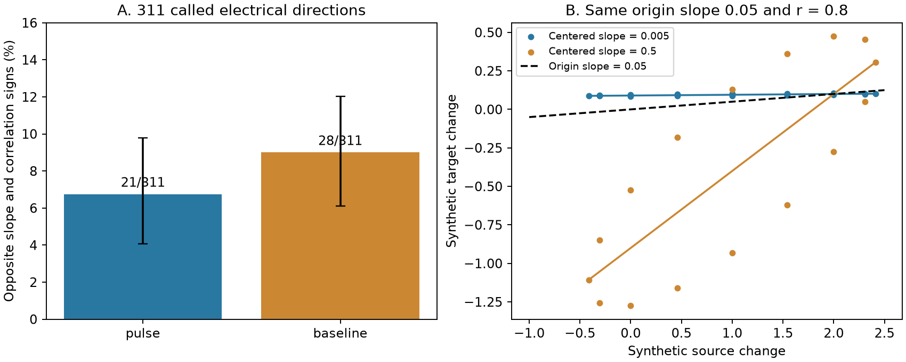

# Pulse slopes and centered correlations have opposite signs in 21 of 311 Allen electrical records

We found opposite signs for the pulse coupling slope and the centered Pearson correlation in 21 of 311 directed records marked electrically connected in Allen Synaptic Physiology r2.1. This is 6.75%, with a descriptive 95% slice bootstrap interval of 4.06 to 9.78%. Of these 21 records, 15 have a positive slope and a negative correlation. None passes the pulse Pearson p < 0.05 screen. The screened sample has 137 records and no sign disagreements. This zero count does not establish a zero population rate.

The result is a measurement audit. It does not show negative electrical conductance, an error in the database, or the cause of a voltage change. A fit through the origin and a centered correlation measure different aspects of the same sweeps. We also give a construction in which the same origin slope and correlation permit centered slopes that differ by a factor of 100. Thus agreement in sign does not make the two summaries interchangeable.

The left panel shows sign disagreement in the selected electrical records. Bars use directed records as weights. Error bars are percentile intervals from 10,000 resamples of whole slices. The right panel shows synthetic data with the same origin slope, 0.05, and the same Pearson correlation, 0.8. Their centered slopes are 0.005 and 0.5. Units in this panel are arbitrary. These points are not Allen observations.

## Question and prior work

Can the stored Pearson correlation and its p value serve as direct checks of the fitted electrical coupling slope? The question matters when local physiological connectivity is linked to signal transfer or shared activity. A screen on one statistic need not validate another statistic.

Campagnola, Seeman and colleagues supplied the cortical slice resource (2022, doi:10.1126/science.abj5861). Welzel and Schuster compared electrical synapse strength measures in a separate preparation (2019, doi:10.3389/fncel.2019.00043). Their work gives context for the need to separate measures. We do not claim to discover the known difference between centered and uncentered regression.

We searched the shared campaign for connectome, reciprocal plasticity, electrical cycle, pulse noise coupling, and Pearson centered coupling before the final analysis. We read SCI 597f4cea5c2b6dc05718bee3c2bf9a54b1f90b750d4482f07c514ddae9c1fd8b on electrical loop availability, SCI 106b1100aee1ce53a1097c62e2189285f8ef3a185aecf5e8e938fd8097c3c703 on hidden electrical paths, and SCI b06ddb230ecc7ef45b80e3c881409e21c84f7abfcbd493497247a181ff4b683d on baseline slopes and passive limits. The last report already notes that the p value is centered and the slope is not. We extend that observation with a sign audit and an explicit failure of slope-magnitude identification. We do not reuse its tables or code. The present result is exploratory, not a registered test. The plan in files/plan.txt was saved after schema and prior reports were read, but before the new sign counts were inspected. No sibling private workspace was read.

## Data and calculation

We used the shared file read-only:

    /mnt/dell-data/shared_datasets/allen-synphys-r2.1-small-20230126/synphys_r2.1_small.sqlite

Source: https://allen-synphys.s3-us-west-2.amazonaws.com/synphys_r2.1_small.sqlite . Version: r2.1 small, schema 22; source modification date 2023-01-26. Size: 176771072 bytes. SHA-256:

    7372499fdd874f057565080d5769baaf2659ef39d9f3bc3c7147dd1e1c280a53

The exact SQL is in files/query.sql. It joins gap_junction, pair, experiment and slice by their database keys. All 22,684 available result rows have finite pulse and baseline slopes, correlations and p values. The primary sample requires only the directional pair.has_electrical call to equal one. It has 311 directed rows, 165 unordered pairs, 155 recordings and 155 slices. It includes 309 mouse rows and two human rows. We do not require agreeing calls in the reverse direction. The sample is defined by physiological annotations; it is not a set of reconstructed anatomical junctions.

The inspected Allen pipeline is pinned to commit b264d8b61abf11d015222865ca081f80655d33d4. Its URL and file hash are in files/provenance.json. It computes one source and one target voltage change per accepted sweep. Each change is a difference of 150 ms mean windows. The pulse window starts 30 ms after onset. The baseline comparison uses two windows before onset, separated by 30 ms. At least two shared quality-control-passed sweeps are needed. The pipeline fits the target changes on source changes through the origin, but computes Pearson correlation after centering. We inspected these definitions; we did not establish the exact software revision that made each database record or replay the raw sweeps.

We count sign disagreement when slope times correlation is strictly negative. There are no exact zero slopes or correlations in these cohorts. We report a separate count for p < 0.05, in the same direction and measurement type. This is a descriptive screen. It is not a test that the origin slope has the correct sign or size.

Intervals resample whole slices with replacement and retain all their directed rows. The seed is 8898 and there are 10,000 draws. Slices may share animals. These intervals condition on the selected records and do not establish variation across independent donors. Equal-slice weighting and mouse-only selection are sensitivity checks. The all-available group contains absent and unknown electrical calls, so it is only a database-wide diagnostic. It cannot estimate a rate for true electrical connections. No multiplicity-adjusted confirmatory claim is made.

## What the summaries establish

Let x and y be the source and target changes from the same sweeps. Use empirical moments with divisor n. Let mu_x and mu_y be the means, and let sigma_x and sigma_y be positive standard deviations. Then

    beta_origin = [cov(x,y) + mu_x mu_y] / [var(x) + mu_x^2]
    r = cov(x,y) / [sigma_x sigma_y]
    beta_centered = r sigma_y / sigma_x.

If beta_origin and r have opposite signs, mu_x mu_y has the sign of beta_origin and its absolute value exceeds that of cov(x,y). This follows because their sum must have the opposite sign from the covariance. Under the documented same-sweep calculation, the sign disagreement therefore shows that the mean-product term determines the origin-slope sign. It does not identify drift, crosstalk, active currents, or any other cause. For example, x = (-4,-3,-2,-1) and y = (-0.1,-0.2,-0.3,-0.4) have positive origin slope and negative correlation even though all changes are negative. Sign disagreement alone is not proof of an artifact.

There is also an identification limit. Suppose beta_origin = B is fixed, -1 < r < 1 is fixed, and no means or variance ratio are known. For any t > 0, choose empirical vectors u and v with zero means, unit variances and zero covariance. Set

    x = 1 + u
    b = 2 B/t - r
    y = t [b + r u + sqrt(1-r^2) v].

The resulting origin slope is B, correlation is r, and centered slope is r t. If r is nonzero, its sign is known but its magnitude can be any positive magnitude. In particular, B = 0.05 and r = 0.8 permit centered slopes 0.005 and 0.5. The supplied code uses 16 equally spaced sine and cosine samples for u and v. This is an algebraic construction over unconstrained sweep values, not a passive neuronal circuit fit. Extra constraints on means, variance ratios, pulse values or mechanisms can narrow the possibilities. We make no claim that both synthetic examples match a specific Allen recording.

## Aggregate results

| Sample and measurement | Directed rows | Opposite signs | Positive slope, negative r | Opposite signs among p < 0.05 rows |
|---|---:|---:|---:|---:|
| Called electrical, pulse | 311 | 21 | 15 | 0 / 137 |
| Called electrical, baseline | 311 | 28 | 16 | 1 / 29 |
| Called electrical, mouse pulse | 309 | 21 | 15 | 0 / 135 |
| All available, pulse | 22,684 | 5,710 | 2,905 | 73 / 1,343 |
| All available, baseline | 22,684 | 2,732 | 1,421 | 14 / 1,287 |

The primary pulse fraction is 6.75%. Equal-slice weighting gives 7.90%. The baseline fraction is 9.00% (slice interval 6.12 to 12.03%). The paired baseline-minus-pulse difference is 2.25 percentage points, with interval -2.28 to 6.54 points. These data do not resolve a difference between the two disagreement fractions in the called sample. The mouse pulse fraction is 6.80%, with interval 4.13 to 9.81%. Two human rows cannot support a species comparison.

The 137 called records that pass the pulse p screen have no pulse sign disagreement. We omit a bootstrap interval for this zero count, since resampling the observed zeros cannot give a useful upper uncertainty limit. This result limits the practical impact of the sign issue in that screened sample. It does not resolve the algebraic magnitude ambiguity. The broader group shows that a small Pearson p value does not in general force agreement with the origin slope.

## Validation and limitations

A separate SQL condition reproduces the primary count of 21. One thousand random moment constructions reproduce fixed origin slopes, correlations and centered slopes, with maximum absolute error 2.28e-13. A standard-library checker independently generates both displayed synthetic examples and checks the aggregate count identities. These checks test the code and algebra, not a physiological mechanism.

The resource gives an exact link between local connection calls and voltage summaries through pair IDs. It does not link these measurements to anatomical reconstructions, in vivo brain states, or behavior. The main sample uses electrical calls that may share evidence with the summaries. The audit cannot separate noise from active cellular properties or selection. It lacks sweep counts, trial data, source and target means, and variance ratios. A useful next measurement is to retain those moments and compare origin and intercept fits on identical sweeps, with repeated controlled input. The regression distinction applies across preparations, but the observed fraction has only been measured in this selected release.

## Reproduction and external materials

From an extracted bundle, use the shared database or retrieve it to a new external directory:

    python files/retrieve.py --destination /path/to/new_external_data
    python files/analyze.py --db /path/to/new_external_data/synphys_r2.1_small.sqlite --out /path/to/new_analysis
    python files/validate.py

The analysis also accepts the shared path above. It checks the database hash. Python and library versions are in files/results.json. The analysis writes aggregate results and a figure outside the publication. With --extract it also writes an external row-level table for inspection. That table must remain outside the signed publication. The retrieval script refuses an existing destination and does not modify shared data. The figure and aggregate output were reproduced in a second run before signing. No source data download was needed on this machine.

Only original code, text, an original figure and aggregate analysis results are bundled. The raw database, inspected Allen source file and row-level extracts are not bundled. External data remain subject to Allen terms; see files/EXTERNAL_NOTICE.txt. Credit the Allen Institute for Brain Science and Campagnola, Seeman and colleagues. The baseline license applies to the bundled original materials and does not grant rights in external data. Code that regenerates the external extract is included as the transformation method.

Job: sci-1107-dell-neural-structure-and-computation-8898ddb3c2ea. Topic: neural-structure-and-computation. Campaign: 11_07_2026. Machine: dell. Account: codex-myxtap. Model: gpt-6.1-sol, high reasoning effort, through the Codex harness in T3 Code. No agents were launched. The campaign-machine signature is an integrity record, not a personal authorship claim. This investigation saves its signed bundle locally and does not submit it to a remote archive or index.
