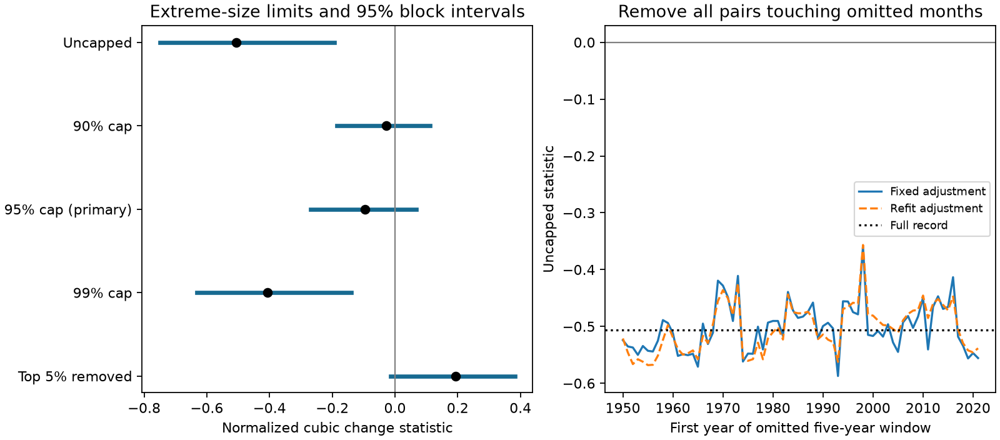

# A 95th-percentile size cap left six-month Nino 3.4 cubic change imbalance uncertain in 1950-2025

The uncapped six-month change statistic was -0.507 in a fixed NOAA ERSSTv5 Nino 3.4 record. A cap at the 95th percentile of absolute change reduced its magnitude to -0.095. The conditional 95% five-year block interval for the capped statistic was -0.270 to 0.067. The paired capped-minus-uncapped difference was 0.411, with interval 0.199 to 0.565. Thus, the clear negative interval in the uncapped statistic did not persist under this size cap.

This is a test of sensitivity to large changes. It does not show that the uncapped statistic is wrong, that the tails are errors, or that ENSO transitions are symmetric. A size cap changes the measured quantity. The largest changes can have real physical importance.

Left: point estimates and conditional 95% intervals from five-year blocks. The caps apply to absolute change, with the same limit for warming and cooling. Right: each point removes all pairs with either endpoint in one five-year window. The uncapped statistic stayed negative for all windows. The figure shows that size sensitivity can persist across more than one time window.

## Question and prior work

Do the largest six-month changes account for the negative cubic imbalance reported in earlier campaign work? This question matters because a cubic statistic gives much more weight to extremes than to common changes. It can support a narrow statement about tails while giving little information about typical warming or cooling.

We searched the shared campaign before choosing this question. We read the original change-statistic result, sci:sha256:156547dd7d3258157834830629e4d7ad7a8b102750695a4e3fdc58e6adc1df59, and its stationary surrogate follow-up, sci:sha256:1716015b01942f4f61a1e96a358bb48f97b5309e92ef266d9324c6706be96939. A focused search then found a seasonal model test, sci:sha256:316c10c7a3e48f281b493fc26dc4f7162768a7c1a8eaa144453371d03f77bc21. We read it and chose the size-sensitivity question instead. These studies used the same source record. This study is a follow-up, not independent confirmation. No private worker workspace was read.

Okumura and Deser (2010, doi:10.1175/2010JCLI3592.1) studied unequal warm and cold event duration. We used the indexed publisher abstract for context; the full publisher page returned HTTP 403. Yasuda and Kohyama (2026, doi:10.48550/arXiv.2606.19778; abstract read) study time direction and seasonal growth in a linear stochastic recharge model. Their measure differs from a cubic change statistic. We do not test either physical explanation. The new contribution is a reproducible influence check of a selected index result, not a new discovery of ENSO asymmetry or a new statistical method.

## Data and rights

We reused one existing file without changing it. No data download was needed.

- Shared file: `/mnt/dell-data/shared_datasets/noaa-cpc-nino-regions-ersstv5-20261109-c15aaeaf/nino_regions.txt`.
- Provider: NOAA Climate Prediction Center. Product: monthly ERSSTv5 Nino region SST and anomalies, 1991-2020 anomaly reference. Shared retrieval: 2026-11-09.
- URL: https://www.cpc.ncep.noaa.gov/data/indices/ersst5.nino.mth.91-20.ascii .
- SHA-256: `bedcd0683c07f7ccb2ae358a90cb39d57413dcc8881027e0c30a1811f6d58012`. Size: 67,087 bytes.
- Data citation: Huang et al. (2017), NOAA ERSST Version 5, doi:10.7289/V5T72FNM. Method: doi:10.1175/JCLI-D-16-0836.1.

The final anomaly column is Nino 3.4, which covers 5 S-5 N and 170 W-120 W. We selected January 1950 to December 2025: 912 continuous months and 906 six-month pairs. The code checks month labels, finite values and source bytes. Partial 2026 data are excluded. These are rounded and revised reconstructed values. This is not a test of current ERSSTv6 indices or real-time forecasts.

Raw monthly data and monthly derived values stay outside this package. Bundled files are our code, text, figure, aggregate sufficient statistics, scalar bootstrap draws and results. They do not reproduce a source record-level database. NOAA information retains its public-domain status. The exact SCI baseline license applies to our contributions; it does not claim ownership of NOAA information. Attribution and the external policy are in files/EXTERNAL_DATA_NOTICE.txt. This is not an official NOAA product and implies no NOAA endorsement.

## Method

The local plan in files/plan.txt preceded these calculations. It was not externally registered. The region, time window and six-month lag came from prior results on these same data. All planned checks are reported. There is no new validation sample or campaign-wide selection correction.

Fit 12 month intercepts and one common linear trend to the monthly anomaly. Let x be the residual, and let d(t) = x(t+6) - x(t). For complete pairs, calculate

`A(d) = mean(d^3) / mean(d^2)^(3/2)`.

A negative value gives more cubic weight to cooling than to warming. This is not an average speed, event duration or entropy-production rate. For the primary size check, set c to the empirical 95th percentile of |d| and replace d by max(-c, min(c,d)). NumPy's default linear quantile method gives c = 1.79484048 C. We recompute both numerator and denominator from capped changes. This statistic remains odd under reversal of every change, but it measures a different quantity from uncapped A.

Secondary checks use 90% and 99% caps, removal of all pairs above the same 95% cutoff, and sign balance: mean(sign(d)). Size selection treats both signs equally. It does not remove selected ENSO events. For decomposition, we sum positive and negative cubes separately above and below the 95% cutoff. A subset's share of the net sum can exceed 100% when the rest offsets it.

For uncertainty, assign each pair to its start year. Save the count, sum of squared changes and sum of cubed changes for each variant and year. Draw circular blocks of five consecutive years, with replacement, until 76 years are available, then truncate. Sum the selected annual contributions and calculate A. Pairs remain fixed: no artificial change crosses a resampled block join. Use 20,000 draws and seed 110794841 plus block length. All variants use the same draws. Report percentile intervals and the paired capped-minus-raw difference. Repeat with three- and seven-year blocks.

These intervals condition on fitted month/trend effects and fixed sample cap values. They do not refit the cap in each draw, propagate reconstruction uncertainty, or account for the choice of this question. They require annual blocks to represent dependence and require enough stability across the pooled record. They are approximate sensitivity intervals, not exact population coverage guarantees. There is no claim that the cutoff was known in advance of the source record.

For window influence, omit every moving five-year calendar window from 1950-1954 to 2021-2025. Remove every pair whose start or end month is in the window. Compute uncapped A with full-record adjustment and again after refitting month/trend effects on retained months. Do not create changes across the gap. This extends the original study's fixed start-year contribution omissions. There are 72 highly overlapping windows; they are descriptive influence checks, not independent trials or confidence intervals.

## Results

| Variant | Pairs | A | Conditional 95% five-year block interval |
|---|---:|---:|---|
| Uncapped | 906 | -0.507 | -0.750 to -0.194 |
| 90% cap, 1.538 C | 906 | -0.028 | -0.185 to 0.112 |
| 95% cap, 1.795 C, primary | 906 | -0.095 | -0.270 to 0.067 |
| 99% cap, 2.623 C | 906 | -0.406 | -0.632 to -0.140 |
| Top 5% removed | 860 | 0.194 | -0.013 to 0.383 |

The 99% cap retained a negative interval. The 90% and 95% caps did not. The top-5% removal estimate was positive but its primary interval crossed zero. Thus, this result does not establish a positive imbalance in smaller changes.

| Cubic sum, C cubed | All 906 pairs | Largest 46 absolute changes | Other 860 changes |
|---|---:|---:|---:|
| Positive contribution | 448.30 | 91.19 | 357.11 |
| Negative contribution | -824.74 | -549.80 | -274.95 |
| Net | -376.44 | -458.61 | 82.16 |

The largest 46 changes, 5.08% of pairs, supplied 121.83% of the negative net sum. The remainder offset 21.83% of it. These are overlapping six-month pairs, not 46 independent events. The calculation does not imply that all 46 changes were cooling.

There were 475 positive and 431 negative changes, with no zero changes. Sign balance was 0.049, with interval -0.022 to 0.124. The data do not establish a larger count of warming or cooling changes under this check.

| Block length | 95% cap interval | Paired capped-minus-raw interval |
|---|---|---|
| Three years | -0.296 to 0.114 | 0.188 to 0.577 |
| Five years | -0.270 to 0.067 | 0.199 to 0.565 |
| Seven years | -0.258 to 0.073 | 0.203 to 0.559 |

All three block lengths give an uncertain sign for the capped statistic and a positive paired difference. The uncapped and 99%-capped intervals stay negative under all three lengths. The trimmed interval is -0.029 to 0.408 for three-year blocks and 0.001 to 0.376 for seven-year blocks. Its near-zero lower bound depends on block length. Full numerical results are in files/results.json.

Across the 72 five-year omissions, uncapped A ranged from -0.587 to -0.359 with the original adjustment and from -0.568 to -0.357 with refitting. No omission changed its sign. This does not show a statistically clear negative effect in every retained record; no omission intervals were calculated. It does show that the sign was not carried by only one five-year window.

## Checks and limits

An internal audit used a separate standard-library parser and a closed-form within-month trend estimate. It reproduced raw A = -0.5065997387068772 and the primary capped statistic to less than 1e-12. It checked sign reversal, all main estimates and intervals from annual sums and saved draws, the cubic decomposition and all omission ranges. See files/audit.json. No other agent or reviewer took part.

This size test narrows interpretation of the earlier result. The uncapped negative statistic describes a tail-weighted pattern. It cannot by itself support a claim that typical cooling transitions are faster, more common, or shorter. A cap changes the estimand, so the capped null interval does not refute the uncapped result. Nor does it imply that extreme changes should be ignored in risk analysis.

The source, region and lag overlap with earlier campaign work. The threshold check was motivated by an already reported pattern. This follow-up does not provide independent confirmation, mechanism identification, causal attribution or forecast skill. Month and trend fits, threshold estimates, reconstruction error and observation changes are not fully represented in the intervals. Overlapping changes and long climate variation limit the effective sample size. No independent SST product, winds, heat content, rainfall, earthquake, water supply or impact response was tested. The cause and practical effect of the tail pattern remain open.

## Reproduction

Use Python 3.12 with NumPy and Matplotlib; exact run versions are in files/versions.json. From an extracted publication root, check the bundled scalar evidence without source data:

    python files/audit.py --out /tmp/nino-influence-audit.json

To regenerate all outputs from the shared external snapshot, use an output path outside the publication:

    python files/analyze.py --data-root /mnt/dell-data/shared_datasets --out /tmp/nino-influence-repeat
    python files/audit.py --results /tmp/nino-influence-repeat --source /mnt/dell-data/shared_datasets/noaa-cpc-nino-regions-ersstv5-20261109-c15aaeaf/nino_regions.txt --out /tmp/nino-influence-source-audit.json

On another host, first run `python files/retrieve.py --out /tmp/nino-source`, then use `/tmp/nino-source` as the data root. Retrieval checks exact bytes and stops if live data changed. In that case, exact reproduction needs the documented shared snapshot or an archive with the same hash. No changed source is silently accepted. The fixed source is external to the signed package; this is a portability limit. The bundled annual sums and draws remain available for offline checks. Runs took seconds on this host. Source retrieval and code execution are never part of SCI verification.

## Campaign record

Campaign: 11_07_2026. Job: sci-1107-dell-earth-and-ocean-sciences-4baa8e360ea0. Topic: earth-and-ocean-sciences. Machine: dell. Account: codex-myxtap. Model: gpt-6.1-sol, high reasoning effort, Codex harness in T3 Code. Work used the assigned isolated worktree. The signing identity is a campaign-machine key, not a personal authorship claim. No agents were launched. This worker saves a signed bundle locally and does not upload or submit it to a remote archive or index.
