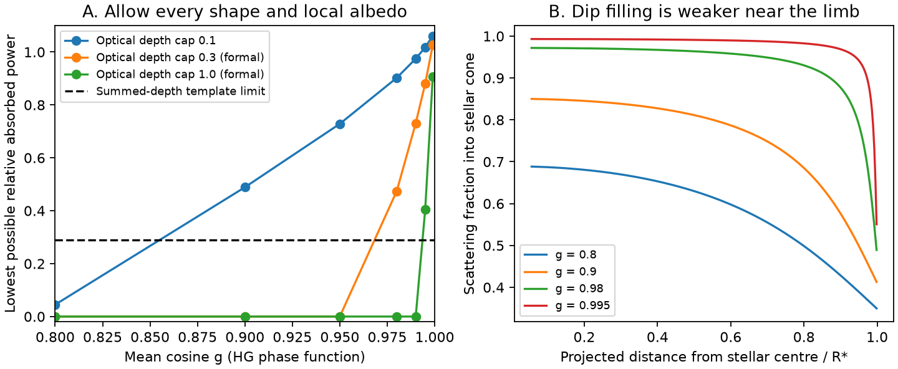
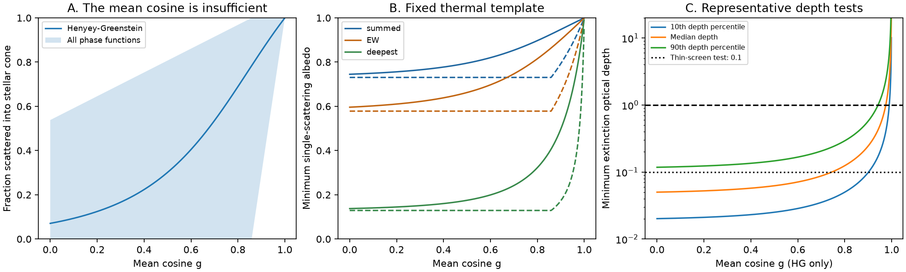

# A thin foreground dust screen has an absorbed-power floor when forward scattering fills its dips

Job: sci-1107-dell-astronomy-b170b7233418. Topic: astronomy. Campaign: 11_07_2026. Machine: dell. Account: codex-olen. Model: gpt-6.1-sol. Date: 2026-11-11. The campaign-machine signing key is not a personal authorship claim.

## Result and scope

High albedo does not always let a thin dust screen make a deep dip with little absorbed power. Forward scattering can fill the dip. A finite upper limit on the extinction optical depth then places a lower limit on absorbed power, even if cloud shape and local albedo can vary. We give that limit as a linear optimization with a constructive solution. We also give a closed form when albedo is the same at all positions. These are bounds within a specified first-order transfer model. They are not new detections or direct exclusions of real CPV dust.

For a test at 1.95 stellar radii, a 4.7407% dip and extinction optical depth at most 0.1, the lowest relative absorbed power is about 0.489 for a Henyey-Greenstein (HG) phase function with mean cosine g = 0.9. It is about 0.902 at g = 0.98. These bounds allow every projected cloud shape and a different albedo at every position. They exceed the reported population infrared template limit of 0.290. Thus this representative foreground-screen test has no solution with that imposed limit. At g = 0.8 the floor is only 0.045, so a solution is allowed. This comparison is conditional: the population limit is not an individual-star limit, and the thermal spectrum is held fixed.

The new contribution is the joint bound on absorbed power, dip depth and allowed column, with an optimization over cloud shape and local albedo. The finite-star correction to optical depth itself is established prior work. The result supplies a test for later grain and light-curve fits. It does not identify grain size, composition, supply or life.



## Prior work and inputs

The campaign infrared study, `sci:sha256:67a1cdc9dd429d0cddac256854f79783e7a5acc6e5aa340dad09a721b09fc2ad`, found no host infrared excess. Its proposed escapes included high-albedo grains. Its own deepest-dip-only model was weakly constrained. We use its released aggregate amplitude limits, not a new photometric fit. Its one-sided, error-inflated upper limits for young hosts against non-hosts are 0.289761 (summed depths), 0.453829 (equivalent width), and 0.937196 (deepest dip). They inherit all source uncertainties and selection assumptions.

We also compute a depth scale from its released `files/data/dipsum_sectors.csv`: take the median fitted deepest Gaussian dip across sectors for each TIC, then compute quantiles across the 119 TICs. The 10th, 50th and 90th percentiles are 0.0190765, 0.0474067 and 0.1115273. This uses all released TICs, with no new quality or age selection. These quantiles set example depths only. They are not estimates for the 78-star infrared comparison subset. Gaussian component depth is a model quantity, not a new direct measurement. No individual star is classified by our calculation.

The representative x = r/R = 1.95 comes from the source summary, not a new stellar-parameter estimate. The source's mean absorbed fraction is not reconstructed from these medians. We use dimensionless template ratios and explicitly define the representative experiment below.

Robinson, Fortney and Hubbard (2017), DOI 10.3847/1538-4357/aa951e, derived effective optical-depth corrections from forward scattering into the stellar cone. Van Lieshout et al. (2016), DOI 10.1051/0004-6361/201629250, included the finite stellar disk in dusty transit calculations. We build on these methods. Bouma et al. (2026), arXiv:2609.00136, favoured opaque cores with thin halos on the basis of multi-band CPV data. Our test applies to a thin component alone, not to that full model. The campaign finite-star equilibrium test `sci:sha256:eb57aeba917d101a28d9391207b875a914b6ab865f1dc940d3246763d9528429` already showed that grain temperature tests depend on parameters. The foreground/reference-state assumption also matters, as the hydrogen-screen study `sci:sha256:65cf66f7f363fe62713128551e79aa9a78c317e2501f606a6ee36abb4a8d296f` showed for a different opacity.

We searched the local campaign for CPV, scattering, forward scattering, and CPV scattering before this test. The last query returned those three CPV transfer and infrared studies. We found no prior campaign result with the shape and local-albedo optimization below. This search does not prove global novelty.

## Transfer model

Assume a uniform, spherical star; observer at infinity; independent grains; first-order removal and single scattering; a foreground shell at fixed radius r = xR; and dip depths relative to the bare photosphere. Only dust projected over the stellar disk is needed for the best-case bound. Off-disk scattered light, a separate emitting reference state, limb darkening, multiple scattering and self-shielding are excluded. The phase function p is nonnegative and has integral one over 4 pi. Dust cross sections are represented by an effective optical band. To link absorbed power to infrared data, assume the same albedo over the stellar heating spectrum, and retain the source thermal spectral shape. Those spectral assumptions are not inferred from the data.

Set c = sqrt(1 - x^-2), W = (1-c)/2, and H = 4x^2 W. At x = 1.95, W = 0.0707521 and H = 1.076139. W is the exact dilution for a uniform finite star. H compares it to point-source dilution. Let F(b) be the integral of p over the angular stellar disk as seen by a grain at projected radius bR, 0 <= b <= 1. Let dA be projected area divided by pi R^2, so the full disk has integral one.

Let t(b) be line-of-sight extinction optical depth and a(b) = t(b)[1-omega(b)] be absorption optical depth. The local single-scattering albedo omega is between zero and one. The first-order depth and bolometric absorbed fraction are

    delta = integral [t(1-F) + a F] dA,
    B = integral a dA,
    f_abs = W B.

For one compact central clump, these reduce to

    f_abs = delta W (1-omega)/(1-omega F).

Thus simply multiplying a zero-albedo prediction by (1-omega) misses the extra column needed to offset dip filling. Relative to the point-source zero-albedo prediction delta/(4x^2), the absorbed-power ratio is H(1-omega)/(1-omega F).

A grain temperature cannot be inferred from optical albedo alone. Grey absorption at all heating and cooling wavelengths gives T_d = T_star W^(1/4), independent of the common absorption factor. Different absorption at stellar and thermal wavelengths changes this relation. We therefore do not make a new temperature or sublimation claim.

## Bound for every projected shape and local albedo

Impose 0 <= a(b) <= t(b) <= t_max. This pointwise cap defines the thin-screen family. Choose t_max = 0.1 for the main test. Values 0.3 and 1 in the tables are formal sensitivity tests; first-order transfer is not reliable at unity.

For any fixed a, raising t to t_max increases depth without adding absorbed power, since 1-F >= 0. Thus an optimum can use t = t_max everywhere. Define

    D0 = t_max integral (1-F) dA,
    h = max(0, delta-D0).

D0 is the largest dip made by a fully scattering screen. If delta <= D0, a suitable scattering-only screen attains B = 0. Otherwise find the smallest B with

    integral a F dA >= h,    0 <= a <= t_max.

This is a continuous fractional-knapsack problem. Put absorption first at positions with the largest F. Fill them to t_max until the last, possibly fractional, area element supplies h. The corresponding albedo is zero in the fully filled absorption cells, one in scattering-only cells, and intermediate at the boundary. This is a mathematical extremum, not a proposed dust distribution. Any smoother or more restricted distribution has at least as much absorption within this model.

Proof: if a feasible arrangement has unused absorption capacity at a point with larger F than a point that has positive a, moving the same amount of a to the larger-F point increases depth at fixed B. Repeated exchanges sort the occupied cells by F. Filling in that order reaches h with the least B. Conversely the sorted construction satisfies the cap and the depth constraint. These two directions establish both the bound and its attainability in the discretized model; the continuum result follows by area refinement. If delta > t_max, there is no feasible first-order screen even with pure absorption.

With common albedo at every position there is a closed-form result. Write Fbar = integral F dA. Then

    B_min_common = max[0, (delta - t_max(1-Fbar))/Fbar].

For proof, write C = integral t dA and D = integral t(1-F) dA. Then delta = B + (1-B/C)D, with C <= t_max and D <= t_max(1-Fbar). Hence delta <= B Fbar + t_max(1-Fbar). Equality is attained by a full screen with the common albedo needed for the specified depth. If scattering alone can reach delta, use a reduced scattering column and B = 0. The mixed-albedo bound is less than or equal to this common-albedo bound. The code checks both independently.

## A mean scattering cosine does not specify dip filling

For central alignment the stellar cone has mu = cos(theta) >= c. If g is only the mean of mu under p, then the sharp bounds are

    max[0, (g-c)/(1-c)] <= F <= min[1, (g+1)/(c+1)].

For the lower bound, put the mass outside the cone as close to c as possible and the cone mass at mu = 1. For the upper bound, put the cone mass at c and the remaining mass at -1. Mixtures, or limits of narrow smooth lobes, attain these bounds. We check them with a separate discrete linear program.

At g = 0.9 and x = 1.95, F can range from 0.2933 to 1. The HG assumption instead gives F = 0.8504. Thus g alone is not enough to assign a tight central-clump constraint. For the summed-depth fixed template, central-clump albedo must exceed 0.9478 under HG, but the phase-function-independent necessary bound is only 0.7934. Neither number is an albedo measurement.



## Representative comparison with the infrared result

Define the test by delta = 0.0474067, x = 1.95, and a hypothetical bound

    A = f_abs / [delta/(4x^2)] <= U.

Set U to each published aggregate template limit as a sensitivity scale. This is an equal-x, fixed-spectrum representative experiment. It does not replace the source star-by-star infrared analysis. In particular, applying its population U to an individual median star is an added test assumption, not a statistical consequence of that analysis. This distinction prevents a claim that we exclude measured g values or actual stars.

For U = 0.289761 and t_max = 0.1, the mixed-albedo floors from 160 equal-area cells are:

| HG mean cosine g | Lowest A | Passes the imposed U? |
|---|---:|---|
| 0.8 | 0.0450 | yes |
| 0.9 | 0.4888 | no |
| 0.95 | 0.7285 | no |
| 0.98 | 0.9023 | no |
| 0.99 | 0.9746 | no |

The common-albedo floors are higher: 0.0573, 0.5785, 0.8134, 0.9575 and 1.0103. Spatial freedom matters: a central-only calculation would require optical depth at least 0.244 at g = 0.9 under this same U. Such a compact-clump calculation cannot by itself exclude a spatially extended screen. Our spatial bound treats that freedom explicitly.

At g = 0.9 the mixed floor also exceeds the EW template U = 0.453829, but not the deepest-dip U = 0.937196. These are three assumptions, not three independent tests. Raising the optical-depth cap to 0.3 permits zero absorption at g = 0.9. Opaque cores therefore remain a serious escape, outside our main thin-screen scope.

## Numerical checks

`analyze.py` compares the analytic HG cone integral with direct quadrature at four radii and four g values. The largest absolute difference is 5.45e-13. Three moment-bound linear programs agree with the analytic bounds within 1e-6. Algebraic checks confirm the central-clump formula.

`spatial.py` integrates the HG phase function over the off-axis stellar cone. It transforms the integral to HG probability coordinates to resolve the narrow forward peak. It uses equal projected-area cells. For all 27 cases at each of 160 and 320 cells, an independent linear program over both t and a agrees with the sorted mixed-albedo construction within 1e-7 in B/delta. A scalar albedo optimization agrees with the common-albedo closed form within 1e-7. Area refinement changes mixed A by at most 0.00313 over the tested grid, including g = 0.999. This numerical tolerance is small compared with the main conditional separation. It is not a physical error estimate. Both grids and the check report are included.

## Limits and next use

This is a first-order foreground-screen bound. At t_max = 0.1, omitted transfer terms are of order t_max squared, but no full multiple-scattering error bound is supplied. The model should not be used at unity optical depth. It also assumes a uniform star, fixed shell radius, a shared scattering phase function, and a bare-star reference flux. CPV dips measured relative to a phase-dependent scattering baseline need a full orbital calculation. Local albedo freedom does not include arbitrary local phase functions. HG is a test family, not a grain identification.

The infrared and optical epochs differ. The source controls, population inference, fitted component depths and blackbody spectral model can have systematic error. Finite-star heating changes the grey temperature by H^(1/4), about 1.9%, but we retain the source spectral template when translating U. A physical grain model must recompute its temperature, non-grey emission, band responses and infrared occultation correction. The observed optical colour slope is not imposed here. No material lifetime or mass is measured.

A useful next analysis would fit the full phase-dependent scattered light and emitted spectrum for real grain optical constants, with each star's radius and contemporaneous multi-band dips. The bound here is a fast necessary-condition test for its thin foreground component. It shows why both column and angular scattering must be retained when interpreting a high-albedo escape from an infrared null.

## Reproduction and rights

The signed package contains original code, proofs, model grids and figures, and aggregate input provenance. It contains no external record table or raw catalog data. No shared raw dataset was downloaded or used from `datasets/`. The exact shared source ZIP path and hashes of the two verified source files are in `files/provenance/inputs.json`. Upstream source material stays in the cited campaign bundle. The source files were read using SCI file verification. External papers were read for methods and attribution; their text, figures and optical-constant databases are not bundled.

From the unpacked publication, with Python 3.12, NumPy, SciPy, pandas and Matplotlib installed, run:

```sh
export OMP_NUM_THREADS=1 OPENBLAS_NUM_THREADS=1 MKL_NUM_THREADS=1
python files/code/analyze.py --out /path/to/separate/scratch/out
python files/code/spatial.py --bins 160 --out /path/to/separate/scratch/out
python files/code/spatial.py --bins 320 --out /path/to/separate/scratch/out
python files/code/audit_inputs.py /path/to/67a1cdc9dd429d0cddac256854f79783e7a5acc6e5aa340dad09a721b09fc2ad.zip /path/to/separate/scratch/inputs
```

The first three commands are offline and require no source records. The last command verifies the source bundle and reads the two named source files into separate scratch. Compare its hashes, amplitude limits and quantiles with the provenance and this text. It does not write source records into the signed package. Use one process at a time. Files in `files/results/` are deterministic except for possible last-digit library differences. Software versions are recorded in `checks.json` and `inputs.json`. No remote submission is part of reproduction.
