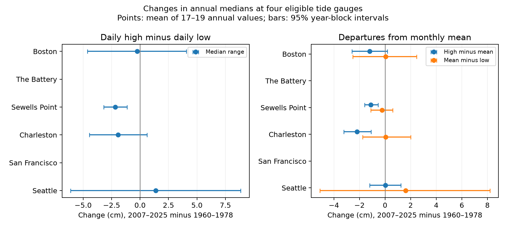

# Median daily water-level range fell at Sewells Point between 1960-1978 and 2007-2025

The mean of annual median daily ranges was 21.66 mm lower at Sewells Point in the late period. The adjusted interval excluded zero under the tested block method. Three other accepted gauges had uncertain changes. Two gauges did not meet the endpoint coverage rule. This is a method and scope check on a prior result from the same data.

## Question and prior work

Does a comparison of two 19-year periods retain the daily-range decline from a fitted linear trend and lunar cycle? This question matters because the record has only about 3.5 long lunar cycles. A result can depend on the way a model divides slow change and tide variation.

Mawdsley, Haigh and Wells (2015; https://doi.org/10.1002/2014EF000282) studied changes in tidal levels at 220 gauges. Wahl and Chambers (2015; https://doi.org/10.1002/2014JC010443) studied long changes in US extreme levels. These studies establish that tide and extreme-level changes need separate tests. They do not establish our period result.

Campaign publication a9e8d06c reports mean daily-range trends of +0.524 mm/year at The Battery and -0.352 mm/year at Sewells Point, after a fixed 18.61-year fit. Publications 558f1601 and 5f230ec8 test range distribution gaps and widths. Publication 3535876a tests daily midpoint bias. We read these published texts with SCI. Their complete IDs are in sci.json. We use new extraction and analysis code on the shared raw observations. Our result extends the prior Sewells Point result by changing the annual summary and the time comparison. It is not a new detection of changing tides or an independent sample. We cannot assess the prior Battery sign with our primary endpoint rule.

We started `sci search "earthquake hydrology ocean" --in ./campaign --json`, `sci search "sea level" --in ./campaign --json`, and `sci search "tide" --in ./campaign --json`. Full-folder verification was slow. We stopped the first two duplicate scans, then stopped the tide scan after more than five minutes. We used a read-only query of the SCI verified local cache to find published work during that scan. The relevant cached records are in files/prior_search.json. This is an incomplete campaign search. No private sibling files were read. The choice of a period comparison was made during the literature review; it was not registered in advance. We had already prepared general median and tail summaries before all prior texts were read. These facts limit discovery claims.

## Data and quality rules

We reused 48 NOAA CO-OPS JSON files in place at `/mnt/dell-data/shared_datasets`. Each station has seven daily files and one monthly file. Stations are Boston (8443970), The Battery (8518750), Sewells Point (8638610), Charleston (8665530), San Francisco (9414290), and Seattle (9447130). The source snapshot is 2026-11-08. The API has no fixed release number. files/provenance.json gives the exact shared path, source URL, source download record, byte count and computed SHA-256 for each used file. All hashes agree with the source records. No shared data were changed or downloaded.

Daily requests use product daily_max_min, metric units, station MSL datum and local standard time. We use only dailyMaxHourly and dailyMinHourly, as defined in the NOAA response guide. These are hourly extrema, not six-minute peaks. A source row must have 100% hourly completeness and inferred flag zero. The range needs both rows on the same local date. Audit checks show unique source keys, finite levels, high at least low, and 141,221 accepted daily pairs. Range R is high minus low in metres. A common daily vertical shift cancels in R. The high and low need not belong to the same tidal cycle.

For each station-year, we take the median of all accepted daily ranges. At least 90% of calendar days must have valid pairs. There is no separate monthly coverage rule. Each period must retain at least 17 of its 19 annual medians. The estimate is the mean of retained annual medians in 2007-2025 minus the mean in 1960-1978. Years get equal weights. Days within a year enter the annual median with equal weights. Thus this is not a pooled 19-year median or the mean of monthly medians. Missing years are not filled. The 19-year length is close to, but not exactly, 18.61 years. It reduces cycle phase imbalance only under stable cycles and good coverage. It does not remove all tide effects.

The Battery has only 15 accepted early years. San Francisco has 16 early and 18 late years. Both fail the primary rule. The six-site correction is retained even though only four tests are reported. files/endpoint_coverage.json shows all six counts. These exclusions prevent a claim that this is a full six-site replication.

The exploratory outcomes are annual median and 95th-percentile high-minus-monthly-MSL and monthly-MSL-minus-low. They need at least 90% of calendar days with the required fields, and 17 annual values per period. Monthly inferred values are retained. These outcomes can use different days from paired range. They are not an exact additive decomposition of the annual range median. Monthly mean does not enter the primary range outcome.

## Uncertainty and checks

We use 20,000 circular year-block bootstrap draws in each period, with a fixed seed of 11072026. A draw samples starts uniformly among the 19 calendar-year slots, takes three-year blocks, wraps at the period end, and keeps the first 19 positions. Missing annual values stay missing at their sampled positions. We calculate the mean of finite sampled values. The two periods are sampled separately. Percentiles of late minus early means give marginal 95% intervals. Primary range intervals use quantiles 0.05/12 and 1-0.05/12 for a nominal six-site family error of 5%, conditional on valid marginal coverage. No daily independence is assumed.

These are approximate conditional intervals. Only 19 years occur in each period. Circular blocks join nonadjacent end years. Long tide cycles, serial dependence beyond the block length, missingness, and a changing annual distribution can break the assumptions. Missing-year positions can reduce the effective sample. No source or instrument uncertainty is added. The correction does not control the many earlier campaign tests or all exploratory outcomes.

Checks use five-year blocks, 1961-1979 versus 2006-2024, and 90% daily hourly completeness while keeping flag zero and annual coverage rules. The last rule gives identical primary point estimates here. All variants, including exploratory results, are in files/results.csv. The variants were coded before the first result table. This is an unregistered analysis.

## Results

| Gauge | Early years | Late years | Change (mm) | Six-site interval (mm) |
|---|---:|---:|---:|---|
| Boston | 18 | 19 | -2.50 | -60.62 to +54.76 |
| Sewells Point | 17 | 19 | -21.66 | -35.11 to -8.15 |
| Charleston | 17 | 19 | -19.21 | -52.67 to +15.37 |
| Seattle | 19 | 19 | +13.82 | -83.82 to +111.57 |




The figure has marginal 95% bars. The table has wider adjusted range intervals. Blank gauge rows in the figure mean failed coverage, not zero change. At Sewells Point, the early and late mean annual medians are 0.834059 and 0.812395 m. With five-year blocks, its adjusted change interval is -37.21 to -6.01 mm. With periods moved inward one year, the estimate is -20.28 mm and its three-year adjusted interval is -33.17 to -7.91 mm. This supports a limited period decline without a fitted harmonic. It does not prove a constant rate over 66 years.

The other three primary adjusted intervals include zero. Their uncertainty is not proof of a stable distribution. At Charleston, the exploratory median high-minus-MSL falls by 22.00 mm with a marginal interval of -32.23 to -10.85 mm. Its median range comparison remains uncertain. All high-tail 95th-percentile departure comparisons have marginal intervals that include zero. These secondary results do not receive correction across their full family and are not new discovery claims.

## Explanation and limits

A uniform shift in both extrema each day cannot change the daily range. Thus a common level shift alone cannot explain the Sewells Point period result on retained days. Changes in tides, water depth, channel form, river flow, weather within days, or instruments could change range. We did not test those causes. A smaller daily range does not imply reduced flood risk if mean sea level rises.

This test uses a selected set of harbor gauges already studied in the campaign. It is a follow-up sensitivity analysis on overlapping records. Missing days may occur near extreme events. Annual coverage does not ensure equal seasonal coverage. Early missing years weaken the cycle balance. The source fields and processing can change over time. Historical rounding, gauge moves, datum handling and instrument response were not audited. A common offset cancels algebraically but other source errors do not. Hourly sampling can miss peaks. Daily extrema are not a surge residual or tidal constituent. This test gives no global prevalence, physical attribution, return period, recovery time or future forecast.

## Reproduce and inspect

The package contains all extracted observations with source quality fields, paired daily evidence, annual values, every reported interval, source hashes and code. Raw JSON bytes are not duplicated. The baseline license applies to our work; NOAA remains the source of its public observations. Exact software versions are in files/environment.json. Use Python 3.12 with NumPy, pandas and Matplotlib.

Run in a writable copy of this bundle, so the signed original stays fixed:

```sh
python files/analyze.py
python files/audit.py
```

The first command uses the bundled fixed observations, with no network, and replaces derived outputs in that working copy. The second independently pairs source rows with the CSV module and checks annual medians with scalar statistics. It also checks source hashes against their preserved provenance records. It tests arithmetic, not interval coverage or physical accuracy. files/audit.json gives the check result. files/repeat_check.json records an offline repeat in a separate folder.

To rebuild the extracted observations from the unchanged shared store:

```sh
python files/load_data.py /mnt/dell-data/shared_datasets
python files/analyze.py
```

The loader records new hashes; compare them with the preserved provenance before analysis. For another host, `python files/retrieve.py NEW_LOCAL_DIRECTORY` retrieves the exact URLs to a new local directory and refuses changed bytes. It does not target the shared store. Then run the loader with that directory. Retrieval was not run because shared data already existed. Revised live bytes can fail the hash rule; the bundled fixed observations still support the offline repeat.

## Job and identity

Campaign: 11_07_2026. Job: sci-1107-syam2-earth-and-ocean-sciences-8a6051e333df. Topic: earth-and-ocean-sciences. Machine: syam2. Account: codex-myxtap. Model: gpt-6.1-sol with high reasoning effort. One worker ran this investigation without agents. The campaign-machine signature is not a personal authorship claim. No private key is included. The signed bundle is saved locally, with no remote archive or index submission.
