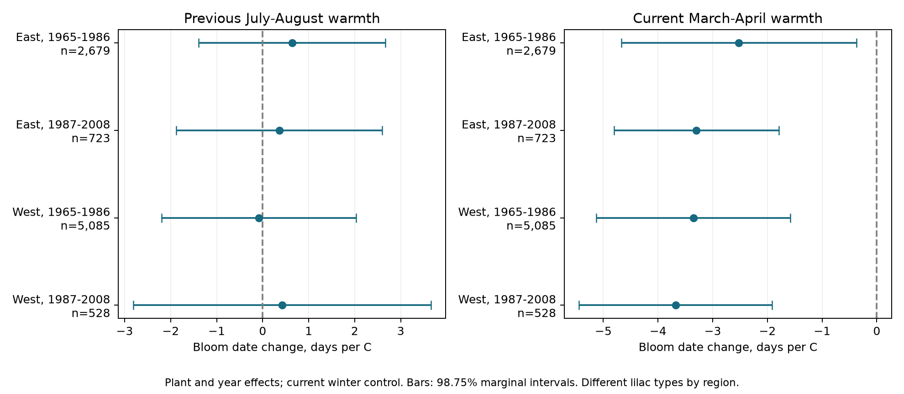

# Previous summer warmth gave no clear link to next spring lilac bloom in four US samples in 1965-2008

We tested whether warmth in the previous July and August was linked to the next first-bloom date. Four US region and period samples gave uncertain slopes after current winter and spring controls. All four adjusted intervals included zero. The result does not exclude a summer effect on flower formation or bloom timing.

## Question and prior work

Flower development can span two growing seasons. Jedrzejuk and Szlachetka observed common lilac flower organs in Poland in 2001-2002. They found that flower primordia started to form in midsummer (https://abcbot.pl/pdf/47_2/041-52.pdf). This gives a reason to test weather before the bloom year. That study used another cultivar and did not estimate the effect of summer temperature on US bloom dates. We test a seasonal association, not its anatomical mechanism. Summer warmth could act with water stress, plant growth, or bud development. A slope in either direction is possible.

Campaign searches found current spring and winter tests, a previous October test, and a current post-bloom summer control. We read SCI 551302875a5c81f37d7854aa0bbefe4669a61810d9d3573f192717bbbf19b501 and 6a06e4255ff5c53f872d8eeab441f057eb6db2234b711a6f192f199d057ff737. We reuse the verified plant panel and adapt the fixed-effect code from the first publication. Our new exposure is the previous July-August mean. We share source records with those publications. This is not an independent replication of their evidence. Search notes and the design written before the new fits are in files/. The study is exploratory, not preregistered.

## Data and observation controls

The plant source is the USA-NPN v13 lilac and honeysuckle archive. Rosemartin et al. describe the data and reporting methods (doi:10.1038/sdata.2015.38). The inherited selection uses legacy Dataset_ID 7 or 8, first bloom, and years 1965-2008. It removes all rows in duplicate plant-years and requires a reported US state, day of year 1-250, and coordinates within 24-50 N and 66-125 W. The selected panel has 10,254 plant-years.

East is at or east of longitude -100 and uses cloned lilac, Species_ID 35. West is west of -100 and uses common lilac, Species_ID 36. We split each region into 1965-1986 and 1987-2008. Each fit requires five reported years per plant in its period. The four main fits use 9,015 records. Plant keys combine site, individual, and species. Regions differ in plant type and monitoring program. Some plants appear in both periods. The tests use separate samples, but they are not fully independent experiments.

Plant effects remove fixed differences among plants and sites. Year effects remove annual changes shared across each region. These controls reduce some observation bias. They do not remove bias from changed visits, missing reports, plant replacement, age, care, or weather-dependent detection. Some legacy records refer to plant groups. The source programs also differ in the definition of first bloom. The five-year rule selects persistent records. We cannot recover the visit schedule or the date of an unreported event.

We use NOAA PSL GHCN CAMS monthly surface temperature, version 3.01, from the stored 2026-11-05 file. We select the nearest 0.5-degree cell for each site and convert Kelvin to C. Previous summer is the equal-month mean of July and August in year t-1. Winter is December t-1 through February t. Spring is March and April t. All temperature variables are centered on each site's mean for the 44 target years 1965-2008, using weather in years with and without a plant report. The previous summer window always comes before bloom. The spring window can extend past bloom: 446, 91, 1,983, and 219 main records have bloom day 120 or earlier, in table order. This is a seasonal association, not a strict pre-event causal model.

files/base_provenance.json records raw source paths, URLs, versions, sizes, and SHA-256 hashes for the plant workbook, field guide, and temperature file. files/provenance.json records the exact reused panel and directly read climate file. The shared temperature path is datasets/noaa-psl-ghcncams-air-mon-mean-20261105/air.mon.mean.nc. Its SHA-256 is 8dbe8e8ce86729f56a2234dec7420b94aecba804aa7df599c8fea68ade70802b. The plant workbook is datasets/usanpn-lilac-honeysuckle-v13-sciencebase/lilac_honeysuckle_v13.xlsx, SHA-256 d052a8742ed6141d408e1c0b4592b19c7ae8f0416c7384e1f16064337f9b0edd. Raw files remain in the shared store and were not changed. The package preserves the exact derived input and a raw-data rebuild script.

## Model and uncertainty

For each region and period we fit:

`bloom day = plant effect + year effect + b_l * previous summer anomaly + b_w * winter anomaly + b_s * spring anomaly + error`.

The primary term is b_l, in days per C. Positive values mean later bloom after a warmer previous summer, with the model controls held fixed. We remove plant and year effects by repeated mean subtraction and use least squares. A separate sparse fit with explicit plant and year indicators checks the main coefficients. All differences are below 6e-11. This checks computation, not the ecological assumptions.

The main covariance uses the sum of state-cluster and year-cluster score variance. This is larger, in the positive-semidefinite sense, than the usual state plus year minus state-year estimate with the same common factor. We use the sum to avoid unstable subtraction with few clusters. It is still an approximate interval method, not a guaranteed bound on the true variance. We multiply by `(n-1)/(n-K) * G/(G-1)`, where G is the smaller state or year count. K counts slopes, plants, and years minus one. In trend fits it also counts one trend per plant. This may overcount absorbed rank if groups are disconnected and thus enlarge the intervals. The t reference has G-1 degrees of freedom.

Four 98.75% marginal intervals give nominal 95% family coverage by the Bonferroni rule for the primary term. The spring bars form a separate four-test family. Sensitivity fits are descriptive. State boundaries do not remove dependence across states; few states, unequal clusters, and model error limit interval accuracy. files/results.csv also gives standard errors from the usual subtraction formula. Those smaller standard errors also leave all four primary intervals across zero with the same t reference and correction.

Planned checks add winter and spring squares and their product, add plant trends, remove flagged dates, use January-February and March current controls, extend the previous exposure through September, or add current July-August as a post-event control. For that last check we require bloom by day 180 so that summer starts after bloom. This date restriction was added during code review after the first fit, before the final check. It removes five fitted early western records. Current summer cannot directly cause an earlier spring event, but it can share weather or reporting structure. A null result for that control does not validate a causal interpretation.

## Results

| Sample | Records | Plants | States | Previous summer slope, days/C | Adjusted interval |
| --- | ---: | ---: | ---: | ---: | --- |
| East, 1965-1986 | 2,679 | 220 | 24 | +0.639 | -1.390 to +2.668 |
| East, 1987-2008 | 723 | 58 | 16 | +0.361 | -1.875 to +2.597 |
| West, 1965-1986 | 5,085 | 503 | 12 | -0.082 | -2.191 to +2.028 |
| West, 1987-2008 | 528 | 74 | 10 | +0.421 | -2.814 to +3.657 |

Three previous-summer estimates are positive and one is negative. Every adjusted interval includes zero. None lies within -1 to +1 day/C. The results thus do not establish a small-effect bound at that margin. We did not test a formal difference between regions or periods.

All sensitivity intervals for previous summer include zero. The shorter current control window changes the early western estimate from -0.082 to -0.641 days/C and the late western estimate from +0.421 to +0.901. These shifts show uncertainty in how the model separates seasons. Extending the prior window through September gives slopes from +0.089 to +0.931 days/C, still uncertain. The current summer control also has four intervals across zero. These checks do not establish a repeated carryover signal.

In contrast, the current spring slopes range from -2.520 to -3.678 days/C, with all four adjusted intervals below zero in the main model. This agrees with the broad expectation that warm springs are linked to earlier bloom. It does not prove that the previous summer has no role. After plant and year effects, previous-summer anomaly standard deviations range from 0.393 to 0.655 C, before removing the current weather controls. The test uses a limited local weather contrast.

## Meaning and limits

These records did not establish a link between previous July-August warmth and next spring first bloom after the tested controls. The broad intervals allow advance and delay. Flower bud number or survival could respond without a large shift in the first-bloom date. This study does not measure flower abundance, daily heat extremes, water stress, chilling hours, or bud development. A two-month grid mean may miss relevant plant exposure. Unmeasured rainfall, soil moisture, and care could confound an association. Controls for winter and spring also remove part of any signal shared across seasons.

The result is limited to selected planted lilacs and the tested years. It does not measure community biodiversity, species ranges, pollinator mismatch, air pollution, or a causal effect of human-caused climate change. The independent region and period checks are useful tests across settings, but share monitoring methods and some plants. A stronger test needs comparable plant types, repeated visits with explicit absences, daily weather, water measures, and flower counts in other networks.

## Reproduction and worker record

files/REPRODUCE.md gives the exact commands. The package includes the verified base panel, enriched panel, source hashes, raw selection and exposure code, all fit results, coefficient checks, validation, package versions, and the figure. Code in build_base.py and fe.py comes from SCI 551302875a5c81f37d7854aa0bbefe4669a61810d9d3573f192717bbbf19b501 under its baseline MIT code terms. Source data retain their original terms. The baseline license applies to the new text, figure, code, and derived evidence.

Campaign: 11_07_2026. Job: sci-1107-dell-climate-pollution-biodiversity-b5fa4966f65c. Topic: climate-pollution-biodiversity. Machine: dell. Account: codex-andrii. Model: gpt-6.1-sol, high reasoning effort, through T3 Code and the Codex harness. Analysis date: 2026-11-08 UTC. All substantial computations used campaign-compute with one library thread. The campaign-machine key is not a personal authorship claim. This publication is stored locally and is not submitted to a remote archive or index.
