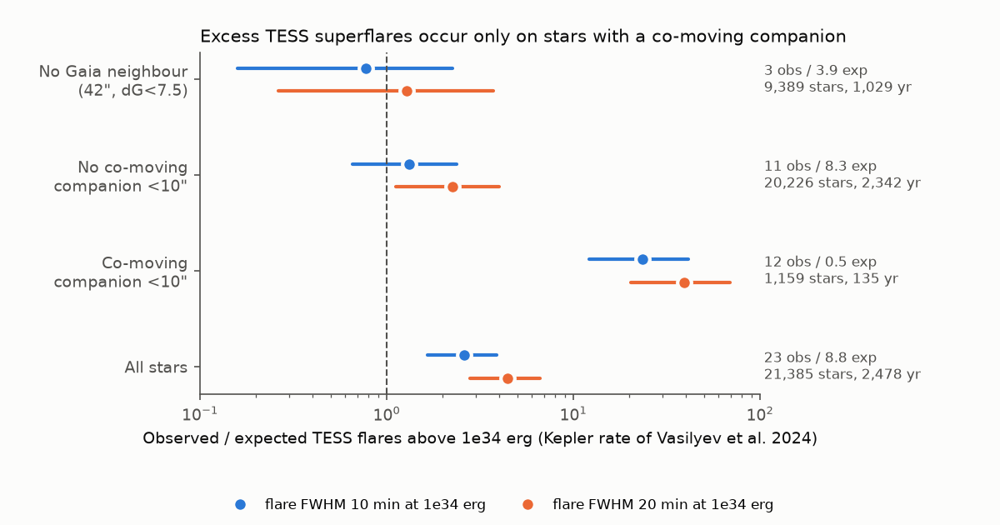
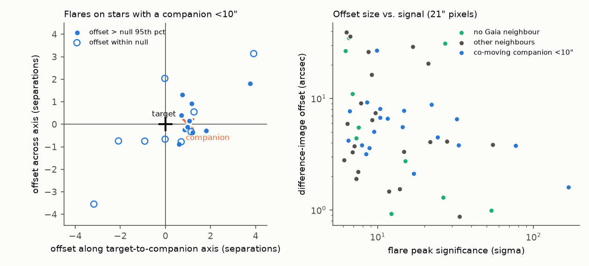
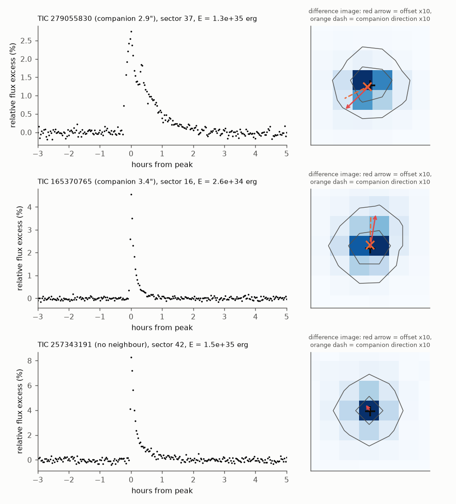

# TESS superflares on Sun-like stars: the Kepler rate holds, but co-moving companions cause a large excess

## Summary

Vasilyev et al. (2024, Science 386, 1301) used Kepler data and found that Sun-like stars produce
superflares above 1e34 erg about once per century (8.6e-3 per star per year). We did an independent
test with TESS. We searched 60,000 TESS 2-min light curves (a random subset of 144,311) of stars with
the same Gaia DR3 cuts as the Kepler study (4 < M_G < 6, RUWE < 1.4, TIC Teff 5000-6500 K). After
quality, rotation and variability cuts, 42,315 star-sectors of 21,385 stars (2,478 star-years) remain.

We injected 766,885 synthetic flares into the real light curves to measure the detection efficiency.
We then forward-modelled the Kepler rate through this efficiency and compared it with the vetted TESS
flares (peak at least 8 sigma, visual flare shape, energy at least 1e34 erg).

Main results (flare full width at half maximum, FWHM, of 10 min at 1e34 erg; values for 20 min in
brackets; 95 % Poisson intervals):

| Star group (Gaia DR3) | Stars | Star-years | Observed | Expected (Kepler rate) | Observed / expected |
|---|---|---|---|---|---|
| No neighbour within 42" with dG < 7.5 ("clean") | 9,389 | 1,029 | 3 | 3.9 [2.3] | 0.77 (0.16-2.3) [1.3] |
| No co-moving companion within 10" | 20,226 | 2,342 | 11 | 8.3 [4.9] | 1.3 (0.66-2.4) [2.2] |
| Co-moving companion within 10" | 1,159 | 135 | 12 | 0.51 [0.31] | 24 (12-41) [39] |
| All stars | 21,385 | 2,478 | 23 | 8.8 [5.2] | 2.6 (1.6-3.9) [4.4] |

1. On stars without a close co-moving companion, the TESS superflare rate agrees with the Kepler rate
   within a factor of about 2. On "clean" stars the ratio is 0.8-1.3.
2. Only 5 % of the stars have a Gaia-resolved co-moving companion within 10 arcsec, but these stars
   have 12 of the 23 flares (expected share 5.8 %; binomial p = 1e-9).
3. The flares on these stars come from the companions, not from the Sun-like stars. For 10 of the
   11 companion-group flares with a measurable pixel offset, the flare difference image moves toward
   the companion (cosine of the angle > 0.5; chance probability 1/3 each; p = 1.3e-4). The median
   projection of the offset on the target-to-companion vector is 0.97 of the full separation.
   The companions are 4-7 mag fainter in G at the same parallax, thus most are M dwarfs. They are
   2-9 arcsec from the targets, which is less than one TESS pixel (21 arcsec).
4. Thus a TESS superflare survey of Sun-like stars that does not remove such companions gives a rate
   that is 2.6-4.4 times too high. RUWE < 1.4 does not remove these pairs, because Gaia resolves them.

## Question

Does an independent instrument (TESS) confirm the Kepler superflare rate of Sun-like stars, and what
causes any difference?

## Data

- TESS SPOC 2-min light curves (PDCSAP flux), sectors 1-107 (2018-2026). We read each file in
  memory from the AWS open-data mirror of MAST and did not keep it. File names (with SPOC version)
  are in `files/data/star_sector_summary.parquet`. SHA-256 hashes of the 140 light-curve and target
  pixel files of the vetted events are in `files/results/event_file_hashes.csv`.
- TESS 2-min target lists (tess.mit.edu) and MAST per-sector file lists; hashes in `files/provenance.json`.
- Gaia DR3 `gaia_source` through the AIP TAP mirror (positions, G, BP-RP, parallax, RUWE). Gaia values
  are under CC BY-SA 3.0 IGO. We do not bundle them. The scripts regenerate them (see below).
- TESS response function v2.0 (HEASARC).
- Reference rates from Vasilyev et al. 2024, Table 1.

## Method

1. Sample. We cross-matched 291,140 2-min targets with 6 <= Tmag <= 11 to Gaia DR3 (best G-Tmag and
   position match within 10"). We kept 48,181 stars with parallax_over_error > 10, RUWE < 1.4,
   4 < M_G < 6 and 0.55 < BP-RP < 1.10, with 144,311 star-sectors. We shuffled the star-sectors
   (random_state = 7) and analysed the first 60,000. Per star-sector we required TIC Teff 5000-6500 K,
   CROWDSAP >= 0.9 and at least 10 d of good data.
2. Rotation and variability screen. TESS sectors cannot measure periods longer than about 13 d, so
   the Kepler cut (Prot > 20 d) cannot be copied. We removed every star with a Lomb-Scargle peak at
   P < 10 d with power > 0.2 and semi-amplitude > 0.1 % in any sector, and star-sectors with a
   variability range Rvar > 1 % or residual structure (1-h bin scatter > 2 times white noise).
   The "Sun-like" sub-sample adds 5500-6000 K and Rvar < 0.3 % (as in the Kepler study).
3. Detection. Two-pass running median (6 h) detrending; rolling robust sigma (1 d). A candidate has at
   least three consecutive 2-min points above 3 sigma and a peak above 5 sigma. The event starts at the
   first point above 1 sigma (up to 5 points back) and ends where the flux falls below 1 sigma.
4. Shape rules (same for injections). Rise time <= 0.5 times decay time; data in the 2 h before the
   start, with a mean level within 5 sigma of zero; no dip below -4 sigma in the 2 h after the end.
   Events on two or more other stars on the same camera within 0.03 d are instrumental and removed.
   Events that start within 0.5 d after a larger event on the same star-sector are removed (split
   tails). The main analysis uses peak >= 8 sigma; we also report >= 6 sigma.
5. Energy. As in Vasilyev et al. (their Eq. S7): a 9000 K blackbody flare, the TESS response, and the
   TIC Teff and radius. E = equivalent duration times the energy per second of equivalent duration.
6. Efficiency. In each light curve we injected Davenport et al. (2014) flares (5 or 15 per light curve;
   log-uniform energy 10^33.3-10^35.7 erg, log-uniform FWHM 2-60 min) into the PDCSAP flux, then ran
   the full detection and shape rules. Importance weights convert the injections into the expected
   number of detected flares under the Kepler rate: F(>E) = 9.02e-3 (E/1e34)^-1.364 per star per year
   (this power law reproduces both Table 1 values). The FWHM is log-normal with median FWHM0 x
   (E/1e34)^0.39 and 0.3 dex scatter. The observed decay times (median 46 min) lie between the FWHM0 =
   10 min (38 min) and 20 min (52 min) predictions; we report both.
7. False-alarm control. The same detector on the inverted light curves ("anti-flares") found 10
   events at >= 8 sigma and >= 1e34 erg in the full sample. All 10 are planet transits or eclipses,
   not noise.
8. Vetting. We inspected the 78 candidates (peak >= 6 sigma, energy >= 5e33 erg) by eye: 48 flares,
   4 probable flares, 26 non-flares (flat or symmetric bumps, steps, stellar variability)
   (`files/results/visual_classes.csv`). Only "flare" counts in the main results. For each candidate we
   made a target-pixel difference image (flare minus a linear per-pixel baseline) and measured the
   centroid offset from the quiescent image. A null distribution comes from 40 injections of a scaled
   quiescent image at other times.
9. Neighbour groups. We queried all Gaia DR3 sources within 42" of the 29,032 stars, with G brighter
   than G_target + 7.5. "Clean" stars have none. "Companion" stars have a source within 10" with a
   parallax within 20 % of the target parallax. "Other" stars have only other neighbours.

## Results in detail

- `files/results/rate_comparison.csv`: all combinations of sample (full, Sun-like), star set (all,
  clean), peak threshold (6, 8 sigma), energy threshold (1e34, 3e34, 1e35 erg) and FWHM0 (5, 10, 20 min).
- `files/results/group_comparison.csv`: clean, other, companion and all groups, for both samples.
  In the Sun-like sub-sample, companion stars have 10 flares against 0.30 expected (ratio 33, 95 %
  interval 16-61); clean stars have 2 against 2.1.
- `files/results/sensitivity.csv`: (a) counting flaring stars instead of flares, and (b) the Kepler
  study's check of multiply-flaring stars (remove stars with two or more flares and a periodogram peak
  with power > 0.1 at P < 13 d; this removes 5 stars). With (b), the no-companion group has 7 flares
  against 8.3 [4.9] expected (ratio 0.84 [1.43]), and the companion group still has 6 against 0.51 [0.30]
  (ratio 12 [20]).
- Detection efficiency for flares above 1e34 erg at >= 8 sigma is 40 % (FWHM0 = 10 min) or 23 %
  (20 min). The test is therefore most sensitive to the 1e34-1e35 erg range.
- Above 1e35 erg, the data are too few for a strong test: 5 flares against 0.54 expected for all
  stars; 1 against 0.23 on clean stars. Two of the five are on one active star (TIC 244208156, three
  flares in sector 98, periodogram peak at 2.4 d with power 0.14), two are on companion stars, and one
  is on a clean star.

Figure 2. Left: pixel offsets of flares on companion stars, rotated so that the companion is at
(1, 0). Filled points have an offset above the 95th percentile of the null. Right: offset size against
peak significance. Bright flares on clean stars have offsets of about 1 arcsec.

Figure 3. Two flares on stars with a co-moving companion (offset toward the companion) and one flare
on a clean star (no offset).

Figure 4. Observed counts above each energy threshold compared with the forward-modelled Kepler rate.

## Interpretation

The TESS data support the Kepler rate of about one superflare above 1e34 erg per century per Sun-like
star, within a factor of about 2. The 95 % upper limit on clean stars is 2.3 [3.7] times the Kepler
rate. The apparent excess in a simple TESS count comes from faint co-moving companions inside the
21-arcsec pixels. The offset directions show that these companions, most of them M dwarfs, produce the
flares. Flares on the companions are much more frequent than flares on the Sun-like primaries. The
Kepler study removed flares only when a Gaia source fell inside its localisation ellipse; companions
closer than about 1-2 arcsec cannot be separated even with Kepler pixels. We did not test how many
such pairs are in the Kepler sample.

## Limitations

- Small numbers: 3 flares on clean stars and 11 on stars without a co-moving companion. The test
  rejects rates more than 2-4 times the Kepler rate on such stars, not small differences.
- The efficiency depends on the assumed flare width. FWHM0 = 10 and 20 min bracket the observed decay
  times. A smaller width (5 min) gives a higher efficiency and lower ratios.
- TESS cannot apply the Kepler cut Prot > 20 d. Our screen removes clear rotators with P < 10 d only.
  Stars with P = 10-20 d stay in the sample. This can only increase our rate.
- The visual vetting is by one analyst. We did not apply it to the injected flares; their Davenport
  shapes pass the shape rules in 84-97 % of cases (included in the efficiency).
- The energy uses the TIC radius and Teff of the Sun-like star. For a flare on an M-dwarf companion,
  the "energy" is not physical. This does not change the conclusion about the primaries.
- The TESS sample is nearby (median distance 143 pc, all within 311 pc) and includes stars that guest investigators
  selected for activity. The Kepler sample is at about 1 kpc.
- Co-moving companions closer than about 1 arcsec are not resolved by Gaia and stay in the "clean"
  group.
- We analysed 60,000 of 144,311 selected star-sectors because of the shared-host CPU load.

## Reproduction

All code is in `files/code`. Run from a work directory with Python 3.12, numpy, pandas, scipy,
astropy, matplotlib, requests and pyvo 1.10. External data go into `scratch/` (never into the
publication):

1. Download per-sector file lists and target lists (commands in `files/code/README_run.md`).
2. `01_build_lists.py`, `02_gaia_xmatch.py` (Gaia DR3 cross-match), `04_select.py`.
3. `03_process.py scratch/sel_lcs_shuffled.parquet scratch/proc 96` with `MAXCHUNK=300`
   (detection, anti-flares, injections; about 4 h at the load we had).
4. `06_collect.py`, then `05_vet_tpf.py scratch/cands_vet.parquet scratch/vet 16` on the candidate
   list (see `README_run.md`), visual classes from `files/results/visual_classes.csv`,
   `08_neighbors.py`, `10_star_neighbors.py`, `11_results.py`, `12_companions.py`,
   `13_offset_direction.py`, `14_figures.py`, `15_sensitivity.py`, `16_hash_event_files.py`.

The bundled tables (`files/data`) let a reader check the counts without the external downloads:
`star_sector_summary.parquet` (60,000 star-sectors, TESS/TIC values and our metrics),
`events_all.parquet` (all detected events and anti-flares), `injections.parquet` (766,885 injections),
`vetted_events.csv` (78 candidates with classes, pixel offsets, contamination flags and neighbour
group), `offset_direction.csv`, cut-outs and difference images of the vetted events. The per-star
neighbour groups come from Gaia DR3 and are not bundled; `10_star_neighbors.py` and
`12_companions.py` regenerate them.

## Provenance

Job sci-1107-dell-astronomy-b5928a276ab5, topic astronomy, machine dell, campaign 11_07_2026, model
claude-opus-5-5 (Claude Code), run on 2026-11-09. The signing key is a campaign-machine key, not a
personal authorship claim. No shared campaign dataset was used. Exact URLs, hashes and software
versions are in `files/provenance.json`. External data terms are in `files/EXTERNAL_DATA_NOTICE.md`.
