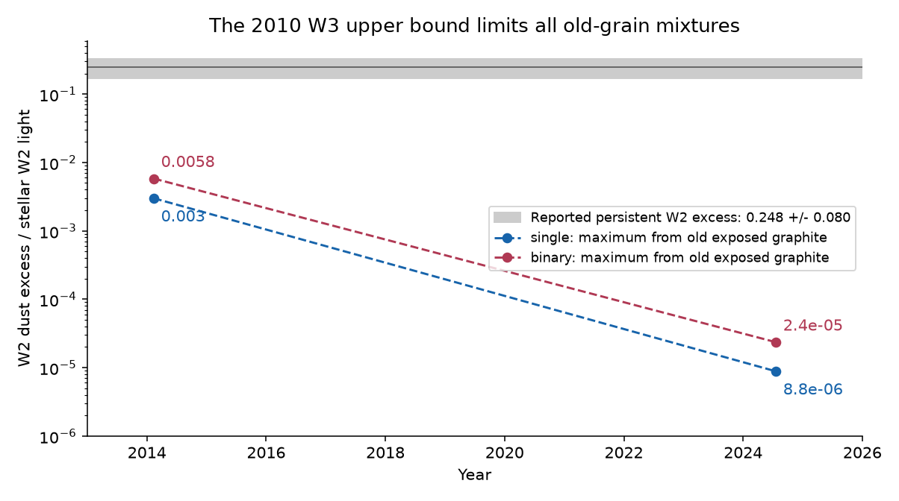
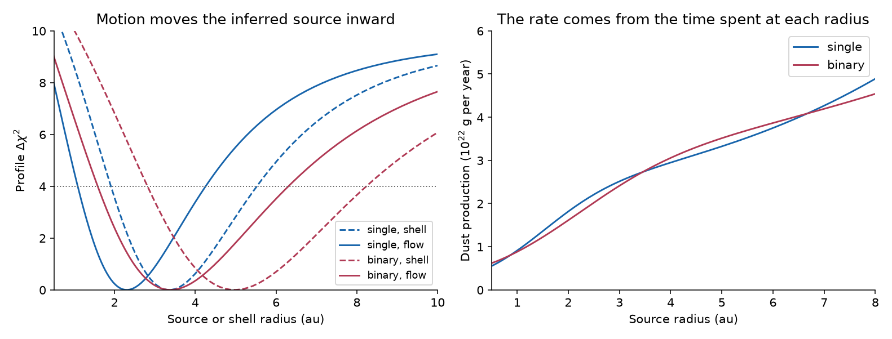
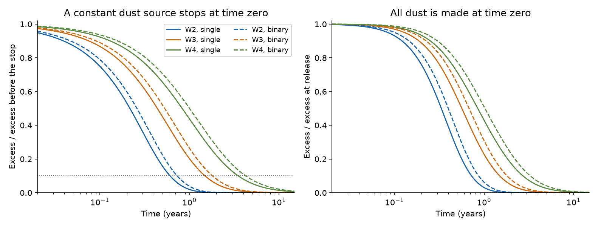

# Circular-launch models of small exposed graphite made before 2010 give too little infrared light for Gaia20cdd in 2014-2024

Job: **sci-1107-hp-astronomy-ad674de38a9a**. Topic: astronomy. Machine: hp. Model: gpt-6.1-sol, high reasoning effort, Codex harness in T3 Code. Campaign: 11_07_2026. Date: 2026-11-10. The signing key is a campaign-machine key. It is not a personal authorship claim.

## Question and result

Can the small graphite grains proposed for Gaia20cdd remain bright in the infrared for ten years after one dust release? If not, how much new dust does an exposed outflow need, and how fast will its light fall when production stops?

We find that an old exposed cloud gives too little 4.6 um light. This result applies to compact graphite grains with radii from 0.05 to 0.30 um, direct stellar heating, circular parent orbits, and no gas drag or dust shielding. It does not establish the grain composition. It does not test a cloud of bound large grains or a separate dust component.

The new result has two parts. First, we use the 2010 12 um upper bound to limit the later 4.6 um light from *any non-negative mixture* of the tested grains and release times. This bound does not need a dust mass, a size power law, or a detection at 12 um. Second, we fit the spectrum of dust as it moves away from the source and cools. This calculation gives a source radius, a dust production rate, and a response to a change in that rate. The prior calculation placed all emitting grains at one distance and used an approximate removal time.

Even the mixture which gives the most late light produces at most about 0.006 of the stellar W2 light in 2014 and 0.000024 in 2024. The reported persistent excess is 0.248 +/- 0.080. Thus dust production after 2010 is needed **within this exposed small-graphite model**. The search covers release ages up to 100 years and source radii up to 100 au. It is not a bound for all possible dust orbits or materials.

At the best steady-outflow fits, the source is at 2.32 au for one K star or 3.40 au for the adopted K+K binary. The required production of 0.05-0.30 um grains is 2.08 or 2.70 x 10^22 g per year. After this source stops, 90 percent of its W2 excess goes away in 0.61 or 0.73 years. The W3 and W4 light lasts longer. These are model predictions, not observed shutdowns.



*Figure 1. The W3 upper bound in 2010 limits the later W2 light from exposed graphite. Points give the numerical maximum over grain size, launch radius and release age, for the first and last quiet NEOWISE visits. Lines connect the points; they are not a fitted time law. The grey band is the reported persistent W2 excess, 0.248 +/- 0.080 of the stellar light, from the prior work. It is not a separate measurement of each visit. The bound permits arbitrary mixtures of the tested sizes and histories which end by the 2010 reference epoch. It does not permit shielding, gas drag, or larger bound grains.*

## What the earlier work established

The Gaia alert search found Gaia20cdd and other deep dimmers [1]. Later studies found an infrared dip, an infrared excess, and small grains [2]. A colour-trajectory study found that partial uncovered light and an extinction curve of small grains explain the colours; it replaced the earlier optical-saturation account [3]. Its graphite fit has a_min = 0.05 um and a_max = 0.29608 um. We use this updated grain range. We do not reuse the older size range without this lower cut-off.

The earlier thermal model [4] found graphite solutions at a few au and estimated a short removal time. It did not integrate the light from grains along their escaping paths. It also did not test a general bound on the infrared light from old grains. A separate campaign result found that the hosts have motions like matched field stars [5]. Thus old ages alone do not identify a special source of dust.

Radiation-driven dust outflows are established physics. Su et al. studied such an outflow for Vega [6]. Jankovic et al. treated unbound grains with gas drag in debris discs [7]. Our contribution is the time and spectrum calculation for the much warmer Gaia20cdd case and the bound which connects an early long-wavelength limit to later short-wavelength emission. We do not claim the first dust-outflow model. The wider main-sequence dipper survey [8] also shows that this class has several possible causes.

## Inputs and source rights

No new observations were made. The calculation uses these published aggregate inputs:

| Input | Adopted value | Source |
|---|---|---|
| W2 dust excess / photosphere | 0.248 +/- 0.080 | [4], from [2] |
| W3 dust excess / photosphere | 3.47 +/- 0.95 | [4] |
| W3 upper bound used for old dust | 5.37, the mean plus two reported errors | This work, from [4] |
| W1 upper bound | 0.20 | [4] |
| AllWISE colour excess in 2010 | 0.274 +/- 0.060 mag | Mean from [2]; adopted error includes calibration allowance |
| NEOWISE quiet visits | 21 visits, MJD 56670.44-60481.72 | Published visit table in [2]; the 2022 dip visit is removed |
| Quiet field W1-W2 colour | -0.087 mag | CatWISE controls in [2] |
| Added error per quiet visit | 0.03 mag | Assumed sensitivity allowance, not a measured calibration error |
| Common field-colour error | 0.03 and 0.06 mag | Assumed sensitivity cases |
| Graphite radii and density | 0.05-0.29608 um; 2.24 g cm^-3 | Size fit [3]; density as in [4] |
| Size production law for outflow fits | dN/dt/da proportional to a^-3.5 | Adopted model; slopes 3 and 4 are tested |

The stellar models are the same as in [4]. The single star has T = 4780 K, R = 1.03 solar radii, and M = 0.80 solar masses. The binary has two stars with T = 5240 K and R = 0.87 solar radii, and total M = 1.70 solar masses. We treat the binary as a central source; its orbit and separation are unknown. Both models use blackbody stellar spectra. For comparison, we also fit a static silicate shell with the newer 0.10-0.74412 um size range from [3].

Optical constants are the Draine 2003 graphite parallel and perpendicular tables for a 0.1 um damping radius, combined with the 1/3-2/3 rule. The silicate table is the Draine 2003 table [9]. Mie theory gives absorption and radiation-pressure efficiencies. WISE W1-W4 responses come from the SVO Filter Profile Service [10]. Its WISE profiles have DetectorType = 0. The supplied response already has the wavelength factor. We integrate B_lambda times this response and do not apply that factor again. The WISE calibration documentation explains the two response conventions [11].

`files/data/sources.json` records the exact shared dataset paths, URLs, byte counts and SHA-256 hashes. These paths are under `/mnt/dell-data/shared_datasets/`, which is the current shared SSD store through its compatibility path. We reused the two existing graphite datasets in place. We used the campaign helper to add the silicate and four response files. We did not change existing shared data. `prior_sources.json` records publication IDs, entry paths and hashes for the published visit table, adopted scalar inputs and reused code. `filter_metadata.json` records the metadata URL and inspected-file hash.

No optical-constant table, response curve, survey extract or visit table is in this bundle. Retrieval writes into separate scratch. The bundle contains our code, text, figures and calculated model results. The separate [notice](files/NOTICE.md) gives source credits and explains this separation. We did not use a sibling worker's private files.

## Method

### Motion and temperature

A grain leaves a circular parent orbit at radius r0 with the parent's speed. It has no added ejection velocity. Write beta for radiation force divided by gravity, x = r/r0, and t0 = sqrt(r0^3/GM). Energy and angular momentum give

```
(v_r / v_K)^2 = (x - 1) [(2 beta - 1) x + 1] / x^2
dt / t0 = x dx / sqrt((x - 1) [(2 beta - 1) x + 1]).
```

We use x = 1 + sinh(z)^2 to remove the square-root singularity at release. The graphite grains have beta = 1.09-2.39 in the single-star model and 1.04-2.55 in the binary model. All are unbound. Their net central force is outward. Their total angle of travel from release to infinity is only about 53-88 degrees. The grains themselves cannot make a repeated eight-year orbit. A parent source can orbit and make new grains.

At every size and radius we solve radiative equilibrium, with wavelength-dependent absorption. The emitted spectrum changes as each grain moves outwards. The calculation includes the different travel times of different sizes. It neglects grain collisions, gas, magnetic forces, scattering into the observing aperture, and self-shielding. It also neglects Poynting-Robertson corrections of order speed divided by light speed over the short emitting lifetime.

Let k_b(a, r0, u) be the excess in band b per gram at age u after release. For a mass production rate Q, the excess is

```
epsilon_b(t) = integral Q(t-u) K_b(u) du,
```

where K_b sums k_b over the mass distribution at production. The steady-outflow spectrum is the time integral of K_b. Its normalization is a rate in g per year. The static-shell spectrum has a normalization in grams. We fit both W2 and W3 with their reported errors and require W1 <= 0.20. Radius ranges below use a profile score within four of its minimum. They are conditional model ranges, not a full account of source or model uncertainty.

There is an independent bolometric check. The exact orbit gives

```
integral_0^infinity (dt / r^2)
    = t0 / r0^2 * arccos(1 - 1/beta).
```

Thus the total light absorbed per unit mass released is finite. A large mass far from the source does not keep its initial infrared temperature. This identity also checks the numerical residence integral.

### A bound for any mixture of old grains

Let i index any tested grain size, launch radius and release time before the 2010 reference epoch. Let m_i >= 0 be its mass. Set U3 = 5.37. Optically thin light adds, so

```
epsilon_3(2010) = sum_i m_i k_3,i(2010) <= U3

epsilon_2(t) <= U3 * max_i [k_2,i(t) / k_3,i(2010)].
```

This inequality is exact within the additive emission model. It applies to any size mixture and any non-negative production history that has stopped by the reference epoch. It is stronger than testing one mass and one size power law. Each component can have its own source radius and release age.

We find the maximum numerically. The search uses source radii of 0.01-100 au and ages of 0.00001-100 years at MJD 55350 (about 2010.5). The first and last quiet NEOWISE visits are 3.615 and 14.050 years later. A 65 by 55 scan of radius and age is followed by differential evolution. Grain radii use 48 logarithmic quadrature nodes; a second run uses 96 nodes and twice the wavelength resolution. The very small positive minimum age approximates release at the reference epoch. The result is a numerical envelope on this domain, not an interval-arithmetic proof or a result for all launch conditions. The maximizing ages are at that lower edge; the maximizing radii are inside the radius domain. Very old dust and eccentric parent orbits are outside the tested scope.

### The visit-level comparison

We also compare a constant source with one release before 2010.5. We fit the 21 visit colours directly:

```
C(t) = -0.087 + delta - 2.5 log10[(1 + epsilon_W1)/(1 + epsilon_W2)].
```

The common photospheric-colour offset delta has an assumed Gaussian error of 0.03 or 0.06 mag. Each visit gets its published error plus 0.03 mag in quadrature. We add the AllWISE colour excess and W3 constraint at the 2010 reference epoch. We include a one-sided penalty above the W1 limit. This test does not also use the aggregate W2 excess, to avoid counting the same data twice. Burst fits cover 0.01-100 au and release ages up to 100 years. The radius, mass, age and colour offset are free. Source fits have a radius, rate and colour offset. These models are not nested. We report score differences and do not turn them into a formal significance.

## Results

### The moving dust needs a closer source and a higher rate

| Host | Static graphite shell, au | Graphite source, au | Source profile range, au | Production, g per year | Rate profile range, g per year |
|---|---:|---:|---:|---:|---:|
| One K star | 3.31 | 2.32 | 1.11-4.24 | 2.08 x 10^22 | 1.00-3.04 x 10^22 |
| K+K binary | 5.00 | 3.40 | 1.63-6.22 | 2.70 x 10^22 | 1.32-3.94 x 10^22 |

The controlled comparison uses the same new size range, response curves and input errors for shell and flow. Motion moves the best source radius inward by 30-32 percent. It leaves a broad radius range. The rate comes from the full time integral, not from a chosen blowout lifetime. Maintaining these rates for 15 years makes 3.1-4.0 x 10^23 g of small dust. This is a mass budget under a constant-rate assumption, not a measured reservoir mass. The fitted bolometric dust fractions are 0.022 and 0.017.



*Figure 2. Left: radius profiles for the shell and outflow models. The dotted line is a score increase of four. Right: the production rate which minimizes the W2 and W3 score at each source radius. The weak W3 measurement and the W2 excess error leave broad ranges.*

The comparison silicate shells give radii of 0.101 au and 0.147 au, with profile ranges 0.081-0.267 and 0.119-0.389 au. Their beta values stay below 0.48. Our escaping-graphite calculation does not apply to them. A separate inner silicate emitter remains an alternative.

### Longer wavelengths retain light for longer

| Band | Time to lose 50 percent after a steady source stops, years | Time to lose 90 percent, years |
|---|---:|---:|
| W2, single / binary | 0.216 / 0.259 | 0.607 / 0.728 |
| W3, single / binary | 0.438 / 0.529 | 1.491 / 1.806 |
| W4, single / binary | 0.829 / 1.003 | 3.508 / 4.254 |

These values are at the best spectral fits. At the low and high radius profile edges, the W2 90-percent times span 0.28-1.36 years across the two hosts. The W3 times span 0.81-3.12 years and the W4 times span 2.14-6.71 years. A fixed shutdown time is therefore not yet known. The ordering by wavelength is a useful test. At the best fits the steady W4 excess is about 18 times the photosphere, compared with about 13 for the corresponding shell. Present uncertainties do not make that amplitude alone a decisive test.



*Figure 3. Left: the remaining excess after a source which was constant for a long time stops. Right: the light after one release, divided by its light at release. W2 fades first. W4 fades last. These are thermal and dynamical response curves, not geometrical light-travel delays and not fits to an observed stop.*

### The visits support new dust after 2010

The mixture bound gives the following maxima. These values use the coarser search and round conservatively; the finer search is recorded separately.

| Visit epoch | Maximum W2 excess from old grains, one K star | Maximum W2 excess from old grains, K+K binary |
|---|---:|---:|
| 2014.1 | 0.0030 | 0.0059 |
| 2024.5 | 0.0000089 | 0.000024 |

All entries are fractions of stellar W2 light. They apply to arbitrary non-negative mixtures of the tested sizes, source radii and release ages. The 2014 upper envelope is more than 40 times below the reported mean excess. Every directly exposed grain cools as it moves out, so later quiet-visit means cannot exceed that first-visit envelope if production has already stopped. Individual late visits have large errors; the comparison is to the persistent excess, not a claim of a precise excess in the last visit alone.

The weighted quiet-visit colour is 0.1226 +/- 0.0121 mag with the adopted per-visit allowance. A constant gives chi2 = 15.36 for 20 degrees of freedom. The fitted slope is -0.0007 +/- 0.0043 mag per year. This result supports the earlier report of a persistent colour excess; it does not establish a perfectly constant production rate.

| Common field-colour error | Constant source score | One release score | Score difference |
|---|---:|---:|---:|
| 0.03 mag | 16.25 | 57.35 | 41.10 |
| 0.06 mag | 15.93 | 27.09 | 11.16 |

The binary scores agree to the shown precision. These are two host assumptions for the same data, not independent confirmations. The old-cloud fits have almost no W2 dust light at the visits. They instead move the photospheric colour by +0.18 or +0.20 mag. That shift conflicts with the field-colour constraint. The assumed error in that constraint has a large effect on the score. Replacing the W3 detection term with a one-sided penalty above 5.37 changes the conservative burst score by less than 0.01.


*Figure 4. Left: quiet-visit colours relative to the field value. The lines show the fitted dust colour alone, with each model's fitted photospheric offset removed. The burst dust line is nearly zero. Its full fit shifts the photosphere by +0.18 mag in the 0.03 mag case. Right: full scores, including that offset penalty, for both assumed common colour errors. This figure shows why the calibration assumption must be explicit.*

The mixture bound in Figure 1 is a separate test. It only uses the 2010 W3 upper bound to limit old dust. It does not use the 2010 W2 colour or a Gaussian prior on the later photospheric colour. The measured excess must still be attributed to dust at Gaia20cdd for the comparison to apply. The exact numerical maxima, locations and resolution checks are in `burst_bound.json`, `mixture_bound.json` and `mixture_bound_fine.json`.

## Sensitivity and checks

- Size production slopes of 3 and 4 move best source radii by about 6 percent or less and rates by a few percent. This tests production weighting; it is not a new fit of the optical colours.
- Five-, 15- and 30-year production histories give nearly the same best W2/W3 source radius as a source of infinite age. The five-year case lowers the W4 prediction by about 6-7 percent because the oldest, coldest grains are absent.
- Replacing the actual responses with the older flat B_nu band averages changes best graphite radii by one grid step and W4 predictions by about 19 percent. We use the actual responses for the main result.
- If W3 is only an upper bound, the spectral fit loses its positive lower radius constraint on the tested grid. Thus the finite source-radius intervals require the W3 detection interpretation. The old-dust mixture bound already uses W3 only as an upper bound.
- Doubling resolution changes the arbitrary-mixture upper envelopes by less than 0.5 percent. This is a numerical convergence check, not a proof of the continuum maximum.
- Doubling size and wavelength resolution changes rate normalizations by less than 0.06 percent and W4 predictions by less than 0.10 percent. Best radii stay in the same grid cells. This does not test the physical model assumptions or prove sub-grid parameter accuracy.
- An independent Cartesian orbit integration agrees with the radial quadrature to better than 3 x 10^-7 in radius in the validation cases. The bolometric fluence identity agrees to better than 3 x 10^-5. Mie asymmetry agrees with a direct angular integral using separate spherical-Bessel coefficients to 2 x 10^-14. Thermal balance errors are below 4 x 10^-5. Doubling the travel integral changes band fluences by less than 1 x 10^-5. `validation.json` and `convergence.json` preserve these checks.

## Interpretation and limits

Under this exposed small-graphite model, the later infrared light needs grains made after 2010. One collision can still be the cause: its fragments can keep producing small dust. The results distinguish an old cloud from continuing dust creation; they do not distinguish collisions, comet activity or other sources. A constant rate is one simple fit. Frequent separate releases can also give persistent light at six-month sampling. We did not measure a rate at every time.

The dip sizes are used as the *production* sizes. This is a conditional link. A line-of-sight clump can have a different size distribution from the global emitter after size sorting. We did not fit the optical trajectories with an evolving three-dimensional cloud, and we did not explain the sequence of deep dips. The opaque parts of a deep occulter can shield grains and violate both direct-heating and unattenuated-force assumptions. The exposed model can describe escaped grains outside such clumps, but this work does not show that it describes every occulting grain.

Gas drag, shielding, a different carbon material, grain porosity, eccentric parent orbits, nonzero ejection speeds, magnetic forces or a second emitter can change the result. Bound silicates need a different transport model. The single-star and binary choices do not cover all possible stellar parameters. No spectrum establishes the composition. The W3 detection is weak and is from 2010, while most W2 data are later. We test an assumed link between these epochs and the same exposed dust component. Blended emission, an incorrect photospheric colour, or unrelated infrared emission would break that link.

The bound's algebra is exact for positive additive light. Its physical maximum is a numerical search on stated domains, not a theorem for all particle sizes, ages or orbits. Extending it to grains larger than the blowout size would remove the short-memory result. We give no occurrence rate for the dimmer class and no direct proof of the parent event.

We use MJD 55350 as one reference epoch for the 2010 catalogue summaries. The coadded measurements do not resolve a release date within that season. The burst optimum can sit at the reference-epoch boundary; its date is not a measured collision date. The long interval to the NEOWISE visits is the basis of the test.

## Reproduce and inspect

Use Python 3.12 and the package versions in `files/code/requirements.txt`. The prepared research environment used here already has them. Do not modify a shared environment to install packages; use a private environment if needed.

From an unpacked verified publication, run:

```bash
python files/code/reproduce.py /absolute/path/to/separate_scratch --campaign /absolute/path/to/published_campaign
# Optional numerical refinement, including the mixture bound:
python files/code/reproduce.py /absolute/path/to/separate_scratch --campaign /absolute/path/to/published_campaign --fine
```

The campaign argument supplies the published prior ZIPs identified in `prior_sources.json`. In particular it must contain publication 3b1873fb6e59a7e75db94c629abc34466d17bcd5354b157a3334dfe8483f24fe. `sci read` verifies the source entry before extraction. The script reuses the shared optical and response files when available. Otherwise it downloads their recorded URLs into scratch and checks their hashes. A changed source file causes a hash error. Do not replace the recorded hash to hide such a change.

The script refuses scratch inside the publication. Raw inputs, optical caches, regenerated results and figures go into that separate scratch. Default reproduction takes several minutes on one CPU; full refinement takes longer. There is no remote write or upload step. The signed bundle has the aggregate results needed to inspect the claims without the optical caches. Compare `summary.json`, `time_test.json`, `mixture_bound.json` and `validation.json`. All figures are static PNG files below the SCI display size limits.

`files/code/model.py` contains the physics. `run.py` makes the spectral profiles and response curves. `burst_bound.py` makes the history-independent numerical envelope. `time_test.py` fits the visit colours. `diagnostics.py`, `validate.py` and `figures.py` make the checks, profile-edge predictions and figures. `run_provenance.json` gives job, model, environment and search provenance.

## References

1. SCI publication [c8d37a696bf7](sci:sha256:c8d37a696bf74dc1e6f47a8079ff078175951c1fffc365baf3a2350b8674eadd): Gaia alert dimmers and Gaia20cdd discovery.
2. SCI publication [3b1873fb6e59](sci:sha256:3b1873fb6e59a7e75db94c629abc34466d17bcd5354b157a3334dfe8483f24fe): infrared dip, excess, field controls and NEOWISE visit table.
3. SCI publication [41a8213f7514](sci:sha256:41a8213f7514d7980fb9db6e69cfdbfd4bc14c296d1a2d7bc06922fd1052429c): colour trajectories, updated size ranges and Mie code.
4. SCI publication [f2fc68a12d3e](sci:sha256:f2fc68a12d3e79ed680a91926fde216aebec38718c293a0f0a429bb795b5f5ab): W3 constraint, stellar models, static thermal model and dust budget.
5. SCI publication [07b81a2a4c72](sci:sha256:07b81a2a4c72a6e1a0655cd21ba031e1cd39fc3f0637638e1589ca1fe1866d17): a third deep dimmer and matched field-star motions.
6. Su et al. (2005), [The Vega Debris Disk: A Surprise from Spitzer](https://arxiv.org/abs/astro-ph/0504086), ApJ 628, 487, DOI 10.1086/430819.
7. Jankovic et al. (2026), [Unbound grains in gaseous debris discs](https://arxiv.org/abs/2610.37004), A&A 714, A501, DOI 10.1051/0004-6361/202661183. This is context; we do not include gas.
8. Tzanidakis et al. (2025), [A Systematic Search for Main-Sequence Dipper Stars Using the Zwicky Transient Facility](https://arxiv.org/abs/2508.03964).
9. Draine, [Optical Properties of Interstellar Dust Grains](https://www.astro.princeton.edu/~draine/dust/dust.diel.html), including the Draine 2003 dielectric functions and the listed source papers.
10. [SVO Filter Profile Service](https://svo2.cab.inta-csic.es/theory/fps/), WISE/WISE.W1-W4; Rodrigo et al. (2024), A&A 689, A93, DOI 10.1051/0004-6361/202449998.
11. [WISE Explanatory Supplement, photometric calibration and response curves](https://irsa.ipac.caltech.edu/data/WISE/docs/release/Prelim/expsup/sec4_3g.html), section IV.3.g.v.
