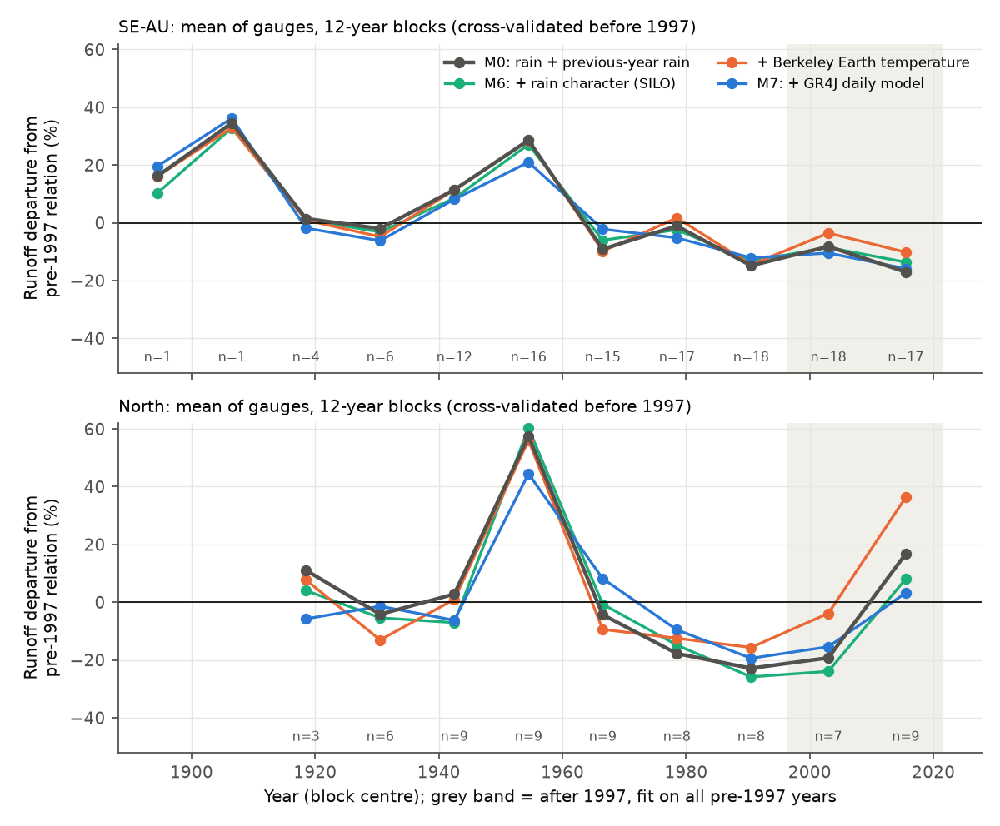
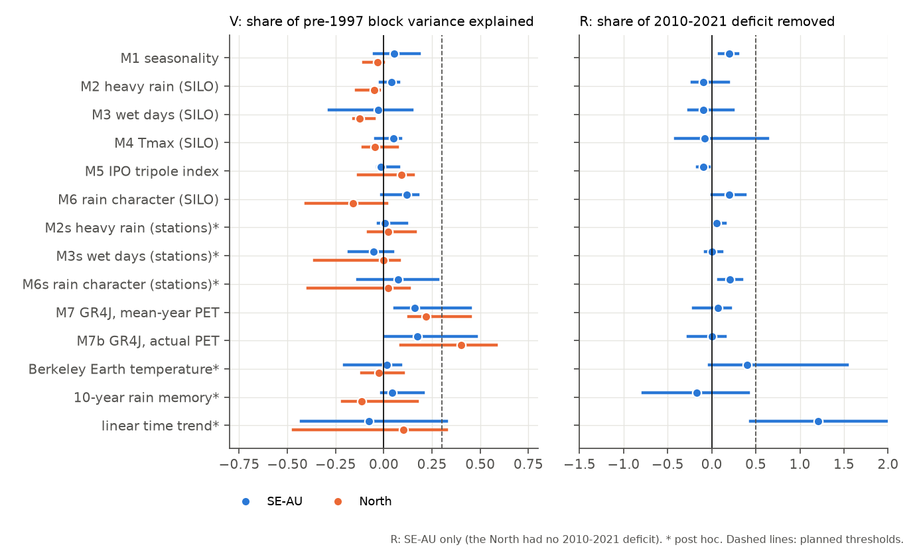
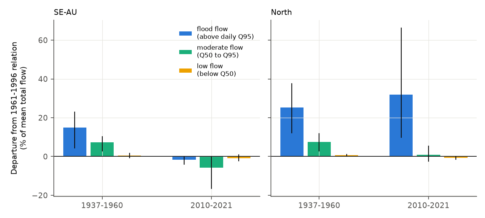

# Rain character, temperature, IPO and GR4J did not explain multidecadal runoff efficiency in 27 eastern Australian records (1889-2021); the 1937-1960 high era was a flood-flow excess in both regions

Job `sci-1107-hp-earth-and-ocean-sciences-777e9ce1b5cb`, campaign 11_07_2026, topic
earth-and-ocean-sciences, machine hp, account claude-myxtap. Model: Claude Opus 5.5
(`claude-opus-5-5`) in Claude Code (T3 Code). The signing key is a campaign-machine key. It is
not a personal authorship claim.

## Summary

**Question.** Campaign bundle 4e9ae7e7 found, in long streamflow records (1889-2025), that runoff
at equal rain in south-east Australia (SE-AU) was about 19% higher before 1957 than in 1957-1996, and
that pre-1997 13-year departures ranged from -13% to +26%. The post-1997 SE-AU deficit was at the
low edge of this range. The open question was: is the post-1997 deficit part of a multidecadal
change in runoff efficiency that has a **climatic cause**? We tested this directly. We added
climatic variables that the annual rain total does not contain to the rainfall-runoff relation,
and measured how much of the pre-1997 multidecadal variation and of the post-1997 deficit each
removes, out of sample.

**Data.** The same 27 long-record gauges as the 4e9ae7e7 window analysis (18 SE-AU, 9 "North"
control gauges in northern NSW and Queensland). Each gauge has 50 or more valid years before 1997
and 10 or more before 1957. Flow: Bureau of Meteorology (BoM) Water Data Online, daily, downloaded
again on 2026-11-11. Daily catchment rain, maximum temperature and PET: SILO series in CAMELS-AUS
v2.03 (1889 to May 2022; the analysis ends in 2021). IPO: tripole index (TPI) from HadISST1. Fixed
rain stations: 42 GHCN-Daily stations of the 4e9ae7e7 network. Post hoc: Berkeley Earth
temperature. Secondary sample: 45 SE-AU and 16 North CAMELS-AUS catchments with 40 or more valid
years in 1951-1996.

**Method (planned; `files/ANALYSIS_PLAN.md` was written before any covariate result).** Per gauge,
annual runoff Q was regressed on rain P and previous-year rain P1 (M0), and on M0 plus one covariate:
cool-season share (M1), rain on days above the 1951-1996 95th percentile (M2), number of wet days
(M3), mean daily maximum temperature (M4), annual TPI (M5), M1-M3 together (M6), and the annual sum
of a daily GR4J model (M7: day-of-year mean PET; M7b: actual PET). The pre-1997 record was split
into nine fixed 12-year blocks (1889-1900 ... 1985-1996). Each block departure (in % of mean
calibration flow) comes from a fit on all **other** pre-1997 years; for M7, GR4J was also
calibrated again for each left-out block (daily KGE; median KGE 0.83-0.85). Post-1997 blocks
(1997-2009, 2010-2021) use a fit on all pre-1997 years. Metrics: **V** = share of the variance of
the gauge's pre-1997 block departures that the covariate removes (median over gauges); **R** =
share of the mean 2010-2021 deficit that it removes. Intervals: 95% bootstrap over 2 x 2 degree
cells (2,000 resamples). Planned rule: a covariate "explains the multidecadal changes including the
post-1997 deficit" if V >= 0.3 and R >= 0.5 (both intervals above 0). North control: a covariate
fails if it predicts a 2010-2021 North deficit more than 10 points larger than M0 (the North
recovered after 2009).

## Main results

**1. No planned climatic covariate met the rule in SE-AU (Figure 2, `files/results/main/`).**

| Model (SE-AU, 18 gauges, 8 cells) | V (95% CI) | 2010-2021 departure | R (95% CI) | North control |
| --- | --- | --- | --- | --- |
| M0 rain + previous-year rain | 0 | -17.0% | 0 | - |
| M1 cool-season share | 0.05 (-0.05 to 0.19) | -13.6% | 0.20 (0.08 to 0.30) | pass |
| M2 heavy rain (SILO) | 0.04 (-0.02 to 0.08) | -18.7% | -0.10 (-0.22 to 0.19) | pass |
| M3 wet days (SILO) | -0.03 (-0.28 to 0.15) | -18.7% | -0.10 (-0.26 to 0.24) | pass |
| M4 Tmax (SILO) | 0.05 (-0.04 to 0.09) | -18.4% | -0.08 (-0.41 to 0.63) | pass |
| M5 IPO tripole index | -0.01 (-0.03 to 0.08) | -18.6% | -0.09 (-0.16 to -0.03) | pass |
| M6 rain character (M1-M3) | 0.12 (-0.01 to 0.18) | -13.7% | 0.20 (0.00 to 0.38) | pass |
| M7 GR4J, mean-year PET | 0.16 (0.06 to 0.45) | -15.9% | 0.07 (-0.21 to 0.21) | pass |
| M7b GR4J, actual PET | 0.17 (0.00 to 0.48) | -17.0% | 0.00 (-0.27 to 0.15) | pass |

The median SD of a gauge's pre-1997 block departures was 21.6% with M0 and 19.0-22.9% with any
covariate. Only the daily GR4J model removed a clear (but small) part of the pre-1997 variation,
and it removed nothing of the 2010-2021 deficit. Seasonality removed one fifth of the deficit but
none of the earlier variation; this repeats the partial seasonal effect of bundle 996e7776. The IPO
made the deficit slightly larger. In the North, M7b met the variance part of the rule (V = 0.40,
0.09 to 0.58; M7 0.22, 0.13 to 0.45), and GR4J reproduced the North recovery after 2009 (2010-2021
departure +3.2% and -6.8%, against +16.7% with M0). The secondary 1951-2021 CAMELS sample (4
blocks) gave the same result: no covariate had V above 0.06 in SE-AU; M1 removed 22% (6 to 42%)
of its 2010-2021 deficit of -10.9% and M6 26% (1 to 59%).

**2. Planned data check: SILO daily rain character drifts before 1937.** Relative to fixed stations,
SILO catchment rain had 5-15 more wet days per year and up to 6 points smaller heavy-rain share in the
1889-1936 blocks (relative to 1951-1996) (`files/results/silo_vs_station_character_by_block.csv`). This is
larger than the block-to-block signal, so by the plan the SILO M2/M3 covariates are unreliable before
1957. Post hoc, we used station-based covariates instead (`files/results/station_variant/`, compared
with M0 on the same years). They also failed: V = 0.01 (heavy rain), -0.05 (wet days) and 0.07
(-0.14 to 0.28, all three); R = 0.06, 0.00 and 0.21 (0.08 to 0.34).

**3. Post hoc: the pre-1997 variation is real and shared, and it is dominated by one era (Figures 1
and 4).** The observed SD of 12-year block means of M0 residuals was 1.9 times (1.4 to 2.4) the SD
expected from short-memory (AR1) noise in SE-AU (16.7% against 8.4%) and 2.1 times in the North.
The mean correlation between gauges of their block departures was 0.46 (SE-AU, 124 pairs) and 0.60
(North). The largest feature is a high-runoff era in 1937-1960: mean departure minus that of
1961-1996 was +34.0 points (15.1 to 46.6) in SE-AU and +43.9 (17.3 to 72.6) in the North. It
included the WWII drought block. Its size did not change with forest cover (Spearman rho -0.05) or
rain-fed pasture (0.11); it was larger in drier catchments (rho 0.56, p = 0.02).

**4. Post hoc: the 1937-1960 excess and the 2010-2021 deficit are in different parts of the flow
range (Figure 3, `files/results/flow_class.csv`).** We split daily flow at each gauge's 1961-1996
50th and 95th percentiles and repeated M0 (1961-1996 calibration) for each part.

| Departure from the 1961-1996 relation, % of mean total flow | Flood flow (above Q95 part) | Moderate (Q50-Q95) | Low (below Q50) |
| --- | --- | --- | --- |
| SE-AU 1937-1960 (18) | +15.0 (4.4 to 23.0) | +7.4 (2.8 to 10.2) | +0.5 (-0.6 to 1.7) |
| SE-AU 2010-2021 (17) | -1.7 (-4.1 to -0.4) | -5.7 (-16.4 to -0.2) | -0.8 (-2.3 to 0.9) |
| North 1937-1960 (9) | +25.2 (12.3 to 37.6) | +7.4 (2.8 to 11.8) | +0.6 (0.2 to 1.0) |
| North 2010-2021 (9) | +31.9 (9.9 to 66.3) | +0.9 (-2.5 to 5.3) | -0.7 (-1.5 to 0.0) |

At the fixed stations, SE-AU rain on heavy days in 1937-1960 was 3.6% **lower** than in 1961-1996
(-7.4 to +0.6); in 2010-2021 it was normal (+2.7%, -9.2 to +10.7). In the North, rain above the
99th percentile was 19.7% higher in 1937-1960 (8.3 to 35.7). Thus the SE-AU flood-flow excess of
1937-1960 occurred without more heavy daily rain, and the SE-AU 2010-2021 loss occurred mainly in
moderate flows with normal heavy rain.

**5. Post hoc: monotonic terms remove the SE-AU deficit but fail the North control.** A linear time
trend fitted on 1889-1996 removed all of the 2010-2021 SE-AU deficit (R = 1.21, 0.44 to 2.96;
1951-2021 sample 1.38, 0.58 to 2.42). Berkeley Earth temperature removed 40% (-3 to 154%; 1951-2021
sample 87%, 53 to 128%). Neither explained pre-1997 variation (V = -0.08 and 0.01). In the North,
both predicted a 2010-2021 deficit that did not occur (departures +38.1 and +36.3 against +16.7 with
M0; 1951-2021 sample +26.6 and +26.4 against +12.7), so both fail the control. The fitted
temperature effect cannot be separated from any slow monotonic change. Ten-year and five-year rain
memory terms did not help (V <= 0.04, R <= 0.06).

## Interpretation

- **The tested climate variables do not explain the multidecadal changes in runoff efficiency.**
  Rain seasonality, daily intensity, wet-day frequency, temperature, the IPO, multi-year rain memory
  and the daily rain sequence in GR4J each leave more than 80% of the pre-1997 block variance in
  SE-AU and all or most of the post-1997 deficit. The best climatic candidate for the deficit is
  cool-season rain share (about one fifth). This is a null result for the "climatic cause"
  hypothesis within the variables we could measure back to 1889.
- **The pre-1997 variation that made the post-1997 deficit look ordinary is mostly one era.** The
  1937-1960 high-runoff era was shared by both regions, sat mostly in flood flows, and in SE-AU came
  with no more heavy daily rain at fixed stations. The post-1997 SE-AU deficit is different in kind:
  SE-AU only (the North recovered, and GR4J reproduces the North recovery from rain), and mostly
  in moderate flows (the range dominated by baseflow and storm recessions; compare bundles 5b8df990
  and 7cecffa9). Thus "post-1997 windows match earlier lows" does not show a common cause; the
  earlier lows are lows relative to a reference that contains the 1937-1960 era.
- **Relative to 1961-1996, the SE-AU 2010-2021 deficit at these long gauges is smaller and
  uncertain:** -8.2% in the flow-class model and -6.7 points (-19.0 to +0.8) relative to the
  1961-1996 blocks, which were already low in 1985-1996 (-14.9%). This agrees with a gradual SE-AU
  decline since about 1960 (bundle 448ef5cf) more than with a 1997 step. The 2010-2021 loss
  relative to 1961-1996 was larger in catchments with more rain-fed pasture (rho -0.60, p = 0.01)
  and in drier ones (rho -0.54, p = 0.02).
- **Possible non-climatic causes of the 1937-1960 flood-flow excess** (not tested): rating curves
  extrapolated to floods in early decades, or surface condition (for example ground cover before
  myxomatosis in 1950-1952, the 1939 fires). Its equal size in forest and pasture catchments and in
  both regions argues against a single land-use cause.

## Limitations

- Small and clustered sample: 18 SE-AU gauges in 8 cells and 9 North gauges in 7 cells; only 1-6
  SE-AU gauges before 1937. V is a median of per-gauge ratios over 4-9 blocks and is noisy.
- Annual linear models; the covariates are entered one family at a time. GR4J is one conceptual model
  with KGE calibration; other models (with groundwater stores) could do better.
- SILO daily character is unreliable before 1957 (planned check). Station covariates come from
  mostly low-elevation stations within 150 km; GHCN-Daily recording practice can also change.
- SILO temperature before about 1957 is weakly constrained; Berkeley Earth is 1-degree.
- Flow-class, noise, coherence, land-cover, trend, memory and Berkeley Earth analyses are post hoc.
- Early flow measurements (ratings, estimated days) may be biased, especially at high flows. We could
  not test rating changes.
- The analysis ends in 2021 (daily rain), not 2025.

## Figures

**Figure 1.** Mean of gauges of 12-year block runoff departures from the pre-1997 relation
(cross-validated before 1997), for M0 and three covariate models. n = gauges per block.

**Figure 2.** V (share of pre-1997 block variance removed) and R (share of the 2010-2021 SE-AU deficit
removed) per model, with 95% cell-bootstrap intervals. Dashed: planned thresholds.

**Figure 3.** Departures from the 1961-1996 relation in 1937-1960 and 2010-2021, split into flood,
moderate and low parts of the daily flow range.

**Figure 4.** Observed SD of pre-1997 12-year block means of M0 residuals against the SD expected
from short-memory (AR1) noise, per gauge.

## Files

- `files/ANALYSIS_PLAN.md`: plan written before covariate results (SHA-256 at writing:
  edd047c4c5b0d373d49f682286f4a9a6c32e8a8e058e5026e699a442437591db).
- `files/code/`: all code; `reproduce.sh` runs the full pipeline into a scratch folder. Main
  scripts: `blocks_analysis.py` (planned models and bootstrap), `gr4j.py` and `gr4j_cv.py` (GR4J
  and block calibration), `build_annual.py`, `tpi.py`, `station_*.py`, `flow_class.py`,
  `posthoc.py`, `figures.py`.
- `files/results/main/`: per gauge, block and model departures (`departures.csv`), V/R metrics with
  intervals (`metrics.json`), group means by block (`group_blocks.csv`), noise test.
- `files/results/station_variant/`, `files/results/camels_1951/`: station-covariate variant and the
  1951-2021 CAMELS sample.
- `files/results/flow_class.csv`, `files/results/posthoc.json`: post hoc results.
- `files/results/gr4j_parameters/`: fitted GR4J parameters and KGE per gauge and calibration set.
- `files/provenance/`: BoM request URLs and SHA-256, GHCN-D SHA-256, CAMELS member SHA-256, shared
  dataset records, gauge list and station network.
- `files/DATA_NOTICE.md`: third-party data terms and credit lines. No flow, rain, temperature, SST or
  station values are in this bundle.

## Reproduction

From an empty scratch folder outside the publication:
`bash <bundle>/files/code/reproduce.sh <bundle>/files/code <campaign>/datasets`.
It needs the shared CAMELS-AUS v2.03 files, HadISST1 and Berkeley Earth copies (SHA-256 in
`files/provenance/shared_dataset_records.txt`), numba, and network access to BoM and NOAA NCEI.
BoM values can be revised by the agencies; compare hashes with
`files/provenance/bom_kiwis_fetch_log.tsv`. Seeds are fixed (GR4J differential evolution seed 1,
bootstrap seed 7). On the campaign host (2 CPUs, heavy load) GR4J took about 2.5 hours and the
bootstraps about 1 hour. Software: `files/environment.txt`.
