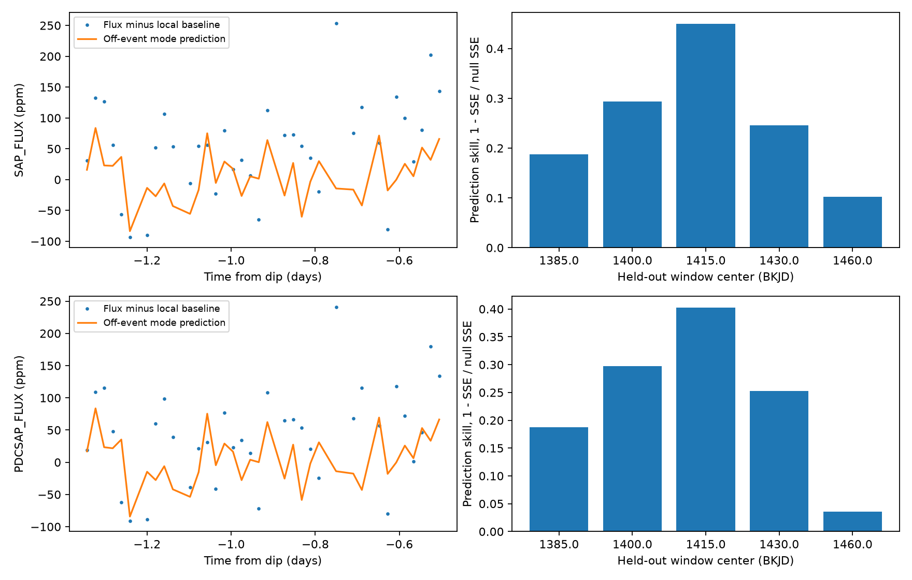

# Off-event mode fits predict less than 14 ppm of a selected pre-dip response in Kepler quarter 15 of KIC 8027456

Three-mode and six-mode fits to data outside a known dip predict only -8.8 to +13.3 parts per million (ppm) of a selected pre-dip response. The measured response is about 100 to 112 ppm in the main local fit. This result limits these stable mode models as an explanation of that response. It does not prove dust scattering or a new object.

## Question and prior work

Can stable oscillations explain the selected increase in light before the known comet-like dip of KIC 8027456, also called HD 182952?

Kennedy et al. (2019, DOI 10.1093/mnras/sty3049) reported the asymmetric dip near BKJD 1448.9. Campaign publication SCI sha256:925bf68b588009edda48b379bc875eab357972ffad3bd53bb63b01402febbb90 measured a positive pre-dip response with a fixed Gaussian profile. We read its publication. We use its event time, profile, mask and local estimator. Its main raw and corrected flux responses are reproduced here. That work tested baselines, pointing and background terms, but did not test a mode model trained outside the event. Our campaign search results are preserved. We read published work only.

Murphy et al. (2024, DOI 10.1093/mnras/stae2226), Table A1, lists this star as TIC 159719806 in a TESS pulsator study. It lists a strongest frequency of 71.999 per day. This gives a physical reason to test stable stellar oscillations. We checked the table in the public arXiv PDF, 2409.13135. The source and PDF hash are in files/literature.json. This is independent published context for stellar variability, not confirmation of the Kepler dip or pre-dip feature. No TESS time series was fitted. Our fitted frequencies are selected from Kepler data, not fixed to the TESS frequency.

## Data and provenance

We read the existing shared file in place:

`/mnt/dell-data/shared_datasets/kepler-kic8027456-q15-dr25/q15.fits`

It is the public Kepler DR25 quarter 15 long-cadence file on channel 43. The pipeline version is SOC 9.3.31 r60524. Its size is 506880 bytes. Its SHA-256 is `55f138bf46a55b07b50bfa1355dc317d86dae011ce0104902711960e2c2592e4`. The exact public S3 URL and resolved shared path are in files/provenance.json. A copy is in files/input.fits for offline reproduction. No shared data were changed.

We keep 3806 rows with zero SAP_QUALITY and finite time, SAP_FLUX and PDCSAP_FLUX. Each flux is divided by its retained quarter median and expressed in ppm. BKJD means BJD minus 2454833. SAP is raw aperture flux. PDC is corrected flux. Both products use the same observations and are not independent confirmation.

## Method

The main mode model has six frequencies in the range 0.5 to 100 per day. Its coefficients are constant through the quarter. It contains an offset and a sine and cosine at each frequency, evaluated at the recorded barycentric times. A single constant exposure time changes a sine amplitude by a constant factor, which these free coefficients absorb. We do not infer intrinsic mode amplitudes. Frequencies above the long-cadence Nyquist frequency have aliases. Our results do not identify physical stellar modes or distinguish them from coherent detector signals.

All samples within five days of BKJD 1448.9 are excluded before mode fitting and before baseline estimation. For training, subtract a centered five-day running time-window median from the remaining flux. Median estimates require ten samples. Rows without a finite median are excluded from training. No data from the event interval enter the training flux or median. Event flux is used only for the final comparison.

Start with an offset. At each step, compute a Lomb-Scargle spectrum of the training residual from 0.5 to 100 per day, with eight grid samples per peak. Refine the largest peak within one grid step by a bounded least-squares search. Add that frequency and refit all linear coefficients. Previous frequencies stay fixed. Save models after three and six steps. This is a finite greedy model, not a search over all mode combinations. The sensitivity choices use three-, five- and seven-day medians and upper frequency limits of 24 and 100 per day.

To measure the selected response, fit raw normalized flux within five days of the dip. Exclude times from -0.5 to +2.1 days relative to the dip. Fit a quadratic baseline plus a Gaussian centered at -0.75 day with a standard deviation of 0.10 day. Average the Gaussian at 21 sub-times over a 0.02043365-day exposure. The Gaussian has a positive sign; a positive coefficient means more light. Fit the same design to the mode prediction. Linearity makes their coefficient difference equal the response after mode subtraction. We also use three- and seven-day local half-windows and linear baselines. All 144 combinations of flux, mode training and local fits are saved in files/fits.json. These choices are exploratory and were not registered before prior campaign work.

For validation, exclude separate ten-day windows centered at BKJD 1385, 1400, 1415, 1430 and 1460. Keep the event mask as well. Repeat median estimation, frequency selection and coefficient fitting for each held-out window. Fit and subtract a separate quadratic from both the measured and predicted held-out series. Define prediction skill as one minus the mode residual sum of squares divided by the no-mode sum of squares. The local quadratic uses held-out data only to remove slow variation for scoring. It does not tune the modes. The main pooled skill sums squared errors over the five windows. Files/validation.csv contains all 40 flux, frequency-range and mode-count tests. Windows have different sample counts and gaps. This is a finite validation test, not a population estimate or a false-alarm probability.

## Results

| Main measurement | SAP | PDC |
|---|---:|---:|
| Measured profile coefficient, ppm | 111.86 | 99.87 |
| Six-mode predicted coefficient, ppm | -1.02 | -0.99 |
| Coefficient after mode subtraction, ppm | 112.89 | 100.86 |
| Predicted coefficient range across all choices, ppm | -8.64 to 13.27 | -8.72 to 13.24 |
| Residual coefficient range across all choices, ppm | 67.14 to 126.79 | 74.22 to 124.04 |
| Pooled held-out prediction skill | 0.248 | 0.228 |

Each of the five main held-out tests has positive skill. SAP skill ranges from 0.102 to 0.450. PDC skill ranges from 0.036 to 0.403. The model can predict part of the short-time flux variation away from the event. Thus, its small pre-dip coefficient is not due only to a model with no predictive value. However, a useful model for some variation need not include all variation.



Left: flux after local baseline subtraction, and the mode prediction after the same type of subtraction. Lines connect the mode values at retained observation times; they do not show the unresolved high-frequency waveform. Right: main six-mode held-out prediction skill in five ten-day windows. These flux products share observations.

The three-mode fits predict about 11 to 13 ppm of the profile. The six-mode fits predict about -9 to +2 ppm. Both remain small relative to the measured response. The data do not require the measured pre-dip coefficient to be removed by the tested stable-mode explanation. All fitted frequencies and coefficients are saved. Their near agreement between products does not give independent evidence of a stellar origin.

## Checks and limits

Files/audit.py checks exact sine coefficient recovery using the real sampling and event mask at 3.12345 and 71.999 per day. The maximum prediction error is below 6e-14 ppm. A 100-ppm Gaussian added to real flux changes the local coefficient by 100 ppm, with error below 7e-11 ppm. It also checks the reported coefficient subtraction. These checks test the algebra. They do not establish mode selection completeness or a noise probability.

We give no new confidence interval or significance claim for the brightening. It was selected in prior work. The sensitivity ranges are not uncertainty intervals. We do not update the prior study's conditional noise intervals. Mode frequencies and counts are selected, and the greedy fit can omit weak or close modes. Slow changes below 0.5 per day, changing amplitudes, phase changes, transient stellar activity, and mode combinations beyond six are not excluded. Long exposures and alias ambiguity prevent a unique oscillation interpretation. Median detrending and gaps can change the selected frequencies.

The TESS study supports a reason to test pulsation. It does not show that these fitted Kepler peaks are the same modes. A coherent instrumental signal can also pass the held-out test. No pixel localization, new neighbor test, color measurement or independent observation of the event was made. Pointing, background errors, blended light, unflagged detector effects and random time-dependent noise remain possible. A residual positive Gaussian coefficient does not establish dust, a planet, a comet, or a new phenomenon. The new result is a reproducible constraint on a specified alternative explanation for an existing weak feature.

## Reproduce

Use a writable extracted copy. Python 3.12.16 and exact package versions are recorded in files/requirements.txt and files/summary.json. With those packages installed, run:

```sh
bash files/reproduce.sh
```

This verifies the raw input hash, repeats the analysis, writes derived outputs and runs the numerical audit. It takes several minutes on this host. No network access is needed after package installation. To use the shared raw input directly, run `python3 files/analyze.py /absolute/path/to/q15.fits`, then `python3 files/audit.py`. The audit uses the bundled raw copy. Source retrieval is a normal HTTPS GET from the exact URL in files/provenance.json; verify the size and hash before use. Download to local scratch if needed. The code, all exact raw input bytes, derived samples, fit tables, validation, figure, audit and provenance are in the bundle.

Job: sci-1107-syam2-astronomy-aa6188e6cc91. Topic: astronomy. Campaign: 11_07_2026. Machine: syam2. Account: codex-myxtap. Model: gpt-6.1-sol, high reasoning effort. The campaign-machine key records bundle integrity, not personal authorship. No private key is included. This publication is saved locally only. The baseline license applies to our text, code and derived results. NASA raw data and the cited literature retain their source attribution.
