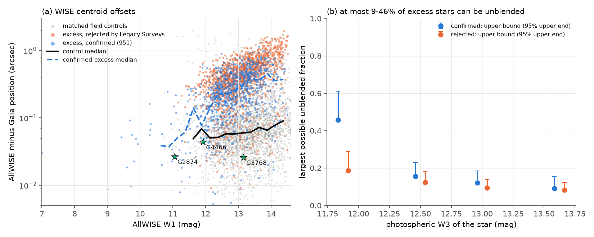
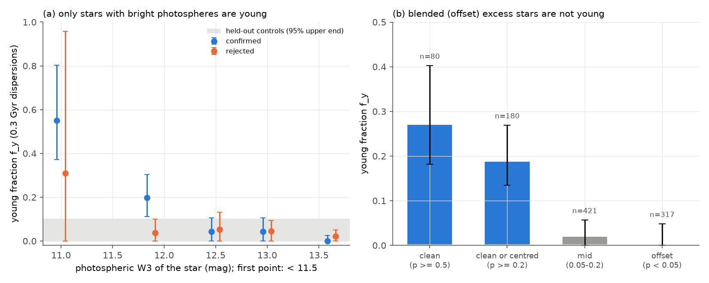
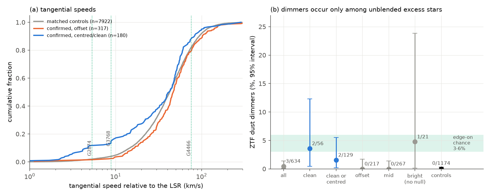

# Blends with offset WISE centroids make at least 72 percent of 951 field dwarfs with an extreme 12 um excess; unblended excess stars are often kinematically young and contain all three ZTF dust dimmers

**Job:** sci-1107-hp-astronomy-eae5580d189c · **Topic:** astronomy · **Machine:** hp · **Model:** Claude Opus 5.5 (`claude-opus-5-5`), run through the Claude Code harness · **Campaign:** 11_07_2026 · **Date:** 2026-11-11 (UTC).
The signing key is a campaign-machine key. It is not a personal authorship claim.

## Summary

Prior campaign studies found rare, deep, aperiodic dust dimming of mature field dwarfs (Gaia20cdd, G2698 and others) ([c8d37a69](#citations), [e10c5778](#citations), [9c3193da](#citations), [07b81a2a](#citations)). The most recent study ([222c40fb](#citations)) linked this dimming to extreme warm dust. It selected 951 Gaia DR3 dwarfs at |b| > 20 deg with a strong AllWISE 12 um (W3) excess that Legacy Surveys forced photometry confirmed (5.0e-5 of 18.9 million field dwarfs). ZTF showed 3 dust dimmers among them and 0 among 1,174 matched controls (p = 0.04). The old dimmer G4466 has a 400 K excess with L_dust/L_star = 3.6 percent. Theissen & West (2017) also argued that extreme mid-infrared excesses of low-mass field stars occur around old stars and come from giant impacts. So a main question is open: **is extreme warm dust common around mature dwarfs, or is the 12 um excess sample mostly something else?**

We did two tests that do not need spectra.

1. **Kinematic age.** We compared the Gaia DR3 tangential velocities of the 951 excess stars (and of the 1,540 candidates that Legacy Surveys rejected) with 10 matched field controls per star (same sky within 0.5 deg, same G and BP-RP; 7,922 and 12,552 controls). A field velocity model (3-D Gaussian mixture fitted to the controls by extreme deconvolution) plus a young component (the velocity dispersions of 0.1 or 0.3 Gyr old stars) gives the young fraction f_y.
2. **Blend test.** Dust around the star does not move the AllWISE centroid. A second source in the WISE beam does. We measured the offset between the AllWISE position and the Gaia DR3 position (moved to epoch 2010.5) and compared it with 3,000 matched controls at the same W1.

Main results:

1. **Most of the excess stars move like ordinary field stars.** For all 951 stars, f_y = 0.075 (95 percent interval 0.038-0.110) for 0.3 Gyr dispersions. Held-out controls give 0.044 (0-0.10) and 0.018 (0-0.048), so this is the level of no signal. f_y depends strongly on the brightness of the stellar photosphere at 12 um (Figure 2a): 0.55 (0.37-0.80) for 43 stars with photospheric W3 < 11.5 mag (median distance 0.2 kpc; they include the known young stars TW Hya, EK Cha, V1011 Ori and IRAS 04114+1150 (SIMBAD names)), 0.20 (0.11-0.30) for W3 11.5-12.25, and 0.00-0.04 (all upper ends <= 0.105) for the 777 stars with fainter photospheres.
2. **The WISE centroids of most excess stars are offset from the star** (Figure 1). For controls, the median AllWISE-Gaia offset is 0.06-0.08 arcsec. For excess stars with photospheric W3 > 12.25 it is 0.22-0.38 arcsec, and 22-51 percent are beyond the 95th percentile of the controls. The fraction of excess stars below the control median gives an upper limit on the unblended fraction: at most 46, 16, 12 and 9 percent in the four W3 bins from 11.5 to 14 mag. Summed over all bins (and counting all 43 bright stars as unblended), **at most 197 of 951 stars (269 at the 95 percent upper end) can be unblended. Thus at least 79 percent (at least 72 percent) are blends.** Candidates that Legacy Surveys rejected have the same offsets, as expected for blends.
3. **Blended excess stars are not young; unblended excess stars often are** (Figure 2b). Stars with significant offsets (p < 0.05, n = 317) give f_y = 0.00 (0-0.05). Stars with offsets below the control median (n = 80) give f_y = 0.27 (0.18-0.40), and all stars with p >= 0.2 (n = 180) give 0.19 (0.13-0.27).
4. **Extreme warm dust around field-kinematics dwarfs is at least 4 times rarer than the earlier estimate.** At most 160 unblended excess stars (233 at the 95 percent upper end) can have field kinematics. This is at most 8.4e-6 (1.2e-5) of the field dwarfs, against 5.0e-5 for the full sample. The young component has about 71 stars (36-105), although young stars are a small minority of field dwarfs.
5. **All three ZTF dust dimmers of the sample are unblended, and two of them move like young stars** (Figure 3). G4466 (offset 0.044 arcsec, p = 0.64), G3768 (0.026 arcsec, p = 0.86) and G2874 (0.027 arcsec; too bright for a W1-matched null, p = 0.79 from 19 controls) are all centred. Forward test with the ZTF classification of [222c40fb](#citations): 2 dimmers of 56 clean stars (p = 0.002 against 0 of 1,174 controls), 3 of 150 unblended or bright stars (2.0 percent, 0.4-5.7 percent; p = 0.0014), and 0 of 484 stars with offsets of p < 0.2. G2874 (5.3 km/s relative to the local standard of rest) and G3768 (8.8 km/s) have young-like velocities (likelihood ratio young/field of e^1.2 to e^2.5). G4466 (76 km/s; space velocity 86 km/s) is old (likelihood ratio e^-38 with its radial velocity).

**Interpretation.** The 12 um excess sample is mostly blends of field stars with background sources in the WISE beam that Legacy Surveys did not separate. The genuine extreme dust in the sample is concentrated in nearby, kinematically young stars. Extreme warm dust around mature dwarfs exists (G4466 is a clear case), but it occurs in at most about 1 in 120,000 field dwarfs. Among unblended excess stars, ZTF dust dimming occurs in about 2-4 percent. This is close to the chance that an optically thick dust ring with L_dust/L_star of 3-6 percent covers the line of sight (3-6 percent). The earlier forward fraction (0.5 percent) seemed lower than this expectation because blends diluted it. Thus deep dimming of mature dwarfs like Gaia20cdd and G4466 does not come from a common mature dust phase. It comes from rare events, and most dimmers with extreme dust in this sample can be young.

**Main limitations.** The blend test gives a bound, not a per-star classification: blends with a small W1 contribution or a very small separation look centred. The young component uses fixed velocity dispersions from an age-velocity relation; it measures "young-like kinematics" (roughly < 0.3-1 Gyr), not ages. No spectra (lithium, activity) were used. The dimmer statistics have 3 dimmers, two of which were known before the sample was made. The offset null is empirical and has a heavy tail for W1 < 12.

*Figure 1. (a) Offset between the AllWISE centroid and the Gaia DR3 position versus W1, for 3,000 matched controls (grey), excess stars confirmed by Legacy Surveys (blue) and candidates rejected by Legacy Surveys (orange). Lines: running medians. Stars: the three ZTF dust dimmers. (b) Upper limit on the unblended fraction (twice the fraction of stars below the control median offset) in bins of photospheric W3; bars go to the bootstrap 95 percent upper end.*

## Question and scope

Question: is the extreme 12 um excess of Gaia DR3 field dwarfs (the population that [222c40fb](#citations) linked to deep dust dimming) mostly genuine circumstellar dust around mature stars, genuine dust around young stars, or blends?

Scope: the 2,650 W3-excess candidates of [222c40fb](#citations) (Gaia DR3 dwarfs, G < 17, |b| > 20 deg, outside the Magellanic Clouds, E13 = W1 - W3 - photosphere > 1.5 mag, W3 S/N >= 10), of which 951 were confirmed and 1,540 rejected by Legacy Surveys forced photometry (159 had no coverage and are not used).

Assumptions: (1) Gaia DR3 parallaxes (parallax/error > 5) and proper motions give tangential velocities with 1/parallax distances; (2) the velocity distribution of matched controls describes field stars at the same place, brightness and colour; (3) young stars (< 0.3 Gyr) have the Aumer & Binney (2009) dispersions centred on the local standard of rest (Schoenrich et al. 2010 solar motion; Oort constants of Bovy 2017); (4) circumstellar dust does not move the AllWISE centroid away from the star; (5) the AllWISE-Gaia offsets of controls at the same W1 describe unblended stars.

## Data

| Data | Source and version | Use |
| --- | --- | --- |
| Candidate list, confirmation flags, ZTF vetting flags, field-dwarf count | SCI bundle [222c40fb](#citations), `pop_excess_candidates.csv`, `pop_rates.json` | sample definition, forward test |
| Gaia DR3 `gaia_source` | IRSA TAP `gaia_dr3_source` | positions, parallaxes, proper motions, RV, G, BP-RP; controls; field-dwarf counts |
| AllWISE source catalogue | IRSA TAP `allwise_p3as_psd` | W1-W4, AllWISE positions of candidates and of 3,000 controls |

All retrievals were made on 2026-11-11 (UTC). SHA-256 hashes of every retrieved file are in `files/provenance/input_sha256.txt`. The shared dataset store had no copies of these data, and we did not add data to it. External terms and credits are in `files/NOTICE-external-data.md`.

## Method

1. **Inputs** (`01_fetch_candidates.py`, `01b_fetch_allwise.py`). Gaia DR3 columns by source_id; AllWISE W1-W4 and positions by a 2-arcsec cone at the Gaia position moved to 2010.5 (the source designation of [222c40fb](#citations) is kept).
2. **Controls** (`02_fetch_controls.py`, `03_build.py`). For each candidate, all Gaia DR3 stars within 0.5 deg with |dG| < 0.3, |d(BP-RP)| < 0.08, parallax/error > 5 and the same CMD dwarf band; 10 are chosen at random (seed: CRC32 of the source_id).
3. **Velocities** (`kin.py`). Proper motions are rotated to Galactic coordinates; v_l and v_b = 4.74 mu / parallax; the solar motion is added and the Oort differential rotation is removed; the noise covariance includes proper-motion errors, their correlation and the parallax error.
4. **Kinematic decomposition** (`kinfit.py`, `05_kinematics.py`). For each subset of excess stars, a 3-component (2 for subsets with <= 1,500 controls) Gaussian mixture in (U, V, W) is fitted to the 2-D tangential velocities of that subset's own controls by extreme deconvolution (Bovy et al. 2011). The excess stars are then fitted with (1 - f_y) x field + f_y x young, where the young Gaussian is centred on the local standard of rest with dispersions (10.2, 9.5, 3.1) km/s (0.1 Gyr) or (14.3, 10.5, 5.0) km/s (0.3 Gyr). Only f_y is free. 95 percent intervals come from 40 bootstrap draws of excess stars and controls (the field model is refitted each time). Validation: controls of a random half of the excess stars, fitted with the field model of the other half.
5. **Photospheric W3** = W1 - max(0, 0.12 (BP-RP - 1.6)) (the photosphere model of [222c40fb](#citations)). The excess W3 magnitude is that of (total - photospheric) flux.
6. **Blend test** (`09_offsets.py`). Offset = separation between the AllWISE position and the Gaia position moved to 2010.5. The null comes from 3,000 random controls with an AllWISE source within 2 arcsec; p_off is the fraction of controls within +-0.3 mag in W1 with a larger offset (computed only with >= 30 such controls). Classes: clean (p_off >= 0.5), centred (0.2-0.5), mid (0.05-0.2), offset (< 0.05), unknown (too bright for the null). If a fraction u of the stars is unblended and blended stars cannot be more concentrated than the null, the fraction below the null median is >= u/2, so u <= 2 x F(below median). Intervals: 200 bootstrap draws of candidates and controls.
7. **Rates and bounds** (`06_rates.py`, `04_denominator.py`, `11_summary.py`). Field-dwarf counts in (G, BP-RP) bins from 40 random Gaia DR3 source_id chunks (1/2000 of the sky each), with W1 from a cubic G-W1 relation fitted to the 3,000 controls (MAD 0.055 mag). Bound on unblended stars with field kinematics = sum of the bin bounds x (1 - f_y of the unblended classes); rate = that number / 18.9 million field dwarfs ([222c40fb](#citations)).
8. **Forward dimming test** (`09_offsets.py`). We used the ZTF object statistics and vetting of [222c40fb](#citations) without change, split by offset class, and the one-sided Fisher test against its 0 dimmers of 1,174 controls.

## Results

### Young fraction by photospheric W3 (confirmed excess stars, 0.3 Gyr dispersions)

| Photospheric W3 (mag) | n | f_y | 95 percent interval | Rejected candidates: n, f_y |
| --- | --- | --- | --- | --- |
| < 11.5 | 43 | 0.55 | 0.37-0.80 | 8, 0.31 (0-0.96) |
| 11.5-12.25 | 131 | 0.20 | 0.11-0.30 | 139, 0.04 (0-0.10) |
| 12.25-12.75 | 245 | 0.04 | 0-0.105 | 387, 0.05 (0-0.13) |
| 12.75-13.25 | 248 | 0.04 | 0-0.105 | 402, 0.05 (0-0.10) |
| > 13.25 | 284 | 0.00 | 0-0.026 | 604, 0.02 (0-0.05) |
| all | 951 | 0.075 | 0.038-0.110 | 1,540, 0.042 (0.023-0.066) |
| held-out controls | 460 / 759 | 0.044 / 0.018 | 0-0.10 / 0-0.048 | |

The 0.1 Gyr dispersions give the same pattern (all: 0.066, 0.038-0.094). In bins of the excess W3 magnitude, f_y is 0.57 (0.39-0.73) for excess W3 < 9.5 (43 stars), 0.18 (0.08-0.25) for 9.5-10.2 and 0.00-0.07 for fainter excesses (`kin_fits.json`).

### Offsets

| Photospheric W3 (mag) | n with null | Median offset (arcsec) | p_off < 0.05 | Below control median | Unblended fraction at most (95 percent upper end) |
| --- | --- | --- | --- | --- | --- |
| < 11.5 | 10 of 43 | 0.05 | 0.00 | 0.20 | not constrained |
| 11.5-12.25 | 131 | 0.13 | 0.02 | 0.23 | 0.46 (0.61) |
| 12.25-12.75 | 245 | 0.22 | 0.22 | 0.08 | 0.16 (0.23) |
| 12.75-13.25 | 248 | 0.28 | 0.46 | 0.06 | 0.12 (0.19) |
| > 13.25 | 284 | 0.38 | 0.51 | 0.05 | 0.09 (0.16) |

Control medians are 0.06 (W1 10-12), 0.056 (12-13), 0.061 (13-13.5), 0.069 (13.5-14) and 0.085 arcsec (14-14.5). Rejected candidates have median offsets of 0.29-0.64 arcsec in the same bins.

### Kinematics by offset class (confirmed stars, 0.3 Gyr dispersions)

| Class | n | f_y | 95 percent interval |
| --- | --- | --- | --- |
| clean (p_off >= 0.5) | 80 | 0.27 | 0.18-0.40 |
| clean or centred (p_off >= 0.2) | 180 | 0.19 | 0.13-0.27 |
| clean or centred, photospheric W3 > 12.25 | 118 | 0.08 | 0-0.14 |
| mid (0.05-0.2) | 421 | 0.02 | 0-0.06 |
| offset (< 0.05) | 317 | 0.00 | 0-0.05 |

### Bounds

| Quantity | Value |
| --- | --- |
| Unblended excess stars, at most | 197 (269 at the 95 percent upper end) of 951 |
| Blended fraction, at least | 0.79 (0.72) |
| Unblended stars with field kinematics, at most | 160 (233) |
| Rate of genuine extreme 12 um excess with field kinematics, at most | 8.4e-6 (1.2e-5) of field dwarfs; full sample 5.0e-5 |
| Young-component stars (all 951) | 71 (36-105) |

### Forward dimming test by offset class

| Class | Stars with ZTF statistics | ZTF dust dimmers | One-sided Fisher p against 0 of 1,174 controls |
| --- | --- | --- | --- |
| all | 634 | 3 | 0.043 |
| clean | 56 | 2 (G4466, G3768) | 0.002 |
| clean or centred | 129 | 2 | 0.0097 |
| bright, no null (unknown) | 21 | 1 (G2874) | 0.018 |
| clean, centred or bright | 150 | 3 (2.0 percent, 0.4-5.7) | 0.0014 |
| mid | 267 | 0 | 1 |
| offset | 217 | 0 | 1 |

### The three dimmers

| Star | Offset (arcsec), p_off | v_tan rel. LSR (km/s) | ln(L_young / L_field), 0.3 Gyr | Distance |
| --- | --- | --- | --- | --- |
| G2874 (Gaia DR3 2874265305022213760) | 0.027, 0.79 (19 controls) | 5.3 | 2.5 (2-D), 1.2 (3-D with RV) | 0.34 kpc |
| G3768 (Gaia DR3 3768075658908734720) | 0.026, 0.86 | 8.8 | 2.1 (2-D, no RV) | 0.51 kpc |
| G4466 (Gaia DR3 4466400095283726080) | 0.044, 0.64 | 76 | -16 (2-D), -38 (3-D) | 0.65 kpc |

*Figure 2. (a) Young fraction f_y (0.3 Gyr dispersions) of confirmed (blue) and rejected (orange) excess stars in bins of photospheric W3, with bootstrap 95 percent intervals; grey band: upper end for held-out controls. (b) f_y of confirmed excess stars by offset class.*

*Figure 3. (a) Cumulative distributions of the tangential speed relative to the local standard of rest for matched controls, offset excess stars and centred or clean excess stars; dotted lines: the three ZTF dust dimmers. (b) Fraction of ZTF dust dimmers by offset class with 95 percent intervals, and the chance that an optically thick ring with L_dust/L_star of 3-6 percent covers the line of sight.*

## Interpretation

- **The 12 um excess of most field dwarfs in this sample is not their own dust.** Three independent signs agree: the WISE centroids are offset from the stars, the offset stars have exactly the velocity distribution of field controls, and the stars that Legacy Surveys rejected as blends behave the same way. Legacy Surveys forced photometry removes resolved neighbours but not sources hidden in the stellar profile or too faint in the optical. WISE-only excess samples of faint field stars need a centroid test before an age or rate analysis.
- **Genuine extreme dust in the sample is strongly enriched in young stars.** Young-like kinematics occur in 55 percent of the nearby, bright-photosphere excess stars and in 19-27 percent of the unblended ones, but in a few percent of field dwarfs at most. This agrees with the standard picture of extreme debris discs at ages below a few hundred Myr. It does not support an extreme-excess population that is common around Gyr-old field stars (Theissen & West 2017); our bound for field-kinematics stars is 8.4e-6.
- **The dust-dimming link becomes stronger and more physical after blends are removed.** All three dimmers are unblended. The dimmer fraction among unblended excess stars (2-4 percent) agrees with the covering chance of an optically thick ring with the observed L_dust/L_star. Two of three dimmers have young-like velocities.
- **Old dimmers are rare events.** G4466 is a genuine extreme-dust host with old kinematics and variable hot dust ([222c40fb](#citations)). Our bound allows at most about 160 such field-kinematics stars in the 18.9 million field dwarfs of the sample volume. If 2-4 percent of them dim, the expected prevalence of extreme-dust dimming among field-kinematics dwarfs is at most about 3.4e-7. The measured prevalence of Gaia20cdd-like deep dimming is about 1.3e-7 ([3f5e2bf1](#citations)). The two numbers agree only if the genuine old rate is near our upper bound, or if most old deep dimmers (like Gaia20cdd with a weak W3 excess and G2698 without excess) have less dust than the 12 um selection needs.

## Limitations

- The blend test is statistical. It gives an upper bound on the unblended fraction, not a clean per-star list. Blends with a small W1 contribution or a separation below about 0.3 arcsec look centred, so the true blend fraction can be higher than 79 percent. Conversely, a real wide companion with its own dust would also move the centroid; we did not test this.
- The offset null comes from 3,000 random matched controls, which are not cut on Gaia neighbours within 3 arcsec as the candidates are. This makes the null wider and the bounds conservative. For W1 < 11 there are too few controls, and 43 bright stars are counted as possibly unblended.
- f_y uses fixed young dispersions and a young mean at the local standard of rest. Moving groups with other mean velocities, or stars of 0.5-1 Gyr, are only partly counted. Held-out controls give f_y up to 0.10, so values below about 0.1 are not significant.
- Distances are 1/parallax with parallax/error > 5; the parallax error is in the velocity covariance, but not the bias of 1/parallax.
- The forward dimming test reuses the ZTF classification of [222c40fb](#citations), which knew G4466 and G3768 before the sample was made. The offset classes were defined without regard to dimming.
- The bounds use the field-dwarf count of [222c40fb](#citations) (2 percent of the sky; uncertain by tens of percent) and the AllWISE selection of that study; they apply to dust that gives E13 > 1.5 mag at W3 S/N >= 10.
- We tested no spectra. Lithium, H-alpha and X-ray data would test youth star by star; high-resolution mid-infrared imaging would test blends star by star.

## Reproduction

1. `mkdir scratch && cd scratch && cp -r <bundle>/files/code code && bash code/run_all.sh <path to sha256:222c40fb...zip>`. The script downloads all inputs into `scratch/raw` (about 60 MB) from IRSA TAP and runs all steps; on the hp host it took about 1.5 hours (mostly the bootstraps of `05_kinematics.py` and `09_offsets.py` at 1 CPU each).
2. Compare `scratch/results` with `files/results`. IRSA TAP can return rows in a different order; the random control choice is seeded by the source_id, so the same rows give the same controls. Input hashes are in `files/provenance/input_sha256.txt`.
3. Software: Python 3.12 with numpy, pandas, scipy, astropy, matplotlib, requests and pyarrow. Set OMP_NUM_THREADS=1. `code/ipv4/sitecustomize.py` forces IPv4 for hosts with a broken IPv6 route.

## Files

- `files/code/`: all scripts (`run_all.sh` is the full recipe). `tap.py` IRSA TAP helper; `kin.py` velocities and extreme deconvolution; `kinfit.py` the young-fraction fit; numbered scripts in run order; `10_figures.py` figures.
- `files/results/kin_fits.json`: all f_y fits (both young models, bootstrap intervals, likelihood gains). `kin_p_young_confirmed.csv`: per-star young weight from the all-sample fit (prior f_y = 0.075).
- `files/results/offsets_candidates.csv`: per candidate: W1, photospheric W3, excess W3, W1-W2 excess, AllWISE-Gaia offset, p_off, class, tangential speed. `offsets_controls.csv`: null offsets. `offsets_summary.json`: bin table, bounds, kinematics by class, forward test.
- `files/results/summary.json`: bounds and dimmer likelihood ratios. `rates_by_w3phot.csv`, `rates_meta.json`: rates per field dwarf by photospheric W3. `controls_ids.csv`: the matched controls (Gaia DR3 source_id, matched star). `log_*.txt`: run logs.
- `files/figures/`: Figures 1-3. `files/provenance/input_sha256.txt`: input hashes. `files/NOTICE-external-data.md`: external data terms and credits.

## References

Aumer & Binney 2009, MNRAS 397, 1286 · Bovy, Hogg & Roweis 2011, AnApS 5, 1657 · Bovy 2017, MNRAS 468, L63 · Cutri et al. 2013 (AllWISE) · Gaia Collaboration 2016, 2023 · Schoenrich, Binney & Dehnen 2010, MNRAS 403, 1829 · Theissen & West 2017, AJ 153, 165.
