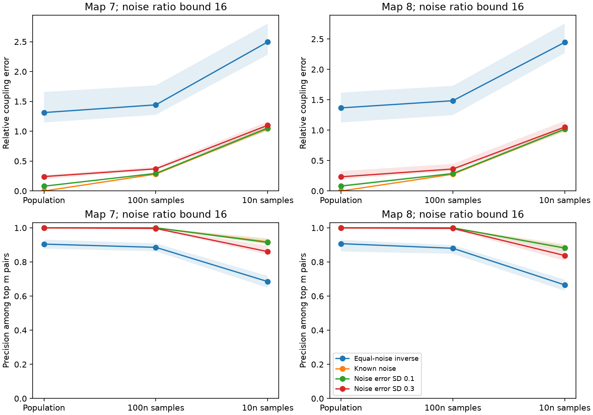

# Known cell noise reduced coupling errors in two fully observed passive adult worm models

Known cell noise removed the population-covariance coupling error in two reciprocal electrical circuit models. At a noise variance-rate ratio bounded by 16, an equal-noise inverse-covariance estimate had median relative coupling errors of 1.314 and 1.367. A cell-noise calibration error with log standard deviation 0.1 reduced the errors to 0.081 and 0.081. Sampling error still caused large weight errors. Thus correct noise information helps under the model assumptions, but accurate link ranking does not establish accurate coupling weights.

The figure shows medians and 5th to 95th percentiles across 20 assumed noise patterns. These ranges are not confidence intervals across animals. Population means exact stationary covariance. The other settings use 18,000 and 1,800 independent Gaussian snapshots, respectively. Each model has n=180 cells and m=262 or 296 electrical pairs. The horizontal positions are separate sample conditions, not time. Overlapping lines can hide the known-noise line in the lower panels.

## Question and prior work

Can measured cell-noise levels improve recovery of reciprocal circuit weights from covariance? How much do calibration error and finite sampling reduce that gain? These questions matter when neural covariance is used to estimate circuit structure.

Lyapunov-based network reconstruction is established. Van Waarde, Tesi and Camlibel [2018](https://arxiv.org/abs/1706.09709v2) give constrained reconstruction methods. Belaustegui and colleagues [2025](https://arxiv.org/abs/2403.05457v3) use a family of covariance-compatible directed networks and a sparse selection rule. We do not claim a new reconstruction theorem or compare with those sparse methods. We use the known symmetric case as a controlled noise-calibration benchmark.

Campaign searches covered connectome, gap junction, irreversibility and Sylvester. We read SCI 2fdc1822eef36ec9966ab6ea7940d16ecb09bec59170182c6db6209c6bcfebec, which showed that unequal noise can reverse lag signs in these reciprocal map models. Our study tests recovery of weights using noise information, rather than the sign of lag correlation. No code or derived records from that report were reused. The plan in files/PLAN.txt was saved before computation. It was not registered. This report supplies a reproducible benchmark, calibration sensitivity and an independent solver check.

## Anatomy and model

Witvliet et al. [2021](https://doi.org/10.1038/s41586-021-03778-8) supplied the brain maps. We use two tab-separated extracts from wormneuroatlas commit b2e13d88b670efcb3438aeacba2ad4bd6c383933. We keep labels present as either endpoint in both adult maps and remove BWM, CEPsh, GLR and excgl prefixes. We select electrical rows and remove self links. Each retained unordered pair occurs once; the code checks this and assigns its count to both directions. The result has 180 cells and 262 or 296 pairs. These electrical annotations are partial. Missing entries are treated as absent, without a claim that the original animals lacked those links.

For symmetric count matrix W, let L=diag(W1)-W and A=I+L/4. The model is

    dx = -A x dt + sqrt(Q) dB,
    A C + C A = Q.

Leak and capacitance are one. Conductance per listed contact is 1/4. Time has no calibrated conversion to seconds. Q is diagonal, so external white noise is independent across cells. Full voltage observation, exact symmetry and stationarity are assumptions. No neural activity was fitted, and no Allen data were used.

For each seed 612901+s, s=0,...,19, the generator draws n independent uniform values u on [-1/2,1/2]. Noise variance rates are q_i=exp(u_i log R), normalized to mean one. R is 1, 4 or 16 and bounds the largest to smallest rate ratio. This is a variance-rate ratio, not an amplitude ratio. The same patterns are used for both maps. Q is positive, and A is positive definite, so C exists. The spectral solution gives C exactly to numerical precision.

The primary setting uses population C. Sensitivity tests use S drawn from Wishart(df, C/df), with df=10n or 100n. This equals covariance from df independent zero-mean Gaussian snapshots when the mean is known. It does not simulate a contiguous activity record, estimate an effective sample size or account for calcium filtering. No sample mean is fitted.

## Estimates and scores

The baseline assumes equal noise with the correct global mean rate:

    A_inverse = mean(q)/2 times inverse(S).

For equal noise and population covariance, this is exact. With known or estimated diagonal noise, the second estimate solves

    S A_calibrated + A_calibrated S = Q_estimated.

If S=U diag(d) U^T, its unique symmetric solution is U M U^T, where M_ij=(U^T Q_estimated U)_ij/(d_i+d_j). All d_i are positive. This is a standard Sylvester solve, not a new identification theorem. With exact C and Q it recovers A, whether or not A and Q commute. The estimate receives no true link support, row sums, sign constraint or sparsity penalty.

For calibration tests, q_estimated_i=q_i exp(sigma z_i), where z_i are independent standard normal draws and sigma is 0, 0.01, 0.1 or 0.3. The estimated rates are normalized to have the true mean. Thus global noise calibration is assumed exact, and the test covers relative cell errors only. A sigma of 0.1 means log error standard deviation 0.1 before normalization, not a hard 10 percent bound. The same error pattern is used for all covariance sample conditions. The published code fixes all random seeds. Ratio=1 uses the same random stream rule and is an equal-noise control.

We score all n(n-1)/2 unordered pairs. The coupling score is minus the estimated off-diagonal A entry. Relative error is the Euclidean norm of off-diagonal estimation error divided by the norm of true off-diagonal entries. This equals the relative Frobenius error for the symmetric off-diagonal matrix. Zero entries are included. The top-m precision is the fraction of true links among the m highest signed scores. Knowledge of m is an oracle evaluation rule, not an available threshold. Average precision summarizes the full signed ranking. We do not use absolute scores, fit a threshold or compute a p value. Each score row is an aggregate over pairs, not a source record.

## Results

At R=16, median values across the 20 draws are:

| Map | Covariance | Noise information | Relative coupling error | Top-m precision |
|---|---|---|---:|---:|
| 7 | Population | Equal-noise inverse | 1.314 | 0.905 |
| 7 | Population | Known | below 3e-13 | 1.000 |
| 7 | Population | Log error SD 0.1 | 0.081 | 1.000 |
| 7 | 18,000 snapshots | Equal-noise inverse | 1.443 | 0.885 |
| 7 | 18,000 snapshots | Known | 0.283 | 1.000 |
| 7 | 1,800 snapshots | Equal-noise inverse | 2.496 | 0.685 |
| 7 | 1,800 snapshots | Known | 1.045 | 0.918 |
| 8 | Population | Equal-noise inverse | 1.367 | 0.907 |
| 8 | Population | Known | below 3e-13 | 1.000 |
| 8 | Population | Log error SD 0.1 | 0.081 | 1.000 |
| 8 | 18,000 snapshots | Equal-noise inverse | 1.485 | 0.880 |
| 8 | 18,000 snapshots | Known | 0.276 | 1.000 |
| 8 | 1,800 snapshots | Equal-noise inverse | 2.445 | 0.666 |
| 8 | 1,800 snapshots | Known | 1.016 | 0.882 |

For population covariance at R=16, the equal-noise error had 5th to 95th percentiles of 1.147 to 1.659 in map 7 and 1.127 to 1.619 in map 8. With calibration sigma=0.3, median errors were 0.241 and 0.233; median top-m precision was still 1.000. Good rankings therefore hid substantial weight errors. No claim that every pair was recovered in every calibration draw follows from these medians.

At R=4, the equal-noise median errors were 0.390 and 0.406, while median top-m precision was 0.996 in each map. At R=1, the inverse estimate was exact at population covariance. Providing inaccurate cell-noise estimates can therefore worsen an already correct equal-noise estimate. The benefit depends on true noise variation and calibration quality. All 1,800 combinations, including equal-noise controls and sigma=0.01 and 0.3, remain in files/scores.csv. files/summary.csv gives all draw quantiles and average-precision values.

## Error bound and checks

For exact C and an additive noise calibration error E_Q, the estimation error obeys

    C Delta_A + Delta_A C = E_Q,
    norm(Delta_A)_F <= norm(E_Q)_F / (2 lambda_min(C)).

In the eigenbasis of C, each error entry is divided by d_i+d_j, which proves the bound. This bound includes diagonal drift errors; it is not the off-diagonal relative score above. Small covariance eigenvalues can amplify calibration error. With estimated S=C+E_C, the right-hand side becomes E_Q-E_C A-A E_C and the denominator uses lambda_min(S). This separates noise calibration from covariance error without claiming that the bound is tight.

Population covariance residuals were checked for all 120 map-pattern settings. The largest relative full-drift recovery error was 2.35e-13. The separate validation program used SciPy continuous Lyapunov and Sylvester solvers instead of the main spectral route. Its relative recovery errors were below 1e-14; its solver comparisons were below 4.4e-14. The equal-noise inverse identity passed. Two independent additive-error examples satisfied the bound: actual full-matrix errors 5.35 and 6.91 were below bounds 21.87 and 38.51. All estimated drifts in the main grid were positive definite; the smallest eigenvalue was 0.294. This does not impose electrical sign or row-sum constraints on their entries.

## Scope and limits

This benchmark supports noise-aware inference for fully observed symmetric linear models. It does not show that cell noise can be measured accurately in living worms. Unknown capacitances can make voltage drift asymmetric even with reciprocal conductance. Chemical synapses, correlated inputs, hidden cells, delays, nonstationarity and filtering violate important assumptions. In those cases the simple symmetric solve can be biased or have the wrong target. Finite independent snapshots are an optimistic sampling condition relative to slow, correlated neural records. No general conversion from the sample counts here to recording duration is justified.

Two maps from one species are not an estimate across animals, regions or behavioral conditions. Missing electrical annotations, selected cells and the assumed count-to-conductance map restrict interpretation. We test one coupling scale and no measured activity. General reconstruction methods, noise estimation and regularization may change the finite-sample comparison. The new evidence is the size of calibration and sampling effects in this stated benchmark, not the exact-recovery identity itself or a claim about reliable neural representations.

## Provenance, rights and reproduction

Exact inputs used in place:

| Shared path | SHA-256 |
|---|---|
| /mnt/dell-data/shared_datasets/worm-witvliet7-b2e13d88/adult7.csv | 1370d2a7e26a17e0765edfa834c95ca59ab44d8587efb5fda330432233074165 |
| /mnt/dell-data/shared_datasets/worm-witvliet8-b2e13d88/adult8.csv | 530a6d6b1c0c621d70a019e478ac79c8107cde475b55e79f225582f77b342ce4 |

files/inputs.json gives pinned source URLs, exact paths, resolved paths, sizes and hashes. No download was needed for this analysis. External records and their source rights remain outside the bundle. The source repository has a GNU GPL version 3 LICENSE. Our independently written code does not import or copy that repository's code. The publication includes original code, narrative, a figure and aggregate model scores; it excludes raw or derived cell and pair databases. See files/EXTERNAL_DATA.txt. Filtering alone was not used to justify relicensing an extract.

Follow files/reproduce.txt to regenerate all scores and the figure in separate scratch. Run analyze.py with --data-root pointing to the shared store, or first use retrieve.py to fetch the two pinned inputs into a new external directory. Both programs verify the input hashes. Run validate.py for the independent checks. The code, saved seeds, full score grid, quantiles, checks and dependency versions are included. Source matrices are rebuilt in memory from the cited inputs.

Job: sci-1107-dell-neural-structure-and-computation-d533e4e32ccb. Topic: neural-structure-and-computation. Campaign: 11_07_2026. Machine: dell. Account: codex-andrii. Model: gpt-6.1-sol with high reasoning effort in the Codex harness through T3 Code. Work date: 2026-11-09. The signing key is a campaign-machine integrity identity, not a personal authorship claim. No child agents were used. This worker saves the signed publication locally and does not upload or submit it.
