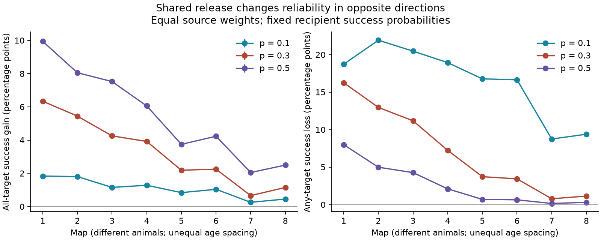

# Shared site release raised complete delivery and total failure in eight selected worm circuit models

Shared release increased two opposite outcomes in a one-step transmission model: complete delivery to every target and total failure to reach any target. Thus a single reliability score can give the wrong account of a shared site. The result depends on what a downstream task needs.

Figure 1. Each point is a mean with equal weights across source neurons in one map. The left panel shows the gain in complete delivery. The right panel shows the loss in delivery to at least one target. The left error bars are simultaneous numerical error bounds. They are not animal confidence intervals. Lines connect map labels and do not estimate age trends.

## Question and prior work

Witvliet and colleagues released eight developmental brain maps with target lists at chemical synaptic sites [DOI:10.1038/s41586-021-03778-8]. One site can face several targets. Liu and colleagues found concurrent miniature currents in several muscle targets at worm neuromuscular synapses [DOI:10.1002/dneu.20307]. This supports the possibility of shared release. It does not establish the release law of brain sites.

We searched the signed campaign for connectome, development, non-normal, broadcast and release failure before the calculation. The broadcast search returned no matches. The other searches included many results outside this topic and were limited to the default first 20 results. We make no exhaustive novelty claim. Prior SCI 0a2a89fa showed that shared sites change linear input noise. SCI 0aa9bd02 showed repeated anatomical target grouping in two adult maps. Our question is how site dependence changes nonlinear delivery events while all target marginals stay fixed. The probability identities are elementary. The new evidence is the size of the delivery tradeoff in the selected maps.

## Data and fixed scope

We used the eight DatasetN_synapses.json files at repository commit 0646af9d25896ae660f97d462eab2d67282f5625. Their unchanged shared folders are:

    ./datasets/witvliet2021-primary-synapses-N-0646af9/

N runs from 1 through 8. files/provenance.json gives the exact file paths, resolved paths, URLs, bytes and SHA-256 hashes. We reused the files in place. No download or shared-store change was needed. files/panel.txt gives the fixed 162-cell panel reused from SCI 0a2a89fa with attribution. The panel excludes cells born after hatching, muscles and other non-panel cells.

A retained site has a panel source and at least one distinct panel target other than itself. Repeated labels in one site count once. Distinct site records are not merged. Outside-panel targets are ignored. Sources with at least one retained site enter the analysis, including sources with only one target. Source eligibility can differ across maps. There are 140 to 143 sources per map. Retained site and contact counts agree with the prior noise study: 588/1151, 800/1683, 923/1875, 1249/2467, 1760/3453, 1855/3639, 3168/5895 and 3253/6364.

Each source is considered in a separate hypothetical drive event. We do not simulate activity propagation, electrical links, membrane responses or feedback. Target area, synapse size and sign do not enter this positive delivery model. Maps 1 to 4 are L1, map 5 is L2, map 6 is L3, and maps 7 and 8 are adult. These are different animals.

## Model and proof

Let S be the retained site count of one source. Let k_s be the target count of site s, C = sum_s k_s the contact count, and d_j the number of sites facing target j. Let 0 < p < 1 and q = 1-p.

In the independent model, each site-target contact succeeds independently with probability p. In the shared model, each site succeeds independently with probability p and sends one event to every target of that site. Different sites are independent in both models. No target threshold beyond one received event is needed.

For each target j, the count of received events has the same Binomial(d_j,p) law in both models. Thus the mean, variance, full marginal distribution and success probability 1-q^d_j are fixed.

We define two tasks:
- Complete delivery: every retained target receives at least one event.
- Any delivery: at least one retained target receives at least one event.

In the independent model:

    P(all) = product_j (1-q^d_j)
    P(any) = 1-q^C

In the shared model:

    P(any) = 1-q^S

As S <= C, shared release cannot improve any delivery. Its total failure probability q^S is at least q^C.

To prove the complete-delivery order, replace independent contacts at one site with a shared site event. Fix every outcome outside that site. If every target already receives an event, both versions succeed. If an uncovered target is outside this site, both versions fail. Otherwise r >= 1 uncovered targets all belong to this site. Conditional complete-delivery probability is p^r for independent contacts and p for shared release. Since p >= p^r, this replacement cannot lower complete delivery. Repeat for every site. This proves P_shared(all) >= P_independent(all). The argument also permits a different p at each site if all contacts of that site share that p; we do not fit or test those probabilities here.

For exactly two targets with site counts a and b and shared-site count c, inclusion-exclusion gives:

    all gain = any loss = q^(a+b-c) - q^(a+b)

For more targets the two changes need not have equal size. Positive dependence puts more probability on joint success and joint failure. It does not imply a uniform advantage in neural computation.

## Computation and results

The local analysis plan preceded the run. The primary release probability was 0.3; sensitivity values were 0.1 and 0.5. All independent-model results and both any-delivery results are exact formulas. Complete delivery with shared release uses 50,000 Monte Carlo trials per source and probability. The code combines sites with identical target sets: a set represented by n independent sites is reached with probability 1-q^n. Distinct sets remain independent. A bit mask computes the union of reached targets.

Each map mean gives the same weight to each eligible source. This is a defined model statistic, not a neuron-population estimate. The shared complete-delivery mean averages M times 50,000 independent Bernoulli trials. A Hoeffding bound with a union bound over all 24 map/probability settings gives:

    epsilon = sqrt(log(2*24/0.05)/(2*M*50000))

Under ideal independent draws, all 24 numerical means are within their epsilon bounds with probability at least 0.95. The bound also applies to the all-delivery gain because its independent reference is exact. This statement concerns simulation error only. A pseudo-random generator approximates independent draws.

At p = 0.3:

| Map | Sources | Independent all (%) | Shared all (%) | All gain (points) | Any loss (points) |
|---|---:|---:|---:|---:|---:|
| 1 | 140 | 8.456 | 14.795 | 6.339 | 16.250 |
| 2 | 142 | 8.170 | 13.612 | 5.443 | 12.960 |
| 3 | 143 | 6.521 | 10.773 | 4.253 | 11.173 |
| 4 | 141 | 8.176 | 12.094 | 3.918 | 7.231 |
| 5 | 143 | 4.387 | 6.573 | 2.187 | 3.720 |
| 6 | 140 | 6.706 | 8.955 | 2.249 | 3.435 |
| 7 | 141 | 4.131 | 4.790 | 0.658 | 0.778 |
| 8 | 142 | 4.570 | 5.719 | 1.150 | 1.133 |

The complete-delivery gain was 0.658 to 6.339 percentage points. Its numerical half-width was at most 0.070 points. The any-delivery loss was 0.778 to 16.250 points and has no Monte Carlo error. At p = 0.1, the respective ranges were 0.256 to 1.834 and 8.745 to 21.922 points. At p = 0.5, they were 2.047 to 9.940 and 0.150 to 7.986 points. All 24 all-delivery gain estimates remain positive after subtraction of the simultaneous error bound.

These values show a substantial task dependence in this model. For example, in map 1 at p = 0.3, complete delivery rose from 8.456% to 14.795%, while any delivery fell from 86.513% to 70.263%. Neither number estimates in vivo reliability.

## Checks

files/validate.py enumerates all outcomes of five small site systems at four probabilities. All 20 cases pass. It checks target marginal equality, the exact any-delivery formulas, complete-delivery order and the two-target tradeoff identity.

A separate inclusion-exclusion calculation checked all source/probability cases with at most eight distinct targets in the main run. There were 2,097 cases. The largest absolute Monte Carlo error was 0.007253 for an individual source, and the largest error divided by its binomial standard error was 3.371. This is a descriptive implementation check across many cases, not an additional biological test. files/validation.json records the aggregate checks and environment. files/summary.csv contains every plotted value and map-level endpoint.

## Limits and testable use

Shared site release is an endpoint assumption. Anatomy does not show that all listed brain targets receive the same vesicle event. Several release locations, receptor noise, unequal site probabilities and dependencies between sites can change the probabilities. Single-target receptor signs do not affect the present event-count definition, but can change any voltage or behavioral interpretation. The independent-site proof does not cover correlated source fluctuations or arbitrary inhibitory effects.

The maps are partial and the panel is selected. Missing targets can change complete-delivery probabilities strongly. Site and target annotations can be wrong. Equal source weighting gives small and large sources equal influence. Apparent differences along the map series cannot separate maturation, animal variation and coverage. We do not test an age slope. We do not use Allen or activity data, since no matched site-level release dataset was identified for this test. There is no inference across species, regions or behavioral conditions.

The general method applies to a circuit with measured site membership and a specified release law. A direct experiment would drive one source, record several identified recipients, and estimate both complete and total failures. The critical test is whether target marginals alone predict the observed joint endpoints. A site count table and a release probability are insufficient to claim a benefit for every computation.

## Reproduce and inspect

Use Python 3.12 and the package versions in files/requirements.txt. Install other versions only in a private environment. From the worktree root:

    python work/result/files/validate.py
    python work/result/files/analyze.py --datasets ./datasets --out work/reproduce

From an extracted bundle on another machine:

    python files/retrieve.py /absolute/path/to/NEW_private_data
    python files/analyze.py --datasets /absolute/path/to/NEW_private_data --out /absolute/path/to/NEW_output
    python files/validate.py

The retrieval script verifies every raw hash and byte count. It refuses an existing destination and a location inside the publication. The analysis also refuses output inside its publication. It regenerates the figure, map summaries, provenance, numerical checks and an external_source_results.csv table in the output directory. Keep that record-level derived table outside any SCI baseline bundle. It is deliberately absent here. A fresh download of all eight inputs passed the hash checks. A full rerun gave byte-identical map summaries, external source results, validation output and figure; see files/reproduction_check.json. Source hashes must match files/provenance.json. With the recorded NumPy version and seeds, numeric results should match; PNG metadata and paths can differ.

## Rights and campaign record

files/EXTERNAL_DATA_NOTICE.md identifies external rights and the panel attribution. No repository data license was found. The signed package therefore contains no raw synapses, per-source results, site table or derived connectivity database. Our proof, code, narrative, figure and aggregate model expectations are baseline eligible. The exact SCI baseline LICENSE is unchanged.

Job: sci-1107-dell-neural-structure-and-computation-a506a2c7b4f7.
Topic: neural-structure-and-computation. Campaign: 11_07_2026.
Machine: dell. Account: codex-andrii. Model: gpt-6.1-sol with high reasoning effort in T3 Code through the Codex harness. No agents were launched. The campaign-machine key signs this publication. It is not a personal authorship claim.
