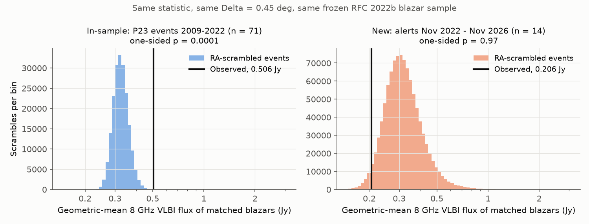
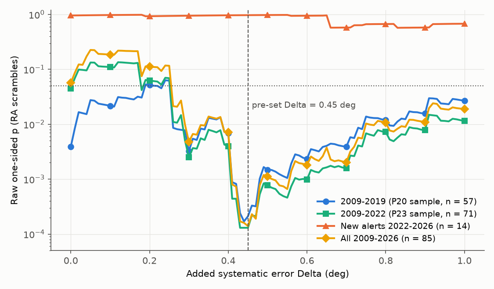
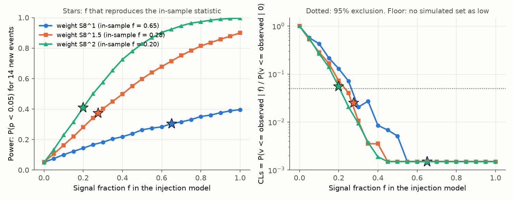

# IceCube track alerts from November 2022 to November 2026 do not replicate the reported link between high-energy neutrinos and VLBI-bright radio blazars

## Summary

Plavin et al. (2020, "P20") and Plavin et al. (2023, "P23") reported that IceCube track events with energy of 200 TeV or more occur near radio blazars with high parsec-scale (VLBI) flux. P23 gives a post-trial p of 3e-4 for 71 events from 2009 to 2022. We did an out-of-sample test with the same statistic and the same fixed parameters. We used only alerts that occurred after the last P23 collection date (2022-11-01).

Before the test, we reproduced the P23 method. Our code finds all 45 blazar-event pairs of the P23 table, and no other pairs. For the 71 P23 events, the raw p at the P23 value Delta = 0.45 deg is 1.0e-4, and the post-trial p is 1.0e-3.

Main result (analysis plan written before the test, `files/PREREGISTRATION.md`):

* 14 new IceCube Gold/Bronze tracks (2022-12-23 to 2026-10-12) pass the P23 selection (E >= 200 TeV, 90% area < 10 deg^2).
* Only 3 blazar pairs occur in the enlarged error regions. The RA-scramble null expects 7.2 pairs. The geometric-mean 8 GHz VLBI flux of the matched blazars is 0.206 Jy. The scramble median is 0.311 Jy (central 68%: 0.250 to 0.402 Jy).
* One-sided p = 0.97 (10^6 scrambles). The data do not replicate the association.
* No new event matches any of the seven blazars that P20/P23 named (3C 279, NRAO 530, PKS 1741-038, PKS 2145+067, TXS 1749+096, PKS 0735+178, PKS 1502+106). No new event matches any blazar with S8 >= 1 Jy (the null expects 0.40 such pairs).
* All secondary variants are also null: p = 0.30 to 0.97 (Table 2).

The test has low power. With a signal model calibrated on the P23 in-sample result, the probability of p < 0.05 for 14 events is 0.30 to 0.41. But the observed statistic is much lower than the signal model predicts. A CLs-type comparison excludes signal fractions f >= 0.25 to 0.30 of events at 95%. The in-sample result needs f = 0.65, 0.28 or 0.20 for blazar weights S8, S8^1.5 or S8^2. These calibrated values are excluded for the first two weights. The third value is at the limit (CLs = 0.055). The cumulative 2009 to 2026 sample (85 events) stays significant (post-trial p = 1.1e-3), but the 71 in-sample events cause this result.



## 1. Question

Do IceCube track alerts that occurred after the P23 data cut-off show the same excess of VLBI-bright blazars in their error regions? This is a direct forecast test of the published claim. The data are new and the method is fixed in advance.

## 2. Data

| Item | Source and version | File in this package | SHA-256 |
|---|---|---|---|
| IceCube alert positions | GCN Circulars archive, https://gcn.nasa.gov/circulars/archive.json.tar.gz, retrieved 2026-11-09 (46,076 circulars, last 46197) | `files/raw/gcn/circ/archive.json/` (213 IceCube alert circulars used by the parser) | full archive: `files/raw/gcn/SHA256SUMS` |
| IceCube alert energy, signalness, stream | AMON Gold/Bronze notice table, https://gcn.gsfc.nasa.gov/amon_icecube_gold_bronze_events.html, retrieved 2026-11-09 | `files/raw/gcn/amon_gold_bronze_20261109.html` | in `files/raw/gcn/SHA256SUMS` |
| VLBI blazars (primary) | Radio Fundamental Catalogue rfc_2022b (VLBI data to 2022-06-07), http://astrogeo.org/sol/rfc/rfc_2022b/rfc_2022b_cat.txt | `files/raw/rfc/rfc_2022b_cat.txt` | dcf937aa6040789c5959fa73ca934d1ab60c22fa94ef698d1522d02275e4f8a9 |
| VLBI blazars (secondary) | rfc_2026c, http://astrogeo.org/sol/rfc/rfc_2026c/rfc_2026c_cat.txt (rfc_2026d catalogue file was not online) | `files/raw/rfc/rfc_2026c_cat.txt` | 78ba66135f2145a19e583b0009b13160a4228f49e283b2f31641e489aec86289 |
| P23 event table and pair table; P20 event table | arXiv source ancillary files of arXiv:2211.09631 (`anc/table1.csv`, `anc/table2.csv`) and arXiv:2001.00930 (`anc/table_1.csv`) | `files/derived/p23/` | - |

Third-party files (GCN circulars, AMON table, RFC catalogues, P20/P23 tables) keep the terms of their providers; the LICENSE applies to our own text, code, derived data and figures. We did not use shared campaign datasets. No suitable dataset was in the store. The two RFC files and the alert files are small, so the package includes them.

Alert table (`files/derived/icecube_track_alerts.csv`): for each alert we use the refined position in the last IceCube circular (asymmetric 90% RA and Dec errors; RA errors are coordinate degrees). We take energy, signalness and Gold/Bronze stream from the AMON notice. Retracted alerts are removed. For 2020 to 2022, the selection gives the same 14 events as P23 (same dates, positions and energies). This confirms the parser and the cuts.

Blazar sample: all RFC sources with average X-band (8 GHz) total VLBI flux S8 >= 0.15 Jy. This gives 3,411 sources in rfc_2022b (P23: 3,412) and 3,385 in rfc_2026c. The primary test uses rfc_2022b. Its flux values come from data recorded before every test event.

## 3. Method

We use the P23 Appendix A procedure without change:

1. Error region: four quarter-ellipses with semi-axes 1.3047 x (RA+ cos Dec, RA- cos Dec, Dec+, Dec-). The factor converts coordinate-wise 90% errors to a two-dimensional 90% region.
2. A blazar is coincident if it is in the region or within Delta of the region edge.
3. Statistic v = geometric mean of S8 over all coincident event-blazar pairs.
4. Null: each event gets an independent uniform random RA. Its Dec and region shape do not change. p = (m + 1)/(n + 1), where m = number of scrambles with v >= observed.

The code computes, for each event and each blazar in the Dec band, the exact RA interval that makes the pair coincident. This makes the step functions of the event RA exact, and 10^6 scrambles take seconds. The Delta-scan post-trial p uses the same scrambles for all Delta values (0 to 1 deg, step 0.01 deg).

Pre-specified primary test: new events (date 2022-11-02 to 2026-11-08), Delta = 0.45 deg, factor 1.3047, rfc_2022b, one-sided alpha = 0.05.

Power model: a fraction f of events comes from a blazar. The blazar is selected with probability proportional to S8^gamma among the blazars that the event region can reach at the event Dec. The event RA is then uniform in the interval that makes this blazar coincident. Other events get a uniform RA. We calibrate f so that the median simulated v of the 71 P23 events equals the observed in-sample value (0.506 Jy). The plan specified gamma = 1. We added gamma = 1.5 and 2 after we found that gamma = 1 needs f = 0.65 to give the in-sample value. For each f, we simulate 20,000 sets of the 14 new events. Power is P(p < 0.05). CLs = P(v <= observed | f) / P(v <= observed | f = 0). This ratio corrects for the low observed value, which is also unusual under the null (P = 0.028).

## 4. Results

### 4.1 Reproduction of P20/P23

| Check | P20/P23 value | This work |
|---|---|---|
| Blazar-event pairs, 71 events, Delta = 0.45 deg | 45 pairs (Table 2) | same 45 pairs, no extra pairs; geometric mean 0.5057 Jy vs 0.5058 Jy |
| 2009-2019 sample (57 events), Delta scan | best Delta 0.45 to 0.5 deg, post-trial p = 0.002 | best Delta 0.44 deg, min raw p 1.7e-4, post-trial p = 1.3e-3 |
| 71 events, Delta scan | min raw p 3e-5 at 0.45 deg, post-trial 3e-4 | min raw p 1.3e-4 at 0.43 deg, post-trial 9.7e-4 |
| 14 events 2020-2022, Delta = 0.45 deg | p = 0.06 | p = 0.15 |

The pair sets agree exactly, but our scramble p-values are about 2.5 to 3 times larger than the P23 values. The P23 value for the 14 events from 2020 to 2022 does not reproduce (0.15 vs 0.06). We did not find the cause. Possible causes are different RFC flux values in the null sample or a different scramble implementation. This difference does not change the conclusions below. The new-sample p (0.97) is far from any threshold.

### 4.2 Out-of-sample events (primary sample)

| Event | Stream | E (TeV) | RA | Dec | 90% area (deg^2) | Pairs | Matched blazars (B1950) |
|---|---|---|---|---|---|---|---|
| IceCube-221223A | GOLD | 353 | 350.54 | +34.71 | 1.16 | 0 | - |
| IceCube-221229A | GOLD | 205 | 31.90 | +4.18 | 5.64 | 2 | 0158+031 (0.333 Jy), 0159+034 (0.161 Jy) |
| IceCube-230707A | GOLD | 279 | 269.03 | -1.94 | 1.38 | 0 | - |
| IceCube-231004A | GOLD | 442 | 143.79 | -25.04 | 3.36 | 0 | - |
| IceCube-240929A | GOLD | 268 | 180.66 | +18.92 | 1.04 | 0 | - |
| IceCube-250302A | GOLD | 1454 | 348.05 | +3.77 | 0.53 | 0 | - |
| IceCube-250309A | GOLD | 4132 | 211.07 | -10.73 | 0.26 | 0 | - |
| IceCube-250429A | GOLD | 397 | 59.68 | +25.32 | 0.61 | 0 | - |
| IceCube-250706A | GOLD | 212 | 266.00 | +38.97 | 0.68 | 0 | - |
| IceCube-251210A | GOLD | 262 | 35.29 | +20.34 | 1.36 | 0 | - |
| IceCube-260610A | GOLD | 888 | 309.20 | +37.22 | 4.85 | 0 | - |
| IceCube-260708A | GOLD | 2293 | 292.81 | -15.17 | 0.66 | 0 | - |
| IceCube-260919A | GOLD | 303 | 111.05 | +6.43 | 0.23 | 0 | - |
| IceCube-261012A | GOLD | 242 | 177.71 | +8.95 | 0.62 | 1 | 1150+095 (0.163 Jy) |

Of 102 non-retracted Gold/Bronze tracks after 2022-11-01, 16 have E >= 200 TeV, 78 have area < 10 deg^2, and 14 pass both cuts. All 14 are Gold alerts.

### 4.3 Primary and secondary tests

Table 2. One-sided p from RA scrambles. "v" is the geometric-mean S8 of matched blazars.

| Test | Events | Pairs | v (Jy) | Null median (Jy) | p |
|---|---|---|---|---|---|
| **Primary**: Delta 0.45, x1.3047, rfc_2022b | 14 | 3 | 0.206 | 0.311 | **0.97** |
| S1: 2D reading (x1), Delta 0.78 | 14 | 4 | 0.227 | 0.311 | 0.94 |
| S2: rfc_2026c fluxes | 14 | 1 | 0.348 | 0.306 | 0.30 |
| S3a: all tracks, area < 10, no energy cut | 78 | 52 | 0.332 | 0.319 | 0.34 |
| S3b: Gold tracks only, area < 10, no energy cut | 23 | 8 | 0.297 | 0.314 | 0.63 |
| S4: all post-P20 events (P23 2020-2022 + new) | 28 | 13 | 0.348 | 0.319 | 0.30 |
| S5: cumulative 2009-2026, Delta scan | 85 | - | - | - | min raw 1.4e-4 at 0.45 deg; post-trial 1.1e-3 |
| Primary sample, Delta scan (descriptive) | 14 | - | - | - | min raw 0.57 at 0.83 deg; post-trial 0.84 |
| S7: pairs with S8 >= 1 Jy | 14 | 0 | - | 0.40 expected | 1.0 |

No Delta value from 0 to 1 deg gives a signal in the new events (Figure 2). The cumulative sample keeps a significant result only because it contains the 71 in-sample events. Its minimum stays at Delta = 0.45 deg.



### 4.4 Power and exclusion

| Blazar weight | In-sample f (68% range) | Power at in-sample f | CLs at in-sample f | Smallest f excluded (CLs < 0.05) |
|---|---|---|---|---|
| S8 | 0.65 (0.37 to 0.99) | 0.30 | < 0.002 | 0.30 |
| S8^1.5 | 0.28 (0.17 to 0.40) | 0.37 | 0.025 | 0.25 |
| S8^2 | 0.20 (0.12 to 0.29) | 0.41 | 0.055 | 0.25 |



The 14 new events alone cannot confirm the effect with high probability. But they disfavor an effect as large as the in-sample result. A real effect is possible only if it is smaller than the in-sample estimate (f below about 0.25), or if blazar weighting is steep (gamma >= 2) and the effect is at the low end of the in-sample range. Regression to a smaller true effect after a selected discovery sample is a known pattern. The data agree with that pattern.

## 5. Limitations

* Small sample. Only 14 events pass the P23 cuts in four years. The p-value alone has low power (30 to 41%). The exclusion statement depends on the signal-injection model (blazar weight, events placed uniformly inside the dilated region, signal events independent).
* The observed statistic is low also under the null (P(v <= observed) = 0.028). CLs reduces the effect of this downward fluctuation, but some of the exclusion strength comes from it.
* IceCube changed its refined-direction reconstruction during 2024-2025. Recent 90% regions are much smaller (often 0.2 to 1.4 deg^2) than earlier regions. The fixed Delta = 0.45 deg dominates these regions. If systematic errors of the new reconstruction differ from those of 2009-2022, the P23 Delta may not be correct for the new events. The Delta scan (0 to 1 deg) shows no signal at any value.
* Energies are the AMON notice "most probable energy" values. The E >= 200 TeV cut uses them as P23 did. Two events with E >= 200 TeV are excluded only because their areas are 28 and 32 deg^2.
* We did not reproduce the P23 scramble p-values exactly (Section 4.1). Our p-values are larger by a factor 2.5 to 3. The pair sets agree exactly.
* RFC flux values are averages over all VLBI epochs, so they include variability. We did not test the flare-based claims (for example, RATAN-600 or OVRO flares at neutrino arrival times) or the claims based on IceCube point-source maps.
* The plan in `files/PREREGISTRATION.md` was written in this job before the new-sample statistic was computed. It has no external timestamp before the analysis.

## 6. Reproduction

```
cd files
bash code/run_all.sh     # Python 3.12, numpy, pandas, matplotlib; about 20 min
```

The scripts read only files inside `files/raw/` and `files/derived/p23/`. `01_parse_alerts.py` rebuilds the alert table from the 213 packaged circulars. This gives the same bytes as the table from the full archive. To start again from the source, download the full GCN archive and the AMON table (URLs above), extract the archive into `raw/gcn/circ/`, and run the scripts. Random seeds are fixed. Monte Carlo p-values can change in the last digit with other numpy versions.

Main outputs: `derived/out_of_sample_results.json` (all tests), `derived/replication_p23.json`, `derived/power_summary.json`, `derived/power_vs_f.csv`, `derived/primary_pairs.csv`, `derived/all_tracks_pairs.csv`, `derived/primary_null_v.npy` (10^6 null statistics), logs `derived/04_log.txt` and `derived/05_log.txt`.


## 7. Provenance

* Job: sci-1107-dell-astronomy-e438baf93c9d. Campaign 11_07_2026. Topic: astronomy. Machine: dell. Account: claude-andrii.
* Model: Claude Opus 5.5 (claude-opus-5-5), working as an autonomous research agent. The signing key is a campaign-machine key. It is not a personal authorship claim.
* Data retrieved on 2026-11-09 from GCN (NASA), AMON/GCN notices, astrogeo.org (RFC) and arXiv (P20/P23 ancillary tables).

## References

* Plavin A., Kovalev Y. Y., Kovalev Yu. A., Troitsky S. 2020, ApJ 894, 101, doi:10.3847/1538-4357/ab86bd (arXiv:2001.00930).
* Plavin A. V., Kovalev Y. Y., Kovalev Yu. A., Troitsky S. V. 2023, MNRAS 523, 1799, doi:10.1093/mnras/stad1467 (arXiv:2211.09631).
* IceCube Collaboration (Abbasi R. et al.) 2023, ApJ 954, 75, doi:10.3847/1538-4357/acdfcb (arXiv:2304.12675), search for correlations with radio-bright AGN.
* IceCube Collaboration (Abbasi R. et al.) 2023, ApJS 269, 25, IceCat-1, doi:10.3847/1538-4365/acfa95 (arXiv:2304.01174).
* Petrov L. et al. 2025, ApJS 276, 38, The Radio Fundamental Catalog. I. Astrometry, doi:10.3847/1538-4365/ad8c36.
