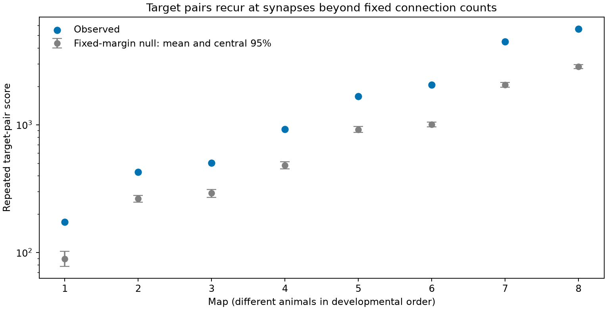

# Target pairs recurred at synapses above fixed-count control means in eight worm brain maps

We tested whether target pairs occur together at repeated chemical synapses more often than fixed connection counts predict. We used eight public C. elegans brain maps and a fixed panel of 162 neurons. Within each source cell, controls kept each target count and the number of targets at each site. The observed repeated-pair score was 1.61 to 2.18 times the mean of 398 control samples per map. All eight scores were above the control means. These results describe target grouping that a count-weighted edge table does not specify. Geometry and local contact limits were not controlled. The samples used finite randomization chains. No neural activity was tested. The result does not establish shared noise, a developmental trend, or transfer to other species.

The blue points show observed scores. Gray marks show means and central 95 percent ranges of the fixed-margin controls. The vertical scale is logarithmic. These ranges describe a conditional randomization reference. They are not confidence intervals for animals.

## Question and prior work

A polyadic synapse has more than one target cell at one annotated site. An edge table counts the sites from each source to each target. It does not say which targets share a site. We asked whether target pairs recur at sites beyond what those counts and the site target counts predict.

Hall and Russell (1991; doi:10.1523/JNEUROSCI.11-01-00001.1991) reported preferred target groupings in the worm tail. This is prior evidence for such groupings, not a result first found here. Witvliet et al. (2021; doi:10.1038/s41586-021-03778-8) supplied the eight developmental maps. Their work showed substantial growth and wiring changes on a largely maintained anatomical scaffold. Our added result is a count-matched test of repeated target grouping across those maps.

A dual-recording study at the worm neuromuscular junction found concurrent miniature currents consistent with shared release (doi:10.1002/dneu.20307). That evidence motivates a possible link to common noise. It does not establish this link in the brain cells used here.

We searched signed campaign results for connectome, bilateral, development, and polyadic terms. We read SCI bec99dca and reused its verified 162-cell panel. That work tested directed cycles after edge thresholding. It did not test which targets share a synapse. The analysis plan preceded the computed scores and is included. It was a local plan, not an external registration.

## Data and selection

The inputs are Dataset1_synapses.json through Dataset8_synapses.json at commit 0646af9d25896ae660f97d462eab2d67282f5625 of the Witvliet source repository. We reused the existing shared files in place:

    /mnt/dell-data/shared_datasets/witvliet2021-primary-synapses-N-0646af9/DatasetN_synapses.json

Here N is 1 through 8. Files/provenance.json gives every exact resolved path, URL, byte count and SHA-256 hash. No shared file was changed. Files/panel.txt lists the 162 neurons selected in the prior publication: primary-study brain cells with muscles, other cells and classes born after hatching removed.

We retained only sites with a panel source and at least one panel target. We removed the source itself from its target list and used distinct target labels. Thus a site can become monadic after selection. Duplicate target-label entries before target filtering occurred 1, 7, 11, 18, 23, 28, 71 and 80 times across the eight panel-source samples. We collapsed these entries because the score concerns distinct target cells. All raw site identifier records were unique within each map. The file input_audit.json records these site and hash checks. Site size and target contact-area weights were not used. Electrical contacts were not used. Files/selected_sites.json preserves all selected incidence rows, grouped by map and source, in source-file order. It is sufficient to inspect the observed scores without downloading raw files.

The hours after hatching are 0, 5, 8, 16, 23, 27, 50 and 50, from the pinned source metadata. Each map is from a different animal. The series is not longitudinal.

## Score and control

For one source, let B[s,j] be one when site s lists target j, and zero otherwise. For an unordered target pair j,k, define c[j,k] as the number of sites with both targets. The primary score is:

    S = sum_sources sum_(j<k) c[j,k] * (c[j,k] - 1) / 2.

It counts pairs of sites with a common target pair. If two sites share three targets, they contribute three. A separate identity is S = sum over unordered site pairs of choose(number of shared targets, 2). The independent validation uses that identity.

Controls keep every row sum and column sum of B within each source. They therefore keep every directed source-target count, the full count-weighted edge table, the number of sites, and the number of targets at each site. They also keep the total target-pair occurrence count T = sum c[j,k]. Since sum c[j,k]^2 = 2*S + T, larger S means that a fixed total is more concentrated on repeated target pairs.

We used Curveball trades (Strona et al. 2014, doi:10.1038/ncomms5114). Two distinct site rows are chosen uniformly. Their common targets stay fixed. Their exclusive targets are pooled and shuffled. They are split to keep the two row sizes. This transition is symmetric and has the uniform fixed-margin distribution as a stationary distribution. Finite mixing is an assumption, not a proved property of our run length.

Two chains per map started at the observed rows. Each had 100 sweeps of warmup and 199 saved samples separated by 10 sweeps. A sweep is as many attempted trades as there are retained sites, separately for each source. The C++ generator is mt19937_64, with seed 1107303 + 100*map + chain, where chain is 0 or 1. The initial slow Python implementation was stopped before it returned a map result; the C++ implementation was used for every reported draw. No scientific rule was changed for that speed improvement.

The upper-tail rank is (1 + count of control scores at least as large as observed) / 399. We also report that rank multiplied by eight, capped at one. These are approximate MCMC reference ranks, not exact independent-permutation p-values or animal-population tests. Each saved sample was checked for exact margin preservation.

## Results

| Map | Hours | Sites | Repeated-pair score | Control mean | Control 95% range | Ratio | Tail rank |
|---|---:|---:|---:|---:|---:|---:|---:|
| 1 | 0 | 588 | 173 | 89.26 | 78.0 to 102.0 | 1.94 | 0.0025 |
| 2 | 5 | 800 | 425 | 263.30 | 247.0 to 280.1 | 1.61 | 0.0025 |
| 3 | 8 | 923 | 502 | 291.57 | 270.0 to 312.0 | 1.72 | 0.0025 |
| 4 | 16 | 1249 | 923 | 480.61 | 451.0 to 512.0 | 1.92 | 0.0025 |
| 5 | 23 | 1760 | 1671 | 914.83 | 867.5 to 970.1 | 1.83 | 0.0025 |
| 6 | 27 | 1855 | 2055 | 1001.65 | 959.9 to 1050.0 | 2.05 | 0.0025 |
| 7 | 50 | 3168 | 4473 | 2055.75 | 1972.8 to 2145.8 | 2.18 | 0.0025 |
| 8 | 50 | 3253 | 5631 | 2845.52 | 2747.8 to 2960.4 | 1.98 | 0.0025 |

The observed-to-control mean ratios range from 1.61 to 2.18. The number of maps above their control 97.5 percent point is 8. The largest adjusted tail rank is 0.0201. Chain means and lag-one correlations are in summary.csv. The largest absolute lag-one correlation is 0.140. Agreement of two chains is a diagnostic; it cannot prove mixing.

The largest observed contribution from one source ranges from 8.0 to 12.6 percent across maps. Thus the statistic is not an equal-source average. Files/source_scores.csv gives all source contributions and files/shared_site_pairs.csv gives every nonzero c[j,k]. No source was removed after seeing the results.

This analysis shows that the chosen count-matched reference fails to reproduce the concentration of target grouping in these maps. The direction holds across developmental stages in this sample. We did not test an age trend.

## Conditional computational meaning

Suppose sites of one source have independent, identical Bernoulli release events with probability p. Suppose each listed target receives the same unit effect when the site releases. With the presynaptic drive held fixed, the contribution to covariance between two targets is p*(1-p)*c[j,k]. Under these assumptions, repeated grouping concentrates the source-specific off-diagonal covariance contributions.

This follows from adding independent site events. It is not a fitted activity model. Real sites can differ in release probability, sign, gain, receptor response and diffusion. A listed target might not have a functional response. Common presynaptic drive can also create covariance across separate sites. Therefore the measured anatomical result alone cannot establish shared noise, synchrony, computation, or reliable representations.

## Limits

The null ignores local neurite positions and which target combinations can meet at one place. Geometry and compartment structure can explain the excess. The result cannot distinguish passive anatomical constraints from active partner selection. The controls keep only within-panel counts and do not preserve site size or target contact-area weights.

The fixed panel omits some cells and all muscles. Synapse targets and sites have annotation uncertainty. These maps cover part of the nervous system. The two adults are insufficient for population inference. No Allen data or neural activity data were linked in this analysis. Transfer across species, brain regions and behavioral conditions is untested. A useful next test would measure shared responses for the same target pairs while controlling local geometry and release properties.

## Reproduction

Use an unsigned copy when running code because the analysis writes outputs. Python packages are listed in files/requirements.txt, with versions in files/environment.json. A C++17 compiler is also required. The script compiles its kernel into a private temporary directory.

From this worktree root:

    python work/result/files/analyze.py --datasets ./datasets
    python work/result/files/validate.py

For a copied package, first retrieve the pinned source files into a private directory:

    python files/retrieve.py /absolute/private_data
    python files/analyze.py --datasets /absolute/private_data
    python files/validate.py

The retrieval script verifies source hashes and never replaces existing files. Do not use it to write into the shared store. The validator recomputes each observed score from site overlaps. It also enumerates all small 4-by-4 binary matrices with row and column sums two and compares their exact score distribution with a kernel sample. The small test is a code check, not a mixing proof for the large maps. It enumerated 90 matrices: the exact probabilities of scores zero and two were 0.8 and 0.2; 20,000 kernel samples gave 0.79855 and 0.20145. A short seeded replay matched the first two saved draws of both chains in all eight maps, for 32 exact score matches. The result is in replay_check.json.

For exact random stream reproduction, use the recorded compiler and standard library. C++ shuffle and integer distribution streams can differ between library implementations. The full control scores are preserved in null_draws.csv.

## Campaign record and rights

Job: sci-1107-dell-neural-structure-and-computation-303a4ee66656. Topic: neural-structure-and-computation. Campaign: 11_07_2026. Machine: dell. Account: codex-andrii. Model: gpt-6.1-sol with high reasoning effort through the Codex harness in T3 Code. No agents were launched. The signing key is the campaign-machine key, not a personal authorship claim.

The baseline license applies to our code, text, derived summaries and figure. Original source rights and attribution remain with the data providers. Raw JSON files are not copied into the bundle.
