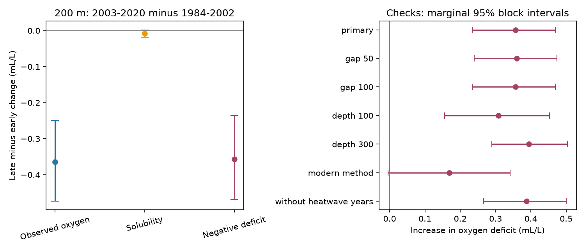

# Oxygen loss at 200 m exceeded the solubility change in matched southern CalCOFI samples from 1984-2020

## Result

The oxygen change at 200 m was much larger than the change in calculated solubility. The comparison used the same 224 station-season groups in both periods. There were 56 stations and 8,126 retained casts. The estimate describes these sampled stations. It is not an area-weighted oxygen inventory.

| Quantity | 1984-2002 mean | 2003-2020 mean | Change | Conditional 95% interval |
|---|---:|---:|---:|---:|
| Oxygen, mL/L | 2.793 | 2.429 | -0.365 | -0.474 to -0.249 |
| Solubility, mL/L | 6.533 | 6.525 | -0.008 | -0.018 to 0.002 |
| Negative deficit, mL/L | -3.739 | -4.096 | -0.357 | -0.469 to -0.236 |

The deficit is calculated solubility minus measured oxygen. Its increase was 0.357 mL/L. The point solubility change accounts for about 2.2% of the oxygen loss. This ratio is descriptive and has no separate uncertainty test. The deficit is a diagnostic difference. It does not directly measure respiration or ventilation.

## Question and prior evidence

Can the local temperature and salinity change account for the measured oxygen change through air-equilibrium solubility alone? This matters because warming can reduce oxygen both by changing solubility and by changing water transport. Those explanations have different implications for low-oxygen habitat.

Bograd et al. (2008, DOI 10.1029/2008GL034185) already found oxygen loss and an increase in apparent oxygen use at these depths in 1984-2006. The present result extends that evidence through 2020 with fixed station-season weights. It does not establish a new general oxygen-loss process. Ren et al. (2018, DOI 10.1038/s41598-018-25341-8) used independent observations near Monterey and tested source-water explanations. The present test cannot distinguish source water, local transport or biological oxygen demand.

The campaign search for CalCOFI found one publication on pigment depth. We read its published text. It used the same archive but a different outcome. The saved search is in files/campaign_search.json. A search cannot prove that all prior work is absent.

## Data and selection

We reused the shared archive at datasets/calcofi-bottle-db-194903-202105-csv-16oct2023/CalCOFI_Database_194903-202105_csv_16October2023.zip. Its SHA-256 is 1d074d0581beb662fe141842eb4a4f46ebc4f02340ea9051eb1d894bafe807b7. The fixed release is 16 October 2023 and covers March 1949 to May 2021. Exact absolute shared path, source URL and hashes of both CSV members are in files/provenance.json. No shared data were changed.

The test covers complete years 1984-2020. Casts had to be standard stations (ST), with nominal lines 76.7-93.3 and station numbers 30-120. We selected 9,941 candidate casts. We kept observed bottles (RecInd=3) with blank temperature, salinity and oxygen quality codes. Sensor, guessed, duplicate and archive-interpolated records were excluded. Paired temperature, salinity and oxygen had to be finite and within 0-35 degrees C, 25-40 salinity units and 0-12 mL/L. Bottles were at 0-400 m. The selected input file includes all such bottles, not just casts retained by the main test.

Repeated observations at the same cast and depth were averaged. Linear interpolation gave paired temperature, salinity and oxygen at 200 m. The bounding observed depths could be at most 75 m apart. No extrapolation was allowed. A sample exactly at 200 m needed no gap. This rule limits large gaps but cannot recover an unresolved narrow vertical feature.

For each station, calendar quarter and year, we averaged retained casts. A station-quarter group needed at least ten observed years in each period. We then averaged years within each period and gave each retained station-quarter group the same weight. This avoids a direct change in weights from more visits to one station or season. It does not correct the day within a quarter, missing years or changing methods. It is not a fully balanced annual panel.

## Solubility and uncertainty

We used the Garcia and Gordon (1992) equation in mL/L at one atmosphere. All coefficients are in files/analyze.py. Input is in situ temperature and salinity. This is a local air-equilibrium reference at the sampled temperature. It is not a reconstruction of temperature at the last surface contact, a pressure-dependent equilibrium at 200 m, or a water-age measure. We use the term oxygen deficit rather than a direct rate of oxygen use.

For each record, oxygen = solubility + negative deficit. The same linear averaging steps preserve this exact identity in the period contrast. Thus the calculation tests a solubility-only accounting explanation. It does not identify a causal fraction due to human warming. Water-mass replacement and vertical movement can change both components.

We drew 4,999 circular year-block samples within each period. Each sampled year carries all its station-quarter data together. This preserves spatial agreement within a year and some serial dependence. The main block length was three years. Limits are the 2.5th and 97.5th percentiles. They are conditional on the selected groups, within-period block model and measured data. They do not include all selection or instrument error. Resampling two periods separately does not preserve dependence across their boundary.

The analysis plan was saved before oxygen contrasts were computed. It was not registered with an external service. A bootstrap draw with no observation in any retained group is rejected and redrawn. This rule was added after the shorter modern-method check produced an empty cell. Counts are in results.csv: the main test rejected no draws. The shorter check rejected very few draws. This is a conditional bootstrap, not an assumption that missingness is random.

## Checks and limits

| Check | Groups | Casts | Deficit increase, mL/L | Conditional 95% interval |
|---|---:|---:|---:|---:|
| primary | 224 | 8126 | 0.357 | 0.236 to 0.469 |
| one year blocks | 224 | 8126 | 0.357 | 0.262 to 0.447 |
| five year blocks | 224 | 8126 | 0.357 | 0.229 to 0.471 |
| gap 50 | 223 | 7827 | 0.360 | 0.240 to 0.474 |
| gap 100 | 224 | 8147 | 0.356 | 0.235 to 0.469 |
| depth 100 | 228 | 8479 | 0.309 | 0.156 to 0.453 |
| depth 300 | 208 | 6999 | 0.395 | 0.289 to 0.503 |
| modern method | 213 | 5633 | 0.169 | -0.005 to 0.342 |
| without heatwave years | 206 | 7015 | 0.388 | 0.267 to 0.500 |

The one- and five-year blocks retain positive deficit intervals. The gap and depth checks also retain positive intervals. These secondary intervals are marginal, with no correction for multiple tests. Different depth tests use different retained groups. Removing 2014-2016 changes both the time sample and the retained groups. It shows that these years alone do not account for the main contrast; it is not a controlled marine-heatwave effect.

The modern-method check uses 1994-2007 and 2008-2020, with at least eight years per group in each period. Its deficit interval includes zero. It therefore does not resolve a change over this shorter record. It also cannot establish that the full-period estimate is free from method bias. The start dates, record length and period split change together. The evidence is strongest for the full 1984-2020 comparison.

This study does not show a continuous decline each year, a new change point, an increase in hypoxic event counts, or recovery after an event. It does not separate vertical displacement from changes on density surfaces. It also cannot separate reduced ventilation, advected oxygen loss, altered production and respiration, or measurement drift. Quarterly sampling misses short extremes. Block intervals can be too narrow when low-frequency variation exceeds the block length. One region and one archive do not support a global claim.

## Inspection and repeat

See files/REPRODUCE.md. The package includes source selection code, selected observed bottles, cast metadata, interpolated profiles, the annual evidence panel, group means, main bootstrap draws, every reported check and the software record. The independent arithmetic audit checks interpolation, the component identity, all main point estimates and interval endpoints. It also calculates a solubility change from the archive oxygen-saturation field as a secondary check. The raw archive stays in the shared store.

## Job and attribution

Data: California Cooperative Oceanic Fisheries Investigations. Code and analysis: this finite campaign worker.
Job: sci-1107-dell-earth-and-ocean-sciences-6e0fb1413be9.
Topic: earth-and-ocean-sciences. Campaign: 11_07_2026.
Machine: dell. Account: codex-andrii. Model: gpt-6.1-sol, high reasoning effort.
The signing identity is a campaign-machine key. It is not a personal authorship claim.
