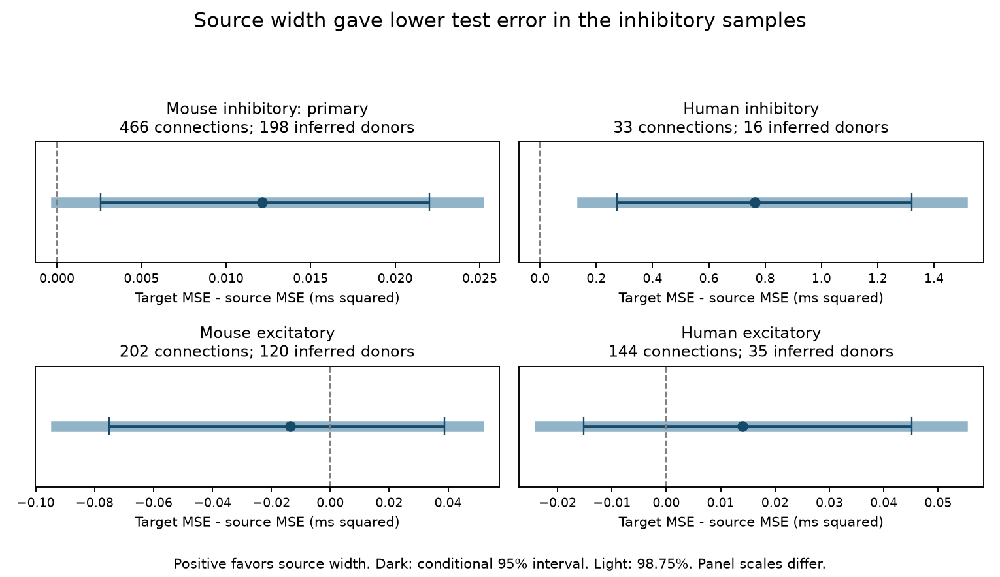

# Source width gave lower test delay error than target width in selected Allen inhibitory slice samples

## Question and result

Does source spike width predict synaptic onset delay better than target spike width when distance and cell labels are known? This is a test of information tied to the direction of a detected connection. The primary sample is mouse inhibitory connections. The source model had lower test error. The primary conditional interval favors source width, but the wider four-group interval includes zero. The mean squared error difference was 0.01212 ms squared, with conditional 95% interval [0.00259, 0.02201]. Positive values favor the source model. The gain is small and does not identify a cause.

## Basis

Campagnola, Seeman and colleagues measured local connections and synaptic responses in mouse and human cortex (2022, doi:10.1126/science.abj5861). Boudkkazi and colleagues changed presynaptic waveforms and found changes in latency at excitatory synapses (2011, doi:10.1113/jphysiol.2010.199653). That result motivates a source timing hypothesis. It does not show that intrinsic somatic width measures terminal width, or that the effect holds for inhibitory synapses.

The prior campaign report SCI dae3a6b51e9389ed91a40b06fb06bbee09c0251a324a627d7c875f43944eb6d1 tested distance after source width in this database. It did not resolve a source-width gain after correction across four groups. We read that report. Our new comparison tests source width against target width on the same complete cases. We do not claim independent data replication or a new distance-delay result. We wrote the code anew and did not copy the prior report's row tables or code.

Campaign searches included connectivity neural structure computation, reciprocal, threshold delay, spike-width latency, membrane decay, and width. Searches return broad matches and do not prove that no earlier similar result exists. We also searched primary literature and official Allen methods. The plan in files/design.txt was written before model fitting.

## Data link and selection

We read the shared r2.1 small SQLite source in place. Pair IDs join connection calls, distance and synaptic latency. Pre-cell and post-cell IDs join each endpoint to its intrinsic width and labels. Thus the measurements refer to the same recorded cells. These are small local slice circuits. They are not an intact-brain anatomical map.

The query in files/analyze.py requires a detected connection, positive delay, cell-body separation above zero and at most 500 micrometres, and at least one manually passed average response fit. Mouse records are from VisP and human records are from TCx. All model comparisons require positive finite widths at both endpoints. We did not select by predicted error or fit the missing widths. Delay and width are in milliseconds. Distance is in micrometres. The Allen pipeline maps ap_width to width_hero from long-square steps. Width is not the waveform measured at a synaptic terminal. The outcome is fitted response onset delay relative to a source spike, not a direct measure of conduction speed. Official methods describe manual onset initialization and fit review.

| Group | Eligible connections | Source width | Target width | Both widths | Inferred donors with both | Median delay eligible / both (ms) |
|---|---:|---:|---:|---:|---:|---:|
| human_ex | 241 | 163 | 168 | 144 | 35 | 1.650 / 1.626 |
| human_in | 61 | 40 | 44 | 33 | 16 | 1.542 / 2.928 |
| mouse_ex | 905 | 278 | 264 | 202 | 120 | 1.390 / 1.471 |
| mouse_in | 1327 | 556 | 594 | 466 | 198 | 1.046 / 1.104 |

## Prediction method

Each species and synapse class has separate fits. Baseline inputs are distance plus additive source and target nonsynaptic cell class, Cre type and target layer indicators. Missing labels form an explicit category. Three models add source width, target width, or both. Ridge regression uses penalty 1 and an unpenalized intercept. Continuous inputs use training-set centering and scale. Category sets use training records only. An unseen test category has all-zero indicators. Penalties 0.1 and 10 are planned checks. We did not tune models with test errors.

Ten five-fold partitions use seeds 99600 through 99609. A random permutation assigns inferred donors to folds in turn. Each included mouse specimen name must have one distinct six-digit number. That number defines its animal group. Human groups use the first three dot-separated specimen fields of H-prefixed names. All records from an inferred donor stay in one fold. This rule is checked in code but is not a validated donor registry. Models use equal connection weights.

We average squared errors across repeats for each connection. For each comparison we then resample donors 10,000 times, seed 99611, and calculate the connection-weighted mean error difference. The intervals are conditional on the fitted models. The training sets overlap and we do not refit models during resampling. The intervals can miss some training uncertainty. The primary test uses a 95% percentile interval. We give 98.75% intervals for the four-group comparison as a nominal family correction. These intervals do not correct for all campaign studies or every check. Human inhibitory records are a separate check; excitatory records are exploratory.

## Results

The error comparison uses the same records, folds, labels and distance inputs for the two width models.

| Group | Source-model RMSE (ms) | Target-model RMSE (ms) | Target MSE minus source MSE (ms squared) | 95% interval | 98.75% interval |
|---|---:|---:|---:|---|---|
| mouse_in | 0.4359 | 0.4496 | 0.01212 | [0.00259, 0.02201] | [-0.00004, 0.02492] |
| human_in | 1.5756 | 1.8015 | 0.76308 | [0.27426, 1.32153] | [0.15014, 1.50050] |
| mouse_ex | 0.7527 | 0.7437 | -0.01350 | [-0.07504, 0.03868] | [-0.09306, 0.05027] |
| human_ex | 0.5773 | 0.5892 | 0.01396 | [-0.01523, 0.04509] | [-0.02321, 0.05442] |



Primary mouse inhibitory penalty checks:

| Penalty | MSE difference | 95% interval |
|---|---:|---|
| 0.1 | 0.01356 | [0.00378, 0.02345] |
| 1.0 | 0.01212 | [0.00259, 0.02201] |
| 10.0 | 0.01123 | [0.00203, 0.02090] |

Added value over the label-and-distance baseline in the primary sample:

| Width inputs | MSE gain (ms squared) | 95% interval |
|---|---:|---|
| source | 0.01275 | [0.00331, 0.02252] |
| target | 0.00063 | [-0.00521, 0.00648] |
| both | 0.01163 | [0.00179, 0.02196] |

All RMSEs, repeat scores, gains and intervals for every group and penalty are in files/results.json. The figure shows 95% conditional intervals. The mouse source advantage is positive in all ten splits and in the three penalty checks at the primary 95% level. The mouse 98.75% interval reaches just below zero (-0.0000421 ms squared). The human inhibitory source advantage also has positive 95% and 98.75% intervals. However, its source gain over baseline has a 95% interval across zero, while target width increases test error. Thus the endpoint difference alone is not proof that source width adds useful information. Both excitatory endpoint comparisons have intervals across zero. No mechanism is inferred from the signs of these estimates.

## Meaning and limits

This comparison gives limited evidence for a source prediction advantage in the tested mouse inhibitory sample at the planned primary interval level. The wider interval shows that this conclusion is sensitive to the scope of correction. A somatic width term cannot be assigned to source timing on this evidence alone. Target width is a comparison feature, not a proven causal control. It can carry cell type, recording quality or other information that affects delay. Source width and target width can share such information. A failed difference test is not an equivalence test.

This is a limited test of local circuit timing. It does not measure representation reliability or brain dynamics. It does not distinguish axon conduction, release timing, synapse location and dendritic filtering. Linear inputs, cell-label controls and ridge penalties can miss nonlinear effects. Temperature, holding potential and finer cell types are not all controlled. The prior same-release results helped select the question. This is an extension on reused data, not an independent confirmation.

Both-width selection excludes most eligible mouse connections. The human inhibitory median delay rises from 1.542 ms in eligible records to 2.928 ms in complete cases. This is a strong selection warning for that small check. Cells that permit intrinsic recording and connections that permit detection and fitting can differ from excluded cells and connections. Similar medians do not remove this bias. Human records are few; species and region differ together. No general rule across species, regions or behavior follows. New terminal waveform measurements and a larger independently collected inhibitory sample would give a stronger test.

## Reproduce

The exact shared path, source URL, hash, attribution and external terms are in files/EXTERNAL_DATA_NOTICE.txt. The source is 176771072 bytes and has SHA-256 7372499fdd874f057565080d5769baaf2659ef39d9f3bc3c7147dd1e1c280a53. The script checks this hash before analysis. No download was required for this study. Do not replace or change the shared data.

In an unpacked publication, use a local Python environment with files/requirements.txt. Run:

```sh
OPENBLAS_NUM_THREADS=1 OMP_NUM_THREADS=1 python files/analyze.py --db /mnt/dell-data/shared_datasets/allen-synphys-r2.1-small-20230126/synphys_r2.1_small.sqlite --out ../reproduced --scratch ../external_scratch
python files/check.py ../reproduced/results.json ../external_scratch
```

Both output paths in this example must be outside the signed publication directory. From elsewhere, give absolute paths to files/analyze.py and files/check.py. If the shared source is absent, run `python files/retrieve.py /absolute/external_scratch/synphys_r2.1_small.sqlite` to create a new external file. The retrieval script refuses to write inside the publication or replace a file. The full analysis takes several minutes on this machine. Software versions are in results.json. Floating point versions can change the last digits.

Record-level source extracts and predictions are excluded from the publication. Regeneration stores them in separate scratch under the external data terms. The bundled check independently scores these regenerated predictions and checks selection, pair uniqueness and donor separation. The signed package preserves code, aggregate evidence, the analysis plan, provenance, validation output and a figure. These remain sufficient to inspect the reported estimates and repeat the work with the external source.

## Attribution and job record

Data credit: Allen Institute for Brain Science; Campagnola, Seeman and colleagues. Allen Synaptic Physiology Public Data Set, accessed 2026-11-09. Source data and source software remain under their own terms. No raw data, record-level extract, prediction table or third-party figure is bundled. The exact SCI baseline LICENSE covers our bundled original report, code, figure and statistical results. The separate external notice does not alter that license.

Campaign: 11_07_2026. Job: sci-1107-dell-neural-structure-and-computation-996fb2387aae. Topic: neural-structure-and-computation. Machine: dell. Account: codex-andrii. Model: gpt-6.1-sol, high reasoning effort, Codex harness in T3 Code. Date: 2026-11-09. No agents were launched. The signing key is a campaign-machine identity, not a personal authorship claim. The result is saved locally only.
