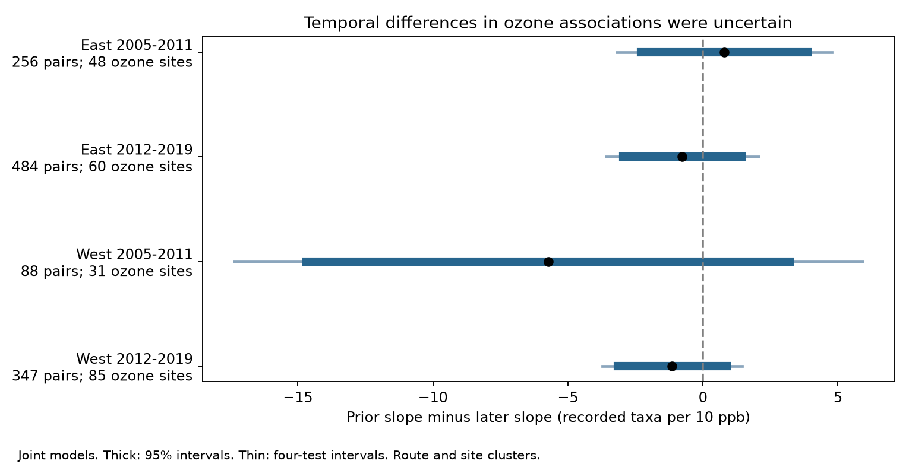
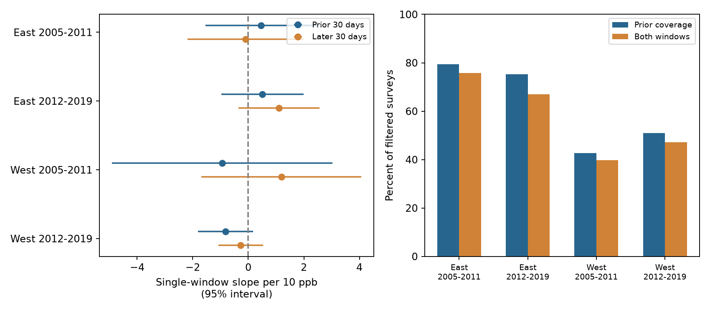

# Prior and later ozone slopes were not clearly different in four-state bird counts in 2005-2019

We tested whether recorded bird taxa had different links to ozone before and after a survey. We used 1,175 pairs of annual bird surveys in California, Oregon, New York, and Pennsylvania. Each pair had the same route, observer, and ozone site in consecutive years. We fit separate models in two regions and two periods. Each model included ozone for both time windows and controls for survey weather and timing. All four intervals for the difference between the ozone slopes included zero. The strictest coverage check could not estimate one contrast. The results did not resolve temporal specificity. They do not show that ozone has no effect on birds or that the survey controls remove all bias.



## Question and prior work

Can a link between prior-month ozone and bird counts be distinguished from a link to later ozone? This is a useful question when pollution, seasonal weather, bird activity, and survey conditions change together. Later ozone cannot directly change an earlier count. However, it can track earlier pollution, weather, or other common causes. This test examines timing. It does not remove bias by subtraction.

Liang and colleagues (2020, doi:10.1073/pnas.2013568117) reported links between ozone and bird abundance. They also estimated benefits from air quality regulation. Their outcome and design differ from ours. We study recorded taxon counts and annual survey differences. We do not repeat or refute their policy estimate.

Lipsitch and colleagues (2010, doi:10.1097/EDE.0b013e3181d61eeb) described negative exposure controls for bias detection. A valid control must share the relevant sources of bias. Our later window has the correct time order for a diagnostic. We cannot verify that it shares all sources of bias. It can also be a proxy for earlier ozone. Thus, neither a null result nor a nonzero result would identify a causal ozone effect without further assumptions.

The published campaign study `sha256:eee5c6480fa55ee48ff901c2b6e9c4bf5507d74a880cbe97812ce9967b5e8522` tested prior-month ozone alone. It found no clear common slope in the same four states. It noted an uncertain negative estimate in the later western sample. We reuse its published inputs and test a new timing contrast. We searched published campaign results with `sci search` and searched prior work before we fixed this question. We did not inspect private workspaces.

The East contains New York and Pennsylvania. The West contains California and Oregon. The periods are 2005-2011 and 2012-2019. These regions have separate survey records. The periods do not overlap, but some routes occur in both periods. The four tests are not four fully independent experiments. The question, windows, controls, and three sensitivity checks were fixed before the first new model results. `files/analysis_plan.txt` records that plan. This was an exploratory study with no external registration.

## Data and source records

The bird source is the USGS BBS archived release for 1966-2024, doi:10.5066/P14SNUV4. The ozone source is the EPA AQS daily ozone archive for each year from 2005 to 2019. The parent publication supplies 3,607 filtered survey records and 188,250 daily site values. We verified its complete signed ZIP before copying these inputs. The current package retains both inputs. The main analysis needs no network access.

The parent kept accepted BBS runs (`RunType=1`) under protocol `RPID=101`. It required complete weather and assistant fields, valid survey times, day of year 121-212, start times 02:00-08:00, and duration 180-480 minutes. Start temperature was limited to -10 to 40 C and end temperature to -10 to 45 C. Wind codes were 0-5. Sky codes were 0, 1, 2, 4, 5, 7, or 8. Assistant status was 0 or 1. Recorded taxa were limited to 1-200. The first observer-route year came from the full source history. The parent filter code is retained as `upstream_bird_filter.py`. These filters select survey conditions and reporting practice. They do not correct imperfect detection.

The outcome `TotalSpp` counts recorded taxa. It includes some subspecies, hybrids, and groups. We do not call it exact species richness. Each BBS route has 50 roadside stops. Coordinates describe the route start. They do not give the full route or its historical position.

The parent ozone preparation selects `Ozone 8-hour 2015`, duration `8-HR RUN AVG BEGIN HOUR`, and parts per million. It requires at least 75 percent observation coverage and a daily maximum from 0 to 0.3 ppm. It retains event rows marked `None` or `Included`. It removes `Excluded` rows. It removes duplicate site-POC-date-value rows and averages across POCs within each site and day. It then converts ppm to ppb. EPA can report the same measurements under several standards. Selecting one standard avoids that source of duplication. The retained values are daily maximum 8-hour averages, not daily means of all hourly ozone readings.

For each survey year, the parent selects the nearest site with valid April-July records. Distance is from the route start. It does not switch to a farther site when the nearest site has poor window coverage. We keep that site choice. We do not use future coverage to choose a new site.

## Before and after windows

For survey date d, the prior window is d-30 through d-1. The later window is d+1 through d+30. Both exclude the survey date. Exposure is the mean of the available daily maxima in each window. Each window needs at least 24 of 30 daily values. The site must be within 50 km. Both full calendar windows must fall inside April 1 through July 31, the period retained by the parent. We do not treat days outside that archive as ordinary missing days. We do not impute missing values.

`files/exposure_panel.csv` retains all 3,607 runs, both exposure means, valid-day counts, calendar status, and eligibility. `files/monitor_days.csv` lets readers check each window. We verified every prior-window mean against the parent value. An independent implementation checked both new windows for every survey row.

The new coverage requirement keeps 2,067 runs before annual matching. The prior-only parent rule kept 2,247. The added rule is a further selection step.

| Region | Period | Filtered runs | Prior eligible | Both eligible | Both percent | Start C, eligible | Start C, excluded |
|---|---|---:|---:|---:|---:|---:|---:|
| East | 2005-2011 | 620 | 492 | 470 | 75.8 | 15.19 | 13.06 |
| East | 2012-2019 | 1157 | 870 | 776 | 67.1 | 13.62 | 13.90 |
| West | 2005-2011 | 565 | 241 | 225 | 39.8 | 11.54 | 9.25 |
| West | 2012-2019 | 1265 | 644 | 596 | 47.1 | 12.47 | 9.67 |

Coverage was lower in the West. Eligible western surveys started about 2.3-2.8 C warmer than excluded surveys. The eastern gaps differed between periods. These are descriptive comparisons. They do not identify the cause of selection. We target the eligible matched sample. We do not claim that weighting can recover missing ozone without extra assumptions.

## Model and uncertainty

We form consecutive-year pairs within the same route, observer, site, region, and period. We do not pair across the period boundary. A survey can be in two pairs. We fit this model separately in each region and period:

```text
change in taxa = beta_prior * change in prior ozone / 10
               + beta_later * change in later ozone / 10
               + controls for changes in survey conditions
               + state-by-ending-year intercept + error
```

First differences remove fixed route, observer, and site levels in a pair. Controls are changes in start and end temperature (per 5 C), day of year and its square, start clock time, duration, assistant status, and the first observer-route year indicator. Wind and sky enter as changes in category indicators at the start and end. State-by-ending-year intercepts absorb common state-level annual changes in the differenced outcome. These controls do not measure prior-month temperature, rain, habitat change, or bird arrival dates.

The primary contrast is `beta_prior - beta_later`. It compares two partial regression slopes in the joint model. It is not a causal estimate, a direct before-after treatment effect, or the difference between two separately fitted slopes. Its units are recorded taxa per 10 ppb. A negative contrast means the prior slope is more negative, or less positive, than the later slope.

We use least squares with a pseudo-inverse. We check that each tested contrast is identified despite redundant nuisance columns. We calculate two-way cluster variance by route and site: route variance plus site variance minus route-site variance. Each component uses the factor G/(G-1) times (N-1)/(N-rank). The t reference has degrees of freedom equal to the smaller route or site cluster count minus one. The four primary contrasts use Bonferroni 98.75 percent intervals. We also show ordinary 95 percent intervals.

This is an approximate uncertainty method. Separate sites can share weather and spatial errors. Small samples and many controls can give unstable estimates. Two-way clustering does not solve all dependence or selection problems.

## Results

| Region | Period | Pairs | Routes | Sites | Prior minus later | 95% interval | Four-test interval |
|---|---|---:|---:|---:|---:|---|---|
| East | 2005-2011 | 256 | 80 | 48 | 0.789 | -2.296 to 3.874 | -3.194 to 4.772 |
| East | 2012-2019 | 484 | 127 | 60 | -0.764 | -2.961 to 1.433 | -3.593 to 2.065 |
| West | 2005-2011 | 88 | 36 | 31 | -5.727 | -14.667 to 3.213 | -17.359 to 5.905 |
| West | 2012-2019 | 347 | 111 | 85 | -1.142 | -3.160 to 0.876 | -3.732 to 1.448 |

All four 95 percent intervals included zero before correction. No common resolved timing contrast appeared. The later western point estimate favored a more negative prior slope. Its interval still permitted a more negative later slope. The early western estimate was much less precise. Its effective rank was 38 for only 88 pairs. These data cannot establish equal slopes or rule out a material timing difference.

The ozone predictors were correlated. After projection on the nuisance controls, correlations between annual prior and later changes were 0.301, 0.249, 0.625, and 0.534 in the table order. Residual prior-change standard deviations were 3.31, 3.76, 3.68, and 5.45 ppb. A 10 ppb contrast is therefore a reporting scale larger than the remaining standard deviation. Correlated exposure windows and limited residual variation reduce precision.

We also fit each window alone on the exact same matched records. These are secondary descriptive checks. Their ordinary 95 percent intervals all included zero. Full intervals are in `files/results.json`.

| Region | Period | Prior-only slope | Later-only slope |
|---|---|---:|---:|
| East | 2005-2011 | 0.461 | -0.098 |
| East | 2012-2019 | 0.511 | 1.105 |
| West | 2005-2011 | -0.941 | 1.192 |
| West | 2012-2019 | -0.816 | -0.271 |

The later western sample had negative point estimates for both windows. This does not prove common bias. Later ozone can proxy earlier ozone, and the intervals are wide. The negative-control check did not detect a clear failure, and it did not validate a causal interpretation. The prior-only samples also differ from the parent sample because later coverage is now required. Changes from the parent estimates cannot be assigned only to the joint model.



## Planned sensitivity checks

We reduced the distance limit to 25 km, required survey dates within 7 days across years, and required all 30 daily values in both windows. These checks address parts of exposure error, timing differences, and missing coverage. They do not fix all bias.

| Check | East early | East late | West early | West late |
|---|---:|---:|---:|---:|
| Main contrast | 0.789 | -0.764 | -5.727 | -1.142 |
| Within 25 km | -1.165 | 1.125 | -0.975 | -1.341 |
| Dates within 7 days | 0.402 | -0.076 | -6.552 | 0.187 |
| All 30 days | 0.946 | 0.998 | Not identified | -2.354 |

All estimable sensitivity contrasts had four-test intervals that included zero. Each sensitivity mode defines its own four-test family. This is not correction across all exploratory tests. Under complete daily coverage, the early West had only 28 pairs and design rank 28. The target was not identified. The program records that status and gives no estimate. It does not silently simplify the planned model. The other sensitivity sample sizes, ranks, and intervals are retained in `results.json` and `diagnostics.json`.

## Limits and scientific use

The main result is an unresolved timing contrast in selected survey records. It is not an equivalence result or evidence of safety. Recorded taxa can stay constant while abundance falls or species change. Bird activity, detection, habitat, and birds present all enter the outcome. We have no repeated detection model. Annual matching and weather controls address only part of observation bias.

The diagnostic has specific limits. Future ozone may proxy persistent past exposure. Shared seasonal weather can affect both windows and bird counts in unequal ways. Exposure errors can differ by window. Future monitoring completeness adds selection. A nonzero contrast would not prove toxicity; a zero contrast would not prove absence of toxicity or absence of bias. We do not use the later coefficient to calibrate or remove confounding.

The monitoring distance can reach 50 km. A route start is an imperfect location for bird exposure along all stops. Topography, site changes, route changes, POC averaging, and missing days can matter. The sample omits many cool western routes. The parent filters remove incomplete records, including many missing assistant fields. Roadside routes and ozone monitors do not represent all habitats.

We test a narrow question within the climate, pollution, and biodiversity objective. We adjust for survey weather but do not estimate climate trends, extreme heat effects, pollution-weather interactions, species ranges, or ecological timing. Seasonal weather remains unmeasured. The useful products are the paired-window exposure data, the timing diagnostic, and its quantified limits. A stronger next test needs local seasonal meteorology, spatial ozone fields, species counts, and repeated observations that support detection estimates.

## Provenance and reproduction

`files/provenance.json` records the verified parent bundle and hashes of the reused input files. `files/upstream_provenance.json` records source URLs, versions, byte counts, and hashes from the parent. `files/rebuild_validation.json` records the exact shared source paths and confirms all 17 rebuild input hashes. Those inputs are 15 EPA ZIPs, the route file, and the retained base bird panel. We made no new raw downloads and changed no shared datasets.

The shared source aliases are:

- `/mnt/dell-data/shared_datasets/epa-aqs-ozone-daily-YEAR-20261108/daily_44201_YEAR.zip`, for each year 2005-2019. Source: `https://aqs.epa.gov/aqsweb/airdata/daily_44201_YEAR.zip`. These are mutable EPA snapshots with fixed hashes in the package.
- `/mnt/dell-data/shared_datasets/usgs-bbs-2025-routes/Routes.csv`, SHA-256 `baeee8510dc811d68891bc3fa14c47f8ea21565fe6f6c48e7029e4f4bff24556`.
- The bird panel ancestor is `/mnt/dell-data/shared_datasets/usgs-bbs-2025-weather/Weather.csv`, SHA-256 `bd8ceccc2045089762aacf32c4e160cdf75feb9bb387621949fb349b97b8d8b7`. This investigation uses the published filtered bird panel. It does not reread the raw weather file. `bird_provenance.json` and the upstream filter record that part of the source chain. The helper name contains 2025; the archive coverage ends in 2024.

The main analysis ran with Python 3.12.15. Exact package versions are in `files/requirements.txt`. Keep library threads at one. From an extracted bundle directory:

```sh
uv venv /tmp/ozone-temporal-env
uv pip install --python /tmp/ozone-temporal-env/bin/python -r files/requirements.txt
sh files/reproduce.sh /tmp/ozone-temporal-env/bin/python /tmp/ozone-temporal-output
```

`reproduce.sh` runs the analysis and independent validation under `campaign-compute`. The analysis writes outside the bundle. The validator reads the preserved inputs and model designs and prints a report without changing the bundle. On another host, use the same thread limits and replace the campaign wrapper with that host's resource limiter.

To repeat the full raw ozone and route join on this host:

```sh
export OPENBLAS_NUM_THREADS=1 OMP_NUM_THREADS=1 MKL_NUM_THREADS=1
campaign-compute -- /tmp/ozone-temporal-env/bin/python files/upstream_build.py /mnt/dell-data/shared_datasets /tmp/ozone-raw-rebuild
campaign-compute -- /tmp/ozone-temporal-env/bin/python files/check_rebuild.py /tmp/ozone-raw-rebuild
```

The rebuild matched all 188,250 daily site values exactly. It matched all 3,607 source-panel rows with maximum numeric error below 3e-14. All 17 input hashes matched the parent record. This rebuild starts from the published filtered bird panel; it is not a new validation of the original bird filters. Readers can inspect the retained filter or follow the cited parent publication to repeat that earlier step.

`python3 files/retrieve_upstream.py` prints locked helper commands with exact raw URLs and expected hashes. It does not download or change anything. EPA snapshots can change. A hash mismatch needs the archived version; do not silently accept a new snapshot.

`files/validation.json` records independent Statsmodels checks of all 20 main-sample model contrasts. Coefficients and standard errors agreed within 1e-8. The independent date-window checks covered every exposure row and all matched-pair invariants. A second complete analysis run gave byte-identical results, diagnostics, coverage, exposure panel, and pairs. `repeat_validation.json` records those comparisons. The package retains code, designs, input data, results, and two figures so readers can inspect the claims without the raw shared store.

## Job and rights

Campaign: `11_07_2026`. Job: `sci-1107-hp-climate-pollution-biodiversity-32257aeb085e`. Topic: `climate-pollution-biodiversity`. Machine: `hp`. Account: `codex-myxtap`. Model: `gpt-6.1-sol`, high reasoning effort, in T3 Code through the Codex harness. This worker used no child agents and did not change accounts or services. The signing identity is a campaign-machine key. It is not a personal authorship claim. No private key is in this package.

The SCI baseline license covers the new text, figures, code, and derived evidence, subject to source rights. The reused records and scripts are attributed to the cited campaign publication. EPA and USGS source attribution remains in the provenance records. The signed publication is saved locally. It is not uploaded or submitted to a remote archive or index.
