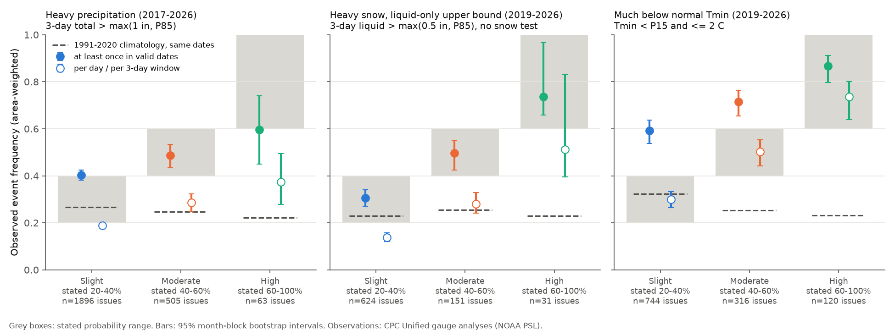
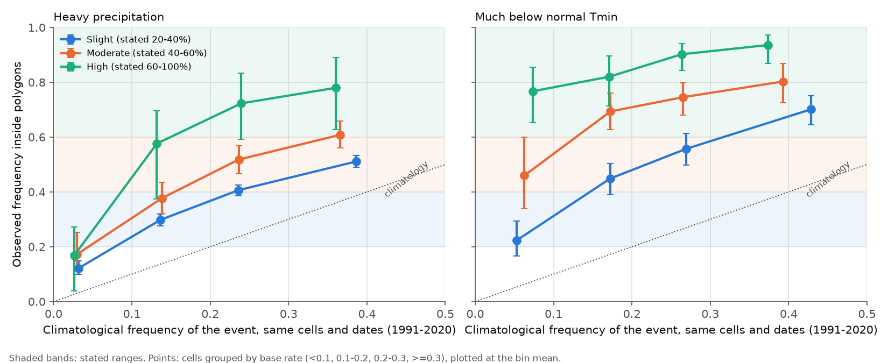
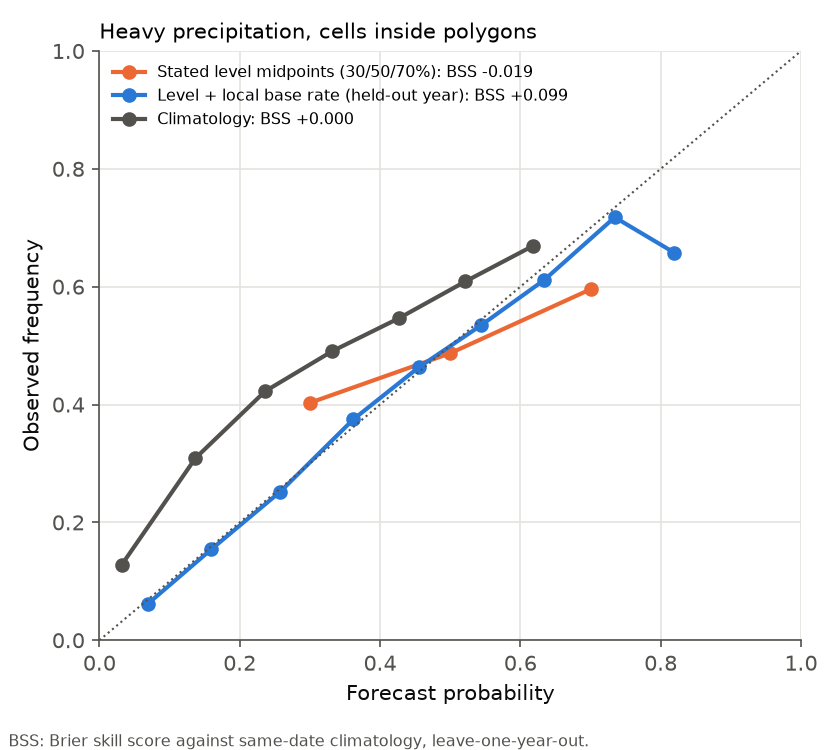

# CPC Week-2 probabilistic hazard levels: calibrated only under different event rules for rain and cold, and blind to the local base rate (CONUS, 2017-2026)

Job: sci-1107-dell-earth-and-ocean-sciences-9e68b188c36b. Campaign 11_07_2026. Topic: earth and ocean sciences.
Machine: dell. Model: claude-opus-5-5 (Claude Code). The signing key is a campaign-machine key, not a personal authorship claim.

## Summary

The NOAA Climate Prediction Center (CPC) issues a Week-2 (days 8-14) U.S. Hazards Outlook every weekday.
Since December 2017 it has included experimental probabilistic polygons. Each polygon has a level
(Slight >= 20%, Moderate >= 40%, High >= 60%) and valid dates. No earlier campaign publication tested this product.
We matched all archived probabilistic polygons for heavy precipitation (2,439 issuances, Dec 2017 - Oct 2026),
heavy snow (1,921 issuances, Dec 2019 - Oct 2026) and much below normal temperatures (744 issuances with
polygons, Aug 2019 - Oct 2026) to the CPC Unified gauge analyses on 0.25-deg (rain, snow) and 0.5-deg (Tmin)
land cells of the contiguous U.S. We wrote the plan (`files/PREREGISTRATION.md`) before we matched forecasts to observations.

Main results:

1. **The product does not say whether a risk applies "at least once during the valid dates" or "on a given day".
   Neither reading makes all hazards calibrated.**
   * Heavy precipitation verifies as an "at least once" probability. Observed frequency: Slight 0.40 [95% CI 0.38-0.42],
     Moderate 0.49 [0.43-0.53], High 0.60 [0.45-0.74]. All three are inside their stated ranges.
     Read per 3-day window, the levels are too high: 0.19 [0.18-0.20], 0.29 [0.25-0.32], 0.37 [0.28-0.50].
   * Much below normal Tmin verifies as a per-day probability: Slight 0.30 [0.26-0.33], Moderate 0.50 [0.44-0.55],
     High 0.74 [0.64-0.80]. All are inside their ranges. Read as "at least once", Slight (0.59 [0.54-0.64]) and
     Moderate (0.72 [0.66-0.76]) are under-forecast, i.e. too low.
   * Heavy snow (liquid-only upper bound, no temperature test): "at least once" gives 0.31, 0.50 and 0.74, which is
     consistent. Per 3-day window, even this upper bound is below the floors for Slight (0.14 [0.12-0.16]) and
     Moderate (0.28 [0.24-0.33]). Thus, under a per-window reading, snow is shown to be over-forecast.
2. **Inside each level, the observed frequency follows the local climatological frequency of the event.**
   For heavy precipitation, Slight cells with a 1991-2020 same-date frequency below 0.1 verified at 0.12 [0.10-0.15],
   below the 20% floor. Slight cells with a base rate of 0.3 or more verified at 0.51 [0.49-0.53], above the 40% ceiling.
   Slight areas west of 100 W verified at 0.26 and east of 100 W at 0.45 [0.43-0.47]. The overall calibration is thus
   a mean of opposite errors. In a logistic model, logit(p) = a_level + b logit(climatology), b = 0.75 [0.68-0.84]
   for rain and 0.85 [0.71-1.00] for Tmin. The labels imply b = 0.
3. **A base-rate-aware relabelling gives a large held-out gain.** In leave-one-year-out tests on cells inside
   polygons, the Brier skill score against same-date climatology was -0.019 for the stated midpoints (30/50/70%),
   +0.018 for refitted level constants, and +0.099 for "level + local base rate" (heavy precipitation).
   For Tmin ("at least once" event) the values were +0.118, +0.328 and +0.388.

The levels carry real information. Observed rain frequency in Slight, Moderate and High areas was 1.5, 2.0 and 2.7 times
the same-date climatology. The errors come from the unstated event definition and from probabilities that do not
scale with the local base rate. A likely source is the event definition itself: the 1-inch floor is above the 85th percentile on 90% of
cell-days. Thus the base rate of the rain event inside polygons ranges from about 3% in the arid West to about 40%
in the wet East and Southeast, and one label cannot mean one probability.

## Data

* **Forecasts.** CPC Week-2 probabilistic hazards shapefiles, `https://ftp.cpc.ncep.noaa.gov/GIS/us_hazards/`
  (`Prcpprob_D8-14_YYYYMMDD.zip` 2017-12-05 to 2026-11-11, `Snowprob_D8-14_*` from 2019-12-03, `Tempprob_D8-14_*` from 2019-06-21).
  We downloaded 6,453 ZIP files on 2026-11-11 with HTTP range requests. We kept all members except the large
  `.shp.xml` metadata file. `files/provenance/hazard_shapefile_members_sha256.tsv.gz` lists the ZIP size and the
  SHA-256 of each kept member. The product description is `week2_us_hazards_info.pdf` (4 Feb 2025, SHA-256 in
  `files/provenance/product_docs_sha256.txt`). Its Table 1 defines the hazards: heavy precipitation is a 3-day
  total above the 85th climatological percentile and above 1 inch; much below normal temperature is a daily
  minimum below the 15th percentile and near or below freezing.
* **Precipitation observations.** CPC Unified Gauge-Based Analysis of Daily Precipitation over CONUS V1.0, 0.25 deg,
  NOAA PSL, `https://downloads.psl.noaa.gov/Datasets/cpc_us_precip/` (1991-2006) and `.../RT/` (2007-2026, to 2026-11-10).
  We used the campaign shared copies `/mnt/dell-data/shared_datasets/noaa-psl-cpc-us-precip-v1-YYYY-20261111/`.
  SHA-256 values are in `files/provenance/cpc_us_precip_inputs_sha256.tsv`. Daily value D is 12 UTC D-1 to 12 UTC D.
  We used 13,626 land cells.
* **Temperature observations.** CPC Global Unified Temperature V1.0 Tmin, 0.5 deg, NOAA PSL,
  `https://downloads.psl.noaa.gov/Datasets/cpc_global_temp/tmin.YYYY.nc`. Shared copies:
  `/mnt/dell-data/shared_datasets/noaa-psl-cpc-global-temp-tmin-YYYY-*`. SHA-256 values are in
  `files/provenance/cpc_global_tmin_inputs_sha256.tsv`.

All inputs are NOAA products. See `files/DATA_NOTICE.md` for their terms and attribution. We bundle no raw input files.

## Methods

* **Unit.** One (issuance, land cell) pair. A cell takes the highest level whose polygon contains its centre, and
  the valid dates of that polygon. If two polygons of the same level overlap, we join their date segments.
  Polygons over Alaska are outside the grid and do not count.
* **Rain event (primary).** The threshold is T = max(25.4 mm, P85), where P85 is the 1991-2020 85th percentile of all 3-day totals
  (zeros included) for the cell within +-15 calendar days. Hazard calendar day d matches gauge day d+1.
  "At least once": any 3-day window that overlaps the valid dates has a total above T.
  "Centre inside": the window centre is a valid day. "Per window": the fraction of windows centred on valid days
  that exceed T. Snow uses max(12.7 mm, P85) with no temperature test, so it is an upper bound on snow events.
* **Tmin event.** Tmin is below the 1991-2020 15th percentile (+-15 days) and at or below 2 C (variants: 0 C, 4 C,
  no freezing condition, +-1 day tolerance). "At least once": on any valid day. "Per day": the fraction of valid days.
* **Climatology.** The frequency of the same "at least once" event at the same cells on the same calendar dates
  in each year 1991-2020.
* **Statistics.** cos(latitude) area weights. 95% intervals come from 2,000 bootstrap resamples of calendar months of issuance,
  because consecutive issuances share weather. A level is over-forecast (under-forecast) when the whole interval is
  below (above) the stated range.
* **Base-rate model.** Weighted logistic regression of the rain event (or Tmin event) on level dummies and
  logit((k+0.5)/31), where k is the number of climatology years with the event. We bootstrapped b with 200 month-block resamples.
  We scored held-out years with the Brier score (leave one calendar year out).

## Results in detail

| Hazard, rule | Slight (20-40%) | Moderate (40-60%) | High (>= 60%) |
|---|---|---|---|
| Rain, at least once | 0.403 [0.382, 0.424] | 0.487 [0.433, 0.534] | 0.596 [0.449, 0.741] |
| Rain, centre inside | 0.339 [0.320, 0.358] | 0.412 [0.364, 0.456] | 0.522 [0.397, 0.659] |
| Rain, per 3-day window | 0.189 [0.176, 0.201] | **0.285 [0.249, 0.322]** | **0.373 [0.279, 0.495]** |
| Rain, same-date climatology | 0.266 | 0.248 | 0.222 |
| Snow upper bound, at least once | 0.306 [0.270, 0.341] | 0.496 [0.424, 0.549] | 0.736 [0.658, 0.966] |
| Snow upper bound, per window | **0.138 [0.120, 0.157]** | **0.280 [0.241, 0.329]** | 0.513 [0.395, 0.832] |
| Tmin <= 2 C, at least once | **0.592 [0.538, 0.637]** | **0.715 [0.655, 0.764]** | 0.866 [0.796, 0.912] |
| Tmin <= 2 C, per day | 0.300 [0.264, 0.334] | 0.502 [0.442, 0.553] | 0.737 [0.639, 0.801] |
| Tmin same-date climatology | 0.324 | 0.253 | 0.231 |
| Issuances (rain / snow / Tmin) | 1,896 / 624 / 744 | 505 / 151 / 316 | 63 / 31 / 120 |

Bold: interval entirely outside the stated range. Tmin "at least once" variants: 0 C gives 0.559/0.683/0.856, 4 C gives
0.612/0.734/0.872, no freezing condition gives 0.627/0.747/0.878, and +-1 day gives 0.673/0.812/0.935. The Tmin under-forecast
under this rule does not depend on the "near freezing" value.

Other rain results (`files/results/prcp_splits.csv`):
* Period length: Slight 0.31 for 1-day periods, rising to 0.44 for 5 or more days. Climatology rises the same way (0.18 to 0.30).
* Lead: 90% of Slight cell-issuances start on day 8 or 9. Later starts are not clearly different (0.39, 0.36).
* Season: Slight 0.36 (JJA) to 0.45 (MAM). Year: Slight 0.35-0.47 in 2018-2026, with no trend.
* Outside all polygons, the rain event occurred somewhere in days 8-14 at 0.19 [0.18-0.20] of the area.
  543 of 2,439 issuances had no CONUS rain polygon.

`files/figures/fig3_slight_maps.png` maps the observed and climatological frequency in Slight rain areas by cell.

## Interpretation

* For rain, the stated levels match the generous "at least once" event. Thus the rain probabilities do not have the
  large miscalibration seen in some other operational products. But they hide a strong dependence on location:
  dry-climate polygons verify too rarely and wet-climate polygons too often. This is like the offsetting errors
  in ShakeAlert contours and NHC wind probabilities found earlier in this campaign.
* The cold-temperature levels match a per-day event. Under the event rule that fits the rain levels, they are about
  1.5-3 times too low for Slight areas. A user who reads all layers in the same way gets an error in one of them.
* A probable source: the CPC objective tools (the Probabilistic Extremes Tool and calibrated ensembles) may compute
  rain as a probability over a 3-day window that covers the period, and cold as a daily probability. Forecasters then copy
  these values into a common label. We could not test this, because archived tool output is not public.

## Deviations from the plan and limitations

* **Post hoc additions.** We added the "per day / per window" rules after we saw the first Tmin result. We added the
  logistic base-rate model and the held-out recalibration after we saw the base-rate splits. The plan named a base-rate
  tercile split; we used fixed bins (<0.1, 0.1-0.2, 0.2-0.3, >= 0.3) instead.
* **Not tested.** Much above normal temperature (145 polygons) and extreme heat need Tmax or heat index; the shared
  Tmax copies for 2013-2026 were not complete during this job. We did not test high winds (no wind observations used)
  or the deterministic composite map.
* **Observation scale.** Gauge analyses on 0.25-deg cells smooth point extremes. The 1-inch and 0.5-inch floors are
  therefore harder to reach than at a single gauge. This could lower observed rain frequencies, most in sparse-gauge
  western areas. It would not explain the Tmin under-forecast or the base-rate slope inside the eastern U.S.
* **Climatology base.** P85 and P15 come from 1991-2020 gauge analyses, not from the reforecast climatology that CPC uses.
* **Brier scores** cover only cells inside polygons. They do not score the decision to draw a polygon.
* **Snow** has no temperature test, so its frequencies are upper bounds.
* **Clustering.** Bootstrap intervals use month blocks. They do not fully remove spatial correlation inside one weather
  event, and High levels have few independent events (22-29 months).

## Reproduction

1. `bash files/scripts/00_retrieve_inputs.sh /path/to/scratch` downloads the NOAA inputs and the hazard members
   (about 1.5 h at the CPC server rate seen here). Compare hashes with `files/provenance/`. The 2026 year files grow as NOAA adds days.
2. `bash files/scripts/run_all.sh /path/to/scratch` runs the climatology (02), matching (03, 06), analysis (04, 05, 07)
   and figures (08). With 2 CPUs, the run takes about 1 h. It needs about 4 GB RAM. Python 3.12 with numpy, pandas,
   xarray, netCDF4, geopandas, shapely 2, scipy, matplotlib and pyarrow.
3. Results: `files/results/*_levels.csv` (calibration per level), `*_splits.csv`, `*_inversion.csv` (threshold
   multiplier), `*_per_issue.csv` (per issuance and level), `*_baserate_model.json`, `*_reliability_loyo.csv`,
   `*_summary.json`, `tmin_cells.parquet` (cell-level Tmin matches). The cell-level rain and snow tables (41 MB and
   12 MB) are not bundled; script 03 regenerates them.
