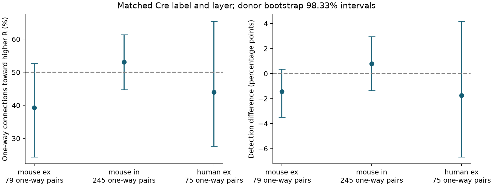

# Matched Allen cortical pairs did not show a clear connection preference toward cells with higher input resistance

## Result

In three selected groups of cortical cell pairs, detected one-way connections did not show a clear preference toward the cell with higher input resistance. The groups contained 3,618 cell pairs tested in both directions. Only 399 pairs had a connection detected in one direction alone. Their higher-resistance target fractions were 39.2%, 53.1%, and 44.0%. All three donor bootstrap 98.33% intervals included 50%.

This is an exploratory audit of directed circuit maps. It provides a paired method and a public evidence table. It does not show that input resistance has no effect on voltage responses. It does not establish equal detection power or equal wiring rates.



Figure 1. The left panel shows the fraction of one-way connections directed toward the cell with higher resistance. The right panel shows the difference in detection rates across all selected pairs: higher-resistance target minus lower-resistance target. Bars are donor bootstrap 98.33% intervals. The dashed lines show equal rates. The cell classes ex and in mean excitatory and inhibitory.

## Question and prior work

For a fixed current, a larger input resistance can produce a larger voltage response. This motivates a possible bias in connection maps: a weak connection might be easier to detect when its target has higher resistance. Biological differences in wiring can also produce this pattern. We ask whether the detected direction follows the resistance ordering of two similar cells. We do not assume that all connection calls came from voltage recordings.

Campagnola, Seeman, and colleagues measured local connectivity and synaptic responses in mouse and human cortex (2022, doi:10.1126/science.abj5861). Their work addresses cell type, spatial sampling, and detection limits. The Allen database links cells, connection tests, and intrinsic physiology through exact cell IDs. These links avoid atlas registration or a match across animals. The stored intrinsic pipeline obtains input resistance from long current steps and stores it in ohms. The public connectivity code defines a probed pair by more than 10 class-specific test spikes. These definitions motivate the present selection.

Before fixing the question, we ran `sci search "connectome neural structure" --in ./campaign --json`, then searches for `inhibitory reciprocity` and `lateral vertical`. We also inspected titles in published campaign bundles. We read two verified campaign reports. Report `sci:sha256:bcfd8c73c33c3e3640ca279bd3dbd511f6971f9e6218fb35ade1a52f84e00e61` tested target resistance for voltage prediction among detected connections. It did not test direction of detection. Report `sci:sha256:be1bc665c37d982b55c16fb1aaeab66479ab234e98dbcecab1c9c1cbbc75b7b2` compared both directions within pairs with different axon labels. It informed the paired control design. We did not reuse either report's data tables or code. The initial broad SCI scans did not complete. We stopped the two redundant scans and used direct title inspection plus verified reads of the relevant published bundles. A later targeted SCI scan for `input resistance` was also stopped before completion. Full-campaign verification was too slow for this finite investigation; search coverage is incomplete. This review is not a systematic review. No private worker workspace was read.

## Data and selection

We used Allen Synaptic Physiology r2.1 small, schema 22, source date 2023-01-26. This release contains local brain-slice recordings, not a complete anatomical connectome. Mouse data are from VisP. Human data are from TCx. Species and region therefore change together. No behavioral condition was tested.

We joined the pair, cell, intrinsic, experiment, and slice tables. Exact SQL is in `files/extract.py`. We kept one row per unordered cell pair and required a reverse pair row. Both connection calls must be binary. Both cells must have the same known nonsynaptic class, ex or in. Each direction must have more than 10 test spikes of that class. Cell-body distance must be positive and at most 500 micrometres. Both resistance values must be finite and positive. Exact resistance ties were excluded. We did not require a response amplitude fit or use the pulse-train arrays.

| Selection step | Pairs left |
| --- | ---: |
| All directed database pairs | 123,506 |
| Unordered pairs with a reverse row | 61,753 |
| Same known class, binary calls, region and distance | 14,093 |
| Both directions probed | 8,647 |
| Both resistance values present, positive, finite and unequal | 5,567 |

The last row includes candidates for the broader sensitivity comparison and a small human inhibitory set. The primary comparison uses mouse ex-ex, mouse in-in, and human ex-ex. Within each pair, Cre labels must agree, with two missing Cre labels counted as equal. Recorded target layers must be equal and nonmissing. Human inhibitory pairs were not a primary group. The plan specified these three groups before direction results were computed. The plan was exploratory and was not externally registered. Initial database counts were inspected before the plan was written.

## Paired method and uncertainty

For each pair, let H be the binary connection call when the higher-resistance cell is the target. Let L be the reverse call. The primary estimate is the mean of H among pairs with H unequal to L. This is the fraction of one-way detected connections that point toward higher resistance. A value of 0.5 means that the two directions occur equally often. A second estimate is mean(H minus L) across all selected pairs. Pairs with neither or both directions detected contribute zero to this second estimate.

The two directions share physical cells, cell-body distance, slice, and experiment. Matching reduces known cell-type and layer differences. It does not control all source and target properties. The test is a direction association, not a causal effect of resistance. Resistance is measured separately from the connection call. A one-way call does not prove that the reverse anatomical connection is absent.

Mouse donor labels were inferred from isolated six-digit animal numbers in specimen names. Human labels use the first three dot-separated fields of names that start with H. Other names use slice ID as a fallback. The code hashes these labels in the stored table. These labels are not a verified donor registry. All primary rows used specimen-based labels, as checked in `files/validation.txt`. Different groups can contain the same donors.

We resampled inferred donors with replacement 20,000 times with seed 110782. All pairs for a donor stayed together. Each draw recomputes the fraction from summed counts, so each pair has equal weight. The primary intervals use quantiles at 0.8333% and 99.1667%. Their marginal coverage target is 98.3333%. A Bonferroni family coverage target of 95% across the three primary fractions depends on valid marginal bootstrap coverage. This is an approximate interval, not a finite-sample guarantee. The second estimate is descriptive and is not an additional confirmatory test. We made no equivalence claim.

## Main evidence

| Group | All pairs | Inferred donors | One-way pairs | Donors with one-way pairs | Higher-resistance target count | Fraction, % [98.33% interval] |
| --- | ---: | ---: | ---: | ---: | ---: | --- |
| Mouse ex-ex | 1,189 | 221 | 79 | 44 | 31 | 39.2 [24.4, 52.6] |
| Mouse in-in | 1,911 | 484 | 245 | 163 | 130 | 53.1 [44.7, 61.4] |
| Human ex-ex | 518 | 45 | 75 | 27 | 33 | 44.0 [27.6, 65.4] |

| Group | H detections | L detections | H minus L, percentage points [98.33% interval] |
| --- | ---: | ---: | --- |
| Mouse ex-ex | 47 | 64 | -1.43 [-3.50, 0.34] |
| Mouse in-in | 221 | 206 | 0.78 [-1.35, 2.94] |
| Human ex-ex | 46 | 55 | -1.74 [-6.67, 4.19] |

No primary fraction interval excludes 50%. No primary detection-difference interval excludes zero. A high total pair count does not imply high directional information: only the one-way pairs inform the primary fraction. Median resistance ratios were 1.58, 1.59, and 1.55 in the three groups. Median forward-to-reverse test-count ratios were 1.00 in all three groups. A median of one does not imply matched exposure for every pair.

## Sensitivity checks

Four checks were specified before direction results. We required more than 100 spikes in both directions, restricted the forward-to-reverse count ratio to 0.8 through 1.25, required a resistance ratio of at least 1.25, or removed the Cre and layer match while retaining the broad class match. These intervals are descriptive 95% intervals without correction across checks.

| Rule | Mouse ex-ex: one-way pairs; fraction % [interval] | Mouse in-in: one-way pairs; fraction % [interval] | Human ex-ex: one-way pairs; fraction % [interval] |
| --- | --- | --- | --- |
| More than 100 spikes | 77; 40.3 [28.1, 51.6] | 174; 51.1 [43.1, 59.5] | 74; 43.2 [28.8, 61.2] |
| Balanced test counts | 57; 40.4 [25.0, 53.1] | 179; 51.4 [43.2, 59.5] | 54; 37.0 [23.7, 54.5] |
| Resistance ratio at least 1.25 | 64; 37.5 [22.8, 51.2] | 165; 53.3 [45.1, 61.3] | 48; 35.4 [17.2, 56.5] |
| Broad class only | 97; 37.1 [25.5, 48.1] | 451; 50.6 [45.4, 55.8] | 77; 42.9 [29.4, 60.9] |

The broader mouse excitatory sample has a descriptive interval below 50%, opposite to the proposed higher-resistance target preference. This sample relaxes cell-label controls and is one of many checks. It does not establish a general reverse preference. None of the strict sensitivity comparisons gives a clear positive preference. All numerical evidence and bootstrap draws are stored.

## Meaning and limits

These data do not support a simple rule that detected connections between matched cells point toward the cell with higher somatic resistance. The result limits a proposed map audit in these samples. The rank comparison does not estimate a resistance dose-response slope, and it does not include measurement error in resistance. It cannot justify using equal detection probabilities in a circuit model. The remaining uncertainty allows effects of practical size, especially in humans.

Connection calls can use current and voltage responses. Somatic input resistance need not set a dendritic synaptic voltage response, and it does not directly amplify a well-clamped current. Noise, access resistance, holding potential, axon loss, synapse location, and the number of tested spikes can differ by direction. Those factors were not jointly modeled. A biological wiring association could cancel a detection association. The observed resistance can also reflect recording quality or cell health. No raw traces or detection thresholds were re-estimated.

The sample requires two intrinsic fits and two tested directions. It can exclude weakly sampled cells and favor selected cell classes. Same Cre and layer labels do not make two cells identical. Within-donor dependence is retained only as far as the inferred donor labels are correct. Bootstrap coverage can be poor with sparse informative donors. We tested only one data release and did not measure intact-brain activity or representation reliability. The evidence does not establish transfer across animals, regions, species, or behavioral conditions.

A useful next experiment would measure both directions with matched spike counts, holding potentials, and noise, and call connections separately from current and voltage recordings. It could test whether a resistance association appears only in the voltage-based calls. Verified donor IDs and an independent anatomical map would help separate detection from wiring.

## Inspection and reproduction

The exact shared raw path is `/mnt/dell-data/shared_datasets/allen_synphys/r2.1_small_2023-01-26/synphys_r2.1_small.sqlite`. Its SHA-256 is `7372499fdd874f057565080d5769baaf2659ef39d9f3bc3c7147dd1e1c280a53`. Size is 176,771,072 bytes. We independently checked the hash. This is the only shared raw data file used in computations. We did not alter or redistribute it.

If this file is absent, retrieve the exact version into a new shared dataset through the campaign helper:

```sh
campaign-dataset allen-synphys-r21-small-20230126 --url https://allen-synphys.s3-us-west-2.amazonaws.com/synphys_r2.1_small.sqlite --filename synphys_r2.1_small.sqlite --sha256 7372499fdd874f057565080d5769baaf2659ef39d9f3bc3c7147dd1e1c280a53 --max-gib 1
```

Use the completed path returned by the helper. Do not overwrite existing shared data. Outside the campaign, retrieve the same URL into local scratch and verify its hash.

From an unpacked publication, install `files/requirements.txt` in a private Python environment. Exact package and Python versions are in `files/provenance.json`. For evidence inspection without the database, run:

```sh
python files/audit.py
```

For full reproduction from the raw database:

```sh
python files/extract.py /path/to/synphys_r2.1_small.sqlite extracted_pairs.csv
python files/analyze.py extracted_pairs.csv reproduced
```

The first command checks the raw hash, opens SQLite read-only, and exports the analysis fields. The second command writes the selected cohort, results, all bootstrap draws, and figure. The exported intermediate is scratch data and is not required for evidence inspection. The analysis needs NumPy, pandas, and Matplotlib. No network access is needed once the raw file and packages are present. Numerical evidence is the reproduction target; font and figure bytes can differ across systems.

`files/cohort.csv` contains all 5,567 candidate unordered pairs after the common filters, with primary-match flags, connection calls, spike counts, resistance values, and hashed donor labels. `files/results.json` contains selection counts and estimates. The audit checks direction coding, unique pairs, selection rules, donor counts, all reported estimates, and interval quantiles against the saved draws. `files/validation.txt` records its outcome. A second raw extraction was byte-identical. A full rerun from that extraction gave byte-identical cohort, results, and all 15 bootstrap tables. `files/plan.txt` records the exploratory choices made before direction results.

## Provenance and terms

Job: sci-1107-dell-neural-structure-and-computation-82cd2d0af5bc. Topic: neural-structure-and-computation. Campaign: 11_07_2026. Machine: dell. Account: codex-andrii. Model: gpt-6.1-sol, high reasoning effort, through the Codex harness in T3 Code. Date: 2026-11-08. No agents were launched. Computations ran directly in the assigned workspace.

Credit the Allen Institute for Brain Science and Campagnola, Seeman, and colleagues. The Allen data retain their original terms at https://alleninstitute.org/legal/terms-use/. The SCI baseline license applies to this report and new code, figures, and derived material to the extent allowed by the source terms. It does not replace those terms. The campaign-machine signature is not a personal authorship claim. This publication is saved locally only.
