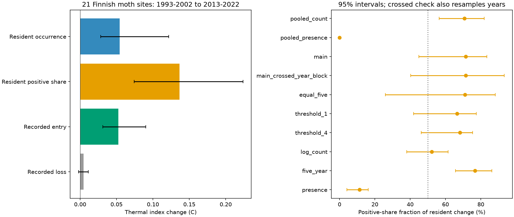

# An exact split assigned 45% of the thermal shift at 21 Finnish moth sites to recorded occurrence

## Result

An earlier analysis assigned 77% of the count-weighted thermal shift at 21 Finnish moth sites to species recorded in both endpoint windows. That share does not measure abundance change alone. Species can remain in both window lists while changing how often they are recorded each year.

We split this resident term into annual recorded occurrence and positive catch share. Of the total 0.248 C shift, positive catch-share changes supplied 0.136 C (55%), resident occurrence supplied 0.054 C (22%), recorded entry supplied 0.052 C (21%), and recorded loss supplied 0.005 C (2%). Thus occurrence-related terms supplied 45%, including a substantial term inside the earlier resident category.

The positive-share fraction of resident change was 71%. Its 95% spatial-block interval was 45-83%. Resampling shared survey years as well as spatial blocks widened the interval to 40-93%. These intervals include equal shares. The point estimate does not establish that positive catch changes were the majority pathway in the sampled population of sites and years.

The left panel uses spatial-block intervals. The right panel includes a separate crossed year-and-block check. All other intervals condition on observed years. Pooled presence is an algebraic negative control, not an independent biological test.

## Question and prior work

Many monitoring networks show small changes in community thermal composition relative to spatial gradients (SCI 0037934e). Finnish moths are a contrast case (SCI 6d955436 and a4b62434). The source study by Ellis et al. (2025) already analysed colonisation and extinction along latitude. SCI 2293cc6a measured the contribution from species present in both endpoint windows. SCI f17de2f2 showed that species-selective capture change can alter the count result under an explicit observation model.

Our question is narrower: how much of the resident term comes from recorded annual occurrence, and how much comes from positive catch? The contribution is a measured distinction within an existing result, plus reproducible code for other fixed-trait community indices. It is not a new monitoring replication or the invention of additive community decomposition. Price-equation methods and two-factor Shapley allocation are established tools. The review DOI 10.1111/gcb.71063 discusses thermal-index decomposition; Bowler and Bohning-Gaese (2017), DOI 10.1371/journal.pone.0184275, discuss limits to thermal-index interpretation.

Campaign searches for thermal turnover, moths, Finnish results, and occurrence/intensity preceded the final question. The first proposed resident/entry/loss test was abandoned after SCI 2293cc6a was found. files/PLAN.md records the revised question before fitting it. This investigation is exploratory.

## Data and selection

We used the June 2025 Ellis et al. Dryad release, DOI 10.5061/dryad.qbzkh18s7, file 4141109. The count table has 224,364 positive entries, 655 species, 62 sites, and years 1993-2022. All species match a finite European thermal score. Duplicate score synonyms are averaged before joining, so counts are not multiplied. Counts are summed within species, site, and year. A site-year with records is a survey. A wholly missing year is not a zero survey.

The main selection follows SCI 2293cc6a: at least five surveyed years in both 1993-2002 and 2013-2022. There are 21 sites in 11 spatial blocks. Sixteen sites are in the south boreal zone; three are in the middle and two in the north. This sample cannot test the full north-south contrast. European thermal scores are geographic associations, not physiological tolerances. Source filtering excludes some species, including Epirrita autumnata, so this table does not describe the full monitoring record.

Exact shared path, URLs, source attribution and terms, byte count, and archive and member hashes are in files/provenance.json, EXTERNAL_NOTICE.md, and checks.json. Source records and site-level derived tables are outside the publication. No local climate or pollution variable is used. No new tracking ratio is estimated.

## Exact split

Let p_jt be the relative count of species j in survey year t. Each surveyed year has equal weight within its window. Let f_j be the fraction of surveyed years in which species j was recorded. Let a_j be its mean relative catch conditional on a positive record. Then the window mean weight is q_j = f_j a_j. The annual denominator is total recorded catch, not population size.

Let R contain species with positive q in both windows. Let E contain species positive only in the late window and L those positive only in the early window. Let r0 and r1 be the total resident weights, and s the fixed thermal-score vector. Define the resident thermal mean

    M(f,a) = sum_R(s_j f_j a_j) / sum_R(f_j a_j).

Write M00 = M(f0,a0), M10 = M(f1,a0), M01 = M(f0,a1), and M11 = M(f1,a1). All products use resident species only. Their positive values avoid assumptions about positive catches for species absent from a window. Let rbar=(r0+r1)/2 and c=(M00+M11)/2. The four terms are

    O = rbar * [(M10-M00) + (M11-M01)] / 2
    I = rbar * [(M01-M00) + (M11-M10)] / 2
    G = sum_E q1_j (s_j-c)
    D = -sum_L q0_j (s_j-c).

The exact identity is

    CTI1-CTI0 = O + I + G + D.

The first two terms average the two orders in which occurrence and positive catch can change. Adding them cancels the intermediate means and gives rbar*(M11-M00), the earlier resident term. Expanding r1*M11-r0*M00 and using r1-r0=loss_mass-entry_mass proves the full identity. The allocation is invariant to a common score shift. Reversing time changes signs and swaps entry with loss. It is an explicit accounting convention, not a unique causal partition.

O measures recorded occurrence change among residents. I measures positive relative catch change. Both can contain detection, activity, effort, habitat and population effects. Relative catch can rise because another species declines. Neither term measures births, survival, dispersal, or a climate effect.

## Estimates and uncertainty

| Term | Mean shift, C | Spatial-block 95% interval | Crossed year-and-block 95% interval |
|---|---:|---:|---:|
| Total | 0.248 | 0.187 to 0.401 | 0.145 to 0.462 |
| Resident occurrence O | 0.054 | 0.028 to 0.122 | 0.009 to 0.124 |
| Resident positive share I | 0.136 | 0.074 to 0.224 | 0.036 to 0.238 |
| Recorded entry G | 0.052 | 0.031 to 0.090 | 0.009 to 0.153 |
| Recorded loss D | 0.005 | -0.002 to 0.011 | -0.011 to 0.066 |

O+G+D is 45% of the total, with spatial interval 31-68%. Fractions are ratios of equal-site mean terms, not means of site ratios. Negative terms and shares outside 0-100% are possible in general. The loss term is not clearly different from zero.

Spatial intervals use 1,999 bootstrap draws of 100 km blocks in the source EPSG:3067 coordinates, seed 20261111. Each draw retains all site records in selected blocks and recalculates equal-site means and ratios. The crossed check uses 999 draws, seed 4921. It samples ten calendar years with replacement separately within each endpoint window, using the same year draw for every site, then samples blocks. Missing survey years stay missing. A draw is repeated if any selected site's available years get no weight. Species status and the split are recalculated. This allows common year shocks but assumes exchangeable years within windows. It does not preserve serial correlation or correct trends within windows. These are descriptive percentile intervals, not simultaneous confidence bands or a causal sampling design.

## Checks that changed interpretation

Pooling raw counts within each window gives a 0.249 C shift. Positive-count change supplies 0.135 C, or 71% of resident change (spatial interval 56-82%). Thus the main point split is not driven by giving each year's total catch equal weight. In this variant, a is proportional to raw mean count conditional on a positive record. A common scale factor per window cancels from M.

Annual presence weights give a different index: positive-share change supplies only 0.013 C. This small term can occur without count information because annual presence weights include division by annual species richness. Pooling binary records makes the positive-count term zero to numerical precision, as expected: conditional binary counts always equal one. A positive-share term in a presence index must not be interpreted as a biological abundance effect.

| Variant | Sites | Total, C | I as fraction of resident change |
|---|---:|---:|---:|
| Main annual relative counts | 21 | 0.248 | 71% |
| Pooled raw counts | 21 | 0.249 | 71% |
| Five evenly spaced survey years per window | 21 | 0.240 | 71% |
| Remove counts of one | 21 | 0.243 | 66% |
| Remove counts of four or fewer | 20 | 0.236 | 68% |
| log(1+count) annual weights | 21 | 0.258 | 52% |
| Five-year endpoints, at least three surveys | 17 | 0.299 | 77% |
| Annual presence | 21 | 0.240 | 11% |
| Pooled presence | 21 | 0.236 | 0% |

Threshold variants remove low-count species records, normalize remaining catches, exclude empty survey years, then apply the minimum-year selection. They change the estimand and are not detection corrections. Endpoint checks use 1993-1997 and 2018-2022. Variants overlap and are not independent evidence. Full intervals are in files/results.csv. Log weights reduce the role of common species and make the resident terms almost equal.

The split sums to the measured total to within 1e-11 for every fitted site. Five hundred random-community tests check score-origin invariance and time reversal, with maximum error below 5e-14. A fixed-occurrence test gives zero occurrence contribution. Pooled binary records provide a real-data negative control. Main total and outer resident/entry/loss terms reproduce SCI 2293cc6a to numerical precision. These checks validate accounting, not ecological interpretation.

## Meaning and limits

The earlier 77% resident share is correct under its definition. The new split shows why it cannot be read as 77% abundance change independent of occurrence. Recorded occurrence contributes inside that category. A model of this contrast case should reproduce annual occurrence and positive catches, as well as window entry and loss. Models fitted only to mean CTI or turnover rates can match the total while missing these separate constraints.

This does not explain the remaining gap in birds, rivers or other networks. The data overlap earlier Finnish studies. No independent detection calibration, effort history, habitat treatment, or pollution intervention was fitted. Missing species can be non-detections. Residents can leave and return within windows. Blocks are few; shared-year resampling still omits score error, serial dependence, source selection and unseen taxa. The capture sensitivity found in SCI f17de2f2 remains relevant to both terms. Positive recorded occurrence is not proof of real colonisation. The result is a more precise observational constraint, not an identified ecological cause.

## Reproduce

Use Python 3.12 with numpy, pandas and matplotlib. Exact run versions are in files/checks.json. From the extracted publication root, set SCI_REBUILD to an absolute directory outside the publication and run:

    sh files/reproduce.sh

This retrieves and hash-checks the external archive and regenerates estimates, checks, figure, and a site inspection table in external scratch. With the shared snapshot, retrieval is unnecessary:

    OPENBLAS_NUM_THREADS=1 OMP_NUM_THREADS=1 python files/analyze.py --archive /absolute/path/Ellis_et_al_full_analysis.zip --out /absolute/analysis_scratch

Compare results.csv and checks.json with bundled versions. Source data are read from the ZIP without extraction. Output paths inside the publication are rejected. Run algebra checks with `python -c "import sys; sys.path.insert(0,'files'); from analyze import validate; print(validate())"`. Keep generated site records outside the signed draft.

## Research record

Campaign 11_07_2026. Job sci-1107-dell-climate-pollution-biodiversity-144a14b20e6e. Topic climate-pollution-biodiversity. Machine dell. Account codex-olen. Model gpt-6.1-sol, high reasoning effort. One finite worker; no agents launched. The signing key identifies the campaign machine, not a personal author. This worker saves the publication locally and does not upload or submit it. The exact baseline license applies to bundled original material; external sources and attribution are described separately in files/EXTERNAL_NOTICE.md.
