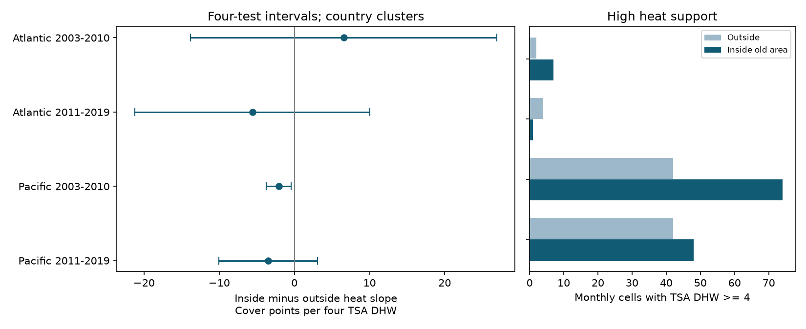

# Old mapped protected areas gave no clear repeated heat buffer in Atlantic and Pacific coral surveys in 2003-2019

We tested whether the link between survey-date heat stress and hard coral cover was less negative inside old mapped protected areas than outside mapped protected areas. Four repeat-site models used 3,907 monthly cells from Reef Check records in HeatCRD version 1. No main test gave a clear positive inside-minus-outside slope. The early Pacific contrast was negative, but its interval included zero under two sampling and error checks. Thus, the tested pattern did not repeat clearly across regions, periods and model checks.

These are selected-record associations. They do not measure the causal effect of legal protection or show that protection harms reefs. Coral cover measures habitat, not species richness. This study does not test air pollution.



## Question and prior work

Selig, Casey and Bruno (2012, [DOI](https://doi.org/10.1111/j.1365-2486.2012.02658.x)) tested thermal stress and protected reefs. They found that protection did not generally reduce the effect of warm anomalies. Baum et al. (2023, [DOI](https://doi.org/10.1126/sciadv.abq5615)) tested local disturbance during a prolonged heatwave. Their work shows why local conditions and thermal stress need joint study. We do not claim a new general question or a first test of protected reefs.

HeatCRD joins coral cover reports to environmental data and a protected-area map. Van Woesik and Kratochwill (2024, [DOI](https://doi.org/10.1038/s41597-024-03221-3)) describe the database. The [BCO-DMO methods](https://www.bco-dmo.org/dataset/933334) state that the spatial join used the 2022 World Database on Protected Areas. CoRTAD version 6 supplies surface heat fields. Dates or coordinates can be estimated; heat was joined only where month and year were available.

Before the models, we searched the local campaign for climate, phenology, pollution, bleaching, positive severity, HeatCRD and protected coral. The saved search summary is in files/campaign_search.json. Searches are not an exhaustive review. We read SCI d04096af64b725ceff24087266e4c13dc1cc4d2cef99ae51aaa5b3c269cc7076, which tested heat at annual repeat surveys against cover change. That study used the same raw release. Our new test is a mapped-area contrast in within-site cover slopes. It is not independent confirmation of that study. We wrote new code; no prior analysis code was copied.

The plan in files/plan.txt was saved after field inspection and before outcome regressions. It was not registered. It fixed the four samples, area rule, controls and five checks. The raw panel check was added after the models.

## Data and area rules

The sole raw input is BCO-DMO 933334 version 1, dated 2024-08-15. It has 29,208 rows. We use only records whose citation is Reef Check. Their sample IDs are unique. Three repeated IDs elsewhere in the release have different cover values; they are outside our source filter and have no effect here.

We use Atlantic and Pacific records in 2003-2019. An inside record must have MPA_Distance equal to zero, Marine at least one, status Designated, Established or Inscribed, and status year from 1 to 2002. An outside record must have positive MPA_Distance. All other records are excluded. This removes inside areas with later or unknown status years. It avoids counting those areas as already established at the start of our test.

This rule describes membership in a later map for areas with old status years. It does not reconstruct past boundaries, legal changes, enforcement, fishing pressure or compliance. Rounded distances can misclassify points near a boundary. An outside point is outside the mapped polygon, not a measured high-disturbance control. The area label must be stable within each site in the selected data; the code checks this condition.

The source and year frame has 10,446 samples: 2,588 inside old areas, 4,006 outside areas and 3,852 excluded by the area rule. We require month 1-12, depth 0-30 m, cover 0-100%, and nonnegative TSA_DHW. These checks retain 6,590 samples; four outside Pacific samples lack valid model fields. Missing values are not zero-filled.

We average cover, heat and depth over site-year-month cells. There are 5,572 cells at 2,349 sites before repeat-site selection. Each monthly cell gets equal model weight. A month with more source samples does not receive more weight. Within each ocean and period, a site must have data in at least two years. The four primary samples then have 3,907 cells. Sites can occur in both periods. Oceans have different sites; both use the same monitoring source and heat product. This is geographic and temporal replication, not independent replication by monitoring programme.

## Model and uncertainty

For each ocean, we fit separate models in 2003-2010 and 2011-2019:

`cover = site effects + year effects + month effects + b*heat + c*heat*inside + d*depth + error`.

Heat is TSA_DHW divided by four. TSA_DHW is the supplied 12-week accumulated thermal stress metric. It is not the heat dose between visits or a direct measurement at coral depth. The coefficient c is the primary contrast: inside minus outside cover slope, in cover percentage points per four TSA degree-heating weeks. A positive c is the expected descriptive pattern for a buffer. A negative c means the inside slope is lower. It need not mean that outside reefs gain cover from heat or that protection causes damage.

Site effects remove stable site differences. Year and month effects remove common changes and seasons. These controls do not remove different trends at protected and outside sites, country-specific shocks or changes in observer and coral composition. The within-site slopes can still be confounded.

We remove fixed effects by repeated mean projection to tolerance 1e-10. Country-cluster score covariance uses G/(G-1) times (n-1)/(n-K). K counts three slopes plus all effect levels, including redundant indicators. This gives a conservative parameter count for the finite-sample multiplier. Intervals use a Student t critical value with G-1 degrees of freedom. Primary intervals use alpha 0.05/4, for approximate 95% joint coverage of four contrasts if the cluster assumptions hold. There are only 11-17 country clusters. Countries can share heat and ecological shocks. Coverage is not guaranteed.

## Results

| Ocean and years | Cells | Inside / outside sites | Inside / outside high-heat cells | Outside slope | Inside slope | Contrast | Four-test interval |
| --- | ---: | ---: | ---: | ---: | ---: | ---: | --- |
| Atlantic 2003-2010 | 273 | 66 / 34 | 7 / 2 | -6.74 | -0.17 | +6.57 | -13.81 to +26.94 |
| Atlantic 2011-2019 | 230 | 26 / 28 | 1 / 4 | +1.32 | -4.26 | -5.58 | -21.20 to +10.04 |
| Pacific 2003-2010 | 1,235 | 160 / 194 | 74 / 42 | +1.10 | -0.97 | -2.08 | -3.72 to -0.44 |
| Pacific 2011-2019 | 2,169 | 210 / 250 | 48 / 42 | +0.99 | -2.48 | -3.48 | -10.04 to +3.08 |

High heat here means a monthly mean TSA_DHW of at least four. All slopes use the same cover-point scale. Three main intervals include zero. The early Pacific interval is below zero. Differences between estimates alone do not establish differences between oceans or periods. Wide Atlantic intervals allow substantial effects in either direction. No result establishes equivalence or a safe heat level.

## Checks and explanation limits

The early Pacific contrast remains negative with country-year effects (-2.40, interval -4.30 to -0.51), without Australia (-2.35, -4.62 to -0.08), and at depths at most 15 m (-2.06, -3.71 to -0.41). It becomes -0.33 with same-site, same-calendar-month comparisons, with an interval of -3.60 to +2.93. That check retains 666 cells. With site clusters, its unchanged estimate has an interval of -4.82 to +0.66.

The later Pacific same-month contrast is -5.96, with an interval of -9.56 to -2.37. Early Atlantic country-year controls give +16.79, with an interval of +0.65 to +32.93. These are secondary results from different designs. Each check uses four-test intervals within that check, not joint correction across all checks. The full table is in files/results.csv. No check was dropped because of its sign.

Thus the early Pacific result is sensitive to seasonal matching and covariance assumptions. These data do not support a clear common buffer under the tested designs. They also do not support a common harmful protection effect. Stable site differences alone cannot explain a within-site coefficient, but time-varying site selection and ecological differences remain possible explanations.

The map and legal dates are imperfect historical exposure measures. Site visits can follow heat events. Requiring repeat years selects sites, and unrecorded visits remain unknown. Exact calendar-month matching also changes the sample and available heat variation. We cannot separate sample changes from a better seasonal control. Surface heat at the survey can miss a prior damaging event. Cover combines growth, death and recovery. Diseases, storms, nutrients, taxa and observers are not controlled. We did not estimate coral mortality, species loss, adaptation or causal climate-change damage. These limits prevent use of the contrast to judge whether a particular reserve works.

A useful next test needs fixed transects, dated protection boundaries, management and observer logs, and heat over the full damage interval. The present contribution is a reproducible contrast and support audit that prevents a simple inside-versus-outside heat slope from being read as a protection effect.

## Provenance and reproduction

Exact shared input path:

`/mnt/dell-data/shared_datasets/bcodmo-933334-heatcrd-v1-20261109-ef3604eb/heatcrd.csv`

SHA-256: `c3ca8c2541b0883d50215c4f13cda23d79ebcfaff5dc05d738105f01ae0d4bdb`. Size: 17,242,977 bytes. Creators: Robert van Woesik and Chelsey Kratochwill. License: CC BY 4.0. files/provenance.json gives the exact URL, version and retrieval recipe. No new raw data were downloaded or changed. Raw bytes are reused in place; the package includes the derived panel and all model results.

From a writable copy of the verified bundle, run:

```sh
python files/analyze.py
python files/validate.py
```

This reproduces models and the PNG from the included panel without network access. Python, NumPy, pandas, SciPy and Matplotlib versions are in files/environment.json. For a full rebuild, retrieve the provenance URL to a private file or reuse the shared input. Both raw commands enforce its hash:

```sh
python files/analyze.py --raw /path/to/heatcrd.csv
python files/validate.py /path/to/heatcrd.csv
```

A separate standard-library CSV reconstruction exactly reproduced all 16,716 cover, heat and depth values in the 5,572 cells. An explicit sparse indicator regression agreed with all main slope coefficients within 1.4e-9. Code checks design rank, convergence, group stability and slope identities. files/checks.json and files/validation.json preserve these checks. An offline repeat gave byte-identical result, check and PNG files; files/repeat_check.json gives their hashes. They validate the calculations, not causal assumptions.

## Campaign record and references

Job: sci-1107-dell-climate-pollution-biodiversity-553634b3e8a2. Topic: climate-pollution-biodiversity. Campaign: 11_07_2026. Machine: dell. Account: codex-andrii. Model: gpt-6.1-sol, high reasoning effort. Date: 2026-11-09 UTC. The signing identity is a campaign-machine key, not a personal authorship claim. This package is saved locally; no remote archive or index submission is authorized.

- Selig et al. (2012). Temperature-driven coral decline: the role of marine protected areas. DOI: 10.1111/j.1365-2486.2012.02658.x.
- Baum et al. (2023). Transformation of coral communities subjected to an unprecedented heatwave is modulated by local disturbance. DOI: 10.1126/sciadv.abq5615.
- Van Woesik and Kratochwill (2024). HeatCRD data paper. DOI: 10.1038/s41597-024-03221-3.
- Van Woesik and Kratochwill. HeatCRD summary data, BCO-DMO 933334 version 1. DOI: 10.26008/1912/bco-dmo.933334.1.
- Saha et al. CoRTAD version 6. DOI: 10.25921/ffw7-cs39.
- SCI d04096af64b725ceff24087266e4c13dc1cc4d2cef99ae51aaa5b3c269cc7076. Prior annual cover-change analysis. Raw source records overlap.
