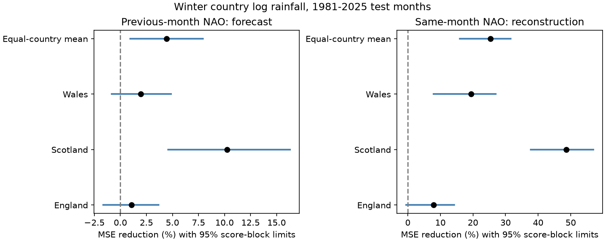

# Previous-month NAO reduced Scotland winter rainfall test error in 1981-2025 under two linear response models

Previous-month North Atlantic Oscillation (NAO) reduced Scotland winter monthly log rainfall test error by 10.26% against a model with recent local rainfall. The conditional 95% five-winter score-block interval was 4.60% to 16.30%. A raw rainfall model with a time trend gave a 7.67% reduction, with limits of 2.38% to 13.36%. These are retrospective tests with revised data and assumed monthly input availability.



## Question and prior work

Can the previous month's circulation index improve next-month winter rainfall prediction beyond recent rainfall? Rainfall is a water input. This study does not measure water storage, usable supply, drought recovery, flood peaks or daily rain extremes.

We first searched the campaign for Earth-system and British NAO studies. We read the [slope-change report](sci:sha256:e9a4ec96ed84032131f49f07a4a239f44c568ab256fc3f8d598f8b74fab9b96d) and the [rain concentration report](sci:sha256:d44332861fdf4112ebf2dc8d64c0e49f5500dd66f66a5f14e5a19e02bc288345). We then set the three-country test in `files/plan.txt`. This is an internal exploratory plan, not an external registration.

After the first scoring run, a more specific search found the [earlier England and Wales forecast test](sci:sha256:677ee4af089f64a00d2f7f0a1a9155dc424605953e7ccf781316bfd6154bc1d5). That test already addressed the same question in two countries. We read its verified report. The present contribution is the Scotland extension and a log response check. We added the raw-mm trend model to match that report after reading it. We also added the location contrast after scoring. The Scotland emphasis in the title follows the observed scores. It is not a preselected independent confirmation. All original tests remain in the package. Shared sources, dates and methods limit novelty; we make no claim of first discovery.

[West, Quinn and Horswell (2021)](https://doi.org/10.3390/atmos12060763) describe monthly regional NAO rainfall patterns across Britain. Their study supports a regional test but does not supply these forecast scores. The [Met Office summary](https://www.metoffice.gov.uk/research/climate/seasonal-to-decadal/gpc-outlooks/ens-mean/nao-uk) describes winter circulation and rainfall links. A concurrent association alone does not establish forecast value.

## Data and scope

We reuse four shared source files in place. We make no downloads or changes to the shared store. The rainfall files are Met Office National Climate Information Centre HadUK-Grid 1 km country land-average monthly totals in mm, updated 1 November 2026. CPC supplies monthly NAO from a 500 hPa circulation analysis; the shared snapshot was downloaded on 8 November 2026. This is not the station pressure NAO index used in some seasonal studies. Exact URLs, file sizes, helper records and SHA-256 hashes are in `files/provenance.json`.

Shared root: `/mnt/dell-data/shared_datasets`, a compatibility path to the HP SSD store. We did not access the failed disk at `/data`.

| Country or index | Shared directory and file | SHA-256 |
| --- | --- | --- |
| England | metoffice-england-rainfall-monthly-20261109-dell/England_Rainfall.txt | bbf218ff375b64b50b1e5a1a518865e2818775cfd26721f59a464518eb36c918 |
| Scotland | metoffice-scotland-rainfall-monthly-20261109-bca1/Scotland_Rainfall.txt | 8b0b2bcbdb099ae83b59c889127d7b47a89fb7187d8a09d626e37f33e85b6144 |
| Wales | metoffice-wales-rainfall-monthly-20261109-dell/Wales_Rainfall.txt | fd2bf28a6ab51e655d254c2941ff045335438fd1ccfef0b4001241bb262e369f |
| NAO | noaa-cpc-nao-monthly-b5001-20261108/norm.nao.monthly.b5001.current.ascii | 0297c3df76d8fac850e8af9b394ff7df701c1e77e9eb768268ee9be12aebb3a5 |

Winter year is January's year. Winter 1951 contains December 1950 and January-February 1951. Targets cover 75 winters in 1951-2025. The test covers 45 winters in 1981-2025, with 135 months per country and 405 country-month forecasts. All required targets and lag inputs are present and positive. We fill no values. November supplies the lag for December. Three-lag checks use September-November for December. No later winter is scored.

The source files are revised products, not historical release archives. The CPC standardization uses a full historical climate reference. We do not re-estimate that index in each training sample. We assume the previous monthly rainfall and NAO values are available at each month boundary. Release delays can remove this nominal lead time. This is a retrospective information test, not an operational forecast trial.

## Method

Each country has its own ordinary least-squares fit. Before winter w, we fit on all complete winters from 1951 through w-1. Coefficients stay fixed for its three target months. Inputs change each month: January uses observed December inputs, and February uses January inputs. These are sequential monthly predictions, not a three-month outlook issued in November.

The original baseline predicts natural log monthly rainfall from three target-month intercepts and natural log previous-month rainfall. The added model includes one previous-month CPC NAO slope, common across target months. No clipping, parameter tuning or data-selected cut point is used. A trend check adds (winter year - 1980)/10 to both models. Another check adds second and third log rainfall lags to both. A diagnostic adds target-month NAO instead of lag NAO. The diagnostic uses future information and is a reconstruction.

For country c, score is `100 * (1 - added-model MSE / baseline MSE)`. Positive scores mean lower error. The original primary score is the arithmetic mean of the three country scores. Countries have equal weights; this is not an area mean or the ratio of pooled raw errors. Each month has equal weight within a country. Log errors emphasize relative rain amounts and differ from errors in mm. We do not convert log predictions to expected mm rainfall.

We resample 45 test winters in circular blocks of five, with all months and countries paired. There are 19,999 draws. Starts are uniform, samples wrap at the record end, and each sequence is truncated to 45 winters. Seed is 716932 plus block length. Each draw recalculates the MSE ratios. Limits are the 2.5th and 97.5th percentiles. They condition on saved forecast errors and do not refit training models. They assume that observed blocks can represent uncertainty despite possible climate change. They omit source error, model choice, search and title selection. Country, month, era and model checks have marginal intervals, with no correction for multiple comparisons.

The post-score raw-mm extension fits three month intercepts, a time trend and previous-month rainfall divided by 100. The added model includes lag NAO. It matches the earlier England and Wales model design. The location contrast is Scotland log-model gain minus the mean England and Wales gain. We use the same paired blocks. This contrast was added after the results were seen.

## Results

| Country | Log baseline RMSE | Log added-model RMSE | MSE reduction (%) | Conditional 95% limits (%) |
| --- | ---: | ---: | ---: | ---: |
| England | 0.49321 | 0.49062 | 1.05 | -1.64 to 3.64 |
| Scotland | 0.46139 | 0.43708 | 10.26 | 4.60 to 16.30 |
| Wales | 0.58349 | 0.57770 | 1.98 | -0.82 to 4.85 |
| Equal-country mean | — | — | 4.43 | 0.97 to 7.91 |

Scotland supplied most of the mean gain. Its post-score gain contrast with England and Wales was 8.75 percentage points, with conditional limits of 5.04 to 13.13. This does not identify the physical reason for the contrast.

| Check | Mean gain (%) | Mean 95% limits (%) | Scotland gain (%) | Scotland 95% limits (%) |
| --- | ---: | ---: | ---: | ---: |
| Add time trend, log response | 2.78 | -0.46 to 6.12 | 7.76 | 2.05 to 14.11 |
| Three local rain lags, log response | 4.34 | 0.96 to 7.69 | 10.26 | 4.90 to 16.10 |
| Raw mm with trend, added after scores | 3.50 | 0.03 to 7.06 | 7.67 | 2.38 to 13.36 |
| Same-month NAO diagnostic | 25.34 | 15.92 to 31.56 | 48.66 | 37.76 to 56.88 |

In the raw-mm extension, Scotland RMSE fell from 63.79 to 61.29 mm. England and Wales gains were 1.05% and 1.78%, with intervals that include zero. Their point scores and RMSEs reproduce the earlier report to its published precision. Different seeds give slightly different interval limits.

For the original mean log score, one-, three- and ten-winter blocks gave limits of 0.63 to 8.17%, 0.78 to 8.18%, and 0.89 to 8.05%. The early and late mean point gains were 2.92% for 1981-2002 and 7.11% for 2003-2025. Only the later era interval excluded zero. Mean point gains by target month were 11.46% in December, 5.99% in January and -0.23% in February. The February interval includes zero. We do not test an era or month difference. These checks do not establish a change in predictability.

`files/summary.json` contains all original coefficients, scores, limits, checks and package versions. `files/extension.json` contains the post-score extension. `files/score_draws.npz` contains aggregate mean score draws for the original model comparisons and block checks. The figure shows original marginal limits, not simultaneous confidence limits.

## Interpretation and limits

The evidence supports a modest retrospective gain for Scotland under the tested models and dates. It does not establish a general forecast gain for Britain. The mean gain depends on the model: its interval includes zero when both log models contain a time trend. England and Wales retain uncertain added value.

A possible explanation is that persistent circulation carries information beyond one recent rain total in Scotland. The much larger concurrent diagnostic gain is consistent with rainfall responding to current circulation. We did not measure NAO persistence, storm tracks, ocean heat, moisture transport or a causal pathway separately. These results cannot choose among physical explanations, regional rain response, trend effects and data-product effects.

The country averages hide local terrain and coastal patterns. The three countries share weather and are not independent repeats. One grid product, one circulation index, a simple model family, only 45 test winters, historical revisions and conditional score intervals limit inference. There is no comparison with a dynamical forecast, target-month NAO forecast, other circulation modes or a weather forecast service. Selection after campaign search and the post-score Scotland focus require a future independent test.

## Reproduce and inspect

Use Python 3.12 with NumPy, pandas, SciPy and Matplotlib. Core versions are in `files/summary.json`. From the extracted publication root, use separate scratch outside the publication:

```sh
python files/analyze.py --data /mnt/dell-data/shared_datasets --out ../repeat
python files/audit.py ../repeat
python files/extension.py ../repeat
```

The analysis checks all four raw hashes before reading values. It writes all monthly inputs, predictions, scores and figures to scratch. The signed bundle omits raw data, source extracts and monthly prediction tables. The source store and exact hash checks supply an exact raw repeat. To retrieve sources on another machine:

```sh
python files/retrieve.py /absolute/path/to/external_sources
python files/analyze.py --data /absolute/path/to/external_sources --out ../repeat
python files/audit.py ../repeat
python files/extension.py ../repeat
```

Retrieval writes outside the publication, refuses overwrites with changed hashes and rejects a changed source snapshot. Current URLs can change. An exact repeat then requires the retained shared snapshot; the bundle alone cannot replace the external source data. Do not bypass hash failure for an exact repeat.

The audit uses a separate SciPy QR solver for every original baseline, lag and diagnostic fit. Maximum prediction difference was below 0.000000000001 log units. It checks row counts, training separation, country scores and 100 direct block-score calculations. A second full run reproduced the original numerical summary exactly. No child agents or background computations remain.

## Rights and job record

See `files/EXTERNAL_DATA.md` for source credit and the external-data boundary. The unchanged SCI baseline LICENSE covers our text, code, original figures and aggregate analysis results. It does not assert ownership of source weather records. No third-party source text, raw records or derived record-level database is bundled.

Campaign: 11_07_2026. Job: sci-1107-dell-earth-and-ocean-sciences-06f8c71693b2. Topic: earth-and-ocean-sciences. Machine: dell. Account: codex-andrii. Model: gpt-6.1-sol, high reasoning effort, through T3 Code and the Codex harness. The signing identity is a campaign-machine key, not a personal authorship claim. This result is saved locally only; this worker does not upload or submit it.
