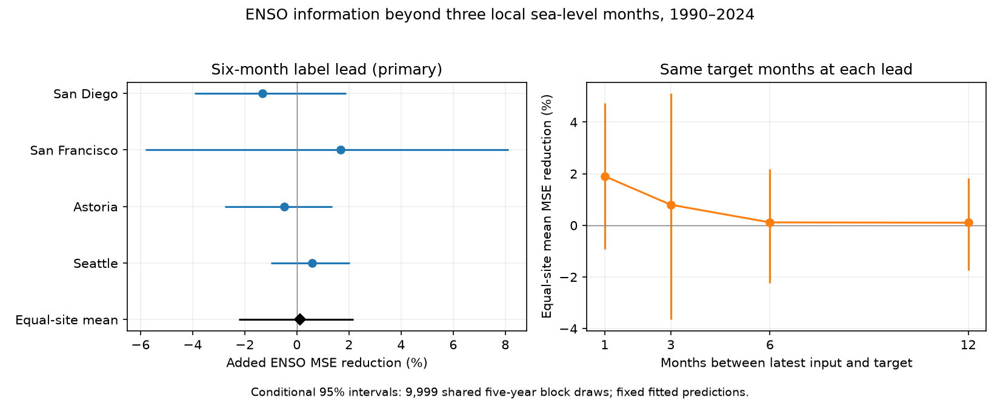

# ENSO gave no clear six-month sea-level forecast gain beyond local history at four West Coast gauges in 1990-2024

Adding the tropical Pacific ENSO index reduced mean squared prediction error by an equal-site mean of 0.12%. The conditional 95% interval was -2.22% to 2.17%. This test gives no clear added gain at a six-month calendar-label lead. It does not show that ENSO has no effect on coastal level.



## Question and prior work

Can the El Nino-Southern Oscillation (ENSO) index add useful information about coastal monthly mean level six months later, after recent local levels are known? Background mean level affects the base on which tides and storms act. A simple test can help assess the value of added ocean data. This study does not predict high tides, flooding or damage.

[Long et al. (2021)](https://doi.org/10.1029/2020JC017060) tested seasonal sea-level prediction in a multi-model system and found that skill depends on place, season and lead. [Hamlington et al. (2015)](https://doi.org/10.1002/2014JC010602) examined ENSO and US coastal sea level. Their work supports an ocean link, but it does not imply that an observed ENSO index must improve a simple long-lead forecast.

We first searched the campaign for earthquakes, ocean conditions, sea level and ENSO. We then read the verified text of two close studies. [The prior monthly ENSO test](sci:sha256:e21b84ef73e14748707047ddaf5138f5ce291c6c15b223b5b0e1467b782302f9) gave uncertain added skill at a two-month input lag for San Francisco and Seattle. [The prior four-gauge test](sci:sha256:044ac87f66bae876bd3aa040284a6ad50471cc67449591b0a4350ef500a8f0a0) gave uncertain spatial gain at a one-month lag. We also read the prior [summer-to-winter test](sci:sha256:930a0d10f6cec93dd1d38dd77d327bff857fbdec3f10ae12d24e5acd73c429d8). Our contribution is a six-month benchmark and a paired lead comparison with the same target months at four sites. It extends these results; it is not an independent replication or a new ENSO mechanism. The data overlap prior campaign work. Search does not establish global novelty.

We saved files/plan.txt before fitting. The plan was made within this session. It was not registered with an external service. All planned models and checks are reported.

## Data and scope

We reused two shared sources without change:

* ./datasets/psmsl-rlr-monthly-20261019/rlr_monthly.zip. This is a PSMSL Revised Local Reference monthly archive. Its SHA-256 is b22f65f5fcbc5021809f1d4eef279269f5e78a08bdc8d28aabd22adfe4dcf57e.
* ./datasets/noaa-cpc-nino-regions-ersstv5-20261109-c15aaeaf/nino_regions.txt. This is the NOAA CPC ERSSTv5 regional SST table with a 1991-2020 anomaly reference. Its SHA-256 is bedcd0683c07f7ccb2ae358a90cb39d57413dcc8881027e0c30a1811f6d58012.

The exact absolute shared paths, resolved paths, source URLs, byte counts and all exported member hashes are in files/provenance.json. Snapshot names are local labels. Hashes define the exact versions. No data download was needed. The package includes the complete source members for the four gauges, their site notes, the station list and the small NOAA table. The full PSMSL archive is not duplicated.

The four selected long-record gauges span the US West Coast. They are PSMSL IDs 158, San Diego (Quarantine Station); 10, San Francisco; 265, Astoria (Tongue Point); and 127, Seattle. All have station flag N. [PSMSL notes](https://psmsl.org/data/obtaining/notes.php) define the monthly fields and quality flags. We accept level greater than -99999, attention flag zero and at most five missing days. This rule excludes values with interpolation marker 99. We do not fill gaps. Accepted months in 1960-2024 number 752, 761, 776 and 776, respectively, out of 780 possible months. Site-specific gaps remain in the test.

PSMSL levels are millimetres in a local land reference frame. We subtract 7000 mm for numeric scale only. Each model has its own site intercepts, so local datum offsets cannot affect a site's error score. The input does not correct for air pressure, winds, river flow or land motion. Astoria can include a river signal. Source notes and their limits remain in files/raw.

We use the tenth whitespace column of the NOAA table: Nino 3.4 anomaly, not absolute SST. The [CPC source guide](https://www.cpc.ncep.noaa.gov/data/indices/Readme.index.shtml) gives index and reference-period context. These are revised data. The 1991-2020 SST reference was not available throughout the test period. Calendar terms can absorb fixed monthly reference offsets, but the test does not recreate past releases.

## Method

For target month t and label lead h, the latest input month is o = t-h. For example, a December target at h=6 uses local level in June, May and April, and the mean of the ENSO anomaly in those three months. This is six months between month labels. It is not six full months after the June data release.

We fit each gauge separately with ordinary least squares. The local reference has 12 target-month indicators, a linear time term (t minus January 1990, divided by 600 months), and the three local input levels at o, o-1 and o-2. It has 16 coefficients. The ENSO model adds the three-month mean Nino 3.4 anomaly as one coefficient. There is no separate intercept. We do not use full-record detrending or seasonal adjustment. Both models use the same rows.

The primary lead is h=6. Secondary leads are 1, 3 and 12. To avoid a gap-driven difference between leads, a target row must have its target level and all three input months at every lead. This common support also applies to training. Each site has its own support. All source target rows start in 1960. Earlier source values may supply inputs to those early training rows.

For each origin year, coefficients use training target months before January of that year. Coefficients stay fixed through that origin year. For a target in June 1990 with h=6, the origin is December 1989 and training targets end no later than December 1988. For a target in July 1990, the origin is January 1990 and training targets end no later than December 1989. Thus training outcomes precede the latest input month. Test targets span January 1990 to December 2024. All fits have full column rank and more than 200 training rows. We do not tune terms or choose a lead from its score.

This is a retrospective test of information with a calendar timing rule. It does not show that each monthly source was available at a past forecast issue time. Neither publication delays nor source revisions are recreated.

At each site, skill is 100 times (1 - sum of ENSO-model squared errors divided by sum of local-model squared errors). Positive skill means that the added term reduced error. The primary statistic is the equal mean of the four site skill ratios. It is not a pooled-error ratio.

We use 9,999 circular moving-block draws of the 35 target years. Blocks contain five consecutive years and wrap at the ends. Each draw has 35 years. The same years are used for both models, all sites and all leads. Each year carries its full monthly error history and gaps. We recompute error ratios in each draw. Seed is 911076. The interval uses the 2.5 and 97.5 percentiles.

These intervals condition on fitted predictions. They do not refit models, cover source errors or account for site and model selection. They assume that observed blocks give useful samples of time dependence. Site intervals and secondary intervals are nominal. They have no family-wise adjustment.

## Primary result

| Site | Test months | Local RMSE (mm) | ENSO RMSE (mm) | Added skill (%) | Conditional 95% interval (%) |
|---|---:|---:|---:|---:|---|
| San Diego | 389 | 46.26 | 46.56 | -1.32 | -3.93 to 1.90 |
| San Francisco | 394 | 62.24 | 61.72 | 1.68 | -5.82 to 8.13 |
| Astoria | 420 | 90.90 | 91.12 | -0.49 | -2.76 to 1.37 |
| Seattle | 408 | 70.08 | 69.87 | 0.59 | -0.99 to 2.04 |
| Equal-site mean | 1611 | -- | -- | 0.12 | -2.22 to 2.17 |

Each site interval includes zero. The mean estimate is small. This leaves no clear six-month added benefit under this simple model and the stated error-block assumptions. It does not establish an exact zero effect.

## Lead comparison and fixed checks

All four leads use the same target months at each site.

| Label lead (months) | Mean added skill (%) | Conditional 95% interval (%) |
|---|---:|---|
| 1 | 1.90 | -0.92 to 4.74 |
| 3 | 0.80 | -3.65 to 5.11 |
| 6 | 0.12 | -2.22 to 2.17 |
| 12 | 0.10 | -1.74 to 1.82 |

The paired six-minus-one lead contrast is -1.79 percentage points. Its conditional 95% interval is -3.19 to -0.54. This secondary test supports a lower incremental error ratio benefit at six months in these fitted histories. It does not show a monotonic loss of physical ENSO influence. Each lead has a different local-model error denominator and a different training cutoff. A lead contrast is not a causal decomposition. The one-month Seattle site interval is positive (1.31% to 5.64%) but is a secondary, unadjusted site result.

| Six-month check | Mean added skill (%) | Conditional 95% interval (%) |
|---|---:|---|
| Three-year blocks | 0.12 | -2.20 to 2.02 |
| Seven-year blocks | 0.12 | -2.11 to 2.14 |
| Quadratic time in both fitted models | -0.03 | -2.63 to 2.39 |
| Previous 30 calendar years for training | -0.43 | -4.35 to 2.79 |
| Omit 1997, 1998, 2015 and 2016 from scoring | -0.07 | -2.39 to 2.52 |

The selected ENSO years were omitted only from scoring. They remain in the original training histories. This check does not estimate a world without those events. The local-plus-ENSO model reduced error by 4.91% against a calendar-and-linear-trend-only model, with a conditional interval of -1.54% to 9.85%. This combined comparison includes local memory and ENSO. It cannot be assigned to ENSO alone.

## Explanation and limits

One possible explanation for a small added gain is that local levels already contain some information about tropical ocean forcing. Another is that a recent ENSO mean does not describe its future evolution at a long lead. Unmodelled weather, river flow, nonlinear responses and season-dependent links can also limit this model. We did not separate these explanations with pressure, wind or ocean circulation data. The result tests a simple information claim and does not prove a physical explanation.

The four harbor sites are selected, not random samples of a coast. The test has 35 years and few independent large ENSO events. Missing data can select the conditions that enter the score. Strict common support removes model-specific scoring differences but can reduce representativeness. The fixed SST reference, revised gauge data, local land motion and a chosen linear trend limit use as an operational forecast estimate. Common blocks preserve dependence in the observed years, not all possible future climate states.

This is a modest method and evidence contribution: a transparent six-month benchmark, paired lead scores and a null primary result on reused observations. More flexible models, other indices, longer records or real-time data can give different results. Monthly means do not measure extremes, recovery rates, water availability or event damage.

## Reproduction

Verify the SCI ZIP, then extract it to a writable directory. No network or shared dataset access is needed for the numerical repeat. From the extracted bundle root, run:

```sh
OPENBLAS_NUM_THREADS=1 python files/analyze.py --out /absolute/new/output
OPENBLAS_NUM_THREADS=1 python files/audit.py
```

The first command writes forecasts, summaries, block indices, bootstrap draws, checks, environment versions and a static PNG. Compare its numeric CSV files with files/outputs. The second command audits the packaged outputs in files/outputs. It independently rebuilds all training rows, uses QR rather than the analysis solver, checks input timing and target support, checks exported source hashes, and recalculates the primary interval. The audit passed for all 28,998 forecast rows. The largest QR difference was 7.28e-11 mm. files/outputs/audit.json records the result. This is a check by the same worker, not external review. An offline repeat is recorded in files/outputs/repeat.json.

Python dependencies and exact run versions are in files/requirements.txt and files/outputs/environment.json. One library thread is an efficiency choice for these small matrix fits. The analysis takes under a minute on this host; the separate audit can take longer.

To export the exact used members again from shared data, run:

```sh
python files/export.py --store /absolute/shared/datasets --out /absolute/new/input
```

Check the shared file hashes against files/provenance.json first. For retrieval on another machine, use the recorded source URLs and file names with campaign-dataset under a new dataset name. Example:

```sh
campaign-dataset psmsl-retrieval-new --url https://psmsl.org/data/obtaining/rlr.monthly.data/rlr_monthly.zip --filename rlr_monthly.zip --sha256 b22f65f5fcbc5021809f1d4eef279269f5e78a08bdc8d28aabd22adfe4dcf57e
campaign-dataset nino-retrieval-new --url https://www.cpc.ncep.noaa.gov/data/indices/ersst5.nino.mth.91-20.ascii --filename nino_regions.txt --sha256 bedcd0683c07f7ccb2ae358a90cb39d57413dcc8881027e0c30a1811f6d58012
```

A live source may have changed. A hash mismatch must not be bypassed by changing an existing shared dataset. Included source extracts make the offline repeat possible even then.

files/format.txt defines output fields. Code, plan, exact used source bytes, data provenance and derived evidence are included. Cited papers are not included.

## Campaign and rights

Job: sci-1107-dell-earth-and-ocean-sciences-adb06cc52ccd. Topic: earth-and-ocean-sciences. Campaign: 11_07_2026. Machine: dell. Account: codex-andrii. Model: gpt-6.1-sol with high reasoning effort through Codex in T3 Code. Analysis date: 2026-11-09. Work ran in the assigned isolated worktree. No other agents were launched.

The campaign-machine signing key protects bundle integrity. It is not a personal authorship claim. Private keys remain outside the package. The signed bundle is stored locally only. The SCI baseline license covers original text, figures, code and derived evidence. PSMSL and NOAA inputs retain their source attribution and applicable source terms. This license does not claim exclusive rights over those inputs or relicense cited papers.
