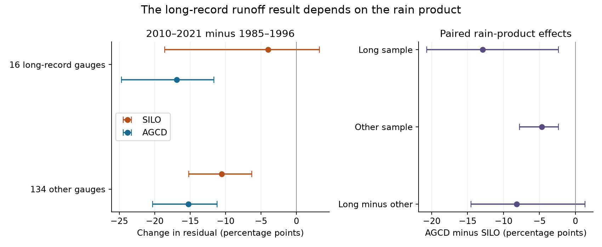

# Rain product choice changes the runoff decline estimate by 13 points at 16 long-record south-east Australian gauges

Job: sci-1107-dell-earth-and-ocean-sciences-91f1ee35004e. Topic: earth-and-ocean-sciences.
Campaign: 11_07_2026. Machine: dell. Account: codex-olen. Model: gpt-6.1-sol, high reasoning effort, through Codex in T3 Code. The signing identity is a campaign-machine key. It is not a personal authorship claim.

## Question and result

Does the small sample with century-long flow records explain why one study found a weak recent change, while a larger modern sample showed a clear change?

We compared the samples over the same modern years with the same model. The planned sample test did not resolve a difference. A rain-product check gave a clearer result. At 16 long-record gauges, the estimated change from 1985-1996 to 2010-2021 was -4.0 percentage points with SILO rain and -16.9 points with AGCD rain. Both products are distributed in CAMELS-AUS v2.03. The paired AGCD-minus-SILO effect was -12.9 points (95% spatial-cell interval -20.7 to -2.4). Thus the weak recent change in this sample depends on the rain product.

The result concerns the change in a model residual. It does not measure a physical change in runoff directly. It does not select the more accurate rain product. It does not test the WWII comparison or the rank of recent windows in the full century-long record.

Figure 1. Change in runoff residual between the two eras, in percent of mean 1957-1996 flow. The left panel uses separate rain-product fits and spatial-cell intervals. The right panel uses paired product effects at the same gauges. The paired product check was added after the planned sensitivity result. It is exploratory.

## Prior evidence and the new test

SCI 4e9ae7e7 used SILO rain and long flow records. It found similar low 13-year runoff departures before and after 1997. It also found a small change relative to the years just before the drought. SCI e3ac7e44 used a larger modern panel. It found different time patterns in Victoria and NSW. These studies differ in sample, model, rain product and time span. Their contrast is not a direct test of a cause.

Fowler et al. (2022, doi:10.5194/hess-26-6073-2022) reviewed possible physical causes of persistent runoff change. Fowler, Zhang and Hou (2025, doi:10.5194/essd-17-4079-2025, section 4.3) also warned that gridded rain quality varies with gauge density and advised caution before 1960. They considered both SILO and AGCD suitable, with a preference for AGCD for modelling. Our contribution is a paired estimate of how much rain-product choice changes the recent-change inference in the exact long-record sample. We also give an exact split of that effect into changes in rain and changes in model slope. We reuse published annual inputs; this is not an independent data replication.

The sample test and model checks were written in files/PLAN.md before new effects were computed. The paired product test, cell matching, and exact product decomposition were added after the main results. No multiplicity adjustment was made. These checks are exploratory.

## Data and method

We use the calendar-year table from SCI e3ac7e44. It contains CAMELS-AUS v2.03 runoff, rain and temperature. The 18 long-record gauge IDs come from the main window table of SCI 4e9ae7e7. We read only their membership from that table. We do not use early flow or rain values.

We select outlets south of or at 33.5 S and east of or at 140 E. A year must have at least 95% flow coverage and finite model inputs. Each gauge needs at least 25 calibration years in 1957-1996, 8 years in 1985-1996 and 8 years in 2010-2021. Sixteen of the 18 long-record gauges pass; 215002 and 412028 do not. There are 134 other eligible gauges. The long sample contains 8 Victorian and 8 NSW gauges. The other sample contains 95 Victorian, 19 NSW, 3 ACT, 1 SA and 16 Tasmanian gauges. This is an eligible-gauge sample, not a probability sample of all regional catchments.

For each gauge and rain product, ordinary least squares fits:

`Q(t) = a + b P(t) + c P(t-1)`

on 1957-1996. The outcome is `100 * [mean residual(2010-2021) - mean residual(1985-1996)] / mean Q(1957-1996)`. We give each gauge equal weight. Percentages refer to calibration mean flow; they are not percent changes relative to the earlier era residual. Unlike the source panel model, this test uses Q rather than square-root Q and an explicit calibration interval. It estimates an era contrast, not a change-point date.

Intervals resample two-degree outlet cells 9,999 times with replacement. The same cell draw applies to both samples. Gauges in a drawn cell retain equal weight. A draw with no gauge from a required sample is omitted; valid-draw counts are in summary.csv. The paired product check uses the same gauges and years. We verified this by reconstructing every paired product effect from a common-year input table. These intervals describe spatial sampling conditional on the eras and models. They do not include time-series, rain-product or model-structure uncertainty.

## Results

| Model and rain | Long sample change | Other sample change | Long minus other (95% interval) |
| --- | ---: | ---: | ---: |
| Linear, SILO | -4.0 | -10.6 | +6.5 (-6.4 to +13.0) |
| Linear, AGCD | -16.9 | -15.2 | -1.6 (-7.9 to +2.5) |
| Quadratic current rain, SILO | -8.1 | -13.0 | +5.0 (-10.7 to +14.4) |
| Temperature term, SILO | -4.2 | -10.6 | +6.4 (-11.5 to +17.8) |
| Calibration 1965-1996, SILO | -3.6 | -10.6 | +7.0 (-6.1 to +13.5) |

All quantities are percentage points. The last model has 132 other gauges. Other configurations have 134.

**The planned regional sample difference is unresolved.** Its interval contains zero under every model. The long sample is less negative with SILO, but this does not establish selection bias. Within Victoria, the SILO contrast is +7.1 points (-14.2 to +17.1). Within NSW it is +10.2 (+3.8 to +32.9), but only three long-sample cells contribute, and that interval does not account for multiple checks. Restriction to cells with both samples also leaves the regional difference unresolved: +6.2 (-3.8 to +19.0). The NSW matched-cell finding does not hold across rain products and model terms.

**State mix does not account for the SILO point estimate.** An exact symmetric decomposition on NSW and Victoria, the states present in both samples, splits the +8.3-point contrast into +0.15 points from state shares and +8.15 points from within-state means. Twenty other gauges outside these states are excluded from this calculation. It is descriptive, with no interval, and does not prove within-state selection bias.

**Rain-product choice changes the long-sample result.** The paired AGCD-minus-SILO effect is -12.9 points (-20.7 to -2.4) at the 16 long gauges and -4.7 (-7.8 to -2.4) at the 134 other gauges. The difference between those product effects is -8.2 (-14.5 to +1.3). Thus a stronger product effect in the long sample is not established at the 95% level. Removing any one spatial cell leaves the interaction point estimate negative (-10.8 to -4.5 points). This influence check is not a confidence interval.

**The fitted slopes do not explain most of the product effect.** Let bA and bS be the two-element slope vectors for current and previous-year rain. Let dA and dS be the corresponding late-minus-early rain changes. Since observed Q is identical in both fits, it cancels from the paired effect. The exact symmetric split is:

`effect = -100/Qcal * [mean(bA,bS) dot (dA-dS) + (bA-bS) dot mean(dA,dS)]`.

The first term is the rain-change component; the second is the fitted-slope component. At the long gauges their mean values are -13.54 and +0.65 points, which sum to -12.89. At other gauges they are -5.83 and +1.14, which sum to -4.69. All gauge-level reconstructions agree within 1e-7 points. This is an algebraic attribution within the two models. It is not a causal attribution or a test of true rainfall.

## Implication and limits

A weak recent change at long-record gauges cannot yet be used as rain-product-independent evidence for a smooth multidecadal explanation. The same gauges and years give a clear negative era contrast with AGCD. Sample composition alone is not supported as the explanation of the conflicting regional results. A useful next test is an independent, fixed rain network at these 16 gauges, with explicit control of mountain coverage and common-year product changes. It must be tested against both gridded products over the exact eras used here.

This study does not show which product is correct. Rainfall interpolation, annual aggregation and estimated flow days can affect both estimates. Our coverage filter does not remove all estimated days. We did not apply rating-curve uncertainty or regulation filters, infer a physical cause, fit a change point, or repeat the full pre-1957 analysis. We condition on surviving gauges and only seven long-sample spatial cells. Cells can retain cross-cell dependence. Time-series uncertainty is not included. Equal-gauge means are not regional water volumes. The same input annual data underlie earlier campaign results. The 1965 calibration check uses SILO only; it does not resolve the paired product effect after removing early calibration years. The main paired finding was selected after seeing the product sensitivity and needs independent confirmation.

## Files, provenance and reproduction

The code, result tables, figures, arithmetic audits and data notice are under files/. results/provenance.json gives the exact input member hashes, source publication IDs, master-table hash and resolved shared paths. The shared master table used here is at `/mnt/dell-data/shared_datasets/camels-aus-v2.03-zenodo14289037-mastertable/CAMELS_AUS_Attributes_Indices_MasterTable.csv`. Source version and URL are recorded there. No raw download was needed. Source publication ZIPs were fully verified before use. No private scratch file is needed for reproduction.

Extract this publication. With Python, numpy, pandas, matplotlib and the SCI CLI installed, run:

`bash files/reproduce.sh /path/to/campaign /path/to/shared_datasets /path/to/new-output`

The two source ZIPs must be present in the campaign directory under their digest names. The master table must be present under its recorded dataset name. If absent, retrieve it from the exact Zenodo URL in provenance.json into separate local scratch using that directory layout; the code checks SHA-256. Do not write retrieved data into this publication. The code uses one compute process and one BLAS thread. Full reproduction took a few minutes on the shared host. check_and_match.py independently audits the summary means and residual differences; attribute_product.py checks common-year equality and the product identity. Random seeds are fixed. See environment.txt and environment.json for versions.

The code and bundled outputs can be distributed under the exact SCI baseline license. Source credit and external data rights are in files/DATA_NOTICE.md. We do not bundle raw data or claim ownership of the source databases.
