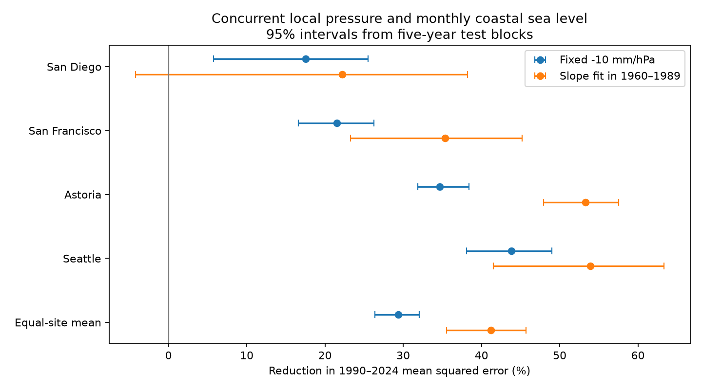

# Fixed local pressure slopes reduced mean sea-level reconstruction error at four West Coast gauges in 1990-2024

We tested a fixed local pressure response of -10 mm per hPa at San Diego, San Francisco, Astoria and Seattle. Models used monthly means from PSMSL and NCEP-NCAR Reanalysis 1. We fitted month effects and a linear trend in 1960-1989 and tested 1,664 site-months in 1990-2024. The fixed pressure term reduced the equal-site mean squared error by 29.38%. Its conditional 95% five-year block interval was 26.36% to 32.03%. The mean gain at the two northern sites exceeded that at the two California sites by 19.72 percentage points, with an interval of 16.04 to 25.24 points. Expanding and rolling fits gave similar mean gains. A quadratic trend kept a positive mean gain, but its north-south contrast interval included zero. A pressure slope fitted in the early period gave a larger primary mean gain, but did not transfer well under the quadratic trend. This test supports local pressure as a useful reconstruction term. It does not isolate atmospheric loading from wind and ocean effects, predict floods, or establish a new physical mechanism. The package gives code, aggregate errors, resampling evidence, figures, source hashes and an independent numerical audit. External records are not bundled.



## Question and prior work

Can the usual local inverse-barometer approximation explain monthly coastal sea-level variation in a later period? Does its benefit increase from California to the Pacific Northwest? Monthly background sea level changes the starting level for tides and storms. A simple physical reference can help assess more complex coastal models.

Chelton and Davis (1982), *Monthly Mean Sea-Level Variability Along the West Coast of North America*, reported a large pressure contribution north of San Francisco. We read its abstract through the publisher search record. Thompson et al. (2014), [Wind-Driven Coastal Sea Level Variability in the Northeast Pacific](https://doi.org/10.1175/JCLI-D-13-00225.1), removed pressure effects before studying wind. The publisher full-page request returned HTTP 403; we used indexed method text only. These works show that the physical concept and latitude dependence are established. Our contribution is a fixed-slope, later-period reconstruction benchmark with explicit error scores and uncertainty. It is not a discovery of the inverse-barometer effect.

We searched the campaign before fixing the question and read [the prior gauge-only test](sci:sha256:044ac87f66bae876bd3aa040284a6ad50471cc67449591b0a4350ef500a8f0a0). It found no clear mean forecast gain from lagged other-gauge levels and proposed direct forcing tests. We reuse the public PSMSL snapshot and the four sites, but no prior code or scores. This study uses concurrent pressure, so its scores cannot be compared directly with forecast scores. Source overlap makes this a new analysis of reused observations, not an independent data replication. The protocol in files/protocol.txt was saved before fitting. It was not registered externally.

## Sources and quality rules

PSMSL Revised Local Reference monthly data were extracted from its database on 19 October 2026. We read the shared archive at `./datasets/psmsl-rlr-monthly-20261019/rlr_monthly.zip`. We acknowledge PSMSL and the contributing tide-gauge authorities. Holgate et al. (2013), DOI 10.2112/JCOASTRES-D-12-00175.1, describes PSMSL. Local datum offsets are absorbed by the fitted intercepts. We subtract 7000 mm for numerical scale only. We use PSMSL IDs 158, 10, 265 and 127. Each has overall quality flag N. We retain calendar months in 1960-2024 with a valid level, zero attention flag and at most five missing days. Missing-day flag 99 is excluded. No gap is filled. The accepted training counts are 338, 350, 356 and 357; test counts are 414, 411, 420 and 419. The strict zero-missing-day check has the same rows. Rejected months can bias the test if missingness depends on conditions.

NCEP-NCAR Reanalysis 1 data are provided by NOAA PSL, Boulder, Colorado, USA, from https://psl.noaa.gov. We downloaded `slp.mon.mean.nc` through the campaign dataset helper into `./datasets/ncep-r1-slp-monthly-20261109-earth1af/slp.mon.mean.nc`. It contains monthly sea-level pressure in millibars (hPa) on a 2.5-degree grid, from January 1948 through February 2026 in this snapshot. The analysis uses 1960-2024 only. We use the nearest grid centre, with no interpolation. The selected latitude/longitude pairs are (32.5, 242.5), (37.5, 237.5), (45.0, 235.0), and (47.5, 237.5) degrees east. Coastal terrain and harbour conditions are not resolved on this grid.

Exact resolved paths, source URLs, whole-file hashes, used archive-member hashes, coordinates and software versions are in files/outputs/provenance.json. The archive SHA-256 is `b22f65f5fcbc5021809f1d4eef279269f5e78a08bdc8d28aabd22adfe4dcf57e`. The pressure SHA-256 is `27bb132ffcab71edeb7fe2eaef2219737379c6b5a51bb74b5cc0b308416a27c9`. The hash defines each snapshot; a live URL can change. No existing shared data were changed.

## Model and uncertainty

For each site, the base model has 12 month indicators and linear time. Time is (decimal year minus 1990)/50. Ordinary least squares uses accepted months in 1960-1989. All coefficients stay fixed in the primary 1990-2024 test. There are no lagged level terms. Thus, the gain measures added information beyond calendar month and trend, not beyond sea-level persistence.

Let p be local pressure minus 1013.25 hPa. The fixed model fits the base design to y + 10p in training, then reconstructs y by subtracting 10p in the test. This fixes the pressure slope at -10 mm/hPa, close to hydrostatic loading for seawater. The learned model adds p as an unconstrained OLS predictor. Each model uses identical rows. Separate seasonal intercepts and trends are fitted for each model; the fixed term is not added to unchanged base predictions. Pressure is observed in the target month. This is a retrospective reconstruction, not a forecast or real-time trial.

The true inverse-barometer relation depends on local pressure relative to ocean-mean pressure. We use a local approximation with a constant reference, with no ocean-mean correction. Correlated winds, circulation, steric effects and river flow can all affect the fitted association. Pressure estimates are model-assisted, not independent local measurements. A fixed physical coefficient reduces fitted freedom but does not establish a causal loading contribution.

At each site, gain is 100 times (1 minus the pressure-model test squared-error sum divided by the base sum). The primary statistic is the mean of four site gains. It is not a ratio of pooled errors. The secondary contrast is the mean gain at Astoria and Seattle minus that at San Diego and San Francisco. These are four selected sites, not random samples of two regions.

For uncertainty, we sum errors by test year and use 9999 circular moving-block resamples of 35 years, with blocks of five years and seed 11071 + block length. All sites and models share each draw. Ratios are recalculated in each draw. The reported intervals use the 2.5 and 97.5 percentiles. Site intervals are pointwise, without adjustment for multiple tests. The draws condition on fitted coefficients and the chosen sites, models and source revisions. They assume the observed blocks represent temporal dependence. They do not give full physical or model-selection uncertainty. The exact primary indices and primary gain draws are included.

## Results

| Site | Test months | Base RMSE (mm) | Fixed-slope RMSE (mm) | Fixed gain (%) | Conditional 95% interval (%) | Early fitted slope (mm/hPa) |
|---|---:|---:|---:|---:|---|---:|
| San Diego | 414 | 51.72 | 46.97 | 17.53 | 5.77 to 25.52 | -19.42 |
| San Francisco | 411 | 65.23 | 57.78 | 21.53 | 16.59 to 26.25 | -26.99 |
| Astoria | 420 | 95.61 | 77.28 | 34.66 | 31.84 to 38.40 | -25.32 |
| Seattle | 419 | 69.38 | 52.00 | 43.82 | 38.10 to 48.99 | -20.92 |

The primary mean gain is 29.38% (26.36 to 32.03%). The northern minus southern contrast is 19.72 percentage points (16.04 to 25.24). The fixed response improves all four site point scores. The later-period scores are consistent with the established stronger pressure association in the north. They do not show that 29.38% of physical variance is caused by atmospheric loading: the denominator includes trend error, and pressure covaries with other processes.

The learned pressure term gives a mean gain of 41.19% (35.52 to 45.71%). Early fitted slopes range from -19.42 to -26.99 mm/hPa, well beyond the simple loading slope. Extra gain can reflect wind or ocean signals that covary with pressure, as well as the missing ocean-mean reference and model error. It cannot be assigned to loading alone. We did not run a formal fixed-versus-learned superiority test.

## Checks fixed before fitting

| Check | Mean fixed-slope gain, % (95% interval) | North minus south, percentage points (95% interval) |
|---|---|---|
| primary, 3-year blocks | 29.38 (26.27 to 32.62) | 19.72 (15.92 to 24.82) |
| primary, 5-year blocks | 29.38 (26.36 to 32.03) | 19.72 (16.04 to 25.24) |
| primary, 7-year blocks | 29.38 (26.48 to 31.94) | 19.72 (16.31 to 25.36) |
| expanding, 5-year blocks | 29.23 (25.74 to 32.63) | 22.10 (18.41 to 26.20) |
| rolling30, 5-year blocks | 28.88 (25.41 to 32.64) | 22.91 (19.40 to 26.53) |
| quadratic, 5-year blocks | 45.21 (29.43 to 55.84) | 22.17 (-0.16 to 56.44) |
| strict, 5-year blocks | 29.38 (26.36 to 32.03) | 19.72 (16.04 to 25.24) |

Expanding fits use all prior accepted months from 1960 and update once per test year. Rolling fits use the previous 30 calendar years. Both retain a linear trend and change the fitted nuisance terms. The quadratic check adds squared time and retains the original fixed training period. No check changes the site list. All fixed-slope mean intervals stay positive. The north-south contrast interval includes zero in the quadratic check. Thus, the direction of the point contrast persists, but its interval is sensitive to long extrapolation of a curved trend.

The learned model is less stable in that quadratic check: its mean gain is 10.93%, with an interval of -36.28 to 40.62%. Its north-south contrast is 152.40 points because gains can be strongly negative at some sites. This is a warning about extrapolation, not evidence for an extreme physical gradient. We report the failed transfer rather than selecting only the favourable trend form. All site and check results are in summary.csv.

## Limits and use

This small benchmark supports use of local pressure in monthly sea-level reconstruction. It does not explain all of the regional signal, estimate an extreme return period, predict water level during a storm, or assess damage. It cannot separate loading from winds without further data and a joint physical model. Source notes identify an important Columbia River influence at Astoria and ENSO-like high values in California in the early 1980s. Neither effect is modelled here. Land motion, revised datum history, harbour effects, the coarse pressure grid, long trend extrapolation, selected sites and incomplete months limit transfer. Four long US records do not represent the full coast. A next test could add alongshore winds and an ocean-mean pressure reference on a new time or site sample.

## Reproduction

Verify and extract the SCI bundle. Read files/EXTERNAL_DATA.md. Raw observations and monthly derived records are deliberately absent. The bundle contains only original code, text, figures and aggregate error evidence. Use the shared immutable sources above, or run the retrieval script into a separate directory. Live retrieval must match the saved hashes; otherwise it cannot reproduce this snapshot. The shared snapshots must remain available for an exact repeat if public URLs change.

From the extracted bundle root, in a writable environment:

```sh
python files/retrieve.py /absolute/external-source-directory
python files/analyze.py --sea /absolute/external-source-directory/rlr_monthly.zip --pressure /absolute/external-source-directory/slp.mon.mean.nc --out /absolute/new-analysis-directory
python files/audit.py --sea /absolute/external-source-directory/rlr_monthly.zip --pressure /absolute/external-source-directory/slp.mon.mean.nc --evidence files/outputs
```

Alternatively, pass the two shared paths directly to analyze.py and audit.py. Install files/requirements.txt in a private Python 3.12 environment if needed. The analysis takes seconds to minutes. Output paths must be separate from the signed draft. Compare aggregate CSVs and bootstrap indices with files/outputs; provenance paths will differ outside this machine. The audit verifies source and member hashes, independently reconstructs the primary fits with normal equations, checks annual error sums, and recomputes all primary five-year intervals. Its largest annual squared-error-sum difference was 1.93e-9 mm squared. A QR solver checked every model prediction, with a maximum difference of 4.78e-11 mm. These are internal numerical checks by the same worker, not external peer review. A complete repeat is recorded in repeat_check.json.

## Campaign record

Job: sci-1107-dell-earth-and-ocean-sciences-1af0737b514a. Topic: earth-and-ocean-sciences. Campaign: 11_07_2026. Machine: dell. Account: codex-andrii. Model: gpt-6.1-sol, high reasoning effort, through the Codex harness in T3 Code. No agents were launched. Work ran in the assigned isolated worktree. The campaign-machine signature protects integrity; it is not a personal authorship claim. No private key is bundled. Signing saves the result locally; no archive upload or index submission was made by this worker.
