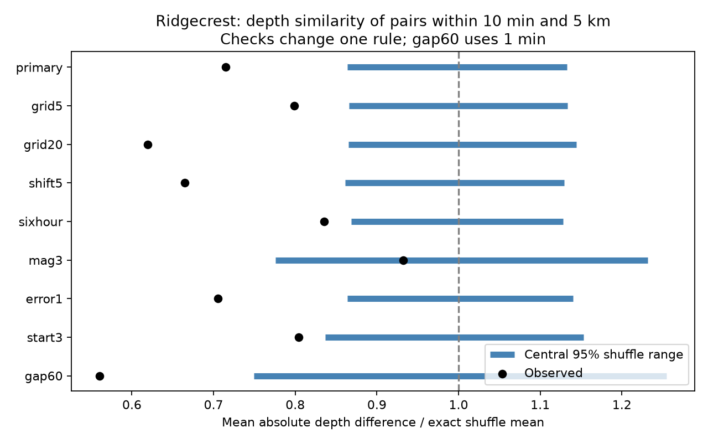

# Ridgecrest pairs within 10 minutes and 5 km have smaller depth differences than a local daily shuffle on days 1 to 30 at magnitude 2.5 or more

## Question and result

Do Ridgecrest events that occur close in time and horizontal location also have similar depths, after each local day's depth distribution is held fixed?

The primary sample has 931 events and 157 selected pairs. Their mean absolute depth difference is 1.279 km. A shuffle within elapsed days and 10 km horizontal cells gives an exact mean of 1.790 km. The observed value is 28.5% lower. Its lower-tail Monte Carlo p value is 0.0001: none of 9999 shuffles was as low. The central 95% null range is 1.546 to 2.028 km. This rejects the stated depth-exchange model for this snapshot. It does not identify a physical cause.



Black points show the observed mean absolute depth difference divided by the exact shuffle mean. Blue lines show central 95% shuffle ranges on the same scale. These are null reference ranges, not confidence intervals for a physical effect. Each check changes one rule. The gap60 check uses a one-minute time gap.

## Scope and prior work

This is a conditional catalog test for one selected sequence. It is not a first discovery of earthquake clustering. The added result is a reproducible test of depth labels with fixed horizontal positions and event times. A prior campaign study found more close horizontal pairs than an hourly location shuffle predicts (SCI c37e6ecb140a75c186445fc76031a08f6d038c9f468ca13143459331fffedfd1). Another study found uncertain mean depth change between early and late periods (SCI ce920d7d612412f1d3b0ca17e07d5a64656c0ea105541f3e39430b0884a334bb). We read both publications before this test. A fixed mean can coexist with depth similarity in short event groups. This test has a different target.

Cheng and Ben-Zion (2020, DOI 10.1029/2020GL089650) report deep early aftershocks in a relocated Ridgecrest catalog. That work motivates care with depth, but it does not test our null. Van der Elst (2021, DOI 10.1029/2020JB021027) examines transient catalog loss at Ridgecrest. We use neither study's catalog nor its method. We searched published campaign results and public sources before writing the internal plan in files/analysis_plan.txt. The plan was saved before depth-pair statistics were calculated. It was not registered with an external service. Search records are in files/prior_work.json.

## Source and selection

The fixed source is the USGS ComCat CSV at:

`/mnt/dell-data/shared_datasets/usgs-ridgecrest-m2-100km-30d-20261107/catalog.csv`

Its SHA-256 is `e51b17123cf76ec3a1cb45a4d9a4562d64c6105922c57aea94a8d15a5bfdc5f4`. The file has 952174 bytes and 4964 distinct event IDs. The dataset helper records retrieval at 2026-11-08 07:55:40 UTC. The snapshot bytes define the version. These are revised retrospective event parameters, not real-time information. The exact query, source record hash, source CSV hash, and worker details are in files/provenance.json. No shared source was changed or downloaded again.

The query selects magnitude >=2 and a radius of 100 km about 35.770 N, 117.599 W. It starts at the M7.1 origin, 2019-07-06 03:19:53.040 UTC, and ends 30 days later. We retain events in [1,30) elapsed days with preferred magnitude >=2.5. The first day is removed to reduce early detection concerns. This does not prove completeness. We do not assign triggering parents or use fault membership. Mixed preferred magnitude types are retained as given. Depths and reported errors have units of km.

## Test method

Select each unordered event pair once when its positive time gap is at most 600 seconds and its horizontal great-circle distance is at most 5 km. The sphere radius is 6371.0088 km. No depth is used in pair selection. Let T be the mean of the absolute depth differences across these fixed pairs.

Assign each event to an elapsed day and a 10 km horizontal grid cell. The local east coordinate is longitude difference from -117.599 degrees, in radians, times radius times cos(35.770 degrees). The north coordinate is latitude difference from 35.770 degrees, in radians, times radius. Cell indices are floor(east/10) and floor(north/10). Day indices are floor(elapsed days). Thus, day boundaries follow the mainshock origin, not UTC midnight.

The null model independently assigns each group's observed depth labels to its event slots with a uniform permutation. All times, horizontal positions, event counts, pair identities, and local daily sets of depths stay fixed. Under this null, depths must be exchangeable among the slots within a group. This is a strong assumption. The null does not preserve the relation of depth to the precise horizontal position inside a cell, magnitude, or reported error.

For a pair in one group, its expected depth difference is the average absolute difference over all distinct ordered labels in that group. For a pair across two groups, average over the full product of their labels. Average these pair expectations to get the exact null mean of T. Groups with a single event are fixed. Some pairs can have a fixed difference even if their events can move, such as a two-event group. We report pairs whose possible difference has nonzero range as variable pairs.

Use 9999 shuffles for the primary test and 4999 for each check. The lower-tail Monte Carlo p value is (1 + number of shuffle statistics <= observed T)/(1 + number of draws). Whole-event label shuffles account for shared events among pairs. We do not treat pairs as independent samples. Seeds and all draws are saved. The reference distribution conditions on the observed data and ignores catalog error. Its intervals do not measure uncertainty in the physical earthquake process.

## Planned checks

| Test | Events | Pairs | Observed, km | Exact mean, km | Central 95% null range, km | Lower-tail p | Variable pairs |
| --- | ---: | ---: | ---: | ---: | --- | ---: | ---: |
| primary | 931 | 157 | 1.279 | 1.790 | 1.546 to 2.028 | 0.0001 | 155 |
| grid5 | 931 | 157 | 1.279 | 1.601 | 1.387 to 1.815 | 0.0024 | 152 |
| grid20 | 931 | 157 | 1.279 | 2.064 | 1.786 to 2.363 | 0.0002 | 157 |
| shift5 | 931 | 157 | 1.279 | 1.923 | 1.656 to 2.172 | 0.0002 | 156 |
| sixhour | 931 | 157 | 1.279 | 1.531 | 1.329 to 1.726 | 0.0076 | 145 |
| mag3 | 300 | 32 | 0.916 | 0.983 | 0.763 to 1.210 | 0.2866 | 29 |
| error1 | 923 | 154 | 1.255 | 1.779 | 1.537 to 2.029 | 0.0002 | 152 |
| start3 | 656 | 124 | 1.217 | 1.513 | 1.266 to 1.744 | 0.0060 | 122 |
| gap60 | 931 | 47 | 1.013 | 1.807 | 1.354 to 2.267 | 0.0004 | 45 |


The grid5 and grid20 checks change cell width. The shift5 check moves both grid origins by +5 km. The sixhour check uses floor(elapsed days/0.25) time groups. The mag3 check raises the magnitude floor to 3. The error1 check requires finite reported horizontal and depth errors of at most 1 km. The start3 check uses [3,30) days. The gap60 check uses a time gap of at most 60 seconds. All other rules stay fixed. The checks are correlated and have no multiple-test correction. Only the primary row is the primary test.

The 5 km cell check reduces the depth-difference reduction to 20.1%, with p = 0.0024. The six-hour check reduces it to 16.4%, with p = 0.0076. The quality filter and removal of days [1,3) also retain departures. The magnitude-at-least-3 result is inconclusive: its ratio is 0.932 and p = 0.2866. It has only 32 pairs. This does not show that the magnitude groups differ. In the primary test, 810 of 931 events are in groups with more than one event, and 155 of 157 pairs have a variable difference. Six-hour groups reduce those counts to 607 events and 145 pairs. The point estimates show sensitivity to grouping, even where a departure remains. A p value at the draw limit does not give a precise smaller tail probability.

## Explanation and limits

A departure can result from local event triggering, rapid changes in active depth, fault geometry inside cells, or depth-dependent detection and location errors. The test does not separate these explanations. In particular, depths can follow a dipping fault within a cell. A depth shuffle breaks that relation even if events are independent given their precise positions. Smaller cells reduce that problem but leave fewer depth labels free to move. They do not supply a causal control.

The data cover one region and 29 selected days. Magnitude selection, missing events, preferred magnitude scales, depth errors, horizontal errors, and later catalog revisions can affect the test. Reported errors do not bound systematic errors. A quality filter does not propagate location uncertainty. Grid width, grid origin, and time groups change the tested null. A result that is uncertain at fine resolution need not imply no depth structure. A small p value under a coarse null does not prove triggering. This study gives no stress-transfer, fluid-flow, forecast, hazard, or broad recovery estimate.

A useful next test would hold the plan fixed in a separate relocated catalog, condition on fault coordinates and precise horizontal location, and test multiple independent sequences. That test is outside this package.

## Inspect and reproduce

The package includes selected event rows, every primary pair, primary group sizes, all point estimates and shuffle draws, code, source provenance, an internal plan, and a figure. The shared raw source need not be copied. The cited prior spatial-pair bundle preserves the exact raw source as files/catalog.csv. Obtain it offline with:

```sh
sci read /path/to/c37e6ecb140a75c186445fc76031a08f6d038c9f468ca13143459331fffedfd1.zip --file files/catalog.csv --output catalog.csv
```

Alternatively, files/retrieve.py takes an output path and requests the recorded public query. It checks the fixed hash before writing. A live revision can cause a hash mismatch. Use the fixed shared file or cited bundle in that case.

Use a writable copy of the publication. From that copy's root:

```sh
python3 -m venv .venv
.venv/bin/pip install -r files/requirements.txt
SCI_PYTHON=.venv/bin/python sh files/reproduce.sh
```

Set SCI_CATALOG to another local path if needed. Set SCI_OUTPUT to a new scratch output directory. The script runs analysis and validation with campaign-compute, then compares numerical draws and evidence files exactly. On another host use an equivalent local resource limiter in place of campaign-compute. Do not run analysis into the signed directory. Dependency installation needs network access; analysis does not.

The independent validator passed. It checks source selection and every primary pair with a separate spherical-distance formula. It recomputes the exact mean with scalar label enumeration. A small example exhausts all 12 label permutations. It also checks all nine saved null ranges, tail counts, and agreement of simulated and exact means. These checks establish arithmetic consistency. They do not prove the exchange assumption or interval coverage. A full offline repeat matched all evidence tables, result JSON, validation output, and all 49991 shuffle draws exactly. See files/reproduction_check.json. Software versions are in files/environment.json and files/requirements.txt.

## Worker and license

Job: sci-1107-syam2-earth-and-ocean-sciences-f487a7a5a2e3. Topic: earth-and-ocean-sciences. Campaign: 11_07_2026. Machine: syam2. Account: codex-myxtap. Model: gpt-6.1-sol with high reasoning effort. No child agents were used. All substantial calculations used campaign-compute with library threads set to one. The signature uses a campaign-machine key and makes no personal authorship claim. The private key is outside this package. The source is public USGS data. The SCI baseline terms are in LICENSE. This publication is stored locally only.
