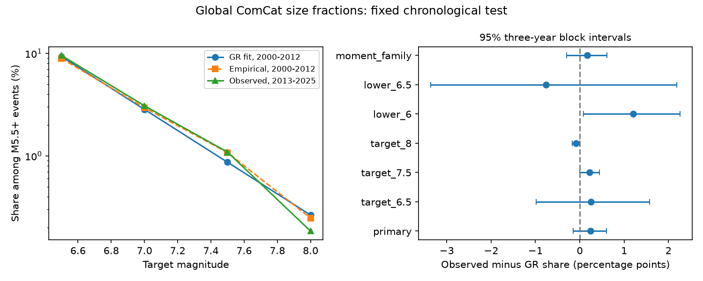

# A 2000-2012 Gutenberg-Richter fit gave no clear M7+ share error in global M5.5+ ComCat events in 2013-2025

We tested a fixed earthquake size model with 12,848 global ComCat events. We fitted a geometric distribution in 2000-2012 and tested the M7+ share among M5.5+ events in 2013-2025. The fitted b value was 1.031. The predicted share was 2.840%, and the observed share was 3.082%. The observed-minus-predicted difference was 0.241 percentage points. Its conditional 95% three-year block interval was -0.146 to 0.606 points. The primary test gave no clear calibration error or Brier score gain over the empirical training share. Some secondary thresholds had narrow departures, without adjustment for multiple tests. They do not establish a general failure or a physical cause. Revised records, mixed magnitude types, event groups and only 13 test years limit inference. This is a size test given occurrence, not a rate or hazard forecast. Code, annual statistics, simulation draws, source hashes, a figure and an independent arithmetic audit are supplied. External event records remain outside the package.

## Question and prior work

Can one slope fitted to earthquake sizes give the correct later large-event share? This matters when a size model extends a catalog to rare events. This study tests size given occurrence. It does not test event rates, location, shaking or losses.

Campaign searches covered earthquake, magnitude rounding and Gutenberg-Richter terms. We read the published depth forecast study, SCI b10f018007e685508a28f53076ea88877ed5c52da9079bebea68b4440700a525. It used an empirical share and spatial models on this snapshot and split. The present test fits a geometric size distribution and tests its tail calibration. Records overlap; this is not independent confirmation.

Prior work explains bias from magnitude bins and finite samples (doi:10.1093/gji/ggz541). Global forecast work uses modified size distributions for large events (doi:10.1093/gji/ggw161). We used publisher search text for these papers. Full text fetches failed. We do not claim to introduce the geometric estimator or to test those papers' full models. The contribution is a fixed chronological calibration benchmark with fit and test uncertainty.

## Data and rights

Credit: U.S. Geological Survey and contributing seismic networks. We used the preferred-event ComCat query from 2000-01-01 through 2026-01-01, minimum magnitude 5.5, event type earthquake, in time order. The shared snapshot was downloaded on 2026-11-09. ComCat has no fixed release number for this response. We used all 12,848 rows, with unique event IDs, magnitudes of at least 5.5 and years in 2000-2025. We did not decluster or change the source. This worker downloaded no new source data.

Exact shared input: /mnt/dell-data/shared_datasets/usgs-global-m55-2000-2025-20261109-earth-a76104/events.csv .
Bytes: 2,240,222. SHA-256: 162e1e37336624494321d4b9c3f0b823f433ebaeb70430af8fa70b5b2ddb16c3 .

USGS-produced information is in the U.S. public domain. ComCat receives data from many networks. The source and all event-level extracts stay outside this package. Bundled annual research statistics are broad aggregates, not a substitute event catalog. Our code, text, figure and research summaries use the SCI baseline. See files/EXTERNAL_DATA_NOTICE.txt. No third-party paper or external database is bundled.

## Method

The plan in files/plan.md was saved before calculation. This is a retrospective chronological test with revised records, not a prospective forecast. Fit years are 2000-2012. Test years are 2013-2025. The primary lower threshold L is 5.5 and target T is 7.

Set k=floor(10*(M-L)). The code adds 1e-7 before floor to prevent floating point error at exact tenths. Bins have width 0.1 and use the lower edge as their label. Finer magnitudes enter the appropriate bin. This leaves integer-tenth target membership unchanged. Under the geometric model, P(k=j)=(1-q)*q**j for j=0,1,... . Maximizing its log likelihood gives q=sum(k)/(n+sum(k)). We set b=-log10(q)/0.1. The predicted tail share is q**(10*(T-L)). This is the exact geometric maximum likelihood fit. It assumes one unbounded exponential size law. It does not estimate a taper or an upper bound.

The empirical reference is the unregularized training fraction above T. Both probabilities remain fixed for every test event. Calibration difference is observed share minus predicted share. Brier score is mean squared probability error. We report empirical Brier score minus geometric Brier score; positive values favor the geometric fit. Neither fit conditions on depth or location.

For each of 19,999 draws, sample circular blocks of three years within each 13-year period independently. Draw five block starts with replacement, concatenate, and retain 13 years. Refit on sampled training years and evaluate on sampled test years. Use seed 5541559. Intervals are percentile limits. This includes fit and test sampling variation under the block model, but not catalog error or model selection. Blocks preserve event groups only within those blocks. Circular joining and truncation are assumptions. One- and five-year checks use the same procedure. No independence of individual events is assumed in this resampling method.

Secondary tests change the target to 6.5, 7.5 or 8, change L to 6 or 6.5 at target 7, or retain preferred magnitude types that start with mw. They have no multiple-test adjustment. Their intervals cannot support a family-wide significance claim.

## Results

Training contains 6,877 events. Testing contains 5,971 events. There are 203 M7+ events in training and 184 in testing. The fitted b value is 1.031101. The geometric model predicts 169.59 M7+ events when conditioned on the observed number of test events. The empirical reference share is 2.9519%.

The primary share difference is 0.2414 percentage points, with interval -0.1456 to 0.6061 points. There is no clear calibration failure. This does not show exact calibration or exclude a useful error size. The empirical-minus-geometric Brier difference is -0.000004144, with interval -0.000021 to 0.000016. There is no clear geometric score gain.

| Check | Train / test count | Predicted / observed share (%) | Difference (percentage points) | 95% three-year interval |
| --- | ---: | ---: | ---: | ---: |
| primary | 6877 / 5971 | 2.8402 / 3.0816 | 0.2414 | -0.1456 to 0.6061 |
| target_6.5 | 6877 / 5971 | 9.3089 / 9.5629 | 0.2540 | -0.9845 to 1.5750 |
| target_7.5 | 6877 / 5971 | 0.8666 / 1.0886 | 0.2220 | 0.0002 to 0.4454 |
| target_8 | 6877 / 5971 | 0.2644 / 0.1842 | -0.0802 | -0.1693 to -0.0001 |
| lower_6 | 2099 / 1775 | 9.1587 / 10.3662 | 1.2075 | 0.0880 to 2.2602 |
| lower_6.5 | 615 / 571 | 32.9806 / 32.2242 | -0.7564 | -3.3581 to 2.1834 |
| moment_family | 6383 / 5571 | 3.1359 / 3.3028 | 0.1670 | -0.3015 to 0.6134 |

The one-year primary interval is -0.2223 to 0.6693 points. The five-year interval is -0.1200 to 0.5893 points. Both include zero. The moment-family check also includes zero.

The M7.5 and M8 intervals are close to zero at one end. The M6 lower-threshold check has a positive interval. These are secondary unadjusted checks with overlapping records and different denominators. They do not establish a general tail departure. Changes across lower thresholds can reflect catalog mixing, sampling or failure of one size law. This test cannot separate those explanations. We did not fit a physical cause after seeing the results.

## Checks and limits

The independent standard-library audit reads the source again. It reproduces every point estimate, direct event-level Brier score and annual statistic. The maximum numerical difference is below 4e-17. The audit does not independently implement the bootstrap. Saved indices and annual statistics permit a separate resampling check.

Completeness at M5.5 is an assumption for physical interpretation, not a result. Preferred magnitude types, sources and procedures vary. A moment-family cut does not make them uniform. Magnitude error is not propagated. Events retain equal weight, including aftershocks. Global pooling can hide regional differences. Geography and depth mix can change over time. There are only 13 training years and 13 test years. Long cycles, clusters across block edges, other time splits and rare extremes are poorly resolved. A revised catalog or new split is a new test. This benchmark cannot validate an unbounded tail above the observed range.

## Reproduction

Use Python 3.12 with numpy, pandas and matplotlib. Exact versions and source checks are in files/checks.json. From an extracted bundle run the following, with outputs outside the signed package:

    python files/analyze.py --input /absolute/path/to/events.csv --out /absolute/path/to/new-output
    python files/audit.py /absolute/path/to/events.csv /absolute/path/to/new-output

The analysis checks the recorded hash. It writes results.csv, annual.csv, bootstrap.npz, checks.json and result.png. The audit writes audit.json. Compare numerical outputs with the signed files. PNG bytes can vary with library versions. bootstrap.npz stores the primary zero-based training and test year indices, share difference draws and score difference draws. Each index row has 13 entries; periods start at 2000 and 2013. annual.csv contains n, sum(k), and target count y for each definition and year. These are sufficient to refit both models.

If the snapshot is unavailable, run python files/retrieve.py --scratch /absolute/path/to/new-external-scratch . The script refuses to write inside its publication and refuses to overwrite a source. The live query can return new bytes. Exact repetition then requires recovery of the recorded snapshot. We do not promise that the endpoint retains it.

## Work record

Campaign: 11_07_2026. Job: sci-1107-dell-earth-and-ocean-sciences-554bc1559b84. Topic: earth-and-ocean-sciences. Machine: dell. Account: codex-myxtap. Model: gpt-6.1-sol, high reasoning effort. Date: 2026-11-09. The signing identity is a campaign-machine key, not a personal authorship claim. No agents were launched. No remote upload or index submission was made.
