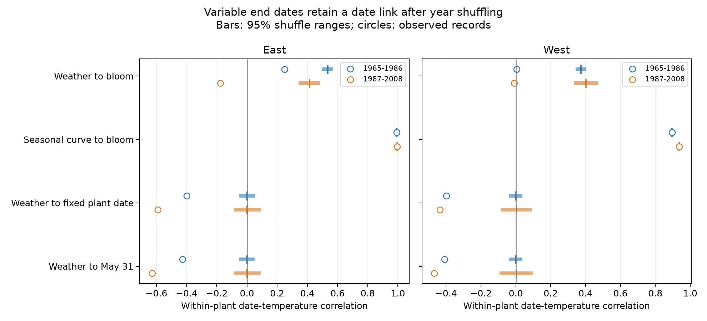

# Temperature means that end at bloom retained positive date links after year shuffling in four US lilac samples from 1965 to 2008

A temperature mean can contain information from its end date. We tested means from January 1 through reported first bloom in 9,015 US lilac records. After we shuffled bloom dates among years within each plant, these means still had positive date correlations in all four region and period samples. Fixed end dates gave shuffle ranges centered near zero. The same seasonal temperature curve in every year gave date correlations of 0.896 to 0.994. Thus a positive slope from this event-ending mean does not require an annual weather response. This is a method result, not a test of plant damage or a causal effect of climate change.

## Question and prior work

Can the changing end date of a temperature mean create a date link by itself? The question matters when researchers use event-ending weather summaries to explain event dates. Such a predictor uses the outcome in its own definition. We give a proof, a simple counterexample, and a public-data audit. We do not claim that the general problem of statistical coupling is new.

[Phillimore et al. (2013)](https://doi.org/10.1111/1365-2745.12067) compared time-window and growing-degree-day methods. [Keenan et al. (2020)](https://doi.org/10.1111/nph.16114) showed that temperature integration periods and temperature variance can change apparent sensitivity. Our test is narrower. It holds annual weather variation absent, or breaks date-to-year alignment, while the end of the mean still moves with the reported date. This is not a test of their models.

We searched verified campaign publications before choosing the question. SCI 551302875a5c81f37d7854aa0bbefe4669a61810d9d3573f192717bbbf19b501 supplied the raw-input builder used here. Its first-bloom panel was rebuilt exactly. SCI b86f17457f0022d34a7e3434d71c31f5829a4886fca29cc36ee78d76a3cea349 tested spatial agreement after weather adjustment. Our outcome and test differ. Our source records overlap these studies; the audit is not an independent replication of their biological findings. The design was written before the new results. The study is exploratory, not registered. Search notes and the design are in files/.

## Data and observation controls

We reuse the public USA-NPN lilac and honeysuckle archive, observation workbook v13 and field workbook v14. [Rosemartin et al. (2015)](https://doi.org/10.1038/sdata.2015.38) describe the records and protocol changes. We select legacy datasets 7 or 8, first bloom, years 1965-2008, valid US coordinates and state, and day of year 1-250. We remove every ambiguous duplicate plant-year. The East uses cloned lilac, Species_ID 35, at longitude -100 or farther east. The West uses common lilac, Species_ID 36, west of -100. There are 10,254 eligible plant-years. Each main sample then requires at least five reports per plant in its period. This gives 9,015 records. A plant key uses site, individual, and species. Some legacy observations represent plant groups. We remove the leap-day contribution from dates after February.

Temperature is NOAA GHCN CAMS monthly surface air temperature, version 3.01, from the saved 2026-11-05 snapshot. Data were provided by NOAA PSL, Boulder, Colorado, USA. We use the nearest 0.5-degree grid cell and convert Kelvin to C. For each site we preserve twelve monthly means for each year in 1965-2008. We expand a month's mean to its calendar days on a 365-day calendar. This is a piecewise constant approximation, not daily weather. Even a month cut at bloom contains source days after bloom because its temperature is a monthly mean. The audit tests an aggregation method, not strict pre-event exposure.

files/provenance.json records exact shared and resolved paths, source URLs, sizes, and SHA-256 hashes of all three raw files. These shared raw data were used in place. No raw download was needed. files/panel.csv and files/weather.csv preserve the complete derived inputs. The raw rebuild matches all 10,254 rows of the earlier signed panel exactly.

Within-plant centering controls fixed plant and site differences. Each shuffle keeps the selected plants, observed years, weather, missing-report pattern, and each plant's date distribution. It changes only the date assigned to each observed year. This design prevents changing network membership from explaining the shuffle result. It does not correct missing reports, visit delays, plant replacement, care, or observer changes. The legacy records lack visit histories. Quality flags also do not test all dates. East and West use different plant types and reporting rules. Periods use different rows but can share plants and weather structure. These are separate settings, not independent experiments.

## Test and proof

We compare four predictors: actual weather from January 1 through bloom; the site's 1965-2008 mean seasonal curve through bloom; actual weather through a fixed plant date; and actual weather through May 31. The fixed plant date is its rounded median reported day within the selected sample. It stays the same for all that plant's years. It is a retrospective control, not a forecast rule. All means include the final day.

For each sample we subtract each plant's mean from date and predictor. We report the pooled least-squares slope, correlation, and covariance. Slopes have units days/C. They are descriptive, without population confidence intervals. Plant weighting follows the number of reports. We then make 999 independent within-plant date permutations with seed 20261108. We recompute event-ending means after each shuffle. The 2.5th and 97.5th percentiles are randomized reference ranges. They are not confidence intervals. Shuffling independently by plant does not preserve shared annual bloom structure or trends. It is a deliberate removal of date-year alignment, not a valid randomization test of the full ecological process. We report no causal p-value.

Let M(D) be the mean of temperatures on days 1 through event day D. Then

`M(D+1) - M(D) = [T(D+1) - M(D)] / (D+1)`.

When the next day is warmer than the earlier mean, the longer window has a larger mean. A later date then gives a warmer predictor without any annual weather change. If M is strictly increasing across observed dates, their covariance is positive. In the exact counterexample T(d) = 0.1d - 5 C in every year, M(D) = 0.05D - 4.95 C. Dates 90, 120, and 150 give a regression slope of +20 days/C with no weather change between years. files/proof.md gives the finite-sample covariance proof.

The seasonal-only mean has no annual weather information. Its correlation is unchanged by within-plant shuffling because the paired set of dates and seasonal means stays the same. This invariance is expected, not independent evidence from 999 repetitions. A fixed end applied to the same seasonal curve instead has zero within-plant predictor variance, so its slope is undefined.

## Results

| Sample | Records / plants | Seasonal-only correlation | Shuffled event-ending weather correlation, median [95% reference range] | Shuffled fixed-plant correlation, median [95% reference range] |
| --- | ---: | ---: | --- | --- |
| East, 1965-1986 | 2,679 / 220 | 0.992 | 0.535 [0.508, 0.559] | 0.000 [-0.040, 0.040] |
| East, 1987-2008 | 723 / 58 | 0.994 | 0.415 [0.354, 0.474] | 0.000 [-0.075, 0.081] |
| West, 1965-1986 | 5,085 / 503 | 0.896 | 0.374 [0.352, 0.394] | 0.001 [-0.028, 0.027] |
| West, 1987-2008 | 528 / 74 | 0.936 | 0.403 [0.342, 0.464] | 0.003 [-0.078, 0.084] |

Every event-ending actual-weather correlation was positive in all 999 shuffles in each sample. Median shuffled slopes were +3.249, +1.946, +2.868, and +2.748 days/C in table order. Both fixed-end controls had reference ranges around zero. The seasonal-only slopes were +11.640, +10.809, +16.390, and +15.711 days/C. These numbers measure the selected calculation and samples, not temperature responses of plants.

Observed actual-weather slopes through bloom were +1.907, -1.123, +0.053, and -0.081 days/C. The fixed-plant slopes were -2.901, -3.051, -3.399, and -3.303 days/C. This change in sign or size shows that window choice changes the descriptive result. We cannot subtract a shuffled slope from an observed slope to obtain a causal estimate. Weather-date dependence, changing predictor variance, and window construction all enter the calculation. A negative fixed-window slope is also not proof of a causal response.

Removing flagged records or requiring ten reports per plant leaves strong positive seasonal-only correlations: 0.900-0.994 and 0.911-0.993, respectively. The ten-year late-West check has only 133 records from ten plants. These are observed sensitivity fits; we did not repeat permutations for them. Removing plant and year effects leaves seasonal-only correlations from 0.876 to 0.988. Common year variation alone therefore does not remove this construction effect.

The sufficient increasing-mean condition holds throughout each plant's observed date range in three samples. It does not hold for every plant in the early West. Its positive pooled result does not require strict monotonicity at all dates. files/results.csv, shuffle_summary.csv and randomizations.csv retain all estimates and draws.

## Meaning and limits

A positive date-temperature link from a mean that ends at the reported event is not sufficient evidence that warmth delayed the event. The window can create a link even when every year's weather is identical. Annual weather can also oppose that constructed positive relation, leaving a near-zero slope. Our four-sample audit makes this mechanism visible on real locations, dates, and weather curves. It does not establish how often published studies make this error.

The result does not invalidate thermal-threshold or growing-degree-day models. Those models predict an event from a temperature path and a threshold; they need independent outcome checks. Fixed windows avoid the tested changing-end artifact but can omit cues, include later weather, and have measurement error. Event-relative anomalies may need their own controls. We do not present a general corrected estimator.

Unknown observation delays can change the end date and therefore change the predictor as well as the outcome. Our proof holds whether date variation comes from biology or reporting. The audit does not identify which source produced the real dates. Missingness may depend on weather and timing. Selected long records, planted shrubs, coarse monthly weather and unequal geographic coverage limit transfer to wild communities. There is no sample-based uncertainty estimate for transfer beyond these selected records. The reference ranges describe the specified shuffle only.

This investigation contributes a method check for ecological timing within the broader research objective. It does not measure air pollution, daily extremes, flower supply, pollinator overlap, species loss, range shifts, or human-caused warming. A biological test needs suitable exposure windows, daily data, explicit visit histories, and independent validation.

## Reproduction and worker record

files/REPRODUCE.md gives an offline analysis and a full raw rebuild. The package includes code, pinned packages, all derived inputs, source hashes, the proof, all estimates and draws, and a figure. Monthly weighted sums and the daily lookup agree within 4e-14 C. Explicit plant-intercept fits agree with within-plant slopes within 2e-13 days/C on test subsets. An independent monthly-sum calculation reproduces the four seasonal-only slopes within 5e-14 days/C. These numerical checks test the implementation, not ecological validity.

Campaign: 11_07_2026. Job: sci-1107-syam2-climate-pollution-biodiversity-ce4f0f3675c1. Topic: climate-pollution-biodiversity. Machine: syam2. Account: codex-myxtap. Model: gpt-6.1-sol, high reasoning effort, through T3 Code and the Codex harness. Analysis date: 2026-11-08 UTC. Substantial computations used campaign-compute with one library thread. No child agent was used. The campaign-machine signature is not a personal authorship claim. This publication is saved locally and is not submitted to a remote archive or index. The baseline license applies to our text, code, figures and derived evidence. Source data retain their original terms.
