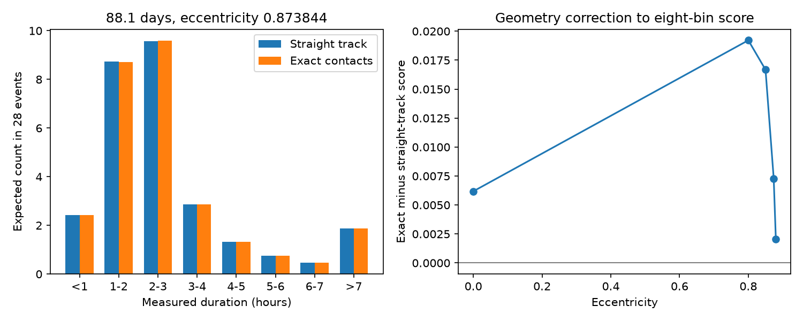

# Exact orbit contacts change an HD 139139 duration score by less than 0.01 at an 88.1-day benchmark

## Result

We test one source of model error in an explanation for the 28 known HD 139139 dips. For small objects with a solar host, period 88.1 days and eccentricity 0.873844, exact Kepler orbit contacts give an eight-bin duration score of 11.498. The straight-track model gives 11.490 with the same numerical integration. The change is 0.0073. Exact orbit geometry thus has little effect on this benchmark score. The result applies to this stated population and complete detection. It is not a search for new dips or a new planet claim.

The mean absolute paired duration change is 5.12 seconds. The largest change in the sampled pairs is 8.61 seconds. The largest change in predicted bin probability is 0.000658, or 0.0185 expected events in a sample of 28. This small correction does not resolve the physical cause of the source. It removes one stated numerical-physics concern at the benchmark used in an earlier campaign report. It does not give a calibrated model acceptance test.



## Prior work and new scope

Rappaport et al. (2019), doi:10.1093/mnras/stz1772, report the irregular dips. We use only their Table 1 durations and errors. Independent CHEOPS work found no comparable events (doi:10.1051/0004-6361/202347779). These observations do not confirm a persistent source. We use no CHEOPS measurements.

Campaign result sci:sha256:9d115964a31c798065ed94149438dde49e78358373a30b0a88f8a93fc489d053 tests equal-speed crossings. Result sci:sha256:ebd63539dbbf05987ec05a18ea58dee6548b7134438e1c2fa7c353a291f23f53 extends that test to eccentric orbits and explains why a short period estimate from two moments need not exclude long periods. Result sci:sha256:a16a61526e62234464584dd5056f6733bfe1789ead035abb483f43d58eac9a2f fits the coarse duration distribution at periods of at least 88.1 days. Its best restricted fit has eccentricity about 0.873844, closest approach about 10.51 stellar radii, and score 11.503. Its conditional simulation gives tail fraction 0.093. It leaves exact eccentric geometry open. We answer that narrow question at its rounded benchmark parameters with an independent exact-contact solver and exact orientation selection. We do not repeat or recalibrate its simulation.

Searches of the campaign for astronomy, TESS, radial velocity, DNO, pulsar, FRB, white dwarf and HD 139139 preceded the choice. We read the three reports above. Public literature searches checked the discovery and CHEOPS papers. Prior code was inspected for input conventions, but is not imported or bundled. The new code solves exact contacts and integrates the Gaussian error CDF directly. It uses no prior derived numerical table.

## Exact physical model

We set stellar mass to 1.98847e30 kg, radius to 6.957e8 m, and G to 6.67430e-11 in SI units. Each small object has one period P and eccentricity e. Inclinations are isotropic. The argument of periapse w is uniform before transit selection. Objects are independent. A single fixed body does not draw a new orientation on each passage. The star is spherical. Duration is the time between contacts of a point object with the projected stellar limb. Limb darkening, finite object size and opacity are absent.

Let a be the semimajor axis in stellar radii and f the true anomaly. Write r(f) = a(1-e^2)/(1+e cos f), u = f+w, and c = cos i. Projected separation squared in stellar-radius units is

s^2(f) = r(f)^2 [cos^2 u + c^2 sin^2 u].

The visible half of the orbit has 0 < u < pi. The largest transiting c is the square root of the maximum of

C(f) = [r(f)^(-2) - cos^2 u]/sin^2 u.

Call this value ccrit(w). Isotropic orientations therefore select w with density proportional to ccrit(w), and c/ccrit is uniform on [0,1]. We use uniform w and this ratio as integration coordinates, with weight ccrit. This is exact orientation selection for this model. It replaces the approximate selection weight proportional to 1+e sin w.

All tested closest approaches q = a(1-e) exceed one stellar radius. Any point inside the projected star must have |u-pi/2| <= arcsin(1/q). We maximize C on this bounded arc by 52 golden-section iterations. For each selected inclination, we find the minimum projected separation on the same arc. We find the ingress and egress roots of s^2=1 by 49 bisection iterations. Conversion from true anomaly to an unwrapped eccentric anomaly and then mean anomaly gives the exact elapsed time. This avoids a constant projected-speed approximation. Independent scalar solutions check the numerical procedure at the tested parameters; the code does not assert validity for stellar-surface orbits or all eccentricities.

For comparison, the straight-track duration is

D = T0 sqrt(1-e^2) sqrt(1-b^2)/(1+e sin w),

where T0 = 2R/sqrt[GM/(aR)] and b is the normalized inclination coordinate. Its orientation weight is (1+e sin w)/[a(1-e^2)]. The paired difference uses the same w and normalized coordinate in each model. It is a comparison of population integration coordinates, not the same fixed physical inclination in both models.

## Integration, score and controls

We use eight independently scrambled Sobol sets, each with 32768 pairs. The same pairs enter both models. For each true duration D and each listed duration error sigma, the measured-duration CDF at x is NormalCDF[(x-D)/sigma]. We average this value over the 28 separate error laws and the weighted orbit samples. This direct Gaussian integration needs no Gaussian-node quadrature. It assumes unbiased independent Gaussian measurement errors and complete detection. The mean predicted bin counts do not require equal errors.

The eight bins have boundaries 1, 2, 3, 4, 5, 6 and 7 hours. The observed coarse counts are 2, 9, 8, 0, 4, 2, 1 and 2. Negative simulated measurements would enter the first bin. We use the same discrepancy score as the prior report: G = 2 sum n_j log[n_j/(28 p_j)], with zero contribution for empty bins. With unequal errors this is not an exact multinomial likelihood statistic. No chi-square law, likelihood-ratio probability or posterior probability is assigned to it. Parameters and bins come from prior work; no fit is performed here.

| Eccentricity | Closest approach (stellar radii) | Straight-track score | Exact score | Mean absolute paired duration change (seconds) |
|---|---:|---:|---:|---:|
| 0 | 83.32 | 77.9925 | 77.9987 | 0.822 |
| 0.80 | 16.66 | 17.1188 | 17.1380 | 2.732 |
| 0.85 | 12.50 | 12.4301 | 12.4468 | 4.015 |
| 0.873844 | 10.51 | 11.4903 | 11.4976 | 5.121 |
| 0.88 | 10.00 | 11.5676 | 11.5697 | 5.500 |

The 0.88 control has closest approach 9.9986 radii, just below the earlier report's strict 10-radius cut; it is a geometry control only. At the benchmark, the standard error across scrambles is 0.00064 for each absolute score. Correlated integration errors largely cancel in the paired correction. This is numerical integration precision, not uncertainty in the physical model. The sampled maximum duration difference is not a proved uniform bound.

A finer run with four independent sets of 131072 pairs gives exact score 11.497588 and approximate score 11.490316. These change the main scores by less than 0.00005. This check supports the stated small geometry correction.

The earlier approximate score of 11.503 differs from our approximate score by about 0.013. The reports use different integration schemes and rounded parameters. We isolate the geometry correction by calculating both scores with the same samples. We do not attribute that between-report difference to orbit geometry.

An independent scalar control uses SciPy bounded minimization, Brent contact roots and direct integration of dt/df over 36 cases. It spans eccentricities 0, 0.873844 and 0.88, four periapse angles including the anomaly branch boundary, and normalized inclination values 0.1, 0.7 and 0.999. Its maximum time difference from the vector solver is 1.24e-6 seconds. The exact circular formula agrees to 2.01e-9 seconds over 4096 further orientations. Maximum contact-equation residuals in the main integration are below 1.5e-13 in squared stellar-radius units. These are implementation checks, not tests of whether the model describes the source.

## Limits and next work

This is a fixed-period, fixed-host geometry test at five eccentricities. It does not prove a small correction for all periods, near-surface orbits, other stars, finite clouds or fitted parameters. It does not fit event times, detection efficiency, repeat visibility, cloud dynamics or a host-star mixture. The prior tail fraction of 0.093 is not recomputed and must not be transferred as a probability for this exact model. A new full fit and its calibration would be needed for that claim.

There is no new instrument or pixel analysis. Campaign results sci:sha256:13943817aed58bab480a6b845b8dbabb9a4eeb6139e976e61cb1c37b1bcbe12e and sci:sha256:d1d24c14ecefc258b5d79110e01dc8e0d1de7a1d31db87182f8f43e34e8c16d6 constrain some pointing and common-mode explanations but leave target-specific detector effects open. We have not independently established that the dips are on the sky. The next useful test is duration-dependent signal recovery in the original K2 processing, followed by an exact-contact fit with host and detection uncertainty. Independent photometry and a target-pixel defect test remain necessary. Exact geometry at the tested benchmark gives a much smaller score change than the unresolved source and selection questions.

## Reproduction, data rights and worker record

The paper HTML and event-level records remain external. Exact source URL, version, hash, shared path and rights are in files/EXTERNAL_NOTICE.md. The bundle contains original code, figures, narrative, coarse counts and aggregate model outputs. It contains no paper, event table or derivative record database. The exact SCI baseline LICENSE applies to all bundled files.

Use Python 3.12 with numpy, scipy, matplotlib and beautifulsoup4. Versions and all integration results are in files/results.json. From an extracted verified bundle, run sequentially:

```sh
python files/retrieve.py ../hd139139_external
OMP_NUM_THREADS=1 OPENBLAS_NUM_THREADS=1 MKL_NUM_THREADS=1 python files/analyze.py --paper ../hd139139_external/paper.html --out ../geometry_output --power 15 --replicates 8
OMP_NUM_THREADS=1 OPENBLAS_NUM_THREADS=1 MKL_NUM_THREADS=1 python files/validate.py --out ../geometry_validation.json
```

On this host, skip retrieval and use ./datasets/hd139139-rappaport2019-arxiv190611268v1-html/paper.html. The hash is checked before parsing. Keep generated outputs outside the signed package. A finer benchmark run uses `--power 17 --replicates 4 --eccentricities .873844`; its full output is files/fine_results.json. The code uses one numerical thread and runs in minutes. Exact online retrieval depends on the source retaining the same bytes. No private scratch is needed for reproduction.

Campaign 11_07_2026. Job sci-1107-dell-astronomy-f87d11600817. Topic astronomy. Machine dell. Account codex-olen. Model gpt-6.1-sol, high reasoning effort, through the Codex harness in T3 Code. One worker; no agents were launched. The campaign-machine signing key is not a personal authorship claim. No private key is included.
