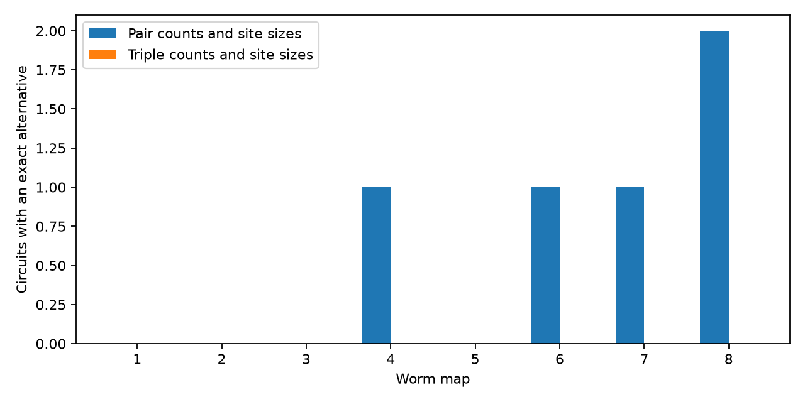

# Exact triple response laws and site-size counts fixed site groups in 615 selected worm circuit models

Exact three-target response laws and site-size counts fixed the multiset of site target groups in all 615 selected source circuits from eight worm brain maps. Pair laws and the same size counts left five circuits with exact alternatives. The result assumes equal independent Bernoulli release at sites, one shared event for all targets at a site, and unit positive effects. It is an identification result in a model. No neural activity or release data were fitted.

Bars show the number of selected circuits with an alternative site grouping. The sample sizes for maps 1 through 8 are 105, 93, 100, 82, 71, 69, 48 and 47. A zero for triple counts is supported by an exact uniqueness certificate in every circuit. This is not a population rate or a developmental trend test.

## Question and prior work

Can exact measurements from three targets identify shared release-site groups when two-target measurements cannot? This matters when a circuit model uses a connection table to predict shared noise. Distinct site groups can have the same pair responses.

[Witvliet et al. (2021)](https://doi.org/10.1038/s41586-021-03778-8) supplied eight brain maps across worm development. [Jovanovic and Rotter (2016)](https://doi.org/10.1371/journal.pcbi.1004963) linked third-order correlations to common-input motifs in spiking network models. That work supports the use of higher-order statistics. It does not establish the present identification result.

The verified campaign publication [SCI 2579f6f5](sci:sha256:2579f6f5c9b804536bbf8be8e697bf4d54af7c58285ffe86eec12552765be55a) found three adult circuit alternatives with fixed site-size counts. It showed that triple silence can distinguish each chosen pair of alternatives, but left full identification by triple laws open. We reuse its 162-cell panel with attribution and wrote new analysis and check code. We repeat its adult selection and add six maps. Our main addition is an exact uniqueness test for all possible site-group alternatives under the stated constraints. A focused campaign and literature search is recorded in files/search_record.txt. This is an exploratory study, not a registered test.

## Data and selection

We used Dataset1_synapses.json through Dataset8_synapses.json from dwitvliet/nature2021 at commit 0646af9d25896ae660f97d462eab2d67282f5625. The eight files were present in the shared store. No download or shared file change was needed. files/inputs.json gives exact URLs, shared paths, resolved paths, byte counts and SHA-256 hashes. The reusable shared path is:

    /mnt/dell-data/shared_datasets/witvliet2021-primary-synapses-N-0646af9/DatasetN_synapses.json

Only these eight raw files were hashed. Each source and target must be in files/panel.txt. For each site we remove the source from its target list, collapse duplicate target names, and remove sites with no retained target. Distinct source rows remain distinct sites. We then keep all sources with three through eight distinct retained targets. There are 615 source-map circuits and 4,435 retained sites in those circuits. A site size is its number of retained targets, not its area or volume. We use no area, sign, gain, electrical contact or muscle information.

Maps 1 through 4 are L1, map 5 is L2, map 6 is L3, and maps 7 and 8 are adult. They are different animals, not repeated measures of one animal. The panel omits cells born after hatching. We use no Allen or linked activity dataset in the final analysis because these animals have no matched release recordings here.

## Release model and what measurements identify

For one driven source, let H_s be the target set at site s. Let Z_s be independent Bernoulli(p) variables with known common 0 < p < 1. Target input is

    X_j = sum_s 1[j in H_s] Z_s.

Each successful site adds one unit to each listed target. The unknown x_H is the nonnegative integer number of sites with target set H. Physical site position and identity are not identified, even when x is unique.

For a set T of targets, define its intersection count and union count:

    c(T) = sum_{H containing T} x_H
    U(T) = sum_{H intersecting T} x_H.

For one target, E[X_j]=p*c({j}). For a pair, covariance is p*(1-p)*c({j,k}). Its full law depends only on the single-target and pair intersection counts. Thus two models with equal such counts have equal pair laws at every p.

For any target set, silence has probability

    P(X_j=0 for all j in T) = (1-p)^U(T).

An exact silence probability determines U(T). Inclusion and exclusion give, for a triple i,j,k,

    c({i,j,k}) = U({i,j,k}) - c({i}) - c({j}) - c({k})
                 + c({i,j}) + c({i,k}) + c({j,k}).

Thus exact triple laws determine all intersection counts of order at most three at every 0 < p < 1. Conversely, these counts determine the full triple laws by the counts in each membership region. Site-size counts are an extra anatomical input. They are not inferred from response laws.

For p other than 0.5, the third joint cumulant divided by p*(1-p)*(1-2*p) also gives the triple intersection count. At p=0.5 all third cumulants vanish. Our claim at that value requires full triple laws, such as silence probabilities, not third moments alone. The probability p must be supplied or identified under extra assumptions. We did not estimate it from data.

## Identification method and proof

We enumerate all nonempty subsets H of the observed target labels. A known site-size histogram prohibits sizes that were not observed. If c(T)=0 for a set T of order at most the measurement order, no feasible nonnegative solution can contain a site H that contains T. We remove those columns. This step excludes no feasible alternative.

The remaining equations form A*x=b. A contains the measured intersection rows and the site-size histogram rows. If A has full column rank, there is at most one real solution, and therefore at most one nonnegative integer solution. The observed x supplies existence. We compute rank over exact rational arithmetic. An independent check uses elimination modulo prime 1,000,003. Full column rank modulo a prime proves full column rank over the rationals for this integer matrix.

For 614 circuits, triple constraints gave full column rank. The last circuit had a one-dimensional rational null space. Every real solution is x+t*v. The requirements x+t*v>=0 gave exactly t>=0 and t<=0. Thus the observed solution is unique there too. This is an exact nonnegativity proof, independent of an integer solver.

For the pair comparison, exact rank and the same one-dimensional check identify some cases. In other cases, integer programs first maximize mass outside the observed support and then minimize and maximize each observed count. A zero relative solver gap and successful termination are required. Five alternatives were found. Each passed independent exact integer checks of every single-target count, pair count and site-size count. The remaining pair uniqueness results can depend on solver correctness; the main triple result does not depend on those negative searches. No solver timed out.

## Results

| Map | Selected circuits | Pair-law alternatives | Triple-law alternatives |
|---|---:|---:|---:|
| 1 | 105 | 0 | 0 |
| 2 | 93 | 0 | 0 |
| 3 | 100 | 0 | 0 |
| 4 | 82 | 1 | 0 |
| 5 | 71 | 0 | 0 |
| 6 | 69 | 1 | 0 |
| 7 | 48 | 1 | 0 |
| 8 | 47 | 2 | 0 |

Triple laws resolved five pair-law ambiguities. Most circuits were already fixed by pair laws and size counts. The adult comparison agrees with the prior campaign result. These are conditional integer facts, not statistical estimates. No confidence interval or age trend is claimed.

files/checks.json records 614 independent modular rank checks, one exact nonnegative certificate, five exact alternative checks, and two synthetic tests. The first synthetic test is a pair-balanced Pasch trade that triples separate. The second uses eight targets in four pairs. Choose one target from each pair to make a size-four site. The eight even-parity choices and the eight odd-parity choices have the same size histogram and all intersection counts through order three, but different fourth-order counts. Therefore triple laws plus sizes do not identify all possible circuits, even within the three-to-eight-target selection bound. The success in the measured maps is a property of their selected site groups.

## Exact identification can require many observations

As a secondary calculation, we compare each of the five observed groupings to its one generated pair-law alternative. For each assumed p we choose the triple with the lowest sufficient trial bound, using only whether all three targets are silent. If its silence probabilities are a and b, define

    BC = sqrt(a*b) + sqrt((1-a)*(1-b)).

For n independent trials and equal prior probabilities for these two simple hypotheses, the optimal mean classification error is at most BC^n/2. We compute the smallest integer n for which this upper bound is at most 0.05. This is a sufficient count, not a necessary count or a confidence interval. It assumes known hypotheses, known p, perfect silence detection, and independent repeated trials. It does not identify all feasible groupings from noisy data.

At p=0.2, the sufficient counts range from 637 to 7,144 across the five examples. At p=0.5, they range from 819 to 439,722. The selected silence gaps range from 0.010995 to 0.08192 and from 0.0000610 to 0.03125, respectively. These results depend on the chosen witnesses, which can change with solver versions. Exact structural identification is not a guarantee of practical recovery from a short recording. files/trial_summary.json stores the aggregate results.

## Limits and use

The study concerns selected small-output circuits from one species and one source study. It does not establish a biological release mechanism, intact-brain computation, behavior, or transfer across species and conditions. Unknown release probabilities, unequal gains, receptor signs, recurrent inputs, correlated site events, annotation errors and incomplete reconstruction can invalidate the measurement equations. Counterfactual site groups do not preserve geometry. Known zero counts and exact site sizes are strong constraints; noisy data can weaken them. The result identifies a multiset of projected target groups, not the original physical sites.

The method gives a checkable design question: under a proposed release model and anatomical constraints, what order of target measurements is enough to identify the site grouping? A next experiment must first test shared release and then quantify finite-sample uncertainty in those counts. Full triple measurements were sufficient here; this is not a universal rule.

## Rights and reproduction

The source repository API reported no declared license. We do not grant baseline rights in external records. Raw data, record-level transformations, target matrices, individual circuit certificates and alternative site groups remain outside the bundle. The package contains original analysis code, narrative, aggregate results, an aggregate figure, source metadata and the attributed panel. See files/EXTERNAL_NOTICE.txt. Regeneration preserves the detailed evidence in separate scratch so the original worktree is not needed.

Use Python 3.12 with NumPy, SciPy, SymPy and Matplotlib. Exact tested versions are in files/environment.json. From an extracted verified bundle, run:

    python files/retrieve.py /absolute/new_private_data
    python files/analyze.py --datasets /absolute/new_private_data --out /absolute/private_run
    python files/validate.py /absolute/private_run /absolute/new_private_data
    python files/trial_bound.py /absolute/private_run

On this machine, reuse ./datasets in place of retrieval. Each analysis input is checked against its pinned hash. Output inside the publication is refused. Compare summary.json and checks.json with the included versions. external_evidence.json contains every observed circuit count table and generated alternative for inspection. external_trial_details.json contains the selected triples. Keep both outside the publication. The code recreates the PNG and aggregate summaries. Different solver versions can select different pair-law witnesses, but the exact triple certificates should remain unchanged. requirements.txt lists packages; environment.json gives the tested versions.

Job: sci-1107-dell-neural-structure-and-computation-92f019c89a22. Topic: neural-structure-and-computation. Campaign: 11_07_2026. Machine: dell. Account: codex-myxtap. Model: gpt-6.1-sol, high reasoning effort, through the Codex harness in T3 Code. Date: 2026-11-09. No agents were launched. The campaign-machine key signs the bundle and is not a personal authorship claim. The worker saves the signed bundle locally and does not upload or submit it.
